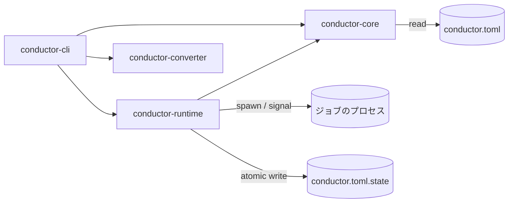
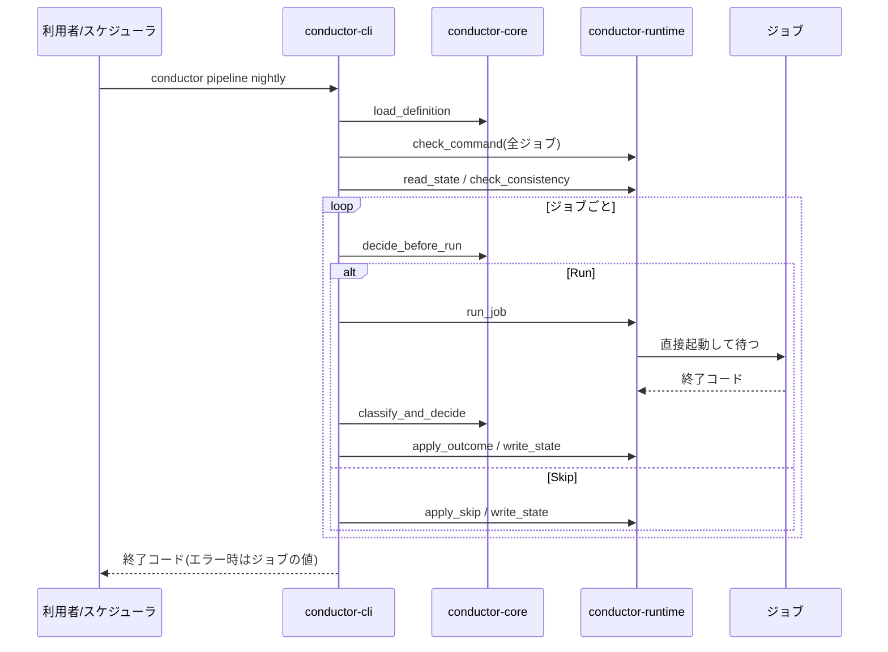
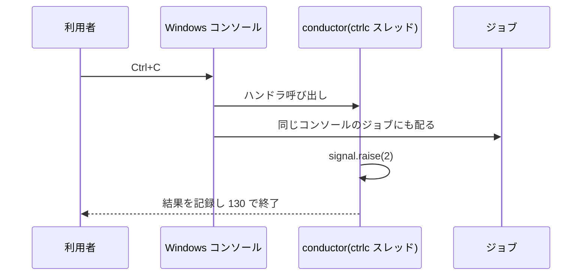

# Architecture

## Architecture Analysis

### System Overview
4 クレートの Cargo ワークスペース。実行ファイル `conductor` は `conductor-cli` が持ち、判断(core)、プロセスとステートの入出力(runtime)、変換(converter)を決まった順に呼ぶ。

### Architectural Style
単一プロセスの CLI で、層を分けたモノリス(ライブラリ 3 つ+調整役 1 つ)。証拠: `crates/cli/src/lib.rs` が「唯一の調整役」(ADR-002)と述べ、core の関数は純粋、ファイルに触れるのは `read_state`・`write_state`・`reset_state`、プロセスに触れるのは `run_job` だけ(`crates/runtime/src/lib.rs`)。

### Component Relationships

テキスト: cli が core・runtime・converter を呼ぶ。runtime は core に依存する。converter は core に依存しない。

### Data Flow
定義の読み込み・検証(core)→ ステートの読み込み・照合(runtime)→ ジョブごとに起動前の判断(core)→ 起動(runtime、シェルを介さない)→ 分類と次の動き(core)→ 結果の記録・原子的な書き込み(runtime)→ 完了ならステートを消去。

### 実行前の検査(`Ctx::prepare`)
`run` と `pipeline` は、実行の前に `crates/cli/src/ctx.rs` の `Ctx::prepare`(`:75-143`)を呼ぶ。この 1 関数が、次の 7 段を、この順に一続きで行う。段 2〜5 が定義と command の検査で、ステートにもシグナルにも触れない。

| 段 | 内容 | 失敗の終了コード |
|----|------|------------------|
| 1 | シグナルの準備(`signals.start`。定義の検査より前) | 70 |
| 2 | 定義の読み込みと検証(`runtime.load_definition`。core の Intake → Parse → Depth → VersionCheck → Walk) | 64 |
| 3 | パイプライン名の照合(`pipeline` のみ。`expected_pipeline` を `load_definition` に渡し、core の walk が `PipelineNameMismatch` を集める) | 64 |
| 4 | 全ジョブの `command` の検査(`runtime.check_command`。起動しない) | 64 |
| 5 | ジョブIDの存在(`run` のみ。`definition.job_index`) | 68 |
| 6 | ステートの読み込み(`runtime.read_state`) | 65 |
| 7 | ステートと定義の照合(`check_consistency`) | 65 |

`aux_commands`(`watch`・`reset`・`convert`)は `prepare` を通らず、シグナルの準備もしない。

### Key Design Decisions
- ジョブは `command` を直接起動する(シェルなし)。文字列(`Command::Line`)は分割規則で、配列(`Command::Argv`)は 1 要素 1 引数(v0.2.0 以降)。
- OS 固有のコードは `platform` モジュールだけ(`cfg(unix)`/`cfg(windows)`)。UNIX 系は新しいプロセスグループで起動し、シグナルを 1 回転送する。Windows は同じコンソールで起動し、`ctrlc` が番号 2 で合図を立てる(`crates/runtime/src/platform/windows.rs`、`crates/cli/src/platform/windows.rs`)。
- 終了コードは全 OS で 0〜255 に丸める。ステートは一時ファイルに書いてから置き換える。
- 依存を差し替える `Deps`(Runtime・Sink・Env・Signals)により、テストで偽の実装を渡せる。`Runtime` trait の 7 メソッド(`load_definition`・`check_command`・`run_job`・`read_state`・`write_state`・`reset_state`・`convert`)が、入出力に触れる唯一の口(`crates/cli/src/deps.rs`)。
- コマンドの追加点は一か所に集まっている: `CommandKind`(`types.rs`)→ 引数の文法の表(`args.rs`)→ 振り分けの `match`(`lib.rs`)→ 流れの関数。
- 定義の構造体のジョブの並びは `PipelineDefinition.jobs`(Rust のフィールド名)。定義ファイルのキーは `job`(`[[job]]`)で、ステートファイルのキーも `job` である。名前が食い違っているのは Rust のフィールドだけ。

### Improvement Opportunities
- Windows の Ctrl+C は手動確認のみ。
- 定義と command の検査を、ステートとシグナルから切り離して呼べる入口がない(`prepare` が一続き)。
- 成功を知らせる表示の種類(`DisplayEvent`)がない。

## Interaction Diagrams

### pipeline の実行(エラーで止まり、再実行で再開する)

テキスト: cli が定義を読み、全ジョブの command を検査し、ステートを読んで、ジョブごとに判断→実行→記録を繰り返す。エラーならステートを残して止まり、次回は同じ位置から再開する。完了すれば `reset_state` で消す。

### Windows での Ctrl+C

