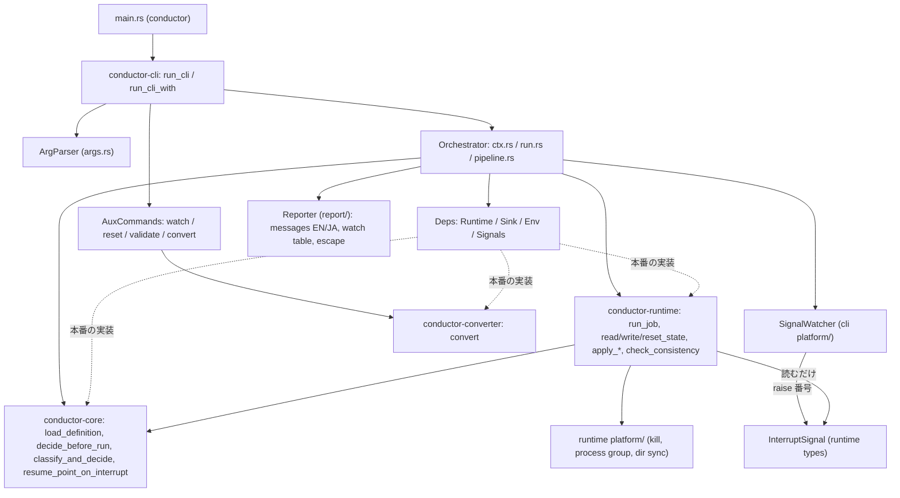
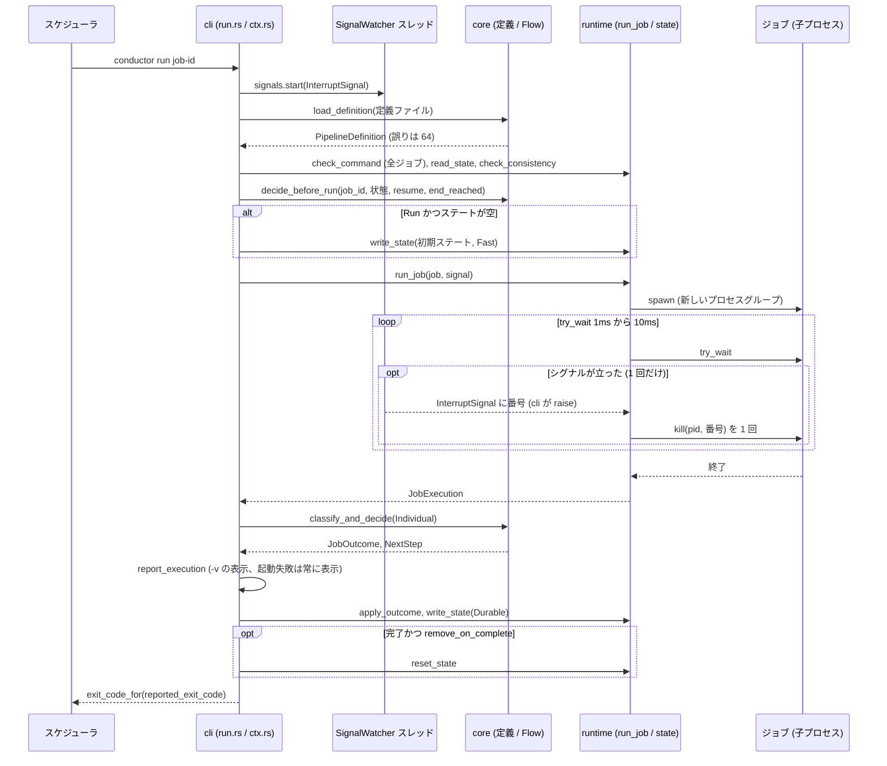
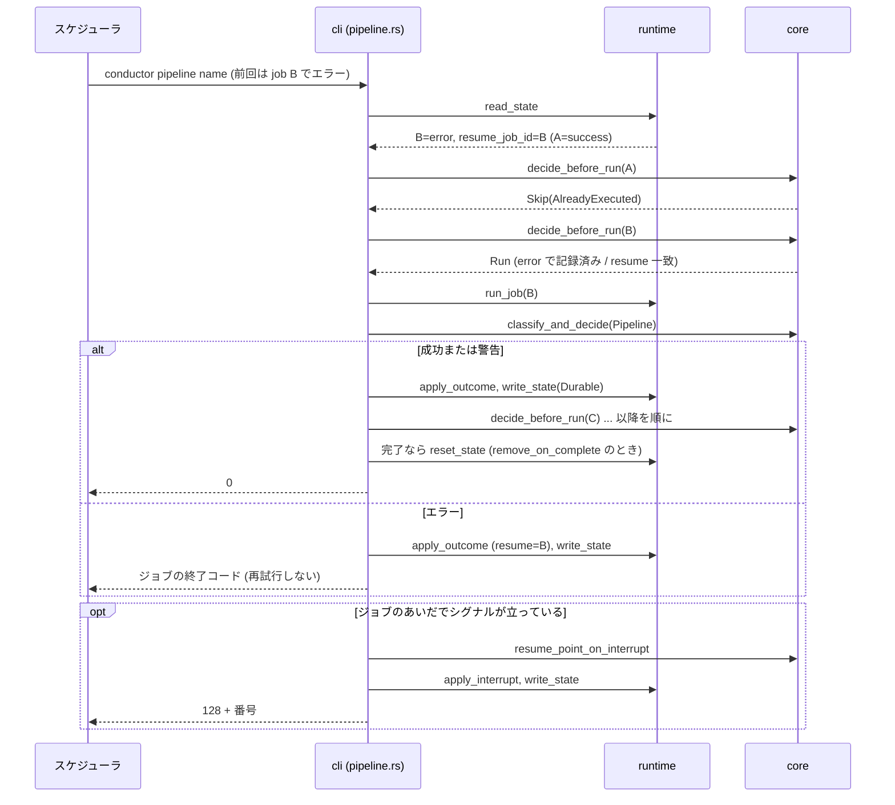
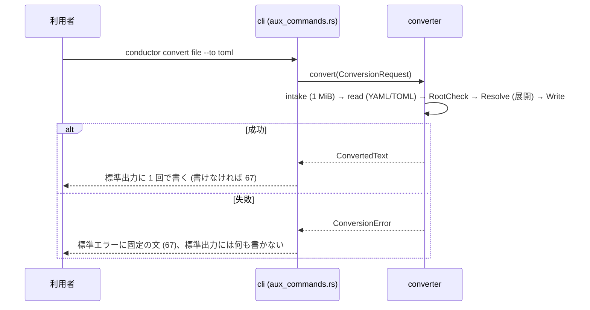

# Architecture

## Architecture Analysis

### System Overview

4 つの crate からなる Cargo ワークスペースで、配布物は単一のバイナリ `conductor`(conductor-cli の `[[bin]]`)である。責務は次のように縦に分かれる。

| crate | 責務 | IO・OS への依存 |
|-------|------|-----------------|
| conductor-core | 定義の読み込み・検証、結果の分類、次の動き、起動前の判断、再開位置 | ファイル取り込み(`definition/intake.rs`)だけ。ほかは純粋な関数 |
| conductor-runtime | ジョブの起動と待ち、シグナルの転送、ステートの読み書き・照合・記録・初期化 | プロセス起動、ファイル、OS 固有部は `platform/` に閉じる |
| conductor-converter | YAML と TOML の相互変換(スキーマ非依存の木) | 入力ファイルの読み取りだけ。core に依存しない |
| conductor-cli | 引数、流れの組み立て(唯一の調整役)、シグナルの監視、表示、終了コード | 標準出力・標準エラー、環境変数、シグナル |

依存の向きは cli → {core, runtime, converter}、runtime → core(converter と core は互いに独立)。cli だけが 3 つを決まった順に呼ぶ。

### Architectural Style

- **モノリシックな単一プロセスの CLI**(ネットワークなし、常駐なし)。ジョブごとに子プロセスを 1 つ起動して待つ。
- **関数型コア + 命令型の殻**: 判断(core の `flow`)と記録(runtime の `state::record` の `apply_*`)は、引数だけから結果を決める純粋な関数。入出力は cli の流れが、決まった順序で呼ぶ(`run.rs` の冒頭の doc コメントが「判断 → 初期ステート → ジョブ → 記録 → 書き込み → 初期化」の固定の順序と述べる)。
- **差し替え口(trait)による依存の注入**: cli は `Runtime`・`Sink`・`Env`・`Signals` の 4 つの trait を `Deps` で受け取る。本番は `SystemRuntime` など、テストは偽実装。純粋な関数は trait を通さず直接呼ぶ。
- 証拠: `crates/cli/src/lib.rs`(`run_cli`/`run_cli_with`)、`crates/cli/src/deps.rs`、`crates/core/src/flow/mod.rs`(「すべて純粋な関数」)。

### Component Relationships

テキストの説明: `main` は `run_cli` を呼ぶ。`run_cli_with` は引数を解釈し、コマンドごとに `run.rs`・`pipeline.rs`・`aux_commands.rs` へ分ける。流れは `Deps` を通して core・runtime・converter の入出力を呼び、純粋な関数は直接呼ぶ。シグナルの監視スレッドが `InterruptSignal` に書き、runtime の待ちのくり返しがそれを読む。

### Data Flow

1. **定義**: `conductor.toml` → `intake`(1 MiB まで)→ `parse`(位置つきの TOML の木)→ `depth`(32 段)→ `version`(`format_version == 1`)→ `walk`(キー・型・構造の検査、誤りはすべて集める)→ `PipelineDefinition`。
2. **実行前の検査**(`Ctx::prepare`): シグナルの準備 → 定義(誤りは 64)→ 全ジョブの `command` の検査(64)→ ジョブIDの存在(68)→ run ID の決定(68)→ ステートの読み込み(65)→ 定義との照合(65)。
3. **ジョブの 1 回の実行**: `decide_before_run` → `Run` なら(ステートが空なら先に初期ステートを `Fast` で書く)→ `run_job` → `classify_and_decide` → `report_execution`(表示)→ `apply_outcome` → `write_state(Durable)` → 完了なら(求められていれば)`reset_state`。
4. **ステート**: `PipelineState`(ジョブごとの status・exit_code・skip_reason、`resume_job_id`、`end_reached`、`completed`、`run_id`)を TOML で保持。一時ファイル → 同期 → `rename` の原子的な置き換え。
5. **終了コード**: `JobOutcome.reported_exit_code` を `exit_code_for` で 0〜255 に合わせて返す。

### 結果の分類と再開位置のモデル(再試行が接するところ)

- 分類(`flow/classify.rs`)の優先順位: ①起動しなかった中断 → 分類なし(128 + 番号)②中断(起動済み)→ エラー(128 + 番号、ジョブのコードは見ない)③起動失敗 → エラー 127 ④シグナル終了 → エラー 128 + 番号 ⑤終了コードが成功の集合 → 成功 ⑥警告の集合 → 警告 ⑦0 で成功の集合にない → エラー(終了コード 1、`conductor_error = true`)⑧それ以外 → エラー(ジョブのコードをそのまま)。
- 次の動き(`flow/next_step.rs`): エラーと「分類なし」は `stop()`(`next_job_id = None`、`resume_job_id = Some(自分)`、`completed = false`)。成功・警告は遷移(`@end` またはジョブID)を見て、間のジョブを `skipped_job_ids` に列挙する。遷移がなければ記述順の次。
- 再開位置: ステートの `resume_job_id` と、エラーのジョブの `status = error`。次の呼び出しで `decide_before_run` が、`error` で記録済み、または `resume_job_id` 一致のジョブを `Run` にする。
- **at-least-once の窓**: `run_job` が終わってから `write_state(Durable)` が終わるまでの間に落ちると、ジョブは未実行として扱われ再実行される。ステートには「実行中」の印がない(起動前に書くのは初期ステートのみ)。

### Key Design Decisions

| 決定 | 影響 |
|------|------|
| ジョブを直接起動(シェルなし)、`command` は `Line` か `Argv` | 3 OS で同じ分割規則(`split.rs` の状態機械)。変数・パイプは解釈しない |
| 待ちは `try_wait` の短い間隔(1 ms から 10 ms)のくり返し、回収はそこだけ | シグナル転送は「まだ終わっていない」回にだけ 1 回送る(pid の再利用で無関係のプロセスに届かない) |
| ジョブは新しいプロセスグループで起動(UNIX)、Windows は同じコンソール | Ctrl+C は conductor だけに届き、conductor が 1 回転送する(二重に届かない) |
| `InterruptSignal`(原子的な整数)を cli が書き、runtime が読む | 立ったら下りない。最初の番号を保持する |
| ステートは原子的に置き換え、結果・スキップ・中断は `Durable`、初期ステートは `Fast` | 壊れた内容にならない。書けないディレクトリはジョブの前に検知 |
| 完了したステートは `read_state` が空として返す(`watch` は `read_state_raw`) | 次の実行は先頭から。`remove_on_complete` で削除も選べる |
| 定義もステートも未知のキーを拒否 | 新しい設定キーは、読み取りの側のキー表に必ず足す必要がある |
| 外部入力でパニックしない(`#![forbid(unsafe_code)]` など) | パニックのフックは固定の英語の文を出して 70 で終わる |
| エラーの表示に入力の値・ライブラリのエラー文を含めない | 固定の文だけで組み立て、キー名・ジョブIDはエスケープして 64 文字で切る |
| `run` と `pipeline` が、ほぼ同じ「判断 → 実行 → 分類 → 表示 → 記録 → 書き込み」を別々に持つ | 再試行を足すと 2 か所を同じに変えるか、共通の関数に寄せる必要がある |

### Improvement Opportunities

- 表示のエスケープ関数が 4 つの crate に重複(`tests/escape_table.rs` で揃えを検査している)。
- `run.rs` と `pipeline.rs` の「ジョブを 1 回実行して記録する」部分の重複。
- 時刻・スリープの差し替え口がない(`Deps` に `Clock` や `Sleep` を足せば、再試行の間隔を実時間なしでテストできる)。
- 設計文書(`entities.md` など)がリポジトリの外にある(`local-docs/` は git 管理外)。

## Interaction Diagrams

### 1. `conductor run <job-id>`(1 つのジョブの実行、ステートの書き込み、シグナル)

テキストの説明: cli が検査を終えたあと、core の判断が `Run` を返せば `run_job` を呼び、ジョブの終了後に分類・表示・記録・耐久的な書き込みを行って、分類に応じた終了コードで終わる。落ちると困る窓は「ジョブの終了」から「Durable の書き込み完了」までである。

### 2. `conductor pipeline <name>` の再開(エラーで止まったあとの再実行)

テキストの説明: `pipeline` は定義の記述順に 1 つずつ `decide_before_run` を呼ぶ。遷移とスキップはステートが運ぶ。エラーで停止し、現状は再試行しない。

### 3. `conductor convert <file> --to yaml|toml`

テキストの説明: 変換はスキーマを知らない汎用の木で行い、結果は文字列で返す。書き出しは cli が行う。

### 4. (参考)再試行が入る位置の見取り図(現状のコードからの事実のみ)

再試行は、図 1・2 の `run_job` → `classify_and_decide` → `report_execution` → `apply_outcome` → `write_state` の並びのうち、「分類がエラー(ジョブ自身の終了コード)」と決まった直後に、同じ run_job をもう一度呼ぶ形で挟まる。このとき既存コードにない要素は、(a) 試行回数と間隔の設定(定義)、(b) 間隔の待ちと、その間のシグナルの扱い、(c) 進捗の表示イベント、(d) 試行を通したステートへの記録の方針、の 4 つである。設計は後続の段階で決める。
