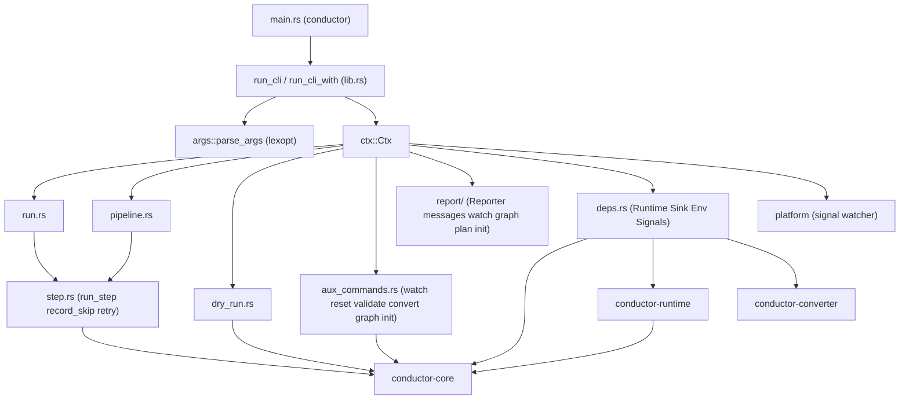
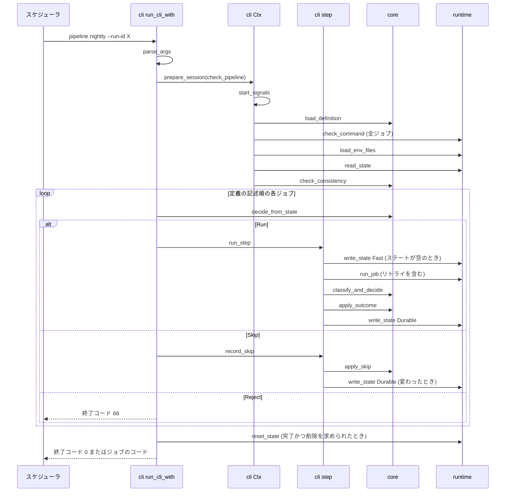
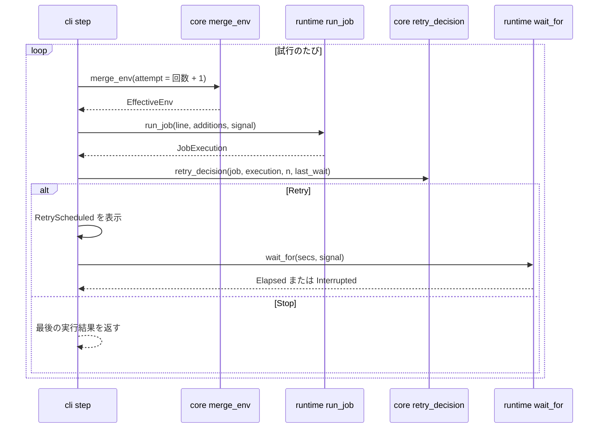
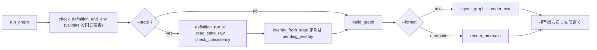

# アーキテクチャ

## Architecture Analysis

### System Overview

4 クレートの Cargo ワークスペースで構成する、単一バイナリの CLI。`conductor-cli` が唯一の調整役(Orchestrator)で、`conductor-core`(定義の検証と純粋な判断・記録・図・計画)、`conductor-runtime`(プロセスの起動とファイルの入出力)、`conductor-converter`(YAML と TOML の変換)を、決まった順に呼ぶ。入出力の副作用は、core の `definition::intake`、runtime の各入出力のモジュール、cli の `deps`・`platform`、converter の `intake` に閉じ込めてある。

### Architectural Style

レイヤー型のモジュラー・モノリス(単一プロセス、単一バイナリ、同期処理。非同期ランタイムは無い)。

- 依存は一方向: cli → {core, runtime, converter}、runtime → core。core と converter は、ほかのクレートに依存しない。
- 「純粋な判断」と「入出力」の分離: core の `flow`(判断と記録)、`consistency`、`envfile`(解析と統合)、`graph`、`plan` は、引数だけから結果を決める純粋な関数。ファイルに触れるのは core では `definition::intake` だけ。
- 差し替え口(trait `Runtime`・`Sink`・`Env`・`Signals`。`crates/cli/src/deps.rs`)で、流れのテストに偽の実装を注入する。純粋な関数は trait を通さず、流れが直接呼ぶ。
- OS 差は `platform` モジュールに閉じ込める(runtime と cli に各 1 つ)。本体の `cfg(unix)`/`cfg(windows)` はそこだけ(`nfr_source.rs` が検査)。
- `unsafe` は runtime の `platform/unix.rs` の `libc::kill` 1 か所だけ(runtime は `#![deny(unsafe_code)]`、ほかのクレートは `#![forbid(unsafe_code)]`)。

### Component Relationships

テキストの代替: `main` が `run_cli` を呼ぶ。`run_cli_with` は引数を解釈し(`args`)、`Ctx` を作って、コマンドごとに `run`・`pipeline`・`aux_commands` へ振り分ける(`run`・`pipeline` は `--dry-run` のとき `dry_run` へ入る)。`run` と `pipeline` は、1 つのジョブの手順を `step` に任せる。`Ctx` は、表示(`report`)、差し替え口(`deps`)、シグナル(`platform`)を持つ。`deps` の本番の実装が core・runtime・converter の関数を呼ぶ。`step`・`dry_run`・`aux_commands` は core の純粋な関数を直接呼ぶ。runtime は core の共有の型と `.env` の解析に依存する。

### Data Flow

1. 引数 → `ParsedArgs`(`CliCommand`)。
2. 定義ファイル → `load_definition`(Intake → Parse → Depth → VersionCheck → Walk)→ `PipelineDefinition`。
3. `check_command` で全ジョブの command を、起動せずに分割・検査(`CommandLine` の並び。以後、分け直さない)。
4. run ID の決定(`--run-id`、なければ環境変数 `run_id_env` または `CONDUCTOR_RUN_ID`)。
5. `.env` の読み取り(`env_file_refs` → `load_env_files` → `LoadedEnvFiles`)。誤りは 64。
6. ステートの読み込みと照合(`read_state`、`check_consistency`)。誤りは 65。
7. ジョブごとに `decide_from_state` → `run_step`(初期ステートを `Fast` で書く → 試行ごとに `merge_env` → `run_job` → `retry_decision` → `wait`)→ `classify_and_decide` → 表示 → `apply_outcome` → `write_state`(`Durable`)。
8. 完了で削除を求められていれば `reset_state`。
9. 表示は `DisplayEvent` を `Reporter` が英日の文にして、標準エラーに出す(`watch`・`graph`・`--dry-run`・`init -`・`convert` の結果は標準出力)。

### Key Design Decisions

- ジョブはシェルを介さず直接起動する。command は定義のデータとして扱い、解釈・展開しない。分割は `split.rs` の状態機械(再帰なし)で、定義の検査のときに 1 回だけ行う。
- 環境は親から引き継ぎ、層を統合した「足す」環境変数だけを `Command::env` で足す(`[pipeline].env_file` < `[pipeline.env]` < `[job].env_file` < `[job.env]` < 自動の変数)。消す手段は無い。`CONDUCTOR_` で始まる名前は予約。
- ステートは原子的に置き換える(一時ファイル → 同期 → `rename`)。最終の結果だけを 1 回書く(リトライの途中は書かない。リトライの回数は保存しない)。読み取りは厳格(知らないキーは壊れたステート)。
- ステートの更新(`initial_state`、`apply_*`)は core の `flow::record` の 1 か所にあり、本番の流れと `--dry-run` の模擬が共に使う。図の辺も、実行と同じ遷移の解決(`resolve_transition`)を使う。
- シグナルは、ジョブの子プロセスの pid だけに、1 回だけ転送する(UNIX は子を新しいプロセスグループで起動)。Windows は同じコンソールのジョブに OS が配る。
- エラー表示は固定の文だけで組み立て、入力に由来する文字列(キー名、ジョブID、パス)は escape して切り詰める。
- 表示の言語と色は `Reporter` のインスタンスごとに遅延で判定する(テストで `Env` を差し替えられる)。

### Improvement Opportunities

- 公開の構造体(`JobDefinition`、`PipelineDefinition`、`PipelineState`、`JobState`)のフィールドが公開で、テストがリテラルで組み立てる。フィールドを足す intent(既定のリトライ、`unset_env`、`log_dir`、時刻)では、変更が広がる。
- ステートの読み取りが知らないキーを拒否するため、キーの追加は旧版との互換を壊す。版(`format_version`)の方針が要る。
- 時刻を扱う仕組みが本体に無い(core は純粋で時刻に触れない)。時刻は cli か runtime で取り、記録の関数へ値として渡す形が、今の分け方に合う。
- 起動の口 `run_job(line, env, signal)` は、足す環境だけを受け取る。消す名前や、出力の行き先(ログのファイル)を渡す口が無い。
- `watch` は 1 回だけの表示で、シグナルの準備も無い。連続表示は、待機(runtime の `wait_for` のような中断を見る待ち)と、画面の書き換えの方針が要る。
- 使い方の表が、`args.rs` の文書、`report/messages.rs` の USAGE、`README.md` の 3 か所にある。

## Interaction Diagrams

### 取引 1: `conductor pipeline <name>`(一括実行)

テキストの代替: スケジューラが `pipeline` を呼ぶ。cli は引数を解釈し、シグナルの監視を始めてから、定義の読み込み、command の検査、`.env` の読み取り、ステートの読み込みと照合を行う。ジョブごとに起動前の判断をし、Run なら `run_step` が(初回は初期ステートを書いて)起動、分類、記録、書き込みを行う。Skip なら `record_skip` がスキップを記録する。Reject なら 66 で終わる。エラーで止まればジョブの終了コード、ジョブのあいだで合図が立っていれば再開位置を書いて 128 + 番号で終わる。完了で削除を求められていれば `reset_state` を呼ぶ。

### 取引 2: 1 回のジョブの起動とリトライ(`step::run_job_with_retry`)

テキストの代替: 試行ごとに、層を統合した環境(`CONDUCTOR_ATTEMPT` は試行の番号)を作り直して `run_job` で起動する。core の `retry_decision` が、ジョブの `[job.retry]` と実行結果から、再実行か停止かを決める。再実行なら知らせを表示し、`wait_for`(合図を 50ms 以下の間隔で確認)で待つ。待機中に中断されたら、起動していない中断の実行結果(`NotStarted`)を返す。

### 取引 3: `conductor graph`

テキストの代替: `run_graph` は、`validate` と同じ検査(定義、command、`.env`)をしてから、`--state` のときだけ run ID を決めてステートを(完了のものも)読み、定義と照合して重ね合わせを作る。core の `build_graph` で図の構造を作り、`text` なら `layout_graph` でレーンを配置して `render_text`、`mermaid` なら `render_mermaid` で整形し、標準出力に 1 回で書く。書けなければ 65。ジョブは起動せず、ステートは書かない。

### 取引 4: `--dry-run`、`validate`、`watch`、`convert`、`init`

- `--dry-run`: `dry_run::enter_flow` → `prepare_checked`(シグナルの準備をしない。定義、`--assume` のジョブID、run ID、`.env`、ステート)→ core の `plan_pipeline`/`plan_run`(実行と同じ判断を、仮定の終了コードで進める)→ `plan_text` で整形 → 標準出力。
- `validate`: `check_definition_and_env` → 成功は `DefinitionValid`(`-v` のときだけ 1 行)で 0、誤りは 64。重複キーは警告。
- `watch`: 定義を検証せず、`run_id_env` だけをゆるく読む(`peek_run_id_env`)→ `read_state_raw` → `render_table` → 標準出力に 1 回。
- `convert`: `conductor_converter::convert`(Intake → Read → RootCheck → Resolve → Write)→ 成功は標準出力に 1 回、失敗は何も書かず 67。
- `init`: `render_template`(英日)→ `--config -` なら標準出力、それ以外は `create_file`(排他の作成。`--force` で置き換え)。既にあれば 69。

## 並行性とシグナル

cli は専用のスレッド(UNIX は `signal-hook` の `Signals`、Windows は `ctrlc` のハンドラ)でシグナルを受け、`InterruptSignal`(Atomic)に最初の番号を立てる。監視の開始は `run`・`pipeline` の `prepare_session` の 1 か所で、定義の検査より前。runtime の待ちのくり返し(1ms から 10ms の `try_wait`)が、立っていれば子の pid に 1 回だけ転送する。リトライの待機は 50ms 以下の間隔で合図を見る。ジョブのあいだで立っていれば、再開位置を記録して 128 + 番号で終わる。補助のコマンド(`watch` など)と `--dry-run` は、シグナルの準備をせず、既定の動作で終わる。
