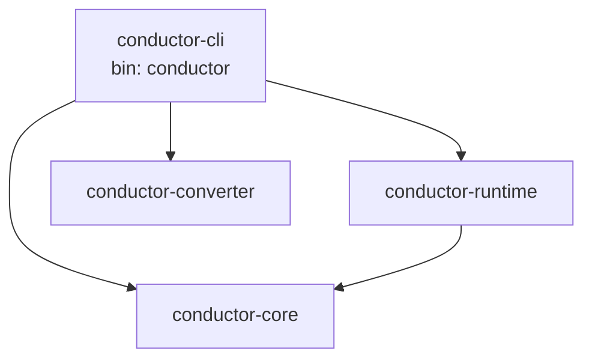
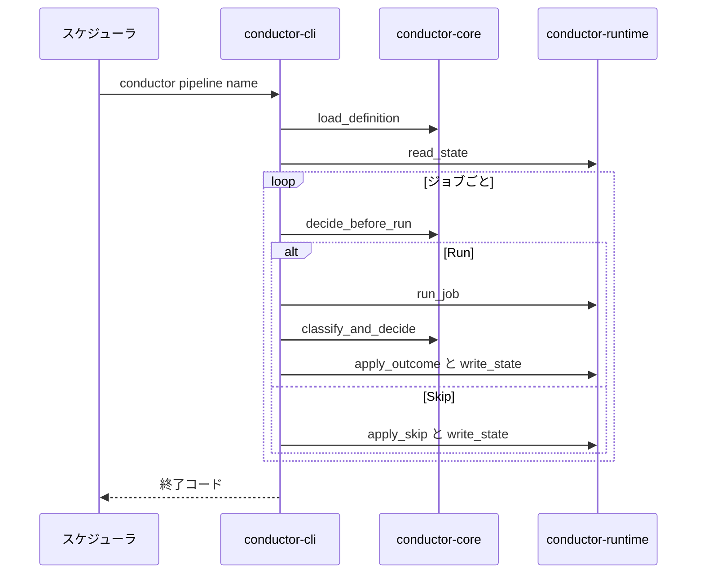
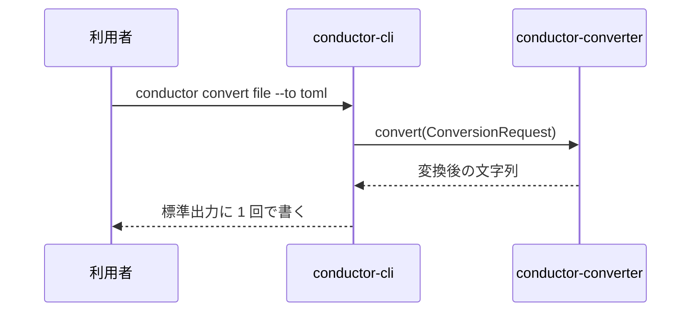

# Architecture

## Architecture Analysis

### System Overview

4 つのクレートからなる Cargo ワークスペース。`conductor-cli` が唯一の調整役で、`conductor-core`(判断、純粋)、`conductor-runtime`(ジョブ起動とステートのファイル入出力)、`conductor-converter`(YAML / TOML 変換)を決まった順に呼ぶ(`crates/cli/src/lib.rs` の文書コメント)。

### Architectural Style

モジュラーなモノリス(単一バイナリ)。判断を純粋関数に、入出力を `runtime` に分け、`cli` は trait(`Runtime`、`Sink`、`Env`、`Signals`。`crates/cli/src/deps.rs`)で依存を差し替え可能にしている。OS 固有コードは `platform` モジュールに集約(`cfg(unix)` / `cfg(windows)`)。

### Component Relationships

テキスト補足: cli は core・runtime・converter に依存し、runtime は core に依存する。core と converter は他の内部クレートに依存しない。

### Data Flow

引数 → `parse_args` → コマンド別の流れ(run / pipeline / watch / reset / validate / convert)。定義ファイル(TOML)は core が検証して `PipelineDefinition` にし、ステートは定義ファイルと同じディレクトリの `<定義名>.state` に runtime が原子的(一時ファイル + 置き換え)に書く。ジョブの終了コードは core が分類し、cli が 0〜255 の終了コードに写す。

### Key Design Decisions

- 純粋関数と入出力の分離(core の `decide_before_run`、`classify_and_decide`、runtime の `apply_*`)
- `unsafe` は runtime の UNIX `kill` 1 か所のみ(cli は `forbid(unsafe_code)`)
- C ビルド依存と `-sys` crate を持たない方針(CI で検査)
- シェルを介さない直接起動、排他制御なし、自動再試行なし

### Improvement Opportunities

本意図(最新の LTS への整合)に関わる事実のみ: 最小の Rust 版の記載が複数箇所にある(code-quality-assessment.md 参照)。それ以外は評価の対象外。

## Interaction Diagrams

### pipeline の実行(エラーで止まり、再開する)

テキスト補足: 定義の読み込み、ステートの読み込み、ジョブごとに「判断、起動、分類、記録、書き込み」を繰り返す。完了時は、削除を求められていれば `reset_state` を呼ぶ。

### convert

テキスト補足: 変換結果を全部作ってから、標準出力に 1 回で書く。失敗時は標準出力が空で終了コード 67。
