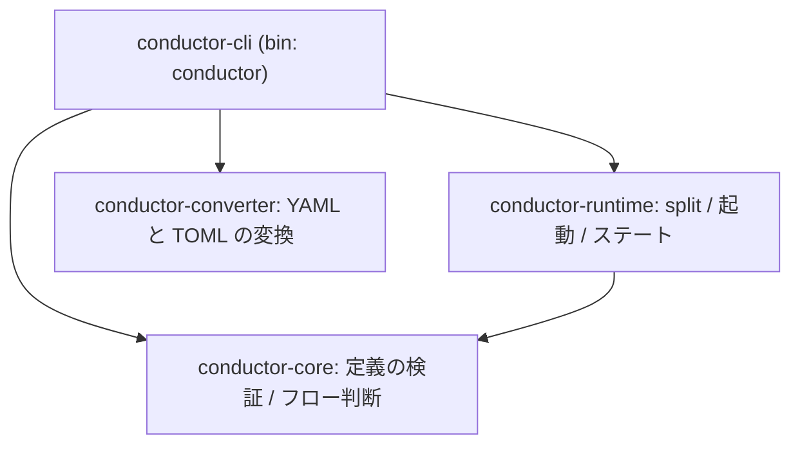
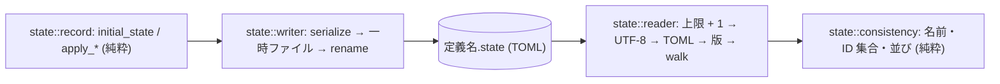
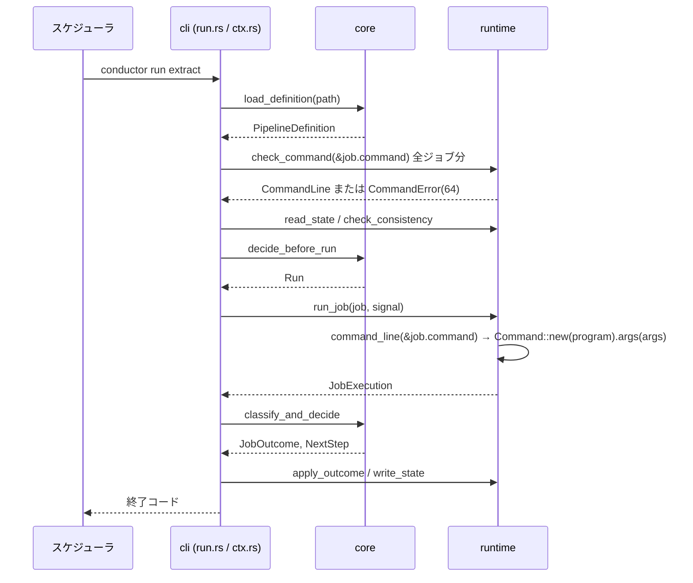

# Architecture

## Architecture Analysis

### System Overview
単一バイナリ `conductor` を作る Cargo ワークスペース(4 クレート)。判断の純粋なロジック(core)、OS に触れる実行(runtime)、形式変換(converter)、入口と表示(cli)に分かれる。cli が 3 つのライブラリを束ね、流れ(Orchestrator)を組み立てる。各クレートの一覧は `component-inventory.md`、依存は `dependencies.md` を参照。

### Architectural Style
モジュラーなライブラリ群 + 薄い CLI(モノリシックな単一プロセス)。cli は `Runtime`・`Sink`・`Env`・`Signals` の trait(`crates/cli/src/deps.rs`)で外部とのやりとりを差し替えられる(テストの偽物の注入口)。core と converter は入出力を持たない純粋な処理(ファイルを読むのは各 `intake` だけ)。

### Component Relationships

テキストの代替: cli は core・runtime・converter に依存し、runtime は core に依存する。converter は core に依存しない。

### runtime のステート部の構成(今回の変更の中心)

テキストの代替: record が作ったステートを writer が TOML にして置き換えで書き、reader が読み戻す。consistency は、読んだステートと定義を、名前・ジョブIDの集合・並びの順に比べる。ステートのファイルに触れるのは reader と writer だけで、ジョブの配列のキー名(`jobs`)が書かれるのは、writer の `serialize` と reader の `TOP_KEYS`・`walk` の 2 か所だけ(実装上の 1 対 1 の対応)。

### Data Flow
1. cli が引数を解析し、定義ファイルを `load_definition`(core: Intake → Parse → Depth → VersionCheck → Walk)で読む。
2. `prepare`(`ctx.rs`)が全ジョブの `command` を `check_command(&Command)`(runtime の `split.rs`)で事前検査し、誤りは終了コード 64。
3. ステートを読み(`read_state`)、定義と照合する(`check_consistency`。誤りは 65)。
4. `decide_before_run`(core)で Run/Skip/Reject を決め、Run なら `run_job`(runtime)が `command_line(&job.command)` で `CommandLine` にし(文字列は `split`、配列は要素をそのまま)、`Command::new(program).args(args)` で起動して `try_wait` で待つ。
5. `classify_and_decide`(core)が結果を分類し、`apply_outcome`(runtime)でステートを更新し、`write_state` で書く。完了なら `reset_state`。
6. `command` の文字列・配列は、定義(`JobDefinition.command: Command`)と `JobExecution.command` に載るが、ステートファイルには保存されない。表示では、起動失敗時のプログラム名(`Command::program_name`)だけが出る。

### ステートファイルの形(v0.2.0 時点。`reader.rs` と `writer.rs` による)
- TOML の表。トップのキーは 9 つ(`TOP_KEYS`): `format_version`(整数 1)、`definition_key`、`definition_path`、`pipeline_name`、`job_order`(ID の配列)、`jobs`(**テーブルの配列。ジョブごとに `id`・`status`・`exit_code`・`skip_reason`**)、`resume_job_id`(省略可)、`end_reached`、`completed`。未知のキーは `corrupt`(65)。
- ジョブのキーは 4 つ(`JOB_KEYS`)。`status` は `pending/success/warning/error/skipped`、`skip_reason` は `byTransition/byEnd`。
- 読み取りの順序: 1 MiB の上限 → UTF-8 → TOML → `format_version` の確認(先。不一致は `versionMismatch`)→ `walk`(キーと型)→ 内容の矛盾(重複 ID、`jobs` と `job_order` の並びの不一致、`resume_job_id` の不在、`completed` と `resume_job_id` の併存)→ `completed` なら空(`None`)として返す。
- 書き込みは `toml::Table` に `jobs` を `Array` として入れて `toml::to_string` で出すため、ファイル上は `[[jobs]]` の配列テーブルになる。

### Key Design Decisions
- command はシェルを介さず直接起動し、分割規則を 3 OS で同一にする状態機械で実装(再帰なし)。文字列と配列の 2 形(`conductor_core::Command`)を持ち、配列は分割しない。
- core の `JobDefinition.command` は「ここでは解釈しない」値で、解釈(分割)は runtime の責務。検査は cli が実行前に全ジョブ分を行う(防御として `run_job` も分割失敗を `start_failure` にする)。
- 誤りは集めて返す(定義の検証)。エラー表示は固定の文とエスケープした名前だけで、入力の値は出さない(runtime の `StateError` も、kind ごとの固定の文とパスだけ)。
- OS 固有コードは `platform/` に閉じ込める。`unsafe` は runtime の `platform/unix.rs` の 1 か所だけ(cli と core は `forbid(unsafe_code)`)。
- ステートは一時ファイルへ書いて `rename` で置き換え(`Durable` は同期)。版は `format_version` で持ち、確認を他の検査より先に行う(将来の版が未知のキーで `corrupt` にならないため)。
- ステートのキー名は、定義ファイルの `[[job]]` と食い違っている(ステートは `jobs`)。ファイル上のキー(`jobs`)と、メモリ上の Rust のフィールド(`PipelineState.job_states`)と、定義側のフィールド(`PipelineDefinition.jobs`)は、別の名前で、ファイルのキーはリテラルで 2 か所に書かれている。

### Improvement Opportunities
- `escape` 相当の関数が 4 クレートに重複している(cli の文書に明記)。
- ステートのキー名(`jobs` と各テストの `[[jobs]]` のリテラル)が、reader・writer・テスト・エラー文に散っている(定数化されていない)。

## Interaction Diagrams

### ジョブの実行(`conductor run <job-id>`)

テキストの代替: 定義を読む → 全ジョブの command を検査 → ステートの照合 → 実行前の判断 → 起動(文字列は分割、配列はそのまま直接起動)→ 分類 → ステートの更新と書き込み → 終了コード。

### 定義の変換(`conductor convert`)

テキストの代替: 取り込み → 読み取り → 展開 → 書き出し → 標準出力。スキーマ(`command` など)は検査しない。
