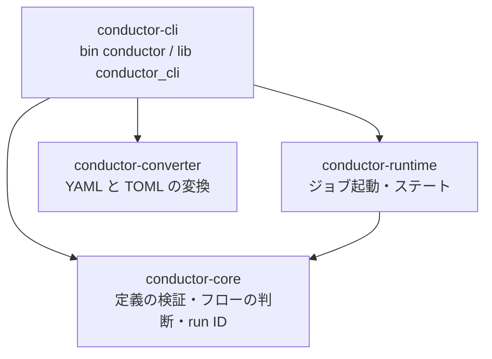
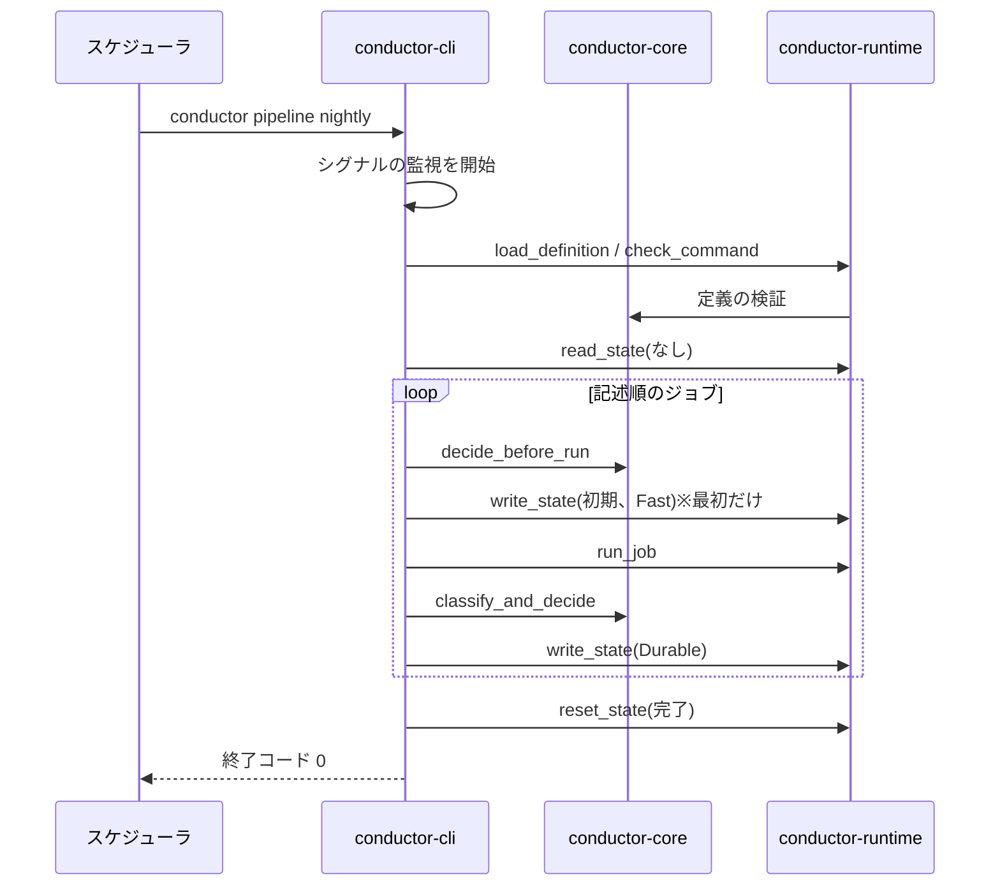
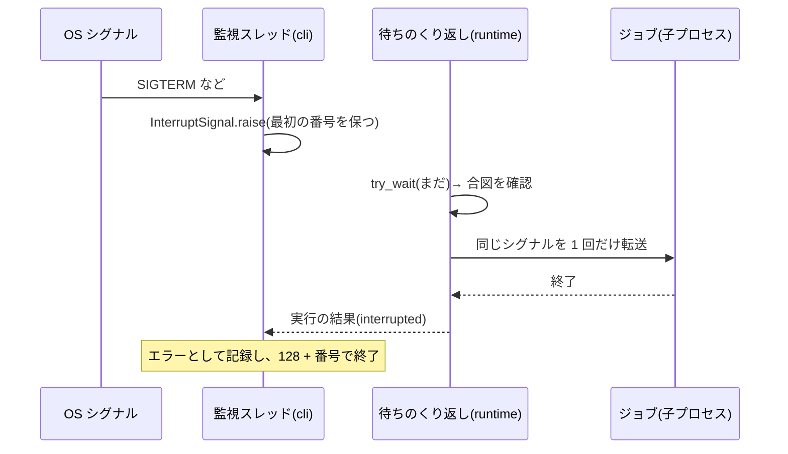

# アーキテクチャ

## Architecture Analysis

### System Overview

Rust の Cargo ワークスペース(4 クレート)で作る、単一バイナリの CLI。`conductor-cli` が唯一の調整役で、判断(`conductor-core`)、実行とステート(`conductor-runtime`)、変換(`conductor-converter`)を、決まった順に呼ぶ。入出力・環境・シグナル・表示先は trait(`Runtime`・`Sink`・`Env`・`Signals`)の背後にあり、テストが偽の実装に差し替える(`crates/cli/src/lib.rs`、`deps.rs`)。

### Architectural Style

レイヤー型のモノリス(プロセス 1 つ、サービスなし)。純粋な判断(core)と、副作用(runtime、cli の入出力)を分ける。ステートは、定義ファイルの隣の TOML ファイル。ネットワークも DB もない。OS 固有のコードは `platform` モジュールに閉じる(`cfg(unix)`/`cfg(windows)`)。

### Component Relationships

テキストの代替: cli は runtime・core・converter に依存し、runtime は core に依存する。converter は core に依存しない。core は葉。

### Data Flow

1. `run`/`pipeline`: シグナルの準備 → 定義の読み込みと検証(64)→ 全ジョブの `command` の検査(64)→ ジョブIDの確認(68)→ run ID の決定(68)→ ステートの読み込み(65)→ 定義との照合(65)→ ジョブごとに `decide_before_run` → 実行 → `classify_and_decide` → ステートの書き込み → 完了なら初期化(`ctx.rs:63-131`、`run.rs`、`pipeline.rs`)。
2. `watch`/`reset`: 定義を検証しない。`--run-id` があれば定義を読まず、なければ `run_id_env` だけをゆるく読む(`ctx.rs:285-303`)。`reset --all` は環境変数を見ず、同じディレクトリの `<定義名>.state` と `<定義名>.<run-id>.state` を整理する。
3. `validate`: 定義の検証と `command` の検査だけ。シグナル・ステートに触れない。
4. `convert`: ファイルを読み、全部を変換してから標準出力に 1 回で書く。

### Key Design Decisions

- 流れの順序を固定し(判断 → 初期ステート → ジョブ → 記録 → 書き込み → 初期化)、at-least-once を明示する(`crates/cli/src/lib.rs` の doc)。
- ステートは、一時ファイル + `rename` の原子的な置き換え。結果・スキップ・中断は `Durable`(同期あり)、起動前の初期ステートは `Fast`(`runtime/src/state/writer.rs`)。
- ジョブは、シェルを介さず直接起動し、UNIX では新しいプロセスグループで起動する。シグナルは子プロセスの pid だけに、1 回だけ転送する(`runtime/src/platform/unix.rs`)。
- run ID は、ステートファイル名の一部になるため、検査済みの `RunId` 型だけをパス組み立てに使う(`core/src/run_id.rs`)。
- `unsafe` は、runtime の UNIX の `kill` 1 か所だけ。cli・core は `forbid(unsafe_code)`。

### Improvement Opportunities

- エスケープ関数が 4 クレートに重複している(`cli/src/report/escape.rs` の doc に明記)。
- README とヘルプ(`messages.rs` の USAGE)の二重管理。
- doc コメント内の要件 ID(BR/NFR/FR)に対応する文書がリポジトリにない。

## Interaction Diagrams

### pipeline の実行(run ID なし、全部成功)

テキストの代替: スケジューラが `pipeline` を呼ぶと、cli は検査・ステートの読み込みのあと、ジョブごとに判断、実行、分類、書き込みをくり返し、完了で初期化して 0 を返す。

### シグナルの転送

テキストの代替: 監視スレッドが最初の番号を合図に残し、runtime の待ちのくり返しが、子プロセスに 1 回だけ転送して、終了を待つ。結果はエラーとして記録され、128 + 番号で終わる。
