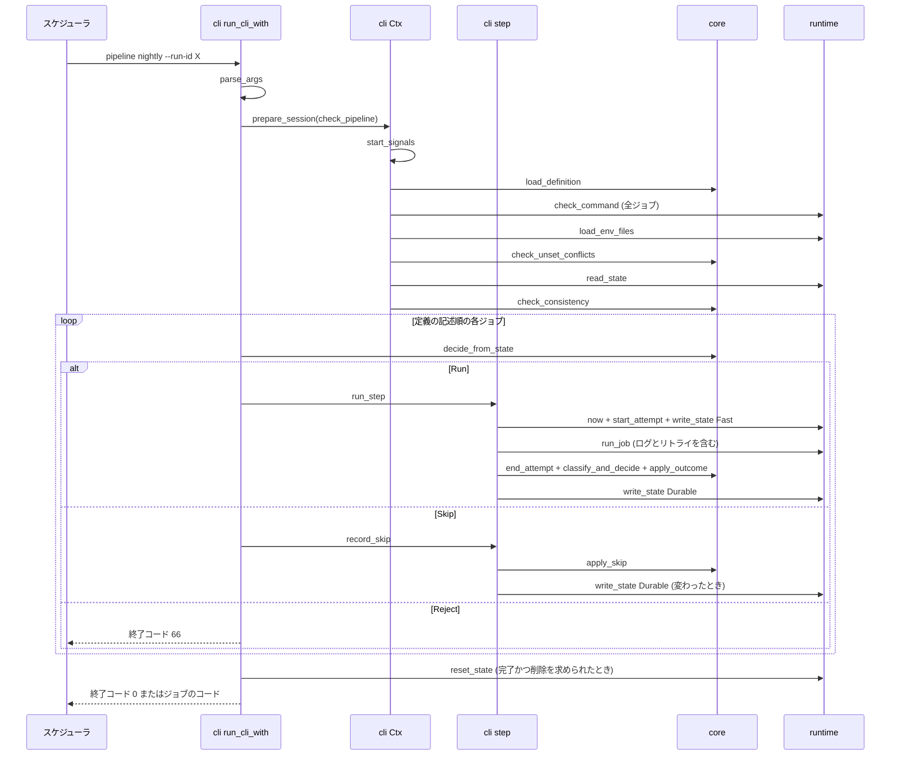
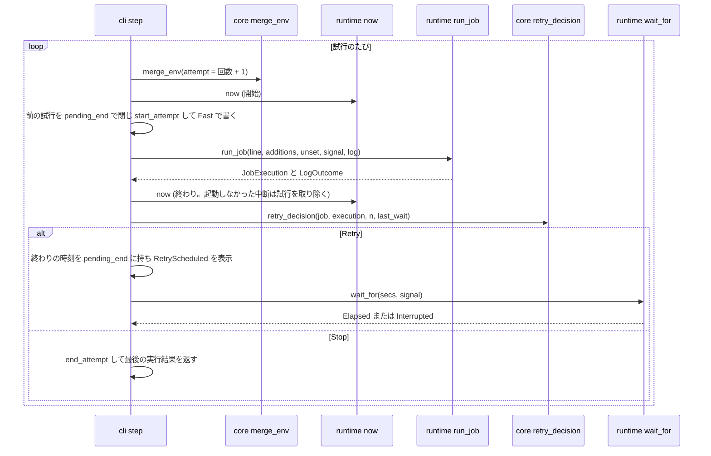
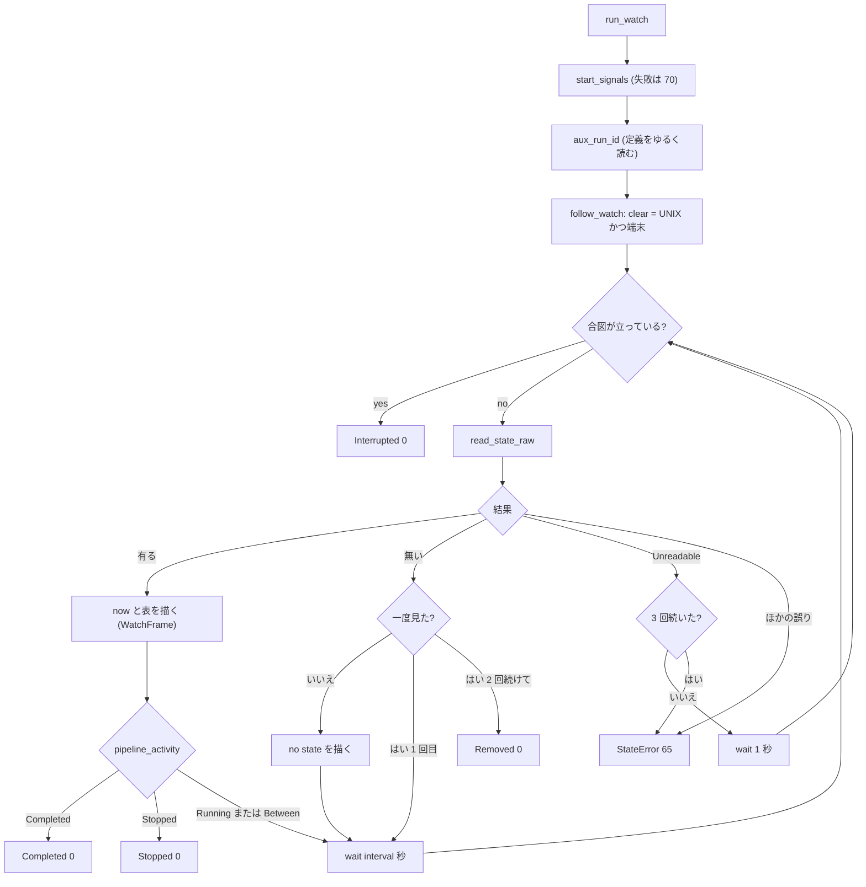
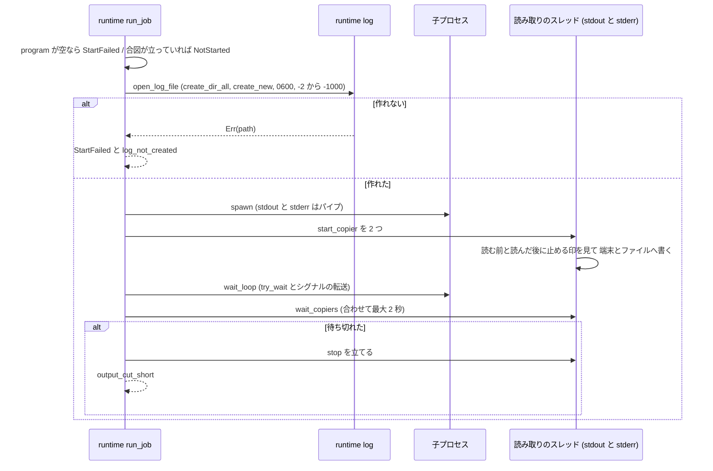
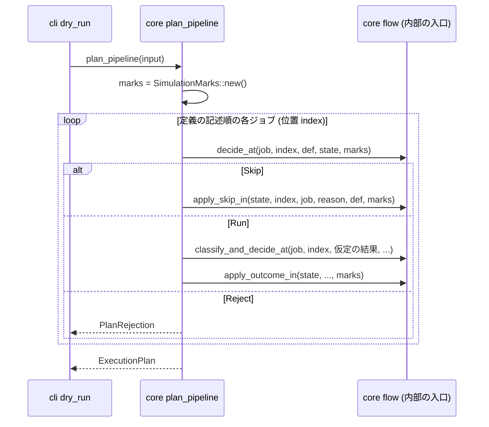

# アーキテクチャ

## Architecture Analysis

### System Overview

4 クレートの Cargo ワークスペースで構成する、単一バイナリの CLI。`conductor-cli` が唯一の調整役(Orchestrator)で、`conductor-core`(定義の検証と、純粋な判断・記録・時刻・図・計画)、`conductor-runtime`(プロセスの起動、ログのファイル、時計、ファイルの入出力)、`conductor-converter`(YAML と TOML の変換)を、決まった順に呼ぶ。入出力の副作用は、core の `definition::intake`、runtime の入出力のモジュール(`runner`、`log`、`clock`、`state`、`envfile`、`file_create`)、cli の `deps`・`platform`、converter の `intake` に閉じ込めてある。

### Architectural Style

レイヤー型のモジュラー・モノリス(単一プロセス、単一バイナリ、同期処理。非同期ランタイムは無い)。

- 依存は一方向: cli → {core, runtime, converter}、runtime → core。core と converter は、ほかのクレートに依存しない(詳細は `dependencies.md`)。
- 「純粋な判断」と「入出力」の分離: core の `flow`(判断・記録・試行の時刻・動きの様子)、`time`、`consistency`、`envfile`、`graph`、`plan` は、引数だけから結果を決める純粋な関数。現在の時刻は runtime の `clock::now` だけが取り、cli が値として core に渡す。
- 差し替え口(trait `Runtime`・`Sink`・`Env`・`Signals`。`crates/cli/src/deps.rs`)で、流れのテストに偽の実装を注入する。`Runtime::now` も差し替えられるため、時刻を使う流れ(所要時間、ログの名前、`watch --follow`)を偽の時計で試せる。
- 公開の入口と内部の入口の分離(v0.10.1): `flow` の判断と記録は、公開の関数(`decide_from_state`、`classify_and_decide`、`apply_skip`、`apply_outcome`)と、位置と目印(`SimulationMarks`)を受け取る crate の中の入口(`decide_at`、`classify_and_decide_at`、`apply_skip_in`、`apply_outcome_in`)の 2 層。計画の模擬(`plan_pipeline`)だけが内部の入口を使い、公開の関数は呼ぶたびに目印を作り直して同じ本体を呼ぶ。
- OS 差は `platform` モジュールに閉じ込める(runtime と cli に各 1 つ)。本体の `cfg(unix)`/`cfg(windows)` はそこだけ(`nfr_source.rs` が検査)。
- `unsafe` は runtime の `platform/unix.rs` の `libc::kill` 1 か所だけ(runtime は `#![deny(unsafe_code)]`、ほかのクレートは `#![forbid(unsafe_code)]`)。

### Component Relationships

テキストの代替: `main` が `run_cli` を呼ぶ。`run_cli_with` は引数を解釈し(`args`)、`Ctx` を作って、コマンドごとに `run`・`pipeline`・`aux_commands` へ振り分ける(`run`・`pipeline` は `--dry-run` のとき `dry_run` へ入る)。`run` と `pipeline` は、1 つのジョブの手順(試行の時刻、ログ、リトライを含む)を `step` に任せる。`Ctx` は、表示(`report`)、差し替え口(`deps`)、シグナルと画面の消去の可否(`platform`)を持つ。`deps` の本番の実装が core・runtime・converter の関数を呼ぶ。`step`・`dry_run`・`aux_commands` は core の純粋な関数を直接呼ぶ。runtime は core の共有の型、時刻の型と整形、`.env` の解析に依存する。

### Data Flow

1. 引数 → `ParsedArgs`(`CliCommand`。`follow`・`interval` を含む)。
2. 定義ファイル → `load_definition`(Intake → Parse → Depth → VersionCheck → Walk)→ `PipelineDefinition`(`log_dir`、`unset_env`、実効の `retry` を含む)。
3. `check_command` で全ジョブの command を、起動せずに分割・検査(`CommandLine` の並び。以後、分け直さない)。
4. run ID の決定(`--run-id`、なければ環境変数 `run_id_env` または `CONDUCTOR_RUN_ID`)。
5. `.env` の読み取り(`env_file_refs` → `load_env_files` → `LoadedEnvFiles`。`required = false` の無いファイルは読み飛ばす)と、`unset_env` との重なりの検査(`check_unset_conflicts`)。誤りは 64。
6. ステートの読み込みと照合(`read_state`、`check_consistency`)。試行の記録が無い動いたジョブは壊れたステート(65)。
7. ジョブごとに `decide_from_state` → `run_step`(試行ごとに `merge_env` → `now` → `start_attempt` → `write_state(Fast)` → `run_job`(ログの指定つき)→ `now` → `retry_decision` →(リトライなら試行を開いたまま知らせて `wait`)→ `end_attempt`)→ `classify_and_decide` → 表示 → `apply_outcome` → `write_state(Durable)`。
8. 完了で削除を求められていれば `reset_state`。
9. 表示は `DisplayEvent`(37 種)を `Reporter` が英日の文にして、標準エラーに出す(`watch`・`graph`・`--dry-run`・`init -`・`convert` の結果は標準出力)。

### Key Design Decisions

- ジョブはシェルを介さず直接起動する。command は定義のデータとして扱い、解釈・展開しない。分割は `split.rs` の状態機械で、定義の検査のときに 1 回だけ行う。
- 環境は親から引き継ぎ、`unset_env` の名前を除いてから(`Command::env_remove`)、層を統合した変数を足す(`[pipeline].env_file` < `[pipeline.env]` < `[job].env_file` < `[job.env]` < 自動の変数)。消す名前の比べ方は OS に任せる(UNIX は完全一致、Windows は大文字小文字を区別しない)。重なりの検査はどの OS でも大文字小文字を区別しない。
- ステートは原子的に置き換える(一時ファイル → `Durable` なら同期 → `rename`)。試行の開始は `Fast`、結果は `Durable` で書く。読み取りは厳格(知らないキーは壊れたステート)。`format_version` は 1 のままで、v0.9.9 までのステートは試行が無いため 65 になる(README に明記)。
- 時刻は UTC の UNIX 秒(`Timestamp`)。暦の計算は core の `time` に自前で書く(新しい依存を使わない)。ステートは RFC 3339、ログの名前は詰めた形(`YYYYMMDDTHHMMSSZ`)。
- リトライの待ちの間は、前の試行の終わりの時刻をメモリに持ち、試行を開いたまま書かない(`step.rs` の `pending_end`)。`watch --follow` から待ちの間が「止まった」に見えないため。
- `watch --follow` の終わりは、読み直したステートの `pipeline_activity`(完了 → 動いている試行 → 止まった → 間)で決める。画面を消せるか(UNIX 系かつ標準出力が端末)は初めに 1 回だけ決め、消せるなら 1 回目から毎回 `ESC[H ESC[2J` を置く。消せないなら 2 回目から空の 1 行を置いて追記する。
- `log_dir` は、指定があるときだけ子の標準出力・標準エラーをパイプにし、流れごとに 1 つの読み取りのスレッドが端末とファイルへ書く。子の終了の後、読み取りの終わりを合わせて最大 2 秒待ち、待ち切れたら「止める」印を立てる。スレッドは印を読む前と読んだ後に見る(v0.10.1)。ファイルは `create_new` で作り、UNIX 系は 0600、名前の衝突は `-2`〜`-1000`。
- 計画の模擬は、定義の記述順に進むことを使い、ジョブの位置と目印(済んだ前置き、pending の無い前置き、`error` の数)を持ち回って、前のジョブから続けて走査する(v0.10.1。1,000 ジョブの性能のテストのため)。目印は `flow` の記録の関数だけでステートを変える間は正しいまま(済んだジョブを済んでいない状態に戻さない)。
- シグナルは、ジョブの子プロセスの pid だけに、1 回だけ転送する(UNIX は子を新しいプロセスグループで起動)。Windows は同じコンソールのジョブに OS が配る。
- エラー表示は固定の文だけで組み立て、入力に由来する文字列(キー名、ジョブID、パス)は escape して切り詰める。

### Improvement Opportunities

- 仕様書 `docs/spec/rust/` が v0.10.0 の構成(試行の時刻、ログ、`watch --follow`、`unset_env` など)を書いていない。この intent の主対象(`code-quality-assessment.md` の「仕様書と実装の差」)。
- `crates/runtime/src/lib.rs:72-82` の「呼び出しの順序」が、v0.10.0 の「試行を始めて `Fast` で書く」を反映していない。
- `watch --follow` の「止まった」の判定は、ステートだけを見るため、エラーで止まったステートと、再開の直前(再開のジョブが試行を書く前)を見分けられない。v0.10.1 で README の注意を、起きる使い方に限って書き直した(判定は変えていない)。
- 使い方の表が、`args.rs` の文書、`report/messages.rs` の USAGE、`README.md` の 3 か所にある(仕様書の `--help` の全文を含めると 4 か所)。

## Interaction Diagrams

### 取引 1: `conductor pipeline <name>`(一括実行)

テキストの代替: スケジューラが `pipeline` を呼ぶ。cli は引数を解釈し、シグナルの監視を始めてから、定義の読み込み、command の検査、`.env` の読み取り、`unset_env` との重なりの検査、ステートの読み込みと照合を行う。ジョブごとに起動前の判断をし、Run なら `run_step` が、今の時刻で試行を始めて `Fast` で書き、起動(ログとリトライを含む)、試行を閉じて分類、記録、`Durable` で書く。Skip なら `record_skip` がスキップを記録する。Reject なら 66 で終わる。エラーで止まればジョブの終了コード、ジョブのあいだで合図が立っていれば再開位置を書いて 128 + 番号で終わる。完了で削除を求められていれば `reset_state` を呼ぶ。

### 取引 2: 1 回のジョブの起動とリトライ(`step::run_job_with_retry`)

テキストの代替: 試行ごとに、層を統合した環境(`CONDUCTOR_ATTEMPT` は試行の番号)を作り直し、今の時刻を取る。リトライの 2 回目以降は、前の試行をメモリに持っていた終わりの時刻で閉じてから、新しい試行を足して `Fast` で 1 回書く。`run_job` に、足す変数、消す名前、合図、ログの指定(`log_dir` があるとき)を渡す。終わったら時刻を取り(起動前に合図が立っていたときは試行を取り除く)、core の `retry_decision` が再実行か停止かを決める。再実行なら試行を開いたまま知らせを出し、`wait_for`(合図を 50ms 以下の間隔で確認)で待つ。待機中に中断されたら、持っていた時刻で閉じて、起動していない中断の結果(`NotStarted`)を返す。

### 取引 3: `conductor watch --follow`(v0.10.0)

テキストの代替: `run_watch` は `--follow` のとき、最初にシグナルの準備をし(失敗は 70)、run ID を決めて `follow_watch` に入る。初めに 1 回だけ、画面を消せるか(UNIX 系で標準出力が端末)を決める。各回は、合図が立っていれば 0 で終わり、そうでなければステートを読み直す。有れば今の時刻を取って表を描き(消せるなら毎回画面を消してから、消せないなら 2 回目から空の 1 行を前に置く)、`pipeline_activity` が完了か止まったならその表を最後に 0 で終わる。動いている・間なら `--interval` 秒待つ。無ければ、一度も見ていないなら `no state` を描いて待ち、見た後なら 2 回続けて無いときに 0 で終わる。読めない(`Unreadable`)ときは描かずに 1 秒後に読み直し、3 回続けば 65。ほかの誤りは 1 回の `watch` と同じ表示で 65。標準出力に書けなければ 65。待ちの途中の合図は 0。

### 取引 4: `run_job` のログ(`log_dir`。v0.10.0、v0.10.1)

テキストの代替: `run_job` は、空の program と起動前の合図を先に確かめる。ログの指定があれば、起動の前にディレクトリとファイルを作る(無いときだけ作る。UNIX 系は 0600。同じ名前があれば `-2` から `-1000` を足す)。作れなければ起動せず `StartFailed` と `log_not_created` を返す。作れたら標準出力と標準エラーをパイプにして起動し、流れごとの読み取りのスレッドが、読んだ分を端末とファイルへ書く(ファイルへの書き込みに失敗したら以後ファイルに書かない)。待ちのくり返しとシグナルの転送はログの有無によらず同じ。子の終了の後、読み取りの終わりを合わせて最大 2 秒待ち、待ち切れたら「止める」印を立てて `output_cut_short` を返す。スレッドは、読む前に印を見て立っていれば読まずに終わり、読んだ後に印を見て立っていれば読んだ分を書かずに終わる(v0.10.1。`runner.rs:315`・`324`)。

### 取引 5: `--dry-run` の計画の模擬(v0.10.1 の内部の入口)

テキストの代替: `plan_pipeline` は、目印を先頭から作り、定義の記述順にジョブの位置を持って進む。各ジョブで、内部の入口 `decide_at` に位置と目印を渡して起動前の判断をし、スキップなら `apply_skip_in`、実行なら仮定の終了コードで `classify_and_decide_at` と `apply_outcome_in` を呼ぶ。拒否なら `PlanRejection` を返す。公開の入口(`decide_from_state` など)は、呼ぶたびに目印を作り直して同じ本体を呼ぶので、本番の流れの判断は変わらない。`plan_run`(1 ジョブ)は公開の入口を使う。

### 取引 6: `graph`、`validate`、`convert`、`init`

- `graph`: `check_definition_and_env`(`validate` と同じ検査)→(`--state` のとき)run ID とステートの読み取り(`read_state_raw`)と照合 → 重ね合わせ → `build_graph` → `text` は `layout_graph` + `render_text`、`mermaid` は `render_mermaid`、`dot` は `render_dot` → 標準出力に 1 回。書けなければ 65。
- `--dry-run`: `dry_run::enter_flow` → `prepare_checked`(シグナルの準備をしない)→ 取引 5 → `render_plan` → 標準出力。
- `validate`: `check_definition_and_env` → 成功は `DefinitionValid`(`-v` のときだけ 1 行)で 0、誤りは 64。重複キーは警告。
- `convert`: `conductor_converter::convert` → 成功は標準出力に 1 回、失敗は何も書かず 67。
- `init`: `render_template`(英日)→ `--config -` なら標準出力、それ以外は `create_file`(排他の作成。`--force` で置き換え)。既にあれば 69。

## 並行性とシグナル

cli は専用のスレッド(UNIX は `signal-hook` の `Signals`、Windows は `ctrlc` のハンドラ)でシグナルを受け、`InterruptSignal`(Atomic)に最初の番号を立てる。監視の開始は `run`・`pipeline` の `prepare_session` と、`watch --follow` の入口。runtime の待ちのくり返し(1ms から 10ms の `try_wait`)が、立っていれば子の pid に 1 回だけ転送する。リトライの待機と `watch --follow` の待ちは 50ms 以下の間隔で合図を見る。`log_dir` があるときは、さらに流れごとに 1 つの読み取りのスレッド(`conductor-log-copier`)が動く。補助のコマンド(`--follow` の無い `watch` など)と `--dry-run` は、シグナルの準備をせず、既定の動作で終わる。
