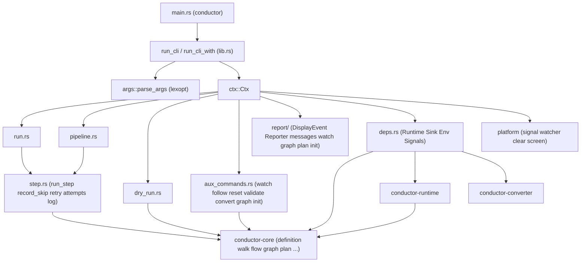
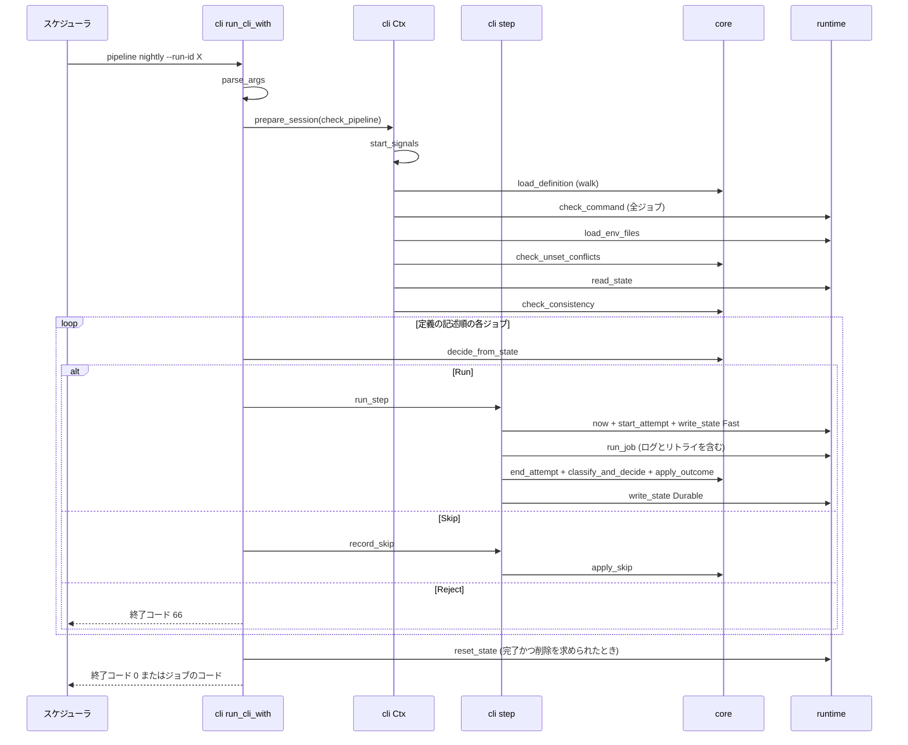
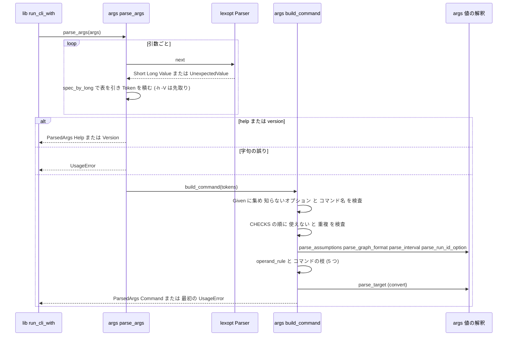
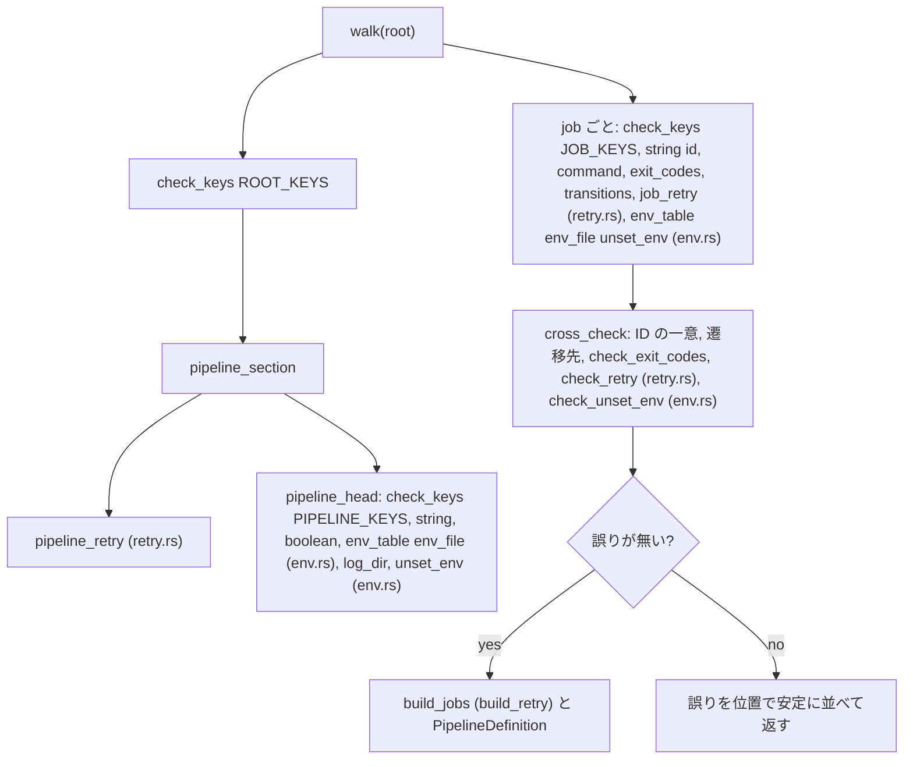
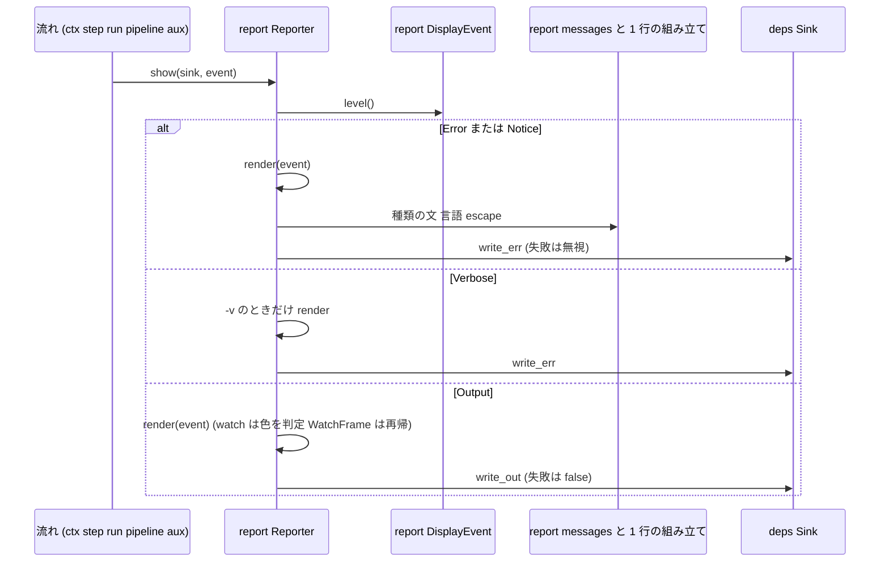
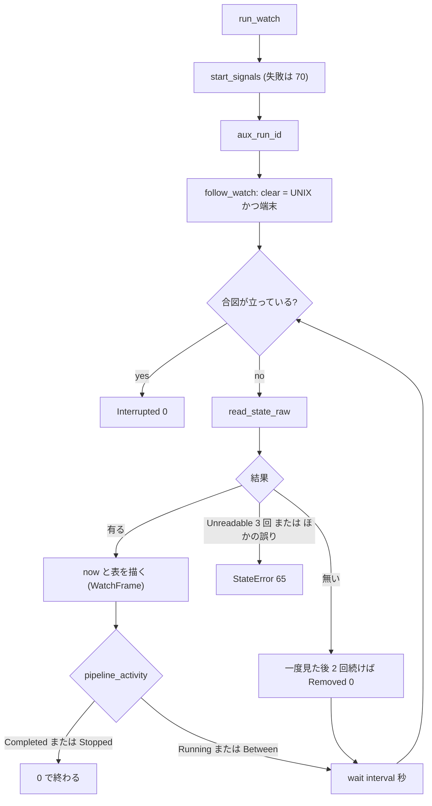
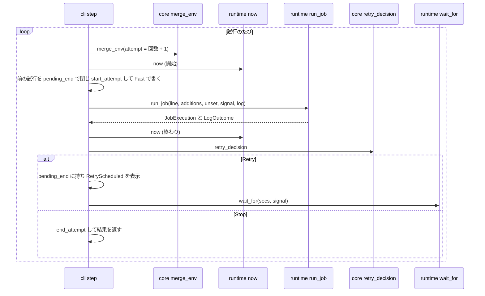

# アーキテクチャ

## Architecture Analysis

### System Overview

4 クレートの Cargo ワークスペースで構成する、単一バイナリの CLI。`conductor-cli` が唯一の調整役(Orchestrator)で、`conductor-core`(定義の検証と、純粋な判断・記録・時刻・図・計画)、`conductor-runtime`(プロセスの起動、ログのファイル、時計、ファイルの入出力)、`conductor-converter`(YAML と TOML の変換)を、決まった順に呼ぶ。入出力の副作用は、core の `definition::intake`、runtime の入出力のモジュール(`runner`、`log`、`clock`、`state`、`envfile`、`file_create`)、cli の `deps`・`platform`、converter の `intake` に閉じ込めてある。

### Architectural Style

レイヤー型のモジュラー・モノリス(単一プロセス、単一バイナリ、同期処理。非同期ランタイムは無い)。

- 依存は一方向: cli → {core, runtime, converter}、runtime → core。core と converter は、ほかのクレートに依存しない(詳細は `dependencies.md`)。
- 「純粋な判断」と「入出力」の分離: core の `flow`、`time`、`consistency`、`envfile`、`graph`、`plan` は、引数だけから結果を決める純粋な関数。現在の時刻は runtime の `clock::now` だけが取り、cli が値として core に渡す。
- 差し替え口(trait `Runtime`・`Sink`・`Env`・`Signals`。`crates/cli/src/deps.rs`)で、流れのテストに偽の実装を注入する。`Runtime::now` も差し替えられる。
- 公開の入口と内部の入口の分離: `flow` の判断と記録は、公開の関数と、位置と目印(`SimulationMarks`)を受け取る crate の中の入口(`decide_at` など)の 2 層。計画の模擬(`plan_pipeline`)だけが内部の入口を使う。
- クレートの中の可視性: cli は `lib.rs` で全モジュールを private(`mod args;`、`mod report;` など)にし、公開は `run_cli`・`run_cli_with`・`install_panic_hook` と差し替え口だけ。core の `definition::walk` も private で、外の入口は `walk::walk` 1 つ(`definition/mod.rs:69`)。モジュールの中の `pub` は crate の中でだけ見える。
- 大きな検査の子モジュール化: `definition/walk/` は、`Walker` の `impl` を子モジュール(`retry.rs`、`env.rs`)に分け、親が呼ぶ順を保つ形(前例 `c34d3f7`)。
- OS 差は `platform` モジュールに閉じ込める(runtime と cli に各 1 つ)。本体の `cfg(unix)`/`cfg(windows)` はそこだけ(`nfr_source.rs` が検査)。
- `unsafe` は runtime の `platform/unix.rs` の `libc::kill` 1 か所だけ(runtime は `#![deny(unsafe_code)]`、ほかのクレートは `#![forbid(unsafe_code)]`)。
- 文書と実装の結び: README はテスト(`crates/cli/src/tests/docs.rs`、`crates/cli/tests/msrv_consistency.rs`)と CI の `docs-check` で、仕様書 `docs/spec/rust/`・`language-agnostic/` の数は `crates/cli/tests/spec_numbers.rs`(v0.10.3)で実装と結ばれる。`spec_numbers.rs` は実装の値をソースのファイルを文字列として読んで数えるので、ソースのファイルのパスと決まった行の形に依存する(`code-quality-assessment.md`)。

### Component Relationships

テキストの代替: `main` が `run_cli` を呼ぶ。`run_cli_with` は引数を解釈し(`args`)、`Ctx` を作って、コマンドごとに `run`・`pipeline`・`aux_commands` へ振り分ける(`run`・`pipeline` は `--dry-run` のとき `dry_run` へ入る)。`run` と `pipeline` は、1 つのジョブの手順を `step` に任せる。`Ctx` は、表示(`report`)、差し替え口(`deps`)、シグナルと画面の消去の可否(`platform`)を持つ。`deps` の本番の実装が core(定義の読み込みと `walk` の検査を含む)・runtime・converter の関数を呼ぶ。`step`・`dry_run`・`aux_commands` は core の純粋な関数を直接呼ぶ。runtime は core の共有の型、時刻、`.env` の解析に依存する。

### Data Flow

1. 引数 → `parse_args`(字句 → `build_command`)→ `ParsedArgs`(`CliCommand`)。誤りは最初の 1 つだけを `UsageError` で返す(68)。
2. 定義ファイル → `load_definition`(Intake → Parse → Depth → VersionCheck → Walk)→ `PipelineDefinition`。Walk は誤りを位置つきで集め、位置で安定に並べて返す(64)。
3. `check_command` で全ジョブの command を、起動せずに分割・検査。
4. run ID の決定(`--run-id`、なければ環境変数 `run_id_env` または `CONDUCTOR_RUN_ID`)。
5. `.env` の読み取りと、`unset_env` との重なりの検査。誤りは 64。
6. ステートの読み込みと照合(`read_state`、`check_consistency`)。
7. ジョブごとに `decide_from_state` → `run_step`(試行ごとに `merge_env` → `now` → `start_attempt` → `write_state(Fast)` → `run_job` → `now` → `retry_decision` → `end_attempt`)→ `classify_and_decide` → 表示 → `apply_outcome` → `write_state(Durable)`。
8. 完了で削除を求められていれば `reset_state`。
9. 表示は `DisplayEvent`(37 種)を `Reporter` が英日の文にして、水準(Error・Notice・Verbose・Output)に従って出す(Output は標準出力、ほかは標準エラー)。

### Key Design Decisions

- ジョブはシェルを介さず直接起動する。command は定義のデータとして扱い、解釈・展開しない。
- 環境は親から引き継ぎ、`unset_env` の名前を除いてから、層を統合した変数を足す(`[pipeline].env_file` < `[pipeline.env]` < `[job].env_file` < `[job.env]` < 自動の変数)。
- ステートは原子的に置き換える(一時ファイル → `Durable` なら同期 → `rename`)。読み取りは厳格(知らないキーは壊れたステート)。
- 時刻は UTC の UNIX 秒(`Timestamp`)。暦の計算は core の `time` に自前で書く。
- リトライの待ちの間は、前の試行の終わりの時刻をメモリに持ち、試行を開いたまま書かない(`step.rs` の `pending_end`)。
- `watch --follow` の終わりは、読み直したステートの `pipeline_activity` で決める。画面を消せるかは初めに 1 回だけ決める。
- 表示の言語と色は `Reporter` のインスタンスごとの遅延のセル(`OnceCell`)で、必要な表示のときだけ判定する。`render` は閉包で言語を必要な枝だけで取る(版とシグナルの準備の失敗は判定しない)。
- エラー表示は固定の文だけで組み立て、入力に由来する文字列(キー名、ジョブID、パス)は escape して切り詰める(`report` の `escape_name` 64 文字、`escape_full` 切らない。本体は core の `escape_display`)。
- 引数の性質は `args.rs` の表 `OPTIONS`(13 行)の 1 か所に置き、表と `Opt` の並びの一致をコンパイル時に確かめる(`const _`)。検査の順は表 `CHECKS`(25 行)で決める。
- 数の一覧の網羅は、本番に公開の配列を持たせず、テスト側の写しと網羅の `match` で保つ。公開の `ALL` を持つのは `CommandKind` だけ。仕様書の数は、ソースを文字列として読んで数える(`spec_numbers.rs`。本番のコードを曲げない)。

### Improvement Opportunities

- 大きなファイル(この intent の対象): `crates/cli/src/report/mod.rs`(746 行。型の定義、表示の本体、1 行の組み立て、エスケープが 1 つのファイル。`render` は 188 行)、`crates/core/src/definition/walk/mod.rs`(695 行。`impl Walker` が 429 行)、`crates/cli/src/args.rs`(679 行。表、字句、組み立て、値の解釈が 1 つのファイル。`build_command` は 132 行)。分け方の材料は `code-structure.md` の「この intent の対象のファイル」。
- 仕様書 `docs/spec/rust/` のモジュールの表(02 章)と、`lib.rs` の `//!` のモジュールの表は、ファイルの配置を手で書いており、検査が無い。ファイルを分けると古くなる。
- `watch --follow` の「止まった」の判定は、エラーで止まったステートと、再開の直前を見分けられない(README の注意で補っている)。
- 使い方の表が、`args.rs` の文書、`report/messages.rs` の USAGE、`README.md` の 3 か所にある。

## Interaction Diagrams

### 取引 1: `conductor pipeline <name>`(一括実行)

テキストの代替: スケジューラが `pipeline` を呼ぶ。cli は引数を解釈し、シグナルの監視を始めてから、定義の読み込み(`walk` の検査を含む)、command の検査、`.env` の読み取り、`unset_env` との重なりの検査、ステートの読み込みと照合を行う。ジョブごとに起動前の判断をし、Run なら `run_step` が試行を始めて `Fast` で書き、起動、試行を閉じて分類、記録、`Durable` で書く。Skip なら `record_skip`。Reject なら 66。完了で削除を求められていれば `reset_state` を呼ぶ。

### 取引 2: 引数の解釈(`args::parse_args`。この intent の対象)

テキストの代替: `parse_args` は `lexopt` で引数を 1 つずつ字句にし、長い名前は表 `OPTIONS` で引いて、値を取るなら値も読む。`-h`・`-V` は先に覚えておき、最後に誤りより先に返す。字句の誤り(`--bogus=x` など)があれば返す。そうでなければ `build_command` が、指定を集め、知らないオプション、コマンドの名前、`CHECKS` の順の「使えない」と「重複」、`--all` と `--run-id`、`graph` の `--run-id` を検査し、値を解釈し(`--assume`、`--format`、`--interval`、`--run-id` の順)、位置引数の数を確かめ、コマンドの枝(`Run`、`Pipeline | Validate | Graph`、`Convert`、`Init`、`Watch | Reset`)で残りを入れる。誤りは最初の 1 つだけ。

### 取引 3: 定義の検査(`definition::walk::walk`。この intent の対象)

テキストの代替: `walk` は根のキーを検査し、`[pipeline]` を読む(既定のリトライを先に、続けてほかの値)。ジョブごとにキー、`id`、`command`、終了コード、遷移、`retry`、`env`・`env_file`・`unset_env` を読む。そのあと、ジョブをまたぐ検査(ID の一意、遷移先、終了コードの重なり、既定のリトライとの重なり、`unset_env` と `env` の重なり)をする。誤りが無ければジョブを組み立てて定義を返し、あれば誤りを位置で安定に並べて返す。同じ位置の誤りの並びは、呼ぶ順で決まる。

### 取引 4: 表示(`Reporter::show`。この intent の対象)

テキストの代替: 流れは `DisplayEvent` を作って `Reporter::show` に渡す。`show` はイベントの水準で出し方を決め、`render` で文を組み立てる。`render` は 35 の枝の `match` で、必要な枝だけが言語を判定し、`messages` の文と 1 行の組み立ての関数(`error_line`、`state_line` など)とエスケープを使う。Error と Notice は常に、Verbose は `-v` のときだけ標準エラーへ書き(失敗は無視)、Output は標準出力へ書いて結果を返す。

### 取引 5: `conductor watch --follow`

テキストの代替: `run_watch` は `--follow` のとき、シグナルの準備をし(失敗は 70)、run ID を決めて `follow_watch` に入る。各回、合図が立っていれば 0、そうでなければステートを読み直し、有れば表を描いて完了か止まったなら 0、動いている・間なら `--interval` 秒待つ。一度見えたステートが 2 回続けて無ければ 0。読めないのが 3 回続くか、ほかの誤りは 65。

### 取引 6: 1 回のジョブの起動とリトライ(`step::run_job_with_retry`)

テキストの代替: 試行ごとに層を統合した環境を作り直し、今の時刻を取って試行を始め `Fast` で書く。`run_job` に足す変数、消す名前、合図、ログの指定を渡す。終わったら時刻を取り、`retry_decision` が再実行か停止かを決める。再実行なら試行を開いたまま知らせを出して待つ。

### 取引 7: `graph`、`validate`、`convert`、`init`、`--dry-run`

- `graph`: `check_definition_and_env` →(`--state` のとき)ステートの読み取りと照合 → `build_graph` → `render_text`・`render_mermaid`・`render_dot` → 標準出力に 1 回。書けなければ 65。
- `--dry-run`: `dry_run::enter_flow` → `prepare_checked` → `plan_pipeline`(内部の入口で位置と目印を持ち回る)→ `render_plan` → 標準出力。
- `validate`: `check_definition_and_env` → 成功は `DefinitionValid`(`-v` のときだけ 1 行)で 0、誤りは 64。
- `convert`: `conductor_converter::convert` → 成功は標準出力に 1 回、失敗は 67。
- `init`: `render_template` → `--config -` なら標準出力、それ以外は `create_file`。既にあれば 69。

## 並行性とシグナル

cli は専用のスレッド(UNIX は `signal-hook`、Windows は `ctrlc`)でシグナルを受け、`InterruptSignal`(Atomic)に最初の番号を立てる。runtime の待ちのくり返し(1〜10ms の `try_wait`)が、立っていれば子の pid に 1 回だけ転送する。リトライの待機と `watch --follow` の待ちは 50ms 以下の間隔で合図を見る。`log_dir` があるときは、流れごとに 1 つの読み取りのスレッドが動く。表示(`report`)、引数(`args`)、定義の検査(`walk`)は単一のスレッドで動き、共有の状態を持たない。
