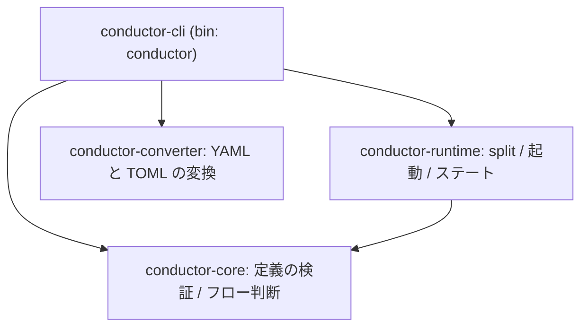
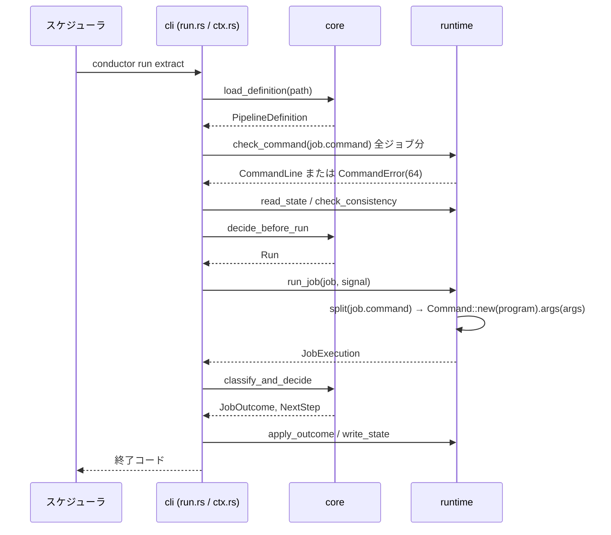
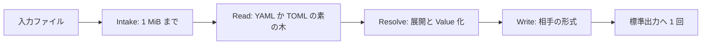

# Architecture

## Architecture Analysis

### System Overview
単一バイナリ `conductor` を作る Cargo ワークスペース(4 クレート)。判断の純粋なロジック(core)、OS に触れる実行(runtime)、形式変換(converter)、入口と表示(cli)に分かれる。cli が 3 つのライブラリを束ね、流れ(Orchestrator)を組み立てる。各クレートの一覧は `component-inventory.md`、依存は `dependencies.md` を参照。

### Architectural Style
モジュラーなライブラリ群 + 薄い CLI(モノリシックな単一プロセス)。cli は `Runtime`・`Sink`・`Env`・`Signals` の trait(`crates/cli/src/deps.rs`)で外部とのやりとりを差し替えられる(テストの偽物の注入口)。core と converter は入出力を持たない純粋な処理(ファイルを読むのは各 `intake` だけ)。

### Component Relationships

テキストの代替: cli は core・runtime・converter に依存し、runtime は core に依存する。converter は core に依存しない。

### Data Flow
1. cli が引数を解析し、定義ファイルを `load_definition`(core: Intake → Parse → Depth → VersionCheck → Walk)で読む。
2. `prepare`(`ctx.rs`)が全ジョブの `command` を `check_command`(runtime の `split`)で事前検査し、誤りは終了コード 64。
3. ステートを読み、定義と照合する(65)。
4. `decide_before_run`(core)で Run/Skip/Reject を決め、Run なら `run_job`(runtime)が `split(&job.command)` で分け、`Command::new(program).args(args)` で起動して `try_wait` で待つ。
5. `classify_and_decide`(core)が結果を分類し、`apply_outcome`(runtime)でステートを更新し、`write_state` で書く。完了なら `reset_state`。
6. `command` の文字列は、定義(`JobDefinition.command`)と `JobExecution.command` に載るが、ステートファイルには保存されない。表示では、起動失敗時のプログラム名だけが出る。

### Key Design Decisions
- command はシェルを介さず直接起動し、分割規則を 3 OS で同一にする状態機械で実装(再帰なし)。
- core の `JobDefinition.command` は「ここでは解釈しない」文字列で、解釈(分割)は runtime の責務。検査は cli が実行前に全ジョブ分を行う(防御として `run_job` も分割失敗を `start_failure` にする)。
- 誤りは集めて返す(定義の検証)。エラー表示は固定の文とエスケープした名前だけで、入力の値は出さない。
- OS 固有コードは `platform/` に閉じ込める。`unsafe` は runtime の `platform/unix.rs` の 1 か所だけ(cli と core は `forbid(unsafe_code)`)。
- ステートは一時ファイルへ書いて `rename` で置き換え(`Durable` は同期)。

### Improvement Opportunities
- command の型が `String` に固定され、分割(runtime)と事前検査(cli)と表示(cli)に、その前提が散っている。型の拡張(文字列 or 配列)は、これらの箇所を揃えて変える必要がある(`code-quality-assessment.md`)。
- `escape` 相当の関数が 4 クレートに重複している(cli の文書に明記)。

## Interaction Diagrams

### ジョブの実行(`conductor run <job-id>`)

テキストの代替: 定義を読む → 全ジョブの command を検査 → ステートの照合 → 実行前の判断 → 起動(分割して直接起動)→ 分類 → ステートの更新と書き込み → 終了コード。

### 定義の変換(`conductor convert`)

テキストの代替: 取り込み → 読み取り → 展開 → 書き出し → 標準出力。スキーマ(`command` など)は検査しない。
