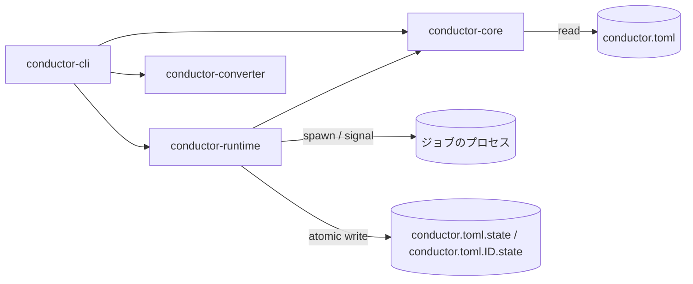
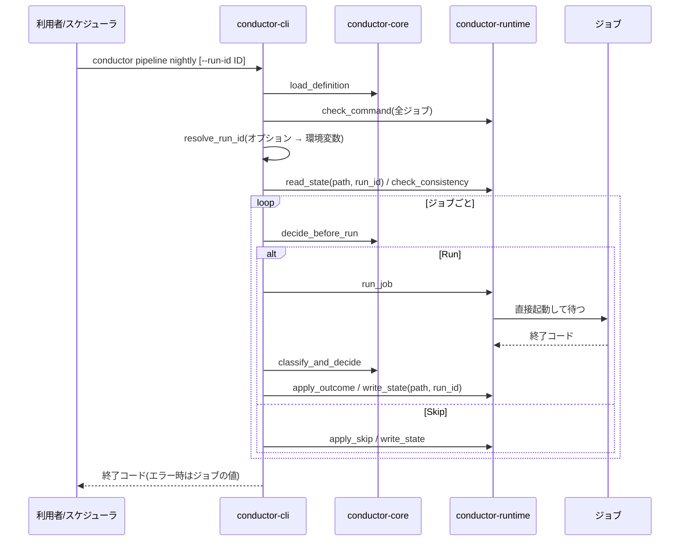
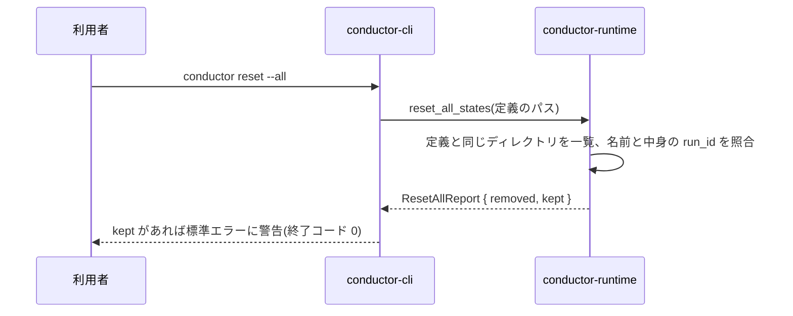
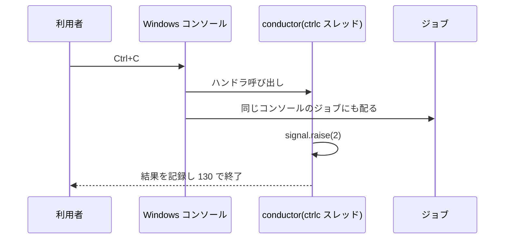

# Architecture

## Architecture Analysis

### System Overview
4 クレートの Cargo ワークスペース(版 0.5.0)。実行ファイル `conductor` は `conductor-cli` が持ち、判断(core)、プロセスとステートの入出力(runtime)、変換(converter)を決まった順に呼ぶ。

### Architectural Style
単一プロセスの CLI で、層を分けたモノリス(ライブラリ 3 つ+調整役 1 つ)。証拠: `crates/cli/src/lib.rs` が「唯一の調整役」(ADR-002)と述べ、core の関数は純粋、ファイルに触れるのは `read_state`・`write_state`・`reset_state`・`reset_all_states`、プロセスに触れるのは `run_job` だけ(`crates/runtime/src/lib.rs`)。

### Component Relationships

テキスト: cli が core・runtime・converter を呼ぶ。runtime は core に依存する。converter は core に依存しない。ステートは、run ID なしなら `conductor.toml.state`、ありなら `conductor.toml.<ID>.state`。

### Data Flow
定義の読み込み・検証(core)→ run ID の決定(cli)→ ステートの読み込み・照合(runtime)→ ジョブごとに起動前の判断(core)→ 起動(runtime、シェルを介さない)→ 分類と次の動き(core)→ 結果の記録・原子的な書き込み(runtime)→ 完了ならステートを消去。

### 実行前の検査(`Ctx::prepare` と `Ctx::check_definition`)
`run` と `pipeline` は、実行の前に `crates/cli/src/ctx.rs` の `Ctx::prepare`(`:81`)を呼ぶ。定義と command の検査(段 2〜4)は `Ctx::check_definition`(`:150`)に切り出されていて、`validate` はこれだけを呼ぶ(`aux_commands.rs`)。`prepare` は、次の順に一続きで行う。

| 段 | 内容 | 失敗の終了コード |
|----|------|------------------|
| 1 | シグナルの準備(`signals.start`。定義の検査より前) | 70 |
| 2 | 定義の読み込みと検証(`runtime.load_definition`。core の Intake → Parse → Depth → VersionCheck → Walk。`[pipeline].run_id_env` の型と形も検査) | 64 |
| 3 | パイプライン名の照合(`pipeline` のみ。`expected_pipeline` を `load_definition` に渡し、core の walk が `PipelineNameMismatch` を集める) | 64 |
| 4 | 全ジョブの `command` の検査(`runtime.check_command`。起動しない) | 64 |
| 5 | ジョブIDの存在(`run` のみ。`definition.job_index`) | 68 |
| 5b | run ID の決定(`resolve_run_id`。`--run-id` か、`definition.run_id_env`(なければ `CONDUCTOR_RUN_ID`)の環境変数。値の規則違反は `invalidValue`)。ステートの読み込みより前 | 68 |
| 6 | ステートの読み込み(`runtime.read_state(&path, run_id)`。run ID があれば、中身の `run_id` とファイル名の照合も) | 65 |
| 7 | ステートと定義の照合(`check_consistency`) | 65 |

`aux_commands`(`watch`・`reset`・`validate`・`convert`)は `prepare` を通らず、シグナルの準備もしない。`watch` と `reset` は定義を**検証しない**: `--run-id` があれば定義を読まず、なければ `runtime.run_id_env(path)` が定義から `[pipeline].run_id_env` だけをゆるく読む(`aux_run_id`。`ctx.rs:303`。`core::run_id::peek_run_id_env`)ので、壊れた定義でも `reset` は成功する。`reset --all` は環境変数も定義も見ず、`reset_all_states(&path)` を呼ぶ(`aux_commands.rs`)。

### ステートファイルの場所と呼び出し元
- 場所の導出は 1 か所: `StateLocation::of(definition_path, run_id)`(`crates/runtime/src/types.rs:114`)。定義ファイル名に、run ID があれば `.<run-id>` を、続けて `.state` を足し、同じディレクトリに置く。
- 読み・書き・消去は、「定義ファイルのパス」と「`Option<&RunId>`」をキーにする。`Runtime` trait(`crates/cli/src/deps.rs`)の `read_state`・`write_state`・`reset_state`(いずれも run ID を取る)と、`reset_all_states(&Path) -> ResetAllReport`、`run_id_env(&Path) -> Option<String>` が加わった。メソッドは `load_definition`・`check_command`・`run_job`・`read_state`・`write_state`・`reset_state`・`reset_all_states`・`run_id_env`・`convert` の 9 つ(`deps.rs:78-110`)。本番の実装 `SystemRuntime` が `conductor_runtime::*` に委譲する(`deps.rs:126-178`)。
- cli 側の呼び出し元: `Ctx::prepare`、`Ctx::write`(`:193`)、`Ctx::reset`(`:208`)、`run_watch`・`run_reset`(`aux_commands.rs`)。`run.rs`・`pipeline.rs` は、`prepare` が返す `Session`(`definition_path` と `run_id`。`ctx.rs:57`)を、`ctx.write`・`ctx.reset`・`initial_state` に渡す。
- `check_consistency`(`state/consistency.rs`)は、パスを使わず、パイプライン名 → ジョブIDの集合 → 並びだけを比べる。run ID の照合は、読み込み(`reader.rs` の `walk`。ほかのキーの検査より先)で行い、食い違いは `corrupt`(65)。
- `reset --all`(`state/reset_all.rs`): 定義と同じディレクトリを 1 回だけ一覧し(再帰なし、シンボリックリンクとディレクトリは対象外)、`<定義名>.state` と、有効な run ID が名前に入り中身の `run_id` が一致する `<定義名>.<ID>.state` だけを消す。読めない・壊れているファイルは、残して名前を `ResetAllReport.kept` に入れ、cli が標準エラーに警告する(終了コード 0)。
- 一時ファイル: `.<state名>.tmp.<pid>.<nanos>.<seq>`。`Durable` の書き込みの成功後に、同じ接頭辞(`.<state名>.tmp.`)で 24 時間以上古いものを消す(`writer.rs`)。`reset --all` は一時ファイルを消さない。
- `Env`(環境変数・端末判定)は `Deps` に入り、`Ctx` も持つ(run ID の環境変数を読むため。`resolve_run_id(.., self.env)`)。`Reporter` は `LC_ALL`・`LC_MESSAGES`・`LANG`・`NO_COLOR` を読む。run ID の環境変数名は、定義の `run_id_env`。

### Key Design Decisions
- ジョブは `command` を直接起動する(シェルなし)。文字列(`Command::Line`)は分割規則で、配列(`Command::Argv`)は 1 要素 1 引数(v0.2.0 以降)。ジョブは親の環境を継承する(runtime は環境を足さない)。conductor は run ID を子の環境へ渡さない(`--run-id` を使っても、ジョブからは見えない。環境変数を export したときだけ見える)。
- OS 固有のコードは `platform` モジュールだけ(`cfg(unix)`/`cfg(windows)`)。UNIX 系は新しいプロセスグループで起動し、シグナルを 1 回転送する。Windows は同じコンソールで起動し、`ctrlc` が番号 2 で合図を立てる(`crates/runtime/src/platform/windows.rs`、`crates/cli/src/platform/windows.rs`)。
- 終了コードは全 OS で 0〜255 に丸める。ステートは一時ファイルに書いてから置き換える。
- 依存を差し替える `Deps`(Runtime・Sink・Env・Signals)により、テストで偽の実装を渡せる。
- コマンドの追加点は一か所に集まっている: `CommandKind`(`types.rs`)→ 引数の文法の表(`args.rs`)→ 振り分けの `match`(`lib.rs:160`)→ 流れの関数。
- 定義の構造体のジョブの並びは `PipelineDefinition.job`。定義ファイルのキーも、ステートファイルのキーも `job`。
- ステートの解釈(`state/reader.rs`)は、最上位キーを `TOP_KEYS`(10 個。`run_id` を含む)の表で固定し、知らないキーを `corrupt` にする。定義の `[pipeline]` も、`PIPELINE_KEYS`(`name`・`description`・`run_id_env`。`core/src/definition/walk.rs:34`)で、知らないキーを `unknownKey`(64)にする。
- run ID の検査は 1 か所: `conductor_core::RunId::parse`(`core/src/run_id.rs`。`A-Za-z0-9._-`、1〜64 文字、先頭が `.` でない)。パスの組み立てには、検査済みの `RunId` だけを使う(パスの区切りや `..` が入らない)。エラーの型は値を持たない(誤りの文に値を出さない)。
- 定義の誤りはすべて集めて返し(`walk`)、ステートの誤りは最初の 1 件で返す。

### Improvement Opportunities
- Windows の Ctrl+C は手動確認のみ。
- 成功を知らせる表示の種類は `DefinitionValid`(`-v` のときだけ)のみ。
- 完了しなかった run ID のステートは自動では消えない。片づけは `reset --all`(利用者の運用)。
- デモは、run ID を見せていない(この intent で対応)。

## Interaction Diagrams

### pipeline の実行(エラーで止まり、再実行で再開する。run ID があっても同じ)

テキスト: cli が定義を読み、全ジョブの command を検査し、run ID を決め、ステートを読んで、ジョブごとに判断→実行→記録を繰り返す。エラーならステートを残して止まり、次回(同じ run ID)は同じ位置から再開する。完了すれば `reset_state` で消す。

### reset --all

テキスト: 定義のパスだけを渡す。runtime が対象のファイルを消し、読めないものは `kept` として返す。cli は、`kept` があるときだけ警告する。

### Windows での Ctrl+C

