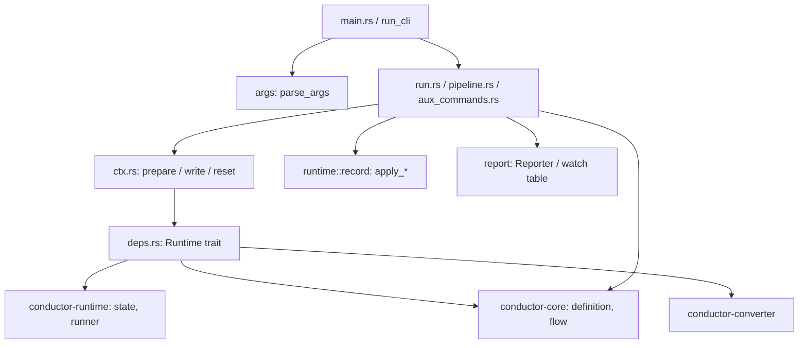
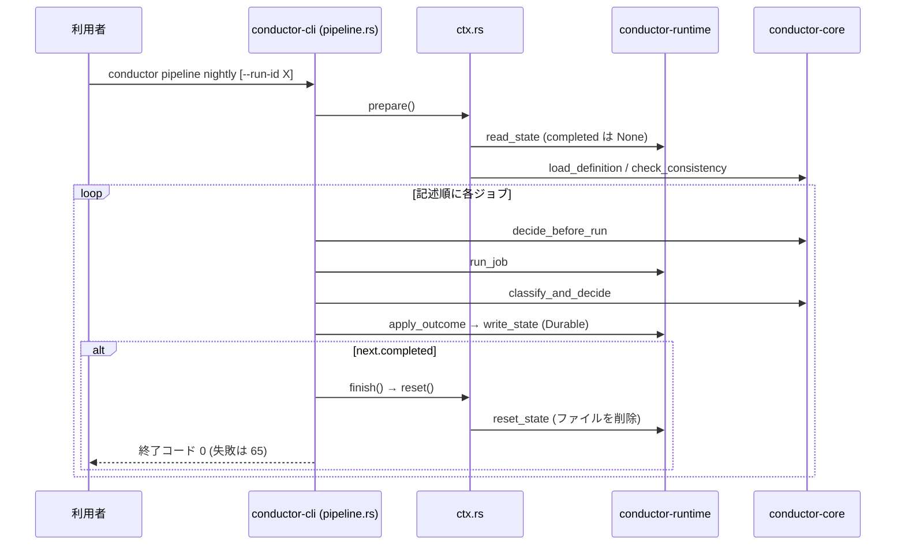
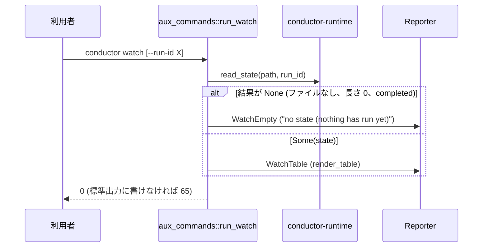

# Architecture

## Architecture Analysis

### System Overview

4 つのクレートからなる Cargo ワークスペース。`conductor-cli` が唯一の調整役(ADR-002 とコメントにある)で、`conductor-core`(判断、純粋)、`conductor-runtime`(ジョブの起動とステートのファイル)、`conductor-converter`(定義の変換)を、決まった順に呼ぶ。入出力と環境は、`conductor-cli` の trait(`Runtime`、`Sink`、`Env`、`Signals`)の裏に隠し、テストが偽の実装を渡せる。

### Architectural Style

レイヤー構造のモノリス(単一バイナリ)。判断は純粋な関数(`decide_before_run`、`classify_and_decide`、`apply_*`、`check_consistency`)、副作用は薄い境界(`read_state`、`write_state`、`reset_state`、`run_job`)に分ける。証拠: `crates/runtime/src/lib.rs` の「ファイルに触れるのは、`read_state`、`write_state`、`reset_state` だけ」、`crates/cli/src/deps.rs` の trait。

### Component Relationships

テキスト: `main` が引数を解釈し、コマンドごとの流れ(`run`・`pipeline`・`aux_commands`)を呼ぶ。流れは `ctx` の共通処理を通して `Runtime` trait の実装(`runtime`・`core`・`converter` の関数)を呼び、判断と記録の純粋な関数は直接呼び、表示は `report` に渡す。

### Data Flow

1. 引数 → `CliCommand`。2. `prepare`: シグナルの準備 → 定義の読み込みと検証(64)→ `command` の検査(64)→ ジョブIDの確認(68)→ run ID の決定(68)→ `read_state`(65)→ `check_consistency`(65)。3. `decide_before_run` → `Run`/`Skip`/`Reject`。4. `Run` は、ステートが空なら初期ステートを `Fast` で書く → `run_job` → `classify_and_decide` → `apply_outcome` → `write_state`(`Durable`)。5. 完了(`completed`)なら `reset_state` でステートを消す(`run.rs`、`pipeline.rs` の `finish`)。6. 終了コード(`exit.rs`)。

ステートは、`<定義ファイル名>[.<run-id>].state`(TOML。キー: `format_version`、`run_id`、`definition_key`、`definition_path`、`pipeline_name`、`job_order`、`job`(配列)、`resume_job_id`、`end_reached`、`completed`)。

### Key Design Decisions

- 完了のステートは、書いた後に消す。ただし、`read_state` は、`completed = true` のステートを「空」として返す(`reader.rs:169-172`)。初期化が失敗・中断して残ったものを、次の実行が先頭から始めるための安全網。
- 完了判定は、純粋な側(`apply_skip`、`classify_and_decide`、`resume_point_on_interrupt`)が `completed` を作り、`conductor-cli` が、記録のあとに削除を呼ぶ。`conductor-runtime` は、完了を判断せず、初期化の手段だけを提供する(`runtime/lib.rs`)。
- 書き込みは、一時ファイル → 置き換え(原子的)。at-least-once(ジョブの終了と記録の間で落ちると再実行されうる)。排他制御なし。
- 定義の `[pipeline]` のキーは `name`・`description`・`run_id_env` だけ(`walk.rs:34`)。知らないキーは `unknownKey`(64)。

### Improvement Opportunities

- 削除の呼び出しが 4 か所に分かれる(`run.rs` 2、`pipeline.rs` 2)。切り替えの判断を、1 か所に集める余地がある。
- `Runtime` trait に、完了のステートを区別して読む口がない。`watch` は `read_state` だけを使うので、完了を表示できない。

## Interaction Diagrams

### `pipeline` の実行と、完了のとき(現状)

テキスト: `prepare` で定義とステートを確かめ、ジョブごとに、判断 → 実行 → 分類 → 記録 → 書き込みを行う。記録した結果の `completed` が true なら、`finish` が `reset_state` を呼んでステートを消し、0 で終わる。削除に失敗したら、65 で終わり、`completed` のステートが残る(次の `read_state` は空として読む)。

### `watch` の現状

テキスト: `watch` は `read_state` の結果が `None` なら `WatchEmpty`、`Some` なら表を表示する。完了のステートは `None` になるので、`no state` と表示される。
