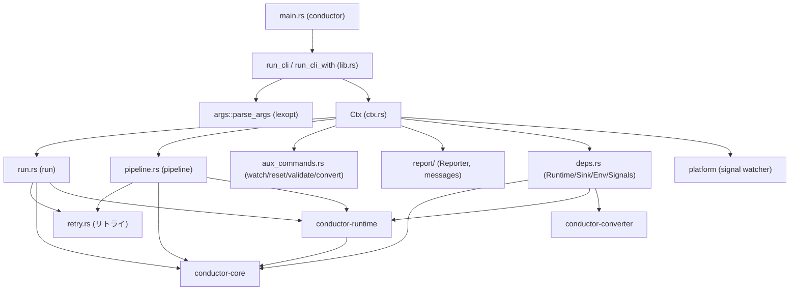
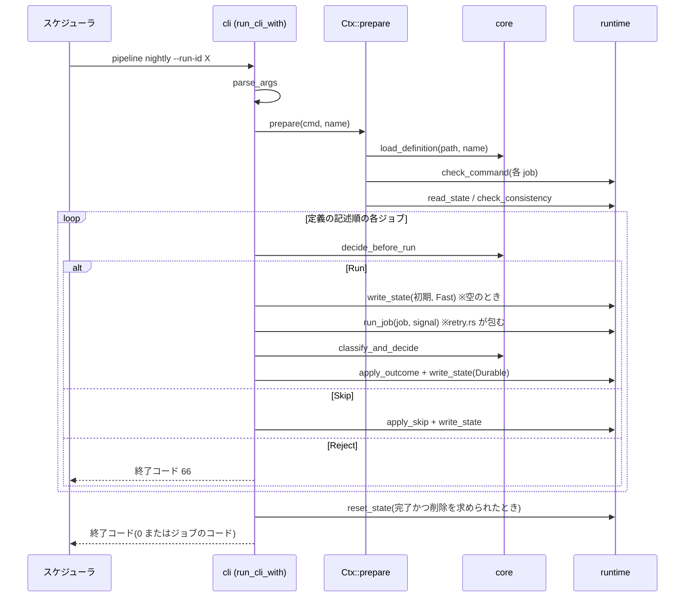
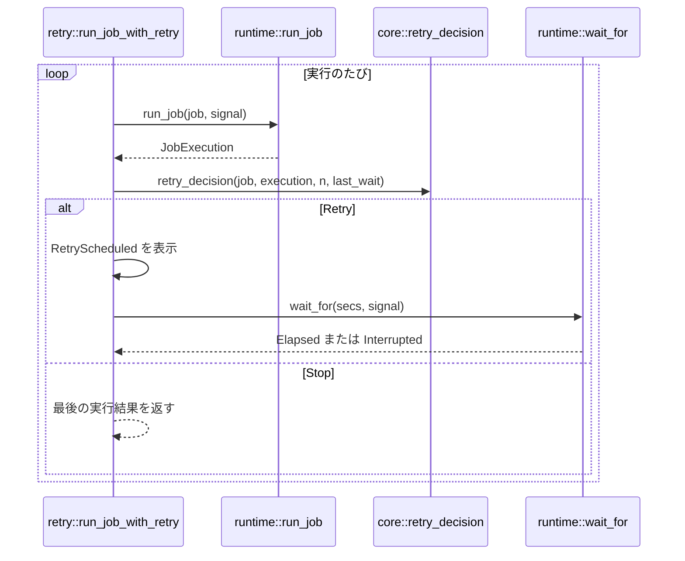

# アーキテクチャ

## Architecture Analysis

### System Overview

4 クレートの Cargo ワークスペースで構成する単一バイナリの CLI。cli クレートが唯一の調整役(Orchestrator)で、core(定義の検証と純粋な判断)、runtime(プロセスの起動とステートのファイル入出力)、converter(YAML と TOML の変換)を決まった順に呼ぶ。入出力の副作用は、core の intake、runtime、cli の deps/platform、converter の intake に閉じ込めてある。

### Architectural Style

レイヤー型のモジュラー・モノリス(単一プロセス、単一バイナリ)。

- 依存は一方向: cli → {core, runtime, converter}、runtime → core。converter は core に依存しない。
- 「純粋な判断」と「入出力」の分離: core の `flow` は引数だけから結果を決める純粋関数。runtime の `apply_*`、`check_consistency` も純粋。
- 差し替え口(trait `Runtime`・`Sink`・`Env`・`Signals`)でテストの偽実装を注入する(`crates/cli/src/deps.rs`)。
- OS 差は `platform` モジュールに閉じ込める(runtime と cli に各 1 つ)。この位置の制約は `nfr_source.rs` が検査する。

### Component Relationships

テキストの代替: main が run_cli を呼ぶ。run_cli は引数を解釈し(args)、Ctx を作って、コマンドごとに run / pipeline / aux_commands へ振り分ける。run と pipeline は retry を介してジョブを実行する。Ctx は表示(report)、差し替え口(deps)、シグナル(platform)を持つ。deps は core・runtime・converter の実関数を呼ぶ。run と pipeline は core の純粋関数と runtime の `apply_*` を直接呼ぶ。runtime は core の共有型に依存する。

### Data Flow

1. 引数 → `ParsedArgs`(`CliCommand`)。
2. 定義ファイル → `load_definition`(Intake → Parse → Depth → VersionCheck → Walk)→ `PipelineDefinition`。
3. `check_command` で全ジョブの command を、起動せずに検査。
4. run ID の決定(`--run-id`、なければ環境変数 `run_id_env` または `CONDUCTOR_RUN_ID`)。
5. ステートの読み込みと照合(`read_state`、`check_consistency`)。
6. ジョブごとに `decide_before_run` → `run_job`(+ リトライ)→ `classify_and_decide` → `apply_outcome` → `write_state`。
7. 完了なら、削除を求められているときだけ `reset_state`。
8. 表示は `DisplayEvent` を `Reporter` が英日の文にして標準エラーに出す(`convert` の結果と `watch` の表は標準出力)。

### Key Design Decisions

- ジョブはシェルを介さず直接起動する。command は定義のデータとして扱い、解釈・展開しない(NFR4.5)。分割は `split.rs` の状態機械(再帰なし)。
- ステートは原子的に置き換える(一時ファイル → 同期 → 置き換え)。最終結果は 1 回だけ書く(リトライの途中は書かない)。
- シグナルは、ジョブの子プロセスの pid だけに、1 回だけ転送する(プロセスグループ全体には送らない)。UNIX は子を新しいプロセスグループで起動する。
- エラー表示は固定の文だけで組み立て、入力に由来する文字列(キー名、ジョブID、パス)は escape して切り詰める。
- 環境は親から継承する(`Command` に環境変数を足さない)。ステートに環境変数は書かない。

### Improvement Opportunities

- `JobDefinition` などの型が、テストのリテラルで直接組み立てられており、フィールド追加の影響範囲が広い。コンストラクタやビルダーの導入余地がある。
- `prepare` / `run_individual` / `run_pipeline` の前処理と記録の流れが似ている。
- 使い方の表が、`args.rs` のコメント、`messages.rs` の USAGE、README の 3 か所にある。

## Interaction Diagrams

### 取引 1: `conductor pipeline <name>`(一括実行)

テキストの代替: スケジューラが `pipeline` を呼ぶ。cli が引数を解釈し、`prepare` で定義の読み込み、command の検査、ステートの読み込みと照合を行う。ジョブごとに起動前の判断をし、Run なら(初回は初期ステートを書いて)起動、分類、記録、書き込みの順に進む。Skip ならスキップを記録する。Reject なら 66 で終わる。完了で削除を求められていれば `reset_state` を呼び、終了コードを返す。

### 取引 2: ジョブの起動とリトライ

テキストの代替: リトライ処理がジョブを実行し、core の `retry_decision` で再実行か停止かを決める。再実行なら知らせを表示し、`wait_for`(中断の合図を 50ms 間隔で確認)で待つ。待機中に中断されたら「起動していない、中断された」実行結果を返す。

### 取引 3: `conductor validate`

`run_validate` → `Ctx::check_definition`(`load_definition` + 全ジョブの `check_command`)→ 成功なら `DefinitionValid`(`-v` のときだけ 1 行)で 0、誤りは `DefinitionErrors` / `CommandErrors` で 64。シグナルの準備、ステートの読み書きはしない。

### 取引 4: `conductor convert`

`run_convert` → `Runtime::convert` → `conductor_converter::convert`(Intake → Read → RootCheck → Resolve → Write)。成功すれば標準出力に 1 回で書き、失敗なら標準出力に何も書かず 67。

## 並行性とシグナル

cli は専用スレッド(`conductor-signals`)でシグナルを受け、`InterruptSignal`(Atomic)に最初の番号を立てる。runtime の待ちのループ(1ms から 10ms の `try_wait`)が、立っていれば子の pid に 1 回だけ転送する。ジョブのあいだで立っていれば、再開位置を記録して 128 + 番号で終わる。
