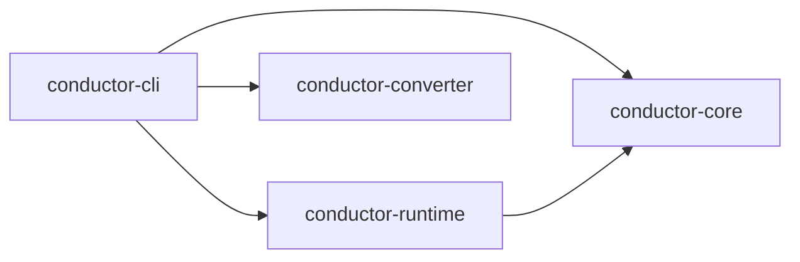

# 依存関係

## クレートのあいだの依存

テキストの代替: `conductor-cli` は、`conductor-core`、`conductor-runtime`、`conductor-converter` の 3 つに依存する。`conductor-runtime` は `conductor-core` に依存する。`conductor-core` と `conductor-converter` は、ほかのクレートに依存しない。循環は無い。

| 依存する側 | 依存される側 | 使うもの |
|------------|--------------|----------|
| runtime | core | 共有の型、時刻、`.env` の解析 |
| cli | core | 定義の型、判断と記録、試行の時刻、`pipeline_activity`、照合、`.env`、`graph`、`plan`、`RunId`、時刻、`escape_display`・`MAX_KEY_DISPLAY_CHARS`(`report`)、`Assumption`(`args`)、定義の読み込み(`deps` 経由) |
| cli | runtime | 起動、時計、待ち、command の検査、`.env` の読み取り、ステート、`create_file`(`deps::Runtime` 経由)、型、エラー型(`report` が表示) |
| cli | converter | `convert`、`TargetFormat`(`args` と `types`)、`ConversionError`(`report`) |

テストの側の依存: cli のテストは core・runtime の公開の口だけを使う。cli の `src/tests/` は crate の中のパス(`crate::args::parse_args`、`crate::report::…`)を使う。`tests/spec_numbers.rs` はクレートの関数を使わず、ソースのファイルを文字列として読む(core・runtime・cli のソース、仕様書、デモ)。

## クレートの中のモジュールの依存(要点)

- core: `definition` → {`error`、`run_id`、`envfile`(予約名)、`types`}。`definition::walk` の中は、`mod.rs` ↔ `retry.rs`・`env.rs`(子は親の `Walker`・中間の型・自由関数を `super::` で使い、親は子の `pub(super)` のメソッドと型を呼ぶ。下の表)。`graph::edges` → `flow`。`plan::simulate` → {`flow`(内部の入口)、`envfile`}。
- runtime: `state` と `file_create` → `temp_file` → `platform`。`state::reader` と `envfile` → `bounded_read`。`runner` → {`log`、`platform`}。
- cli: `lib` → {`args`、`ctx`、`report`}。`ctx` → {`run`、`pipeline`、`aux_commands`、`deps`、`run_id`、`report`}。`run`・`pipeline` → {`step`、`dry_run::enter_flow`}。すべての流れ → `report`、`exit`。`report` → {`types`、`deps`(`Env`・`Sink`)、`platform`(`color_supported`)}。`report::messages` → `report`(`StateContext`)。`panic_hook` → `report::messages`。`args` → `types`。

### この intent の 3 つのファイルの中と周りの依存

| ファイル | 中のまとまりの依存 | 周りとの依存 |
|----------|--------------------|--------------|
| `crates/cli/src/report/mod.rs` | `render` → 1 行の組み立て → エスケープ → core の `escape_display`。`render` → `messages`、`watch::render_table`、自分(`WatchFrame` の再帰)。`DisplayEvent` → `StateContext`・`ResultDetail`・`FramePrefix` | 子(`watch`・`graph_text`・`graph_dot`・`plan_text`)が `super::escape_*`・`super::push_line` を使う。`messages` が `crate::report::StateContext` を使う。流れ 7 ファイルとテストが型と `Reporter` を使う |
| `crates/core/src/definition/walk/mod.rs` | `walk` → `Walker` の各メソッド → 基本(`push`・`type_error`・`check_keys`)。`job`・`pipeline_head` → 値の読み取り、遷移、子のメソッド。`cross_check` → `check_exit_codes`、子の `check_retry`・`check_unset_env`。`walk` → `build_jobs` → 子の `build_retry` | 子の `env.rs` が `push`・`type_error`・`string`・`boolean`・`check_keys`・`PipelineHead`・`RawJob` を、`retry.rs` が `push`・`check_keys`・`RawJob`・`SuccessCodes`・`exit_code_of`・`integer_of` を使う。外は `definition/mod.rs:69` だけ。`spec_numbers.rs` がファイルを読む |
| `crates/cli/src/args.rs` | `parse_args`(字句)→ 表を引く関数 → `OPTIONS`。`parse_args` → `build_command` → `Given`・`CHECKS`・`operand_rule`・値の解釈。値の解釈 → `Opt::subject` | 外は `lib.rs:113` と `src/tests/args_grammar.rs:23` だけ。`types` の `RUN_ID_OPTION`・`--interval` の定数・`RunIdArg::parse` を使う |

## 外部の依存(直接)

版と目的は `technology-stack.md` の表を参照。

| クレート | 種類 | 依存する側 | 対象 |
|----------|------|------------|------|
| `toml` | 実行時 | core、runtime、converter | 全 OS |
| `thiserror` | 実行時 | core、runtime、converter | 全 OS |
| `lexopt` | 実行時 | cli | 全 OS |
| `saphyr-parser` | 実行時 | converter | 全 OS |
| `signal-hook` | 実行時 | cli | `cfg(unix)` |
| `ctrlc` | 実行時 | cli | `cfg(windows)` |
| `libc` | 実行時 | runtime | `cfg(unix)` |
| `tempfile` | 開発時 | 4 クレート | 全 OS |

## 推移的な依存(`Cargo.lock`、ワークスペースの外の 42 パッケージ)

| 系統 | パッケージ(版) |
|------|-----------------|
| `toml` の系 | `toml_parser`(1.1.5)、`toml_writer`(1.2.0)、`toml_datetime`(1.1.3)、`serde_spanned`(1.1.3)、`serde_core`(1.0.229)、`winnow`(1.0.5)、`indexmap`(2.14.2)、`hashbrown`(0.17.1)、`equivalent`(1.0.3) |
| `thiserror` の系(手続きマクロ) | `thiserror-impl`(2.0.21)、`syn`(3.0.10)、`quote`(1.0.47)、`proc-macro2`(1.0.107)、`unicode-ident`(1.0.27)、`serde_derive`(1.0.229) |
| `saphyr-parser` の系 | `arraydeque`(0.5.1) |
| `signal-hook` の系 | `signal-hook-registry`(1.4.8)、`errno`(0.3.15)、`libc`(0.2.191) |
| `ctrlc` の系 | `nix`(0.31.3)、`windows-sys`(0.61.2)、`dispatch2`(0.3.1)、`objc2`(0.6.5)、`objc2-encode`(4.1.0)、`block2`(0.6.2)、`bitflags`(2.13.2)、`cfg-if`(1.0.5)、`cfg_aliases`(0.2.2) |
| `tempfile` の系(開発時) | `fastrand`(2.5.0)、`getrandom`(0.4.3)、`rustix`(1.1.6)、`linux-raw-sys`(0.12.1)、`once_cell`(1.21.4)、`r-efi`(6.0.0)、`windows-link`(0.2.1) |

v0.10.2 → v0.10.3 の `Cargo.lock` の差は 4 クレートの版だけで、パッケージの増減は無い。

## 依存の方針と検査

- 新しい外部の依存を加えない(`project.md` の Forbidden、`team.md` の Code Style)。ファイルを分ける整理にも依存は要らない。
- C のコンパイルを要する依存と `-sys` クレート(`linux-raw-sys`・`windows-sys` を除く)を実行時の依存に持たない(`ci.yml` の `build-check`)。
- ネットワークのライブラリを持たない(`nfr_source.rs`)。
- 既知の脆弱性は `cargo audit` で見るが、マージを止めない。

## 文書と実装の依存

- 仕様書(`docs/spec/`)は実装を書き起こしたもので、実装が正。仕様書の数は `crates/cli/tests/spec_numbers.rs` が実装と結ぶ(実装 → 仕様書の向きの検査。実装のソースのパスに依存する)。モジュールの表(`docs/spec/rust/02-architecture.md` など)は検査されない。
- README は `crates/cli/src/tests/docs.rs`・`crates/cli/tests/msrv_consistency.rs`・CI の `docs-check` が実装と結ぶ。
- デモのスクリプトは `unix_demo.rs`・`windows_demo.rs` が実行して結び、場面の数は `spec_numbers.rs` が数える。

## 外部のシステムへの依存

- プロセスの起動、ファイルシステム、環境変数、シグナル、時計、端末だけ。データベース、ネットワークのサービス、クラウドの資源は無い。
