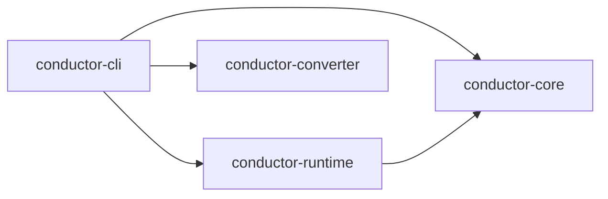

# Dependencies

## 内部の依存(crate 間)

| 依存元 | 依存先 | 使うもの |
|--------|--------|----------|
| conductor-cli | conductor-core | `load_definition`、`decide_before_run`、`classify_and_decide`、`resume_point_on_interrupt`、型(`PipelineDefinition`、`JobExecution`、`PipelineState`、`DefinitionError`、`RunId` ほか)、`peek_run_id_env`、`DEFAULT_RUN_ID_ENV`、`definition::intake::read_definition` |
| conductor-cli | conductor-runtime | `run_job`、`check_command`、`read_state`、`read_state_raw`、`write_state`、`reset_state`、`reset_all_states`、`apply_*`、`initial_state`、`check_consistency`、`InterruptSignal`、`StateLocation`、`Durability` ほか |
| conductor-cli | conductor-converter | `convert`、`ConversionRequest`、`TargetFormat`、`ConversionError` |
| conductor-runtime | conductor-core | 共有の型(`JobExecution`、`PipelineState`、`NextStep` など)と `RunId` |
| conductor-core | なし | |
| conductor-converter | なし(core に依存しない。定義の検証は `conductor run` などの読み込み時に core が行う) | |

- 循環はない。変更の影響は core の型(`JobDefinition` など)が最も広い: runtime と cli の両方が使う。
- 同じ規則のエスケープ関数が core・runtime・converter・cli に重複(コード上の依存ではなく、テストで揃えを検査)。

## 外部の依存

| ライブラリ | 版 | 使う crate | 対象 OS | 備考 |
|------------|-----|------------|---------|------|
| toml | 1.2.1 | core、runtime、converter | 全 | 推移: toml_parser 1.1.5、toml_datetime 1.1.3、toml_writer 1.2.0、serde_core/serde_spanned、winnow 1.0.5、indexmap 2.14.2 |
| thiserror | 2.0.21 | core、runtime、converter | 全 | proc-macro(syn 3.0.10、quote、proc-macro2) |
| saphyr-parser | 0.3.4 | converter | 全 | 推移: arraydeque 0.5.1、hashbrown 0.17.1 ほか |
| lexopt | 0.3.2 | cli | 全 | |
| signal-hook | 0.4.6 | cli | UNIX | signal-hook-registry 1.4.8 |
| ctrlc | 3.5.2 | cli | Windows(`Cargo.lock` には UNIX 向けの推移の `nix` 0.31.3、`objc2` なども載る) | |
| libc | 0.2.191 | runtime | UNIX | `unsafe` は `kill` の 1 か所 |
| tempfile | 3.27.0 | 4 crate(dev) | 全 | |

- 通常の依存に、C のビルドを要するもの・`-sys` crate(`linux-raw-sys`・`windows-sys` を除く)は入れない方針(CI で検査)。
- 実行時に外部のコマンド・サービスは要らない(ジョブとして定義に書かれたコマンドを起動するのは利用者の定義による)。
- 再試行の実装に追加の外部ライブラリは要らない見込み(間隔の待ちは `std::thread::sleep` で足りる。時刻のライブラリは持たない方針)。

## 実行時・運用上の依存

| 依存 | 内容 |
|------|------|
| ファイルシステム | 定義ファイルと同じディレクトリにステートファイルと一時ファイルを作る(書き込める必要がある。書けない場合は最初のジョブの前に 65) |
| 環境変数 | `LC_ALL`・`LC_MESSAGES`・`LANG`(言語)、`NO_COLOR`(色)、`CONDUCTOR_RUN_ID` または定義の `run_id_env` の名前の変数(run ID) |
| OS のシグナル | UNIX: SIGHUP・SIGINT・SIGQUIT・SIGTERM。Windows: Ctrl+C |
| スケジューラ | cron など(呼び出し側。終了コードで次を決める) |
| CI | GitHub Actions(`ci.yml`、`release.yml`、`audit.yml`)、`dtolnay/rust-toolchain`、`taiki-e/install-action`(cargo-llvm-cov) |
