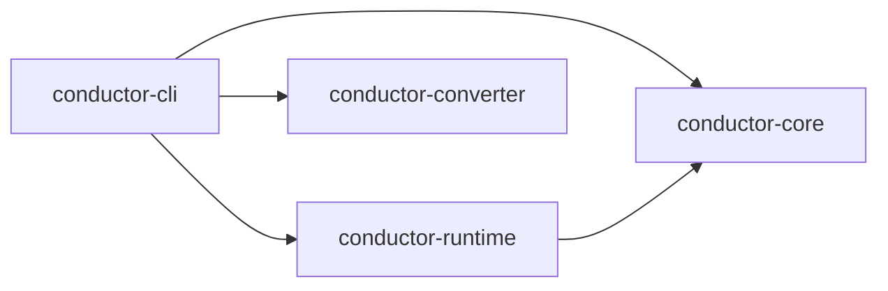

# 依存関係

## クレート間(内部)

テキストの代替: cli → runtime・core・converter。runtime → core。converter と core は、ほかの内部クレートに依存しない。

## 外部の依存

| クレート | 版 | 使うクレート | 条件 | 用途 |
|----------|----|--------------|------|------|
| `toml` | 1.2.1(default-features なし) | core(`parse`、`std`)、runtime・converter(+ `display`、`serde`) | 全 OS | 定義・ステートの読み書き |
| `thiserror` | 2.0.21 | core・runtime・converter | 全 OS | エラー型 |
| `saphyr-parser` | 0.3.4 | converter | 全 OS | YAML の読み取り |
| `lexopt` | 0.3.2 | cli | 全 OS | 引数の分割 |
| `signal-hook` | 0.4.6(`iterator` のみ) | cli | UNIX | シグナルの監視 |
| `ctrlc` | 3.5.2 | cli | Windows | Ctrl+C |
| `libc` | 0.2(ロック: 0.2.191) | runtime | UNIX | `kill` |
| `tempfile` | 3.27.0 | 全 4 クレート(dev) | テスト | 一時ディレクトリ |

`Cargo.lock` は 46 パッケージ。

## ビルド・検査の制約(CI)

- C のビルドが要る依存(`cc`・`cmake`・`pkg-config`・`bindgen`)と、`-sys` クレート(`linux-raw-sys`・`windows-sys` を除く)は禁止(`ci.yml:46-54`)。
- 最小の Rust 1.85.0 で、ビルドとテストが通ること。

## 実行時の依存

なし(単一の実行ファイル。外部ランタイム・ネットワーク不要)。ジョブとして起動するコマンドは、利用者の環境のもの。

## 開発・CI の道具

`cargo-llvm-cov`(+ `llvm-tools-preview`)、`cargo-audit`、`musl-tools`(Linux のリリースのビルド)、`7z`・`tar`・`sha256sum`(リリースの組み立て)、`gh`(下書きのリリース)。
