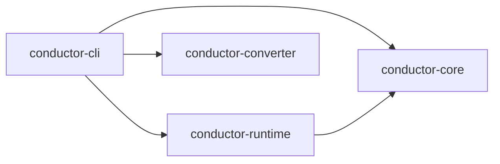

# 依存関係

## クレートのあいだの依存

テキストの代替: `conductor-cli` は、`conductor-core`、`conductor-runtime`、`conductor-converter` の 3 つに依存する。`conductor-runtime` は `conductor-core` に依存する。`conductor-core` と `conductor-converter` は、ほかのクレートに依存しない。循環は無い。

| 依存する側 | 依存される側 | 使うもの |
|------------|--------------|----------|
| runtime | core | 共有の型(`JobExecution`、`ExecutionResult`、`PipelineState`、`JobState`、`Attempt`、`Command`、`RunId`)、時刻(`Timestamp`、`format_compact`、`format_rfc3339`、`parse_rfc3339`)、`.env` の解析(`parse_env_file`、`LoadedEnvFiles`、`EnvFileError`) |
| cli | core | 定義の型、判断と記録、試行の時刻(`start_attempt`、`end_attempt`、`cancel_attempt`)、`pipeline_activity`、照合、`merge_env`、`env_file_refs`、`check_unset_conflicts`、`graph`、`plan`、`RunId`、時刻と所要時間、定義の読み込み(`deps` 経由) |
| cli | runtime | `run_job`、`now`、`wait_for`、`check_command`、`load_env_files`、ステートの読み書き、`create_file`(すべて `deps::Runtime` 経由)、`CommandLine`、`InterruptSignal`、`Durability`、`StateLocation`、`LogTarget`、`LogOutcome`、エラー型 |
| cli | converter | `convert`、`TargetFormat`、`ConversionError`(`deps::Runtime::convert` 経由) |

テストの側の依存: cli のテスト(`src/tests/` と `tests/`)は core・runtime の公開の口だけを使い、core の `tests/common/kinds.rs`(誤りの種類の写し)は core の統合テストの中だけで共有される。クレートの private の `const`(定義とステートのキーの表)は、どのテストからも見えない。

## クレートの中のモジュールの依存(要点)

- core: `definition` → {`error`、`run_id`、`envfile`(予約名)、`types`}。`types` → `time`。`time` → `types`(`job_duration` が `JobState` を読む)。`graph::edges` → `flow`(`resolve_transition`)。`plan::simulate` → {`flow`(公開の判断、内部の入口 `decide_at`・`classify_and_decide_at`・`apply_*_in`、`SimulationMarks`)、`envfile`(`merge_env_names`、`merge_unset_names`)}。`flow`・`consistency` → `types`。`types` と `time` は互いの型を使うが、同じクレートの中のモジュールで、関数の循環は無い。
- runtime: `state` と `file_create` → `temp_file` → `platform`。`state::reader` と `envfile` → `bounded_read`。`runner` → {`log`、`platform`}。`log` → `platform`(0600)。`state`・`file_create`・`platform` は互いの内部を使わない。
- cli: `lib` → `args`、`ctx` → {`run`、`pipeline`、`aux_commands`}。`run`・`pipeline` → {`step`、`dry_run::enter_flow`}。`step` → `ctx`。`aux_commands` → `platform`(`clear_screen_supported`)。すべての流れ → `report`、`exit`。`ctx` → `deps`、`run_id`。`deps` → `platform`。

## 外部の依存(直接)

版と目的は `technology-stack.md` の表を参照。ここでは依存する側と対象だけを書く。

| クレート | 種類 | 依存する側 | 対象 |
|----------|------|------------|------|
| `toml` | 実行時 | core、runtime、converter | 全 OS |
| `thiserror` | 実行時 | core、runtime、converter | 全 OS |
| `lexopt` | 実行時 | cli | 全 OS |
| `saphyr-parser` | 実行時 | converter | 全 OS |
| `signal-hook` | 実行時 | cli | `cfg(unix)` |
| `ctrlc` | 実行時 | cli | `cfg(windows)` |
| `libc` | 実行時 | runtime | `cfg(unix)` |
| `tempfile` | 開発時 | 4 クレート | 全 OS |

## 推移的な依存(`Cargo.lock`、ワークスペースの外の 42 パッケージ)

| 系統 | パッケージ(版) |
|------|-----------------|
| `toml` の系 | `toml_parser`(1.1.5)、`toml_writer`(1.2.0)、`toml_datetime`(1.1.3)、`serde_spanned`(1.1.3)、`serde_core`(1.0.229)、`winnow`(1.0.5)、`indexmap`(2.14.2)、`hashbrown`(0.17.1)、`equivalent`(1.0.3) |
| `thiserror` の系(手続きマクロ) | `thiserror-impl`(2.0.21)、`syn`(3.0.10)、`quote`(1.0.47)、`proc-macro2`(1.0.107)、`unicode-ident`(1.0.27)、`serde_derive`(1.0.229) |
| `saphyr-parser` の系 | `arraydeque`(0.5.1) |
| `signal-hook` の系 | `signal-hook-registry`(1.4.8)、`errno`(0.3.15)、`libc`(0.2.191) |
| `ctrlc` の系 | `nix`(0.31.3)、`windows-sys`(0.61.2)、`dispatch2`(0.3.1)、`objc2`(0.6.5)、`objc2-encode`(4.1.0)、`block2`(0.6.2)、`bitflags`(2.13.2)、`cfg-if`(1.0.5)、`cfg_aliases`(0.2.2) |
| `tempfile` の系(開発時) | `fastrand`(2.5.0)、`getrandom`(0.4.3)、`rustix`(1.1.6)、`linux-raw-sys`(0.12.1)、`once_cell`(1.21.4)、`r-efi`(6.0.0)、`windows-link`(0.2.1) |

`git diff v0.9.9 HEAD -- Cargo.lock` の差は 4 クレートの版の 8 行だけで、パッケージの増減は無い(v0.10.0 の機能と v0.10.1・v0.10.2 の直しは、依存を 1 つも増やしていない)。

## 依存の方針と検査

- 新しい外部の依存を加えない(`project.md` の Forbidden、`team.md` の Code Style)。仕様書と実装の数を突き合わせるテストも、標準ライブラリだけで書くことになる。
- C のコンパイルを要する依存と `-sys` クレート(`linux-raw-sys`・`windows-sys` を除く)を実行時の依存に持たない(`ci.yml` の `build-check` が `cargo tree` で検査)。
- ネットワークのライブラリを持たない(`crates/cli/tests/nfr_source.rs`、`crates/runtime/tests/nfr_source.rs`)。
- 既知の脆弱性は `cargo audit` で見るが、マージを止めない。
- `toml` は機能を絞って使う(core は `parse`・`std` だけで、書き出しを持たない)。

## 文書と実装の依存

- 仕様書(`docs/spec/`)は実装を書き起こしたもので、実装が正(`docs/spec/rust/00-README.md`)。仕様書からコードへの依存も、コード・テスト・CI から仕様書への依存も無い。
- README は、`crates/cli/src/tests/docs.rs`(必須の語句、例と実際の処理・出力の一致、使い方の行の揃い)と `crates/cli/tests/msrv_consistency.rs`(MSRV)と CI の `docs-check` が実装と結ぶ。
- デモのスクリプトは、`crates/cli/tests/unix_demo.rs`・`windows_demo.rs` が実行して結ぶ。

## 外部のシステムへの依存

- プロセスの起動(`std::process::Command`)、ファイルシステム、環境変数、シグナル(OS)、時計(`SystemTime`)、端末(標準出力が端末か。`IsTerminal`)だけ。データベース、ネットワークのサービス、クラウドの資源は無い。
- ジョブ自体は、利用者が定義に書く任意の実行ファイル。
