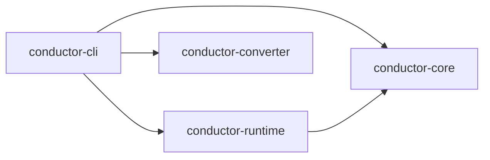

# 依存関係

## クレート間の依存(内部)

テキストの代替: cli は core、runtime、converter に依存する。runtime は core に依存する。core と converter は、ほかの内部のクレートに依存しない(converter は core を知らない)。

| クレート | 内部の依存 | 備考 |
|----------|------------|------|
| conductor-core | なし | 共有型(`PipelineDefinition`、`JobExecution`、`PipelineState` など)を定める |
| conductor-runtime | core | `JobDefinition`、`JobExecution`、`PipelineState`、`RunId` などを使う |
| conductor-converter | なし | 汎用の `Value` の木。定義のキーの意味を知らない |
| conductor-cli | core、runtime、converter | 調整役。差し替え口 `Runtime` が 3 つの実関数を束ねる |

循環はない。

## モジュール間の主な呼び出し(cli の中)

- `lib.rs` → `args`、`ctx`、`run`、`pipeline`、`aux_commands`、`report`
- `run` / `pipeline` → `ctx`、`retry`、`report`、core の `decide_before_run`・`classify_and_decide`・`resume_point_on_interrupt`、runtime の `apply_*`・`initial_state`
- `retry` → core の `retry_decision`、`Runtime::run_job`、`Runtime::wait`
- `ctx` → `deps`(`Runtime`、`Env`、`Signals`、`Sink`)、`args::resolve_run_id`、`report`、runtime の `check_consistency`
- `deps` → core(`load_definition`、`peek_run_id_env`、`definition::intake::read_definition`)、runtime(各関数)、converter(`convert`)、`platform`
- `report` → core の `DefinitionErrorKind`・`DecisionReason`、runtime の `StateErrorKind`・`CommandErrorKind`・`MismatchKind`、converter の `ConversionErrorKind`

## 外部の依存(Cargo.lock の版)

| クレート | 版 | 依存元 |
|----------|----|--------|
| toml | 1.2.1(spec 1.1.0) | core、runtime、converter |
| thiserror | 2.0.21 | core、runtime、converter |
| saphyr-parser | 0.3.4 | converter |
| lexopt | 0.3.2 | cli |
| signal-hook | 0.4.6 | cli(UNIX) |
| ctrlc | 3.5.2 | cli(Windows) |
| libc | 0.2.191 | runtime(UNIX) |
| tempfile | 3.27.0 | テスト |

推移的な依存は `Cargo.lock` に固定している(今回のスキャンでは展開していない)。脆弱性の検査は `audit.yml`(`cargo audit`、`continue-on-error`、警告のみ。毎週月曜 03:00 と PR)。

## ファイルを共有する型の依存(この intent に関わるもの)

- `JobDefinition` は core の `types.rs` が定義し、core の `walk.rs`(組み立て)、runtime の `runner.rs`(起動)、cli の `ctx.rs`・`retry.rs`・`deps.rs`(`Runtime` の署名)、および多数のテストが使う。
- `DefinitionErrorKind` は core が定義し、cli の `report/messages.rs`(英語の文)と `report/mod.rs` が使う。
- `Command`(`Line`/`Argv`)は core が定義し、runtime の `split.rs` が分け、cli の `ctx.rs` が表示のために使う。
- `UsageErrorKind::ALL` は cli の `types.rs` と `report_messages.rs` のテストが使う。
