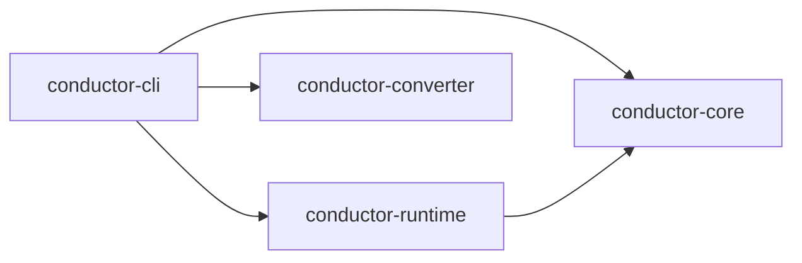

# Dependencies

## 内部の依存(クレート間)

テキストの代替: cli → core, runtime, converter / runtime → core。converter と core は、ほかの内部クレートに依存しない。循環は無い。

## 外部の依存

[technology-stack.md](technology-stack.md) の表のとおり(toml 1.2.1、thiserror 2.0.21、saphyr-parser 0.3.4、lexopt 0.3.2、signal-hook 0.4.6、ctrlc 3.5.2、libc 0.2、tempfile 3.27.0)。`Cargo.lock` を `--locked` で使う。推移的な依存は `Cargo.lock` に 40 余り(`rustix`、`nix`、`windows-sys`、`winnow` など)。

## 備考

- converter が core に依存しないため、cli が両方を橋渡しする。command の型を core で変えても、converter はコンパイルに影響を受けない。
- runtime は core の型(`JobDefinition`、`JobExecution`、`PipelineState` など)を使う。`JobDefinition.command` の型を変えると、runtime の `runner.rs`、`state/record.rs`、`state/consistency.rs` と、cli の `ctx.rs` がコンパイルに影響を受ける(`flow/` と各テストの組み立ても)。
- 脆弱性の検査は `cargo audit`(警告のみ、週次と PR)。メジャー版の遅れは確認していない。
