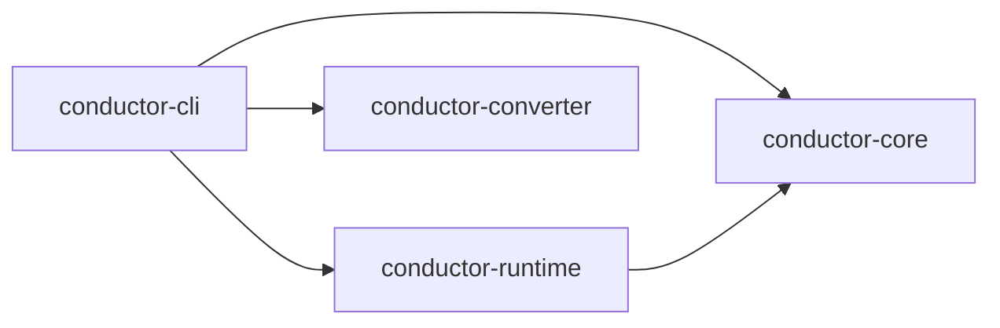

# 依存関係

## クレートのあいだの依存

テキストの代替: `conductor-cli` は、`conductor-core`、`conductor-runtime`、`conductor-converter` の 3 つに依存する。`conductor-runtime` は `conductor-core` に依存する。`conductor-core` と `conductor-converter` は、ほかのクレートに依存しない。循環は無い。

| 依存する側 | 依存される側 | 使うもの |
|------------|--------------|----------|
| runtime | core | 共有の型(`JobExecution`、`ExecutionResult`、`PipelineState`、`JobState`、`Command`、`RunId`)、`.env` の解析(`parse_env_file`、`LoadedEnvFiles`、`EnvFileError`、`MAX_ENV_FILE_BYTES`) |
| cli | core | 定義の型、判断(`decide_from_state`、`classify_and_decide`、`retry_decision`、`resume_point_on_interrupt`)、記録(`initial_state`、`apply_*`)、照合、`merge_env`、`env_file_refs`、`graph`、`plan`、`RunId`、`escape_display`、定義の読み込み(`deps` 経由) |
| cli | runtime | `run_job`、`wait_for`、`check_command`、`load_env_files`、ステートの読み書き、`create_file`(すべて `deps::Runtime` 経由)、`CommandLine`、`InterruptSignal`、`Durability`、`StateLocation`、エラー型 |
| cli | converter | `convert`、`TargetFormat`、`ConversionError`(`deps::Runtime::convert` 経由) |

## クレートの中のモジュールの依存(要点)

- core: `definition` → {`error`、`run_id`、`envfile`(予約名)、`types`}。`graph::edges` → `flow`(`resolve_transition`)。`plan::simulate` → {`flow`(判断と `apply_*_in`)、`envfile`(`merge_env_names`)}。`flow`・`consistency` → `types`。循環なし。
- runtime: `state` と `file_create` → `temp_file` → `platform`。`state::reader` と `envfile` → `bounded_read`。`runner` → `platform`。`state`・`file_create`・`platform` は互いの内部を使わない(`temp_file` の文書)。
- cli: `lib` → `args`、`ctx` → {`run`、`pipeline`、`aux_commands`}。`run`・`pipeline` → {`step`、`dry_run::enter_flow`}。`step` → `ctx`。すべての流れ → `report`、`exit`。`ctx` → `deps`、`run_id`。`deps` → `platform`。

## 外部の依存(直接)

| クレート | 版 | 種類 | 依存する側 | 対象 |
|----------|----|------|------------|------|
| `toml` | 1.2.1 | 実行時 | core、runtime、converter | 全 OS |
| `thiserror` | 2.0.21 | 実行時 | core、runtime、converter | 全 OS |
| `lexopt` | 0.3.2 | 実行時 | cli | 全 OS |
| `saphyr-parser` | 0.3.4 | 実行時 | converter | 全 OS |
| `signal-hook` | 0.4.6 | 実行時 | cli | `cfg(unix)` |
| `ctrlc` | 3.5.2 | 実行時 | cli | `cfg(windows)` |
| `libc` | 0.2 | 実行時 | runtime | `cfg(unix)` |
| `tempfile` | 3.27.0 | 開発時 | 4 クレート | 全 OS |

## 推移的な依存(`Cargo.lock`、ワークスペースの外の 42 パッケージの主なもの)

| 系統 | パッケージ(版) |
|------|-----------------|
| `toml` の系 | `toml_parser`(1.1.5)、`toml_writer`(1.2.0)、`toml_datetime`(1.1.3)、`serde_spanned`(1.1.3)、`serde_core`(1.0.229)、`winnow`(1.0.5)、`indexmap`(2.14.2)、`hashbrown`(0.17.1)、`equivalent`(1.0.3) |
| `thiserror` の系(手続きマクロ) | `thiserror-impl`(2.0.21)、`syn`(3.0.10)、`quote`(1.0.47)、`proc-macro2`(1.0.107)、`unicode-ident`(1.0.27)、`serde_derive`(1.0.229) |
| `saphyr-parser` の系 | `arraydeque`(0.5.1) |
| `signal-hook` の系 | `signal-hook-registry`(1.4.8)、`errno`(0.3.15)、`libc` |
| `ctrlc` の系 | `nix`(0.31.3)、`windows-sys`(0.61.2)、`dispatch2`(0.3.1)、`objc2`(0.6.5)、`block2`(0.6.2)、`bitflags`(2.13.2)、`cfg-if`、`cfg_aliases` |
| `tempfile` の系(開発時) | `fastrand`(2.5.0)、`getrandom`(0.4.3)、`rustix`(1.1.6)、`linux-raw-sys`(0.12.1)、`once_cell`(1.21.4)、`r-efi`(6.0.0)、`windows-link`(0.2.1) |

## 依存の方針と検査

- 新しい外部の依存を加えない(この intent の決定。`project.md` の Forbidden)。`.env` の読み込みと図の描画は自前で書く。
- C のコンパイルを要する依存と `-sys` クレート(`linux-raw-sys`・`windows-sys` を除く)を実行時の依存に持たない(`ci.yml` の `build-check` が `cargo tree` で検査)。
- ネットワークのライブラリを持たない(`crates/cli/tests/nfr_source.rs`、`crates/runtime/tests/nfr_source.rs` が `std::net`、`TcpStream`、`reqwest`、`hyper` などの不在を検査)。
- 既知の脆弱性は `cargo audit` で見るが、マージを止めない。
- `toml` は機能を絞って使う(core は `parse`・`std` だけで、書き出しを持たない)。

## 外部のシステムへの依存

- プロセスの起動(`std::process::Command`)、ファイルシステム、環境変数、シグナル(OS)だけ。データベース、ネットワークのサービス、クラウドの資源は無い。
- ジョブ自体は、利用者が定義に書く任意の実行ファイル。
