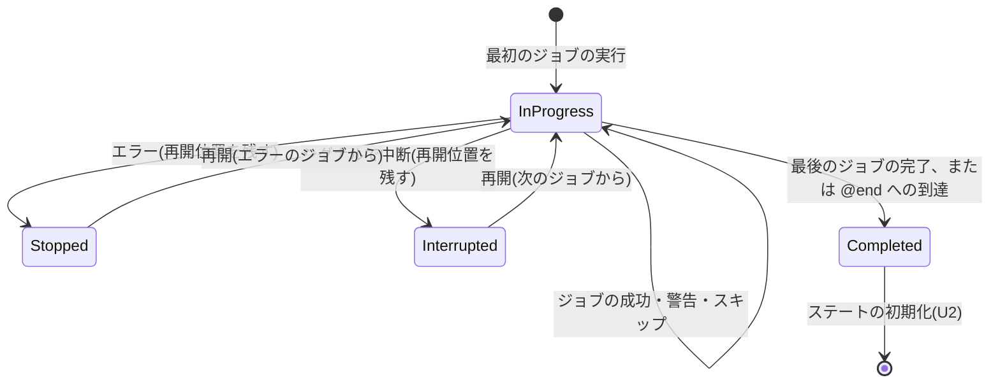
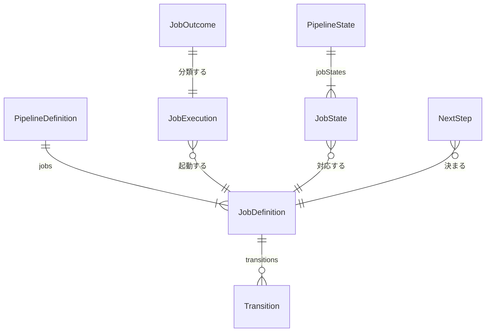

# Functional Spec(u1-core)

上流: entities(この Unit の entities.md)、rules(この Unit の rules.md)、unit-of-work、unit-of-work-story-map、stories、requirements、components、contract-summary。この Unit が実装するストーリー: US1.1、US1.2、US1.3、US2.1、US2.2、US2.3、US3.1、US3.2、US4.2、US4.3(他の Unit と分担するものを含む。unit-of-work-story-map を参照)。

この文書は、ワークフローと状態遷移の「正」である。データの形は entities.md、判断の規則は rules.md が正であり、ER 図と規則の要約は、そこから導いた参考の表示である。技術に依存しない記述で、コードは含まない。

## ワークフロー

### W1 定義の読み込みと検証(`load_definition`。DefinitionLoader。US1.1、US1.2、US1.3)

1. 定義ファイルの場所を決める。パスの指定があればそれ、なければ実行ディレクトリの `conductor.toml`。(BR4.1)
2. ファイルが存在しない、または読めなければ、`fileMissing` / `unreadable` を返して終わる。(BR1.9)
3. 書式の版を確認する。版が無ければ `versionMissing`、対応しない版なら `versionUnsupported` を返して終わる(他の検査はしない)。(BR1.7)
4. 知らないキー、型の誤りを検査する。(BR1.6、BR1.5)
5. ジョブの遷移を検査する: 遷移先の存在(BR1.1)、エラー結果への遷移先(BR1.2)、自分自身・前のジョブへの遷移先(BR1.3)。
6. 警告と成功の終了コードの重複、0 の警告指定を検査する。(BR1.4)
7. `pipeline` コマンドで渡された名前があれば、定義の `name` と比べる。(BR1.8)
8. 誤りが1つでもあれば、すべての誤り(ファイル・行・原因)を返して終わる。誤りがなければ、PipelineDefinition を返す。(BR1.11、BR1.12)

### W2 ジョブを起動する前の判断(`decide_before_run`。Flow。US2.2、US4.2、US4.3)

入力: ジョブID、PipelineDefinition、各ジョブの JobState(記録が無いジョブは、pending と同じ扱い)。出力: Decision。(BR3.5)

次の順に、最初に当てはまるものを採る。

1. そのジョブが、遷移によるスキップ(`byTransition`)として記録されている: `skip`(理由 `skipTarget`)。
2. そのジョブが、`@end` によるスキップ(`byEnd`)として記録されている、または `@end` に到達ずみで、そのジョブが `@end` より後ろにある: `skip`(理由 `afterEnd`)。
3. そのジョブが成功または警告で記録済み: `skip`(理由 `alreadyExecuted`)。(Q2: A)
4. そのジョブがエラーで記録済み、または再開位置(`resumeJobId`)と一致する: `run`。
5. ステートが空で、そのジョブが記述順で最初: `run`。
6. 記述順で、そのジョブより前のジョブがすべて、実行済み(成功または警告)またはスキップとして記録されていて、そのジョブが pending(または記録なし): `run`(次に実行する順番にある)。
7. 上のどれでもない: `reject`(理由 `outOfOrder`)。(Q1: A、BR3.8)

### W3 実行した後の分類と判断(`classify_and_decide`。Flow。US2.1、US2.2、US2.3、US3.1、US3.2、US4.2、US4.3)

入力: JobDefinition、JobExecution(`signalNumber` を含む)、各ジョブの JobState、PipelineDefinition、実行の方式(`runMode`: `individual` は個別実行、`pipeline` は一連の実行)。出力: JobOutcome と NextStep。

次の順に、最初に当てはまるものを採る。(BR2.3 の優先順位)

1. 起動しなかった中断(`started` が false で `interrupted`)なら、分類せず、そのジョブを再開位置にし、返す終了コードを 128 + `signalNumber` として、終わる。(BR2.4)
2. 中断(`started` が true で `interrupted`)なら、ジョブ自身の終了コードや `terminatedBySignal` の値にかかわらず、エラー、128 + `signalNumber` とし、そのジョブを再開位置にして、停止を返す。(BR2.3、BR3.4)
3. 起動失敗なら、エラー、127。そのジョブを再開位置にして、停止を返す。(BR2.3、BR3.4)
4. シグナルで終了していれば、エラー、128 + その番号。そのジョブを再開位置にして、停止を返す。(BR2.3、BR3.4)
5. それ以外は、終了コードを分類する。(BR2.1)
5. 返す終了コードを決める。成功・警告は 0、エラーはジョブの終了コードそのまま。成功コードに含まれない 0 は、1 にして、`conductorError` を true にする。(BR2.2)
6. 次の動きを決める。エラーなら停止(再試行しない)で、そのジョブを再開位置にする。(BR3.4)
7. 成功・警告なら、対応する遷移先を見る。遷移先がジョブIDなら、そのジョブを次の対象にし、間のジョブをスキップにする。(BR3.1、BR3.2)  `@end` なら、次の対象は無しで、以降をすべてスキップにし、`endReached` を true にする。(BR3.3)  遷移が書かれていなければ、記述順で次のジョブを次の対象にする。(BR1.10)
8. 完了を判定する。(BR3.6)
   - 記述順で最後のジョブが、実行(成功・警告)またはスキップで終わったなら、`runMode` によらず、`completed` を true にする。
   - `runMode` が `pipeline` で、`@end` に到達したなら、その場で終わるため、`completed` を true にする。
   - `runMode` が `individual` で、`@end` に到達したなら、`endReached` だけを true にし、`completed` は false のままにする。以降のジョブは、スケジューラから呼ばれ、W2 の 2 で `skip`(`afterEnd`)になり、最後のジョブがスキップされた時点で `completed` が true になる。
9. 再実行して、エラーだったジョブが成功・警告で終わったなら、再開位置(`resumeJobId`)は無しにし、次の対象を決める。`completed` のとき、再開位置は無し。(BR3.4)

### W4 ジョブとジョブのあいだで中断されたときの再開位置(`resume_point_on_interrupt`。Flow。US4.3)

入力: PipelineDefinition、各ジョブの JobState。出力: 再開位置、`endReached`、`completed`。(BR3.7)

1. 記述順で、まだ起動していない最初のジョブを、再開位置(resumeJobId)にする。
2. 最後のジョブの直後なら、再開位置は無しで、`completed` を true にする。`endReached` が true なら、その値を引き継ぐ。
3. エラーとしては記録しない。

## 状態遷移

### ジョブ(JobState の status)

| 現在 | きっかけ | 次 |
|------|----------|----|
| pending | 実行して成功した(BR2.1) | success |
| pending | 実行して警告で終わった(BR2.1) | warning |
| pending | 実行してエラーで終わった、起動失敗、シグナル終了、中断(BR2.3、BR3.4) | error |
| pending | 遷移で、間のジョブとしてスキップになった(BR3.2) | skipped(byTransition) |
| pending | `@end` により、以降のジョブとしてスキップになった(BR3.3) | skipped(byEnd) |
| error | 再実行して成功した | success |
| error | 再実行して警告で終わった | warning |
| error | 再実行して再びエラーで終わった | error |
| success / warning / skipped | 再び呼ばれた(BR3.5) | 変わらない(スキップとして扱い、0 で終わる) |

- `success`、`warning`、`skipped` は終端であり、パイプラインが完了して初期化されるまで変わらない。(初期化は U2 の責務)

### パイプライン(PipelineState の完了)

Text fallback: 進行中(InProgress)から、エラーで停止(Stopped)、シグナルで中断(Interrupted)、最後のジョブの完了または `@end` への到達で完了(Completed)になる。停止・中断からは、再開して進行中に戻る。完了すると、ステートは初期化される(U2 の責務)。

## 参考: ER 図(entities.md から導出)

## 参考: 規則の要約(rules.md から導出)

| 規則 | 内容 |
|------|------|
| BR1.1〜BR1.9 | 定義の検証(遷移先、エラーへの遷移、前向きのみ、重複、型、不明なキー、版、名前、ファイル) |
| BR1.10〜BR1.13 | 既定の遷移、受理、記述順、構造の制約(重複するジョブID、空の値など) |
| BR2.1〜BR2.4 | 分類、返す終了コード、起動失敗・シグナル・中断、起動しなかった中断 |
| BR3.1〜BR3.8 | 次の対象、スキップ、@end、停止と再開位置、起動前の判断、完了、中断時の再開位置、拒否 |
| BR4.1 | 定義ファイルの場所 |
| BR5.1 | conductor 自身のエラーの終了コード(64、65、66、67) |

## 他の Unit との分担(この Unit が実装しない部分)

- U2 u2-runtime: ジョブの直接起動と、環境の引き継ぎ(US2.1 の AC2.1.1、AC2.1.2)、ステートの保持と初期化(`reset` を含む)、ジョブの結果(JobExecution)の生成。
- U3 u3-cli: コマンドとオプションの受け付け(`--config`)、流れの組み立て、表示、スケジューラへ終了コードを返すこと、3つの OS での同じ結果(NFR3)の確認。

## 契約(contract-summary)への反映が必要な点

この Functional Design で、契約 C1・C2 に次を足す必要がある。契約を直すまでは、この Functional Design を優先する。
- C1 の JobExecution に `signalNumber`(受け取ったシグナルの番号)を足す。
- C2 の `classify_and_decide` の入力に、`signalNumber`(JobExecution に含まれる)と `runMode`(`individual` または `pipeline`)を足す。
- C2 の `decide_before_run` の Decision の理由(`skipTarget`、`afterEnd`、`alreadyExecuted`、`outOfOrder`)を明記する。

## Assumptions & Open Questions

- 判断の関数の引数の形(特に、各ジョブの JobState をどの形で渡すか)は、Code Generation で決める。 [assumption]
- 順序外の判定(BR3.5)の細部(遷移でスキップされた間のジョブが記録されることを前提とする)は、rules.md の前提に従う。 [assumption]
