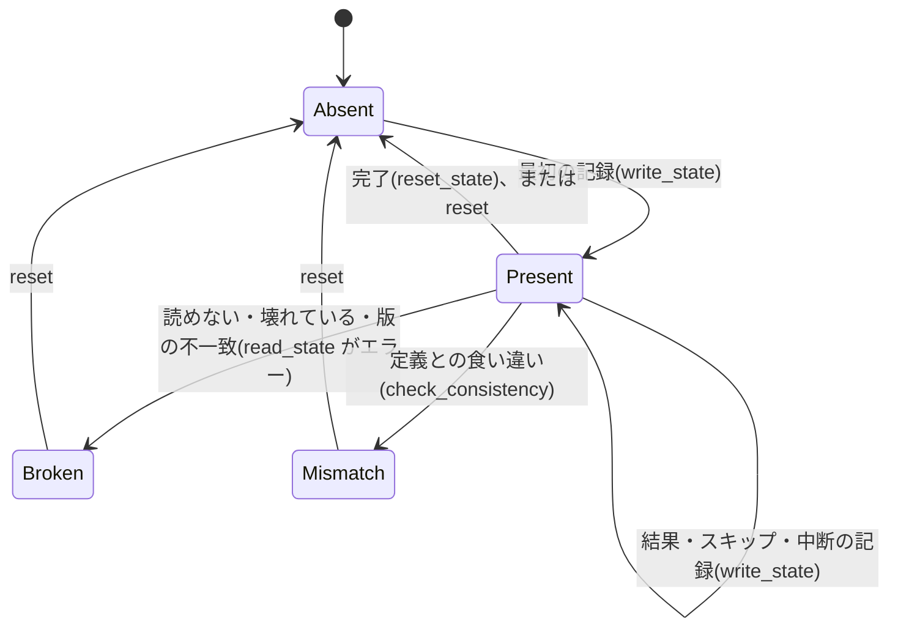
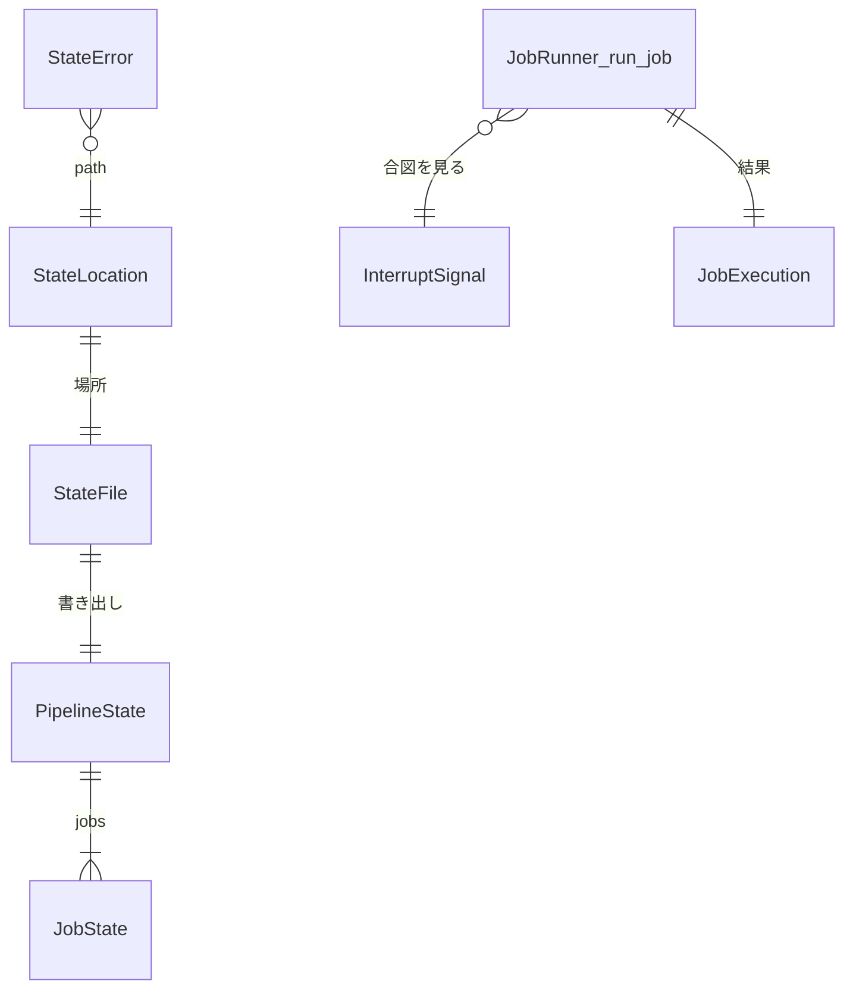

# Functional Spec(u2-runtime)

上流: entities(この Unit の entities.md)、rules(この Unit の rules.md)、unit-of-work、unit-of-work-story-map、stories、requirements、components、contract-summary、u1-core の functional-spec(W2〜W4 の判断。この Unit は、その結果を記録する)。この Unit が実装するストーリー: US2.1(AC2.1.1、AC2.1.2、AC2.1.5)、US2.2(状態の記録)、US2.5(AC2.5.1、AC2.5.2、AC2.5.6)、US3.2(状態の記録)、US4.1、US4.2、US4.3、US4.4、US5.1(状態の読み取り)、US6.1。unit-of-work-story-map のとおり、u1-core(分類と判断)、u3-cli(コマンド、表示、流れの組み立て)と分担する。

この文書は、ワークフローと状態遷移の「正」である。データの形は entities.md、判断の規則は rules.md が正であり、ER 図と規則の要約は、そこから導いた参考の表示である。技術に依存しない記述で、コードは含まない。

## ワークフロー

### W1 ジョブの起動(`run_job`。JobRunner。US2.1、US2.5)

入力: JobDefinition、InterruptSignal(Cli が用意する読み取り専用の合図)。出力: JobExecution。

1. command の文字列を、コマンド名と引数に分ける。(BR1.1)分けられないとき(閉じていない引用符、空)は、ここには来ない(Cli が、実行の前に、全ジョブを検査して、定義の誤りとして報告している)。来た場合は、起動失敗(startFailure)として返す(防御)。
2. 合図が、すでに立っていれば、ジョブを起動せず、`started = false`、`interrupted = true`、`signalNumber = 合図の番号` の JobExecution を返して終わる。(BR1.6)
3. ジョブを、シェルを介さずに、直接起動する。作業ディレクトリ、環境変数、標準入出力を引き継ぐ。(BR1.2、BR1.3)起動できなければ(見つからない、実行できない)、`started = true`、`startFailure = true` の JobExecution を返して終わる。(BR1.4)
4. ジョブの終了を待つ。時間切れにしない。(BR1.5)
5. 待っているあいだに、合図が立ったら、受け取ったシグナルを、ジョブに1回だけ転送する(UNIX 系。Windows は、OS が Ctrl+C を配るため、追加の送信はしない)。2回目以降の合図は、転送済みとして扱う。引き続き、ジョブの終了を待つ。(BR1.7)
6. ジョブの終了を観測する。終了コードがあれば `exitCode`、シグナルで終了したとき(UNIX 系)は `terminatedBySignal`。(BR1.4)
7. 観測の直後に、合図が立っていれば、`interrupted = true`、`signalNumber = 合図の番号` を足す。ジョブ自身の `exitCode` と `terminatedBySignal` は、そのまま持つ。(BR1.7)
8. JobExecution を返す。分類と終了コードの決定は、u1-core の Flow が行う。

### W2 ステートの読み取り(`read_state`。StateStore。US4.1、US5.1)

入力: 定義ファイルのパス。出力: PipelineState、または空、または StateError。

1. ステートファイルの場所を決める。(BR2.1)
2. ファイルが存在しなければ、空(初期状態)を返す。(BR2.3、AC5.1.2)
3. 読めなければ `unreadable`、大きさが上限を超えれば `tooLarge`、TOML の誤りや内容の誤りは `corrupt`、版が違えば `versionMismatch` を返す。(BR2.2、BR2.3)
4. 読めたが、`completed` が true のステートは、パイプラインの完了後の初期化が、失敗または中断されて残ったものとして、**空として返す**(BR2.3)。
5. 読めたら、PipelineState を返す。

### W3 ステートの書き込み(`write_state`。StateStore。US4.1)

入力: 定義ファイルのパス、PipelineState。出力: 成功、または StateError(writeFailed)。

1. 同じディレクトリに一時ファイルを作り、全内容(TOML、書式の版つき)を書き、ディスクへの書き込みを確かめる。(BR2.4)
2. 一時ファイルを、ステートファイルへ、置き換えで移す。(BR2.4)
3. 失敗したら、一時ファイルを消し、`writeFailed` を返す。

### W4 ステートと定義の照合(`check_consistency`。StateStore。US4.4)

入力: PipelineState、定義のジョブIDと記述順、パイプライン名。出力: ConsistencyResult。(BR2.5)

1. パイプライン名が違えば `mismatch(pipelineName)`。
2. ジョブIDの集合が違えば(追加・削除・改名)`mismatch(jobIds)`。
3. 集合が同じで、並びが違えば `mismatch(jobOrder)`。
4. どれでもなければ `ok`。

### W5 ステートの初期化(`reset_state`。StateStore。US6.1、US4.2)

入力: 定義ファイルのパス。出力: 成功、または StateError(removeFailed)。(BR2.6)

1. ステートファイルを読まずに、削除する(破損、食い違い、版の不一致の検査をしない)。
2. ファイルが存在しなければ、何もせず成功。

### W6 ステートへの記録(`initial_state`、`apply_outcome`、`apply_skip`、`apply_interrupt`。StateStore。US2.2、US3.2、US4.2、US4.3)

純粋な関数(入出力なし)。呼び出し側(Cli)が、結果を受け取り、記録して、`write_state` を呼ぶ。(BR2.8、BR2.9)

- `initial_state(定義, 定義ファイルのパス)`: すべてのジョブが `pending` の PipelineState。
- `apply_outcome(ステート, ジョブID, JobExecution, JobOutcome, NextStep)`: そのジョブの `status`(分類のとおり)と `exit_code`(JobExecution の exitCode そのまま)を書く。NextStep の `skippedJobIds` を、`skipped`(理由は `skipReasonKind`)にする。`resume_job_id`、`completed` を NextStep のとおりに書く。`end_reached` は、一度 true になったら、false に戻さない。
- `apply_skip(ステート, ジョブID, 理由, 定義)`: `decide_before_run` が `skip` を返したジョブを、`skipped` にする(`skipTarget` は byTransition、`afterEnd` は byEnd。`alreadyExecuted` は、書き換えない)。そのあと、u1-core の `resume_point_on_interrupt` を、定義とステートに対して呼び、`resume_job_id`、`end_reached`(一度 true になったら戻さない)、`completed` を書く。**個別実行で、最後のジョブがスキップされたとき、`completed` が true になる**(AC4.2.2、AC4.2.3)。
- `apply_interrupt(ステート, ResumePoint)`: ジョブを起動しない中断、またはジョブのあいだの中断の記録。`resume_job_id`、`end_reached`、`completed` を、u1-core の `resume_point_on_interrupt` のとおりに書く。エラーとしては記録しない。

完了(`completed`)のとき、呼び出し側は、記録したあとに、W5 を呼ぶ。(BR2.7)W5 の前に落ちる、または W5 が失敗すると、`completed` が true のステートが残るが、W2 が、それを空として扱うため、次の実行は、先頭から始まる。(BR2.3)

呼び出しの順序(契約 C2 の順序の続き): ステートが空のときの最初のジョブの前に、`initial_state` を書く(BR2.9)。ジョブごとに、`decide_before_run` → (run のとき)`run_job` → `classify_and_decide` → `apply_outcome` → `write_state`。skip のときは、`apply_skip` → `write_state`。**保証の範囲(at-least-once):** `run_job` の終了と `write_state` のあいだに落ちると、そのジョブは、次の呼び出しで、再実行される。(BR2.9)

## 状態遷移

ジョブの状態(JobState の status)と、パイプラインの完了の遷移は、**u1-core の functional-spec の「状態遷移」が正**である。この Unit は、その遷移を、W6 の関数で、ステートに書く。

### ステートファイル

Text fallback: ステートファイルは、なし(Absent)から、最初の記録で、あり(Present)になる。記録のたびに、ありのまま更新される。完了、または reset で、なしに戻る。読めない・壊れている(Broken)、定義との食い違い(Mismatch)は、ジョブを実行せず、reset でなしに戻す。

## 参考: ER 図(entities.md から導出)

## 参考: 規則の要約(rules.md から導出)

| 規則 | 内容 |
|------|------|
| BR1.1〜BR1.2 | command の分け方(3つの OS で同じ)。シェルを介さない直接起動 |
| BR1.3〜BR1.5 | 引き継ぎ、結果の区別、時間の上限なし・再試行なし |
| BR1.6〜BR1.7 | 起動前の中断、実行中の中断(シグナルの転送) |
| BR2.1〜BR2.2 | ステートの場所(定義ファイル名.state)、TOML・版つき |
| BR2.3〜BR2.4 | 読み取りの失敗、原子的な書き込み |
| BR2.5〜BR2.7 | 食い違いの検知、初期化(reset)、完了時の初期化 |
| BR2.8〜BR2.10 | 記録(結果・スキップ・中断)、記録のたびに書く、排他制御なし |

## 他の Unit との分担(この Unit が実装しない部分)

- U1 u1-core: 終了コードの分類と、返す終了コード、次の動き(遷移・スキップ・完了・再開位置)の判断、起動前の判断(実行・スキップ・拒否)。AC2.1.3、AC2.1.4、AC2.1.6 の分類、AC2.2.x の判断、AC4.2.x の完了の判断、AC4.3.1・AC4.3.2 の判断。
- U3 u3-cli: コマンドとオプションの受け付け、流れの組み立て(`decide_before_run` → `run_job` → `classify_and_decide` → 記録 → `write_state`)、シグナルの受け取りと合図の用意、command の検査(全ジョブ)を定義の誤りとして報告すること、ステートの誤り・食い違い・拒否の表示と終了コード、`watch` の表示、`reset` コマンド、起動時間(NFR1)の測定、3つの OS での同じ結果(NFR3)の確認。

## 契約(contract-summary)への反映が必要な点

この Functional Design で、契約 C3 と E3 に次を足す必要がある。契約を直すまでは、この Functional Design を優先する。
- C3 に、`check_command`(command の検査。BR1.1)、`initial_state`・`apply_outcome`(JobExecution を受け取る)・`apply_skip`(定義を受け取り、completed も書く)・`apply_interrupt`(記録。W6)を足す。`write_state` と `read_state` の入力は、定義ファイルのパス(ステートの場所を決める。Q1: A)。`check_consistency` の入力に、パイプライン名を足す。
- E3 に、`definition_path` を足し、`definition_key` を「定義ファイルのパス(照合には使わない)」と確定する。ステートファイルの場所を「定義ファイルと同じディレクトリの `<定義ファイル名>.state`」と確定する。

## Assumptions & Open Questions

- 競合(ジョブの終了と、シグナルの到着)の規則(BR1.7)は、決め打ちである。 [assumption]
- ジョブの終了と、ステートの書き込みのあいだに落ちたとき、ジョブが再実行される(at-least-once。BR2.9)。冪等でないジョブには、利用者側で注意が要る(利用者向けの説明は、README などで扱う)。 [assumption]
- SIGKILL などで conductor が強制終了されたとき、ジョブのプロセスが残りうる。この Unit は、検知も停止もしない。 [assumption]
- 定義ファイルのディレクトリが書き込めない場合(読み取り専用)は、この版では、使えない(最初のジョブの前に、writeFailed で止まる)。ステートの場所を指定する手段は、将来の拡張とする。 [assumption]
- 同時に実行された2つの conductor が、同じステートを書く場合は、後に書いた方が勝つ(排他制御をしない。BR2.10)。 [assumption]
