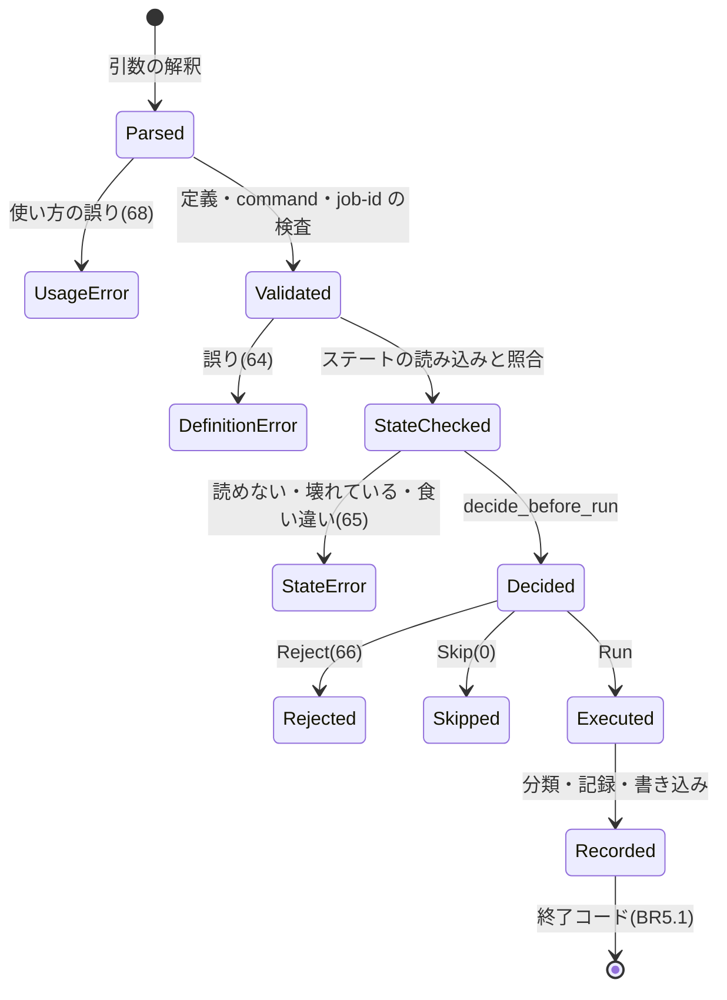

# Functional Spec(u3-cli)

上流: entities(この Unit の entities.md)、rules(この Unit の rules.md)、unit-of-work、unit-of-work-story-map、stories、requirements、components、contract-summary、u1-core・u2-runtime・u4-converter の functional-spec。この Unit が実装するストーリー: US1.3、US2.3、US2.4、US2.5(の一部)、US3.1、US3.2、US5.1、US6.1、US7.1(コマンドの部分)。他の Unit と分担するもの(US2.1、US2.2、US4.x など)は、それらが提供する関数を、この Unit が、正しい順序で呼ぶことで、利用者に届ける。

この文書は、ワークフローと状態遷移の「正」である。データの形は entities.md、判断の規則は rules.md が正であり、ER 図と規則の要約は、そこから導いた参考の表示である。技術に依存しない記述で、コードは含まない。

## ワークフロー

### W1 コマンドの受け付け(Cli。US1.3、US2.4)

1. 引数を解釈して、CliCommand を作る。使い方の誤りは、UsageError として、使い方を標準エラーに出して、終了コード 68 で終わる。(BR1.1〜BR1.3)
2. run・pipeline・watch・reset は、定義ファイルの場所を決める。(BR1.4)
3. run・pipeline は、シグナルを受け取る準備をして、中断の合図を用意する(定義の検査より前)。(BR4.1)
4. コマンドごとの流れ(W2〜W6)へ進む。

### W2 `conductor run <job-id>`(US1.3、US2.3、US2.4、US2.5、US4.x の呼び出し側)

1. 定義ファイルを読んで検証する(`load_definition`)。誤りがあれば、すべての誤りを表示して、終了コード 64。(BR2.1)
2. 全ジョブの command を検査する(`check_command`)。誤りがあれば、定義の誤りとして、終了コード 64。(BR2.1)
3. job-id が、定義になければ、UsageError(unknownJob)、終了コード 68。(BR2.1)
4. ステートを読む(`read_state`)。StateError なら、終了コード 65。(BR2.2)
5. ステートがあれば、定義と照合する(`check_consistency`)。Mismatch なら、reset を促して、終了コード 65。(BR2.2)
6. `decide_before_run` を呼ぶ。(BR2.3)
   - **Reject:** 理由を表示して、終了コード 66。ステートは変えない。
   - **Skip:** `apply_skip`、書き込み、(completed なら)初期化。-v なら表示。終了コード 0。(BR2.4)
   - **Run:** 次へ。
7. ステートが空なら、初期ステートを書く(`Fast`)。書けなければ、終了コード 65。(BR2.5)
8. `run_job` でジョブを実行する(合図つき)。(BR2.5)
9. `classify_and_decide`(実行の方式 Individual)で、JobOutcome と NextStep を得る。(BR2.5)
10. `apply_outcome` で記録し、`write_state`(`Durable`)で書く。失敗は、終了コード 65。(BR2.5)
11. NextStep が completed なら、`reset_state`。失敗は 65。(BR2.5)
12. 成功コードに含まれない 0 なら、原因を表示する。(BR2.6)
13. -v なら、結果と遷移を表示する。(BR6.3)終了コードは、JobOutcome の `reportedExitCode`(BR5.1、BR5.2)。

### W3 `conductor pipeline <pipeline-name>`(US3.1、US3.2)

1. W2 の 1〜5 と同じ検査(パイプライン名を、`load_definition` に渡す)。(BR3.1)
2. ステートが空なら、初期ステートを書く(`Fast`)。(BR3.2)
3. 定義の記述順に、次のジョブを決めて、くり返す。(BR3.2)
   - `decide_before_run`:`Skip` なら、`apply_skip` で記録して書き、次へ。`Reject` なら、終了コード 66。`Run` なら、W2 の 8〜11(実行の方式 Pipeline)。
   - ジョブが error で終わったら、停止し、ジョブの終了コードで終わる(再試行なし)。(BR3.4)
   - `completed`(最後のジョブの完了、`@end`)なら、`reset_state` して、終了コード 0。(BR3.3)
   - 次のジョブへ進む前に、合図が立っていれば、`resume_point_on_interrupt` と `apply_interrupt` で、再開位置を記録して、128 + 番号で終わる。(BR4.2)

### W4 `conductor watch`(US5.1)

定義ファイルの場所から、ステートを読み、一覧(ジョブID、状態、補足)を標準出力に1回出して終わる。空なら、空であることを表示する。StateError は 65。(BR7.1)

### W5 `conductor reset`(US6.1)

`reset_state` を呼ぶ。ステートがなくても、エラーにしない。終了コード 0。(BR7.2)

### W6 `conductor convert <file> --to <format>`(US7.1)

`convert` を呼び、変換結果を標準出力に書く。ConversionError は、標準エラーに表示して、終了コード 67。(BR7.3)

## 状態遷移

この Unit は、状態を持たない(永続する状態は、u2-runtime のステート)。1回の呼び出しは、引数の解釈から、終了コードまでを、1度で終える。

### 実行の流れ(run)

Text fallback: 引数の解釈 → 検査 → ステートの確認 → 起動前の判断。判断は、拒否(66)、スキップ(0)、実行のいずれか。実行は、記録して、終了コードで終わる。どの段階の誤りも、決められた終了コード(68、64、65)で終わる。

## 参考: 規則の要約(rules.md から導出)

| 規則 | 内容 |
|------|------|
| BR1.1〜BR1.5 | 5つのコマンド、`--config`、`-v` の範囲、定義ファイルの場所、単一の実行ファイル |
| BR2.1〜BR2.6 | 個別実行の検査、ステート、判断、スキップ、実行と記録、成功コードに含まれない 0 |
| BR3.1〜BR3.4 | 一括実行の検査、記述順の実行、完了と初期化、エラーで停止 |
| BR4.1〜BR4.3 | シグナルの受け取り、合図の確認、中断の終了コード |
| BR5.1〜BR5.3 | 終了コード、OS の範囲、3つの OS で同じ結果 |
| BR6.1〜BR6.5 | 言語、既定の表示、-v、エラーの組み立て、色 |
| BR7.1〜BR7.3 | watch、reset、convert |

## 他の Unit との分担(この Unit が実装しない部分)

- U1 u1-core: 定義の読み込みと検証、終了コードの分類、次の動き、起動前の判断、再開位置。
- U2 u2-runtime: ジョブの起動とシグナルの転送、ステートの保持・照合・初期化・記録。
- U4 u4-converter: 定義ファイルの変換。

## 契約(contract-summary)への反映が必要な点(この Functional Design で確定する)

この Functional Design で、契約に次を足す。契約を直すまでは、この Functional Design を優先する。

- **C2(u1-core):** `decide_before_run` の入力に、ステートの `resume_job_id` と `end_reached` を足す。`classify_and_decide` の入力に、`runMode`(Individual / Pipeline)を足す。Decision の理由(`skipTarget`、`afterEnd`、`alreadyExecuted`、`outOfOrder`)を明記する。`resume_point_on_interrupt` を、ジョブのあいだの中断の記録に使う(W3)。
- **C3(u2-runtime):** `check_command`、`initial_state`、`apply_outcome`(JobExecution を受け取る)、`apply_skip`(定義を受け取り、completed も書く)、`apply_interrupt` を足す。`read_state`・`write_state`・`reset_state` の入力は、定義ファイルのパス。`write_state` に、耐久性の指定(`Durable`/`Fast`)を足す。`check_consistency` の入力は、ステートと定義(パイプライン名を含む)。
- **E1(コマンド):** 使い方の誤りの終了コード 68 を足す。conductor 自身のエラーの具体の値を、64(定義)、65(ステート、食い違い)、66(拒否)、67(変換)、68(使い方)と確定する。`convert` の出力は、標準出力だけ。`--config` は run・pipeline・watch・reset、`-v` は run・pipeline だけ。
- **E2(定義ファイル):** ジョブを並べる表の名前を `job`(`[[job]]`、`[[job.transitions]]`)にする(Q1: A)。u1-core の実装の `jobs` を `job` に直す(この Unit の Code Generation の手順に含める)。
- **E3(ステートファイル):** u2-runtime の functional-design のとおり(`definition_path` の追加、ステートの場所)。

## Assumptions & Open Questions

- 一括実行のとき、`-v` の表示と、ジョブのあいだの中断の確認は、個別実行に準じる。詳細は、Code Generation で確定する。 [assumption]
- u1-core の functional-design の成果物(規則・契約)は、書き換えない。契約の差分は、この文書の「契約への反映が必要な点」と、各 Unit の code-summary の記録が、反映までの正である。 [assumption]
