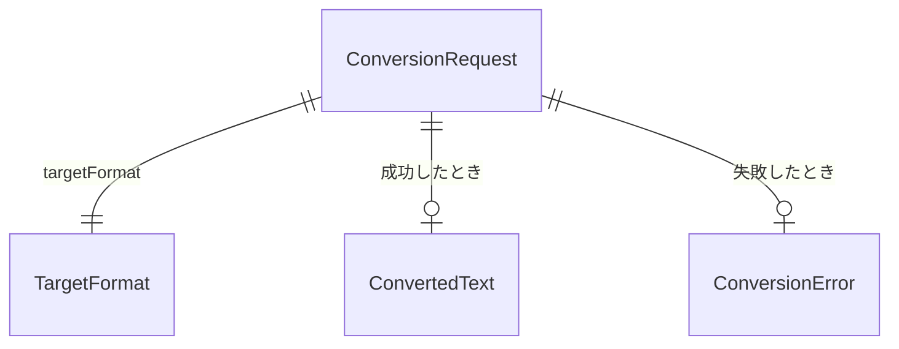

# Functional Spec(u4-converter)

上流: entities(この Unit の entities.md)、rules(この Unit の rules.md)、unit-of-work、unit-of-work-story-map、stories、requirements、components、contract-summary。この Unit が実装するストーリー: US7.1(AC7.1.1、AC7.1.2、AC7.1.3)。unit-of-work-story-map の US7.1 は、u3-cli(コマンドの受け付けと出力)と分担する。

この文書は、ワークフローの「正」である。データの形は entities.md、判断の規則は rules.md が正であり、ER 図と規則の要約は、そこから導いた参考の表示である。技術に依存しない記述で、コードは含まない。

## ワークフロー

### W1 定義ファイルの変換(`convert`。Converter。US7.1)

入力: ConversionRequest(inputPath、targetFormat)。出力: ConvertedText、または ConversionError。

1. 入力の形式を決める。targetFormat が toml なら YAML、yaml なら TOML。拡張子は見ない。(BR1.1)
2. 入力ファイルを開く。ファイルがなければ `fileMissing`、権限がない・通常のファイルでない・UTF-8 でなければ `unreadable`、大きさが上限(1 MiB)を超えれば `tooLarge` を返して終わる。(BR1.5)
3. 入力を、決めた形式として読む。文法が誤っていれば、`syntax`(位置が分かれば line つき)を返して終わる。(BR1.4、AC7.1.3)
4. 最上位がマップであることを確かめる。そうでなければ `rootNotMap` を返して終わる。空の TOML は、空のマップとして続ける。(BR1.8)
5. YAML のアンカーとエイリアスを展開する。(BR1.7)
6. キーと値の木を走査し、相手の形式で意味を変えずに表せない値(null、文字列でないキー、複数文書、TOML の日時、範囲を超える整数)があれば、`unrepresentable`(keyPath つき)を返して終わる。1つ見つかった時点で止めてよい。(BR1.6)
7. 木を、相手の形式の文字列に書き出す。コメントと、マップのキーの記述順は保持しない。配列の要素の順序は保つ。(BR1.2、BR1.3、AC7.1.1、AC7.1.2)
8. 文字列(ConvertedText)を返す。書き出し先への出力は、呼び出し側(Cli)が行う。(BR1.9)

失敗のときは、どの段階でも、出力を作らない。エラーの表示の内容は、固定の文と場所だけで組み立てる。(BR1.10)

## 状態遷移

この Unit は、状態を持たない。1回の呼び出しは、入力から出力(または失敗)までを、1度で終える。

## 参考: ER 図(entities.md から導出)

Text fallback: ConversionRequest(入力のパスと TargetFormat)から、成功すれば ConvertedText、失敗すれば ConversionError のどちらか1つが得られる。

## 参考: 規則の要約(rules.md から導出)

| 規則 | 内容 |
|------|------|
| BR1.1 | 入力の形式は、--to の反対 |
| BR1.2〜BR1.3 | 意味を保つ変換。コメントと順序は保持しない |
| BR1.4〜BR1.5 | 文法の誤り、読めない入力は、変換せず原因を返す |
| BR1.6〜BR1.8 | 表せない値、アンカーとエイリアスの展開、最上位がマップでない入力 |
| BR1.9〜BR1.10 | 結果は文字列で返す(書き出しは Cli)。エラー表示の組み立て |

## 他の Unit との分担(この Unit が実装しない部分)

- U3 u3-cli: `conductor convert <file> --to <format>` の受け付け、結果の標準出力・ファイルへの書き出しと、書き出しの失敗の報告、ConversionError の表示(Reporter)、非 0 の終了コード(conductor 自身のエラーの終了コード 67。rules の BR5.1 は u1-core の Functional Design)。
- U1 u1-core: 変換した結果の定義としての検証(`conductor run` などでの読み込み時)。

## Assumptions & Open Questions

- 変換の結果は、`conductor` が読める定義になるとは限らない(Q1: A)。定義としての正しさは、変換の利用者が、読み込み時に確かめる。 [assumption]
- 標準出力かファイルかの具体の指定(`--output` のような追加のオプション)は、u3-cli で決める。 [assumption]
