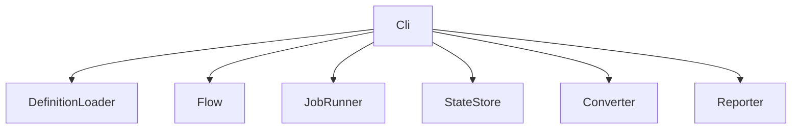

# Components(コンポーネント一覧)

上流: requirements(FR1〜FR7、NFR1〜NFR6)、stories(US1.1〜US7.1)、team-practices。ここでの部品は「作るコード」の論理的なまとまりであり、デプロイの形(`conductor` は単一バイナリ)や技術スタックは決めない。ファイルシステムなど、部品が使うものは外部依存として扱う。部品の分け方は中間の粒度とし、7つの部品にした。[Q1]、ADR-001

## Part A: 機械可読な一覧

```yaml
components:
  - name: Cli
    summary: コマンドとオプションを受け付け、各部品を呼び出して1回の実行を組み立てる調整役
    behaviour: >
      run / pipeline / watch / reset / convert の各コマンドと、--config、-v / --verbose
      を受け付ける。定義を読み、ステートを読み、Flow に次の動きを判断させ、JobRunner
      にジョブを起動させ、結果をステートに書き、Reporter に表示させる流れを組み立てる。
      スケジューラへ返す終了コードは、Flow が決めた値をそのまま返す(規則は Flow が持つ。ADR-008)。
      個別実行(run)と一連の実行(pipeline)の流れは、別々の手順として組み立て、
      大きくなったら、さらに分ける。
      シグナルは、Cli だけが OS から受け取る。ジョブの起動前に、中断の合図(JobRunner と
      共有する読み取り専用の合図)を用意して JobRunner に渡し、シグナルを受け取ったらその
      合図を立てる(ADR-007)。ジョブが動いていないとき(ジョブとジョブのあいだ、ステートの
      書き込み中)にシグナルを受けた場合は、進行中の書き込みを完了させ(書き込みは原子的に
      行う)、次のジョブは起動せずに、128 + シグナル番号で終了する。ステートには、次に実行する
      ジョブの位置が残る。
      他の部品どうしは直接呼び合わない(ADR-002)。
    responsibilities:
      - コマンドとオプションの解釈
      - 1回の実行の流れの組み立て(読み込み、判断、起動、記録、表示)
      - シグナルの受け取りと、中断の合図の用意
      - watch と reset の扱い(食い違い・破損のステートでの動きを含む)
    depends_on:
      - component: DefinitionLoader
        interaction: 定義ファイルを読み込み、検証してもらう
        style: sync
      - component: Flow
        interaction: 結果の分類、終了コード、次に実行・スキップするジョブ、完了と再開位置の判定を決めてもらう
        style: sync
      - component: JobRunner
        interaction: ジョブのコマンドを起動し、中断の合図を渡して、終了コードやシグナルを受け取る
        style: sync
      - component: StateStore
        interaction: ステートの読み込み、書き込み、初期化、定義との照合を頼む
        style: sync
      - component: Converter
        interaction: convert コマンドで定義ファイルを変換してもらう
        style: sync
      - component: Reporter
        interaction: 表示する内容(種類とデータ)を渡し、文言の組み立てと出力を頼む
        style: sync
    dependents: []
    external_dependencies:
      - name: OS のシグナル
        kind: other
        purpose: シグナルを受け取り、中断の合図を立てる
    entities: []

  - name: DefinitionLoader
    summary: 定義ファイル(conductor.toml)を読み、構造と内容を検証する
    behaviour: >
      定義ファイルを読み込み、パイプラインの名前と説明、各ジョブ(ID、コマンド、
      警告・成功の終了コード、遷移ルール)を取り出す。起動時に検証する: 存在しない
      ジョブID、エラー結果への遷移先、自分自身や記述順で前のジョブへの遷移先、
      警告と成功の重複、0 の警告指定、型の誤り、パイプライン名の不一致。
      誤りがあれば、ファイル名・行・原因を返す。型の誤りの事前検知(NFR4)は、この部品が担う。
      定義ファイルは、既定で実行ディレクトリの conductor.toml とし、--config で別のパスを
      指定できる。
    responsibilities:
      - 定義ファイルの読み込み
      - 定義の検証と、誤りの位置・原因の報告(型の誤りを含む)
      - ジョブの記述順の保持
    depends_on: []
    dependents:
      - component: Cli
        interaction: 定義ファイルを読み込み、検証してもらう
    external_dependencies:
      - name: ローカルのファイルシステム
        kind: other
        purpose: 定義ファイルの読み取り
    entities:
      - name: PipelineDefinition
        identifier: name
        attributes: [name, description, jobs]
        references: []
      - name: JobDefinition
        identifier: id
        attributes: [id, command, warningExitCodes, successExitCodes, transitions]
        references: []

  - name: Flow
    summary: 結果の分類、返す終了コード、次に実行・スキップするジョブ、完了と再開位置を決める(入出力を持たない判断ロジック)
    behaviour: >
      終了コードを、成功(成功コードを書かなければ 0 のみ、書けばその値だけ)・警告・エラーに
      分類する。成功コードに含まれない 0 はエラーとする。分類結果から、スケジューラへ返す
      終了コードを決める(警告は 0、エラーはジョブの終了コードをそのまま、成功コードに含まれない 0 は 1、
      起動失敗は 127、シグナル終了は 128 + シグナル番号)。分類結果と遷移ルールから、
      次に実行するジョブと、スキップするジョブ(現在と遷移先のあいだ)を決める。
      @end 以降のジョブは、すべてスキップにする。記述順で最後のジョブが実行またはスキップで
      終わったとき、または一連の実行で @end に到達したときを、完了と判定する。
      エラーで終わったときは停止とし、再開の位置(エラーになったジョブ)を決める。
      ファイルやプロセスには触れず、必要な情報はすべて引数で受け取り、結果を値として返す。
      受け取る情報と返す結果の形は、下のエンティティで示す。
    responsibilities:
      - 終了コードの分類と、返す終了コードの決定
      - 遷移・スキップ・ジャンプの判断
      - 完了と再開位置の判定
    depends_on: []
    dependents:
      - component: Cli
        interaction: 結果の分類、終了コード、次の動き、完了と再開位置の判定を決めてもらう
    external_dependencies: []
    entities:
      - name: JobOutcome
        identifier: jobId
        attributes: [jobId, classification, reportedExitCode]
        references:
          - entity: JobExecution
            owned_by: JobRunner
            relationship: 各 JobOutcome は、1回のジョブの実行結果(JobExecution)を分類したものである
      - name: NextStep
        identifier: jobId
        attributes: [jobId, nextJobId, skippedJobIds, skipReasonKind, endReached, completed, resumeJobId]
        references:
          - entity: JobDefinition
            owned_by: DefinitionLoader
            relationship: 各 NextStep は、遷移ルールを持つ JobDefinition に基づいて決まる

  - name: JobRunner
    summary: ジョブのコマンドを、シェルを介さず直接起動し、終了コードとシグナルを扱う
    behaviour: >
      コマンド文字列を、コマンド名と引数に分けて、シェルを介さずに起動する。作業ディレクトリと
      環境変数は conductor から引き継ぐ。ジョブの標準出力・標準エラーは、そのまま通す。
      起動できないとき、シグナルで終了したとき、終了コードがあるときを区別して返す。
      時間制限は設けない。ジョブの待機中は、Cli から渡された中断の合図を監視し、合図が立ったら、
      受け取ったシグナルをジョブにも転送し(Windows では終了の要求に読み替える)、ジョブの終了を
      待ってから、シグナルで終わった実行結果(中断された)として返す(ADR-007)。
      OS ごとの違いは、この部品に閉じ込める。
    responsibilities:
      - コマンドの分割と直接起動
      - 終了コード・起動失敗・シグナル終了の区別
      - 中断の合図の監視と、シグナルのジョブへの転送
    depends_on: []
    dependents:
      - component: Cli
        interaction: ジョブを起動し、結果を受け取る
    external_dependencies:
      - name: OS のプロセス管理
        kind: other
        purpose: ジョブのコマンドの起動、シグナルの送信、終了の待機
    entities:
      - name: JobExecution
        identifier: jobId
        attributes: [jobId, command, exitCode, terminatedBySignal, startFailure, interrupted]
        references:
          - entity: JobDefinition
            owned_by: DefinitionLoader
            relationship: 各 JobExecution は、1つの JobDefinition に基づいて起動される

  - name: StateStore
    summary: ステートファイルを安全に保持し、破損と定義との食い違いを検知する
    behaviour: >
      実行ディレクトリの近傍のステートファイルに、ジョブごとの結果、スキップ・ジャンプ、
      エラーの位置(再開位置)、@end への到達、定義のジョブ構成(ID と記述順)を保持する。
      書き込みは、中断されても壊れた内容が残らないように、原子的に行う。読み込み時に、
      読めない・壊れているときは、パスと原因を返す。定義のジョブ構成(IDと記述順だけ)を
      引数で受け取り、ステートに記録されたものと食い違うときは、食い違いを返す(ADR-004)。
      初期化(パイプライン完了時の自動初期化、reset)を行う。reset の初期化は、食い違い・破損の
      検査を迂回して行う(破損したステートも初期化できる)。ステートは定義ファイル1つにつき1つ。
      ステートの内容の型の誤りの検知(NFR4)は、この部品が担う。
    responsibilities:
      - ステートの読み込みと、破損の検知
      - ステートの安全な書き込み
      - 定義とステートの食い違いの検知
      - ステートの初期化(検査を迂回する reset を含む)
    depends_on: []
    dependents:
      - component: Cli
        interaction: ステートの読み込み、書き込み、初期化、定義との照合を頼む
    external_dependencies:
      - name: ローカルのファイルシステム
        kind: other
        purpose: ステートファイルの読み書き(原子的な更新)
    entities:
      - name: PipelineState
        identifier: definitionKey
        attributes: [definitionKey, pipelineName, definitionPath, jobStates, jobOrder, resumeJobId, endReached, completed]
        references:
          - entity: PipelineDefinition
            owned_by: DefinitionLoader
            relationship: 各 PipelineState は、1つの PipelineDefinition に対応する
      - name: JobState
        identifier: jobId
        attributes: [jobId, status, exitCode, skipReason]
        references:
          - entity: JobDefinition
            owned_by: DefinitionLoader
            relationship: 各 JobState は、1つの JobDefinition に対応する

  - name: Converter
    summary: 定義ファイルを YAML と TOML のあいだで変換する
    behaviour: >
      入力ファイルを読み、キーと値の意味が同じになるように、指定された形式で出力する。
      コメントと記述順は保持しない。入力が読めない、または文法が誤っているときは、変換せずに
      原因を返す。
    responsibilities:
      - YAML と TOML の相互変換
      - 変換できないときの原因の報告
    depends_on: []
    dependents:
      - component: Cli
        interaction: convert コマンドで定義ファイルを変換してもらう
    external_dependencies:
      - name: ローカルのファイルシステム
        kind: other
        purpose: 入力の読み取りと、出力の書き出し
    entities: []

  - name: Reporter
    summary: conductor 自身の表示(-v、watch、エラー)を組み立て、環境のロケールに合わせた文言で出力する
    behaviour: >
      Cli から、表示の種類(ジョブの結果、スキップ、遷移、状態の一覧、エラー)とデータを受け取り、
      文言を組み立てて出力する。既定では conductor 自身の表示は出さず、-v / --verbose で有効に
      する(エラーは常に表示する)。文言の言語は、環境のロケールに従う(英語と日本語)。
      状態は色だけでなく文字でも表し、端末以外への出力では色を無効にする。
      watch は、ジョブID・状態・補足の3列の一覧を、1回表示して終了する。食い違い・破損のステートに
      対する watch は、一覧の代わりに原因(パスと理由)を表示する。ロケールの判定は、必要になる
      ときまで行わない(起動の速さのため)。
    responsibilities:
      - 表示の種類ごとの文言の組み立て
      - ロケールに応じた言語の選択
      - 色の有効・無効の切り替え
      - watch の一覧の整形
    depends_on: []
    dependents:
      - component: Cli
        interaction: 表示する内容(種類とデータ)を渡し、出力を頼む
    external_dependencies:
      - name: 環境のロケール・標準出力
        kind: other
        purpose: 言語の判定と、端末かどうかの判定、出力
    entities:
      - name: DisplayEvent
        identifier: kind
        attributes: [kind, subject, data]
        references:
          - entity: JobOutcome
            owned_by: Flow
            relationship: ジョブの結果の表示は、JobOutcome の内容を元データにする
          - entity: JobState
            owned_by: StateStore
            relationship: 状態の一覧の表示は、JobState の内容を元データにする
```

## Part B: 人が読むための表示

### Component Diagram



Text fallback: `Cli` が、`DefinitionLoader`、`Flow`、`JobRunner`、`StateStore`、`Converter`、`Reporter` の6つを呼び出す。6つの部品どうしは、直接呼び合わない。

### Component Summary

| Component | Purpose | Depends On | Dependents | Entities Owned |
|-----------|---------|------------|------------|----------------|
| Cli | コマンドの受け付けと、1回の実行の組み立て | DefinitionLoader、Flow、JobRunner、StateStore、Converter、Reporter | なし | なし |
| DefinitionLoader | 定義ファイルの読み込みと検証 | なし | Cli | PipelineDefinition、JobDefinition |
| Flow | 分類・終了コード・遷移・完了の判断(入出力なし) | なし | Cli | JobOutcome、NextStep |
| JobRunner | ジョブの直接起動、終了コード・シグナルの扱い | なし | Cli | JobExecution |
| StateStore | ステートの保持、破損・食い違いの検知、初期化 | なし | Cli | PipelineState、JobState |
| Converter | YAML と TOML の相互変換 | なし | Cli | なし |
| Reporter | 表示の組み立てとロケール対応 | なし | Cli | DisplayEvent |

### Entity Ownership

| Entity | Owning Component | Identifier | Attributes | References |
|--------|------------------|------------|------------|------------|
| PipelineDefinition | DefinitionLoader | name | name、description、jobs | なし |
| JobDefinition | DefinitionLoader | id | id、command、warningExitCodes、successExitCodes、transitions | なし |
| JobOutcome | Flow | jobId | jobId、classification、reportedExitCode | JobExecution(JobRunner) |
| NextStep | Flow | jobId | jobId、nextJobId、skippedJobIds、skipReasonKind、endReached、completed、resumeJobId | JobDefinition(DefinitionLoader) |
| JobExecution | JobRunner | jobId | jobId、command、exitCode、terminatedBySignal、startFailure、interrupted | JobDefinition(DefinitionLoader) |
| PipelineState | StateStore | definitionKey(仮) | definitionKey、pipelineName、definitionPath、jobStates、jobOrder、resumeJobId、endReached、completed | PipelineDefinition(DefinitionLoader) |
| JobState | StateStore | jobId | jobId、status、exitCode、skipReason | JobDefinition(DefinitionLoader) |
| DisplayEvent | Reporter | kind | kind、subject、data | JobOutcome(Flow)、JobState(StateStore) |

- PipelineState の識別子 `definitionKey` は仮のものである。別パスの定義ファイルを指定したときの紐づけの方式(定義ファイルのパスを含めるか、パイプライン名だけにするか)は、Functional Design で決める。決めるまで、パイプライン名とパスの組み合わせを前提にする。
- JobState の `status` と `skipReason` で、次のことを表せる。成功・警告・エラー・スキップ・未実行の区別、スキップの理由(警告などの遷移による、または `@end` による)、エラーの位置(PipelineState の `resumeJobId`)、`@end` への到達(PipelineState の `endReached`)。

### データ型のみの依存(呼び出しの辺ではないもの)

部品どうしは、Cli を通してしか呼び合わない(ADR-002)。一方、Cli が部品のあいだで運ぶ値は、他の部品のエンティティの形に依存する。これは、呼び出しの依存ではなく、データの形だけの依存であり、上の図の辺には含めない。

| 受け取る側 | 形に依存するエンティティ(所有部品) | 内容 |
|------------|--------------------------------------|------|
| Flow | JobDefinition(DefinitionLoader)、JobState(StateStore)、JobExecution(JobRunner) | 遷移ルール、これまでの状態、ジョブの実行結果を、引数として受け取る |
| Reporter | JobOutcome(Flow)、JobState(StateStore) | 表示の元データとして受け取る |
| StateStore | PipelineDefinition(DefinitionLoader)の、ジョブIDと記述順だけ | 定義との照合のために、引数として受け取る |
| JobRunner | JobDefinition(DefinitionLoader) | 起動するコマンドと、成功・警告の終了コードの扱いを受け取る |

### External Dependencies

| Component | Dependency | Kind | Purpose |
|-----------|------------|------|---------|
| Cli | OS のシグナル | other | シグナルの受け取りと、中断の合図を立てること |
| DefinitionLoader | ローカルのファイルシステム | other | 定義ファイルの読み取り |
| JobRunner | OS のプロセス管理 | other | ジョブの起動、シグナルの送信、終了の待機 |
| StateStore | ローカルのファイルシステム | other | ステートファイルの原子的な読み書き |
| Converter | ローカルのファイルシステム | other | 入力の読み取りと出力の書き出し |
| Reporter | 環境のロケール・標準出力 | other | 言語と端末かどうかの判定、出力 |

### Rationale

| Component | なぜ独立した部品か |
|-----------|--------------------|
| Cli | 1回の実行の流れを組み立てる、唯一の調整役。他の部品は、互いを知らずに済む(ADR-002) |
| DefinitionLoader | 定義ファイルの形式と検証は、定義の書き方が変わったときだけ変わる。独立した関心事である |
| Flow | 分類、終了コード、遷移の判断は、入出力を持たないため、単体でテストしやすい。変更の理由(遷移・終了コードの仕様)が他と異なる(ADR-005、ADR-008) |
| JobRunner | OS のプロセス・シグナルの扱いは、OS ごとの違いが大きく、変更の理由が他と異なる(複数 OS 対応のリスクを閉じ込める)。シグナルの転送もここで受け持つ(ADR-007) |
| StateStore | ステートの安全な書き込みと整合は、固有のライフサイクルを持つ。ステート形式の変更は、他の部品に波及させたくない(ADR-004) |
| Converter | 他の部品に依存しない独立した機能で、優先度(Should)と提供のタイミングが異なる |
| Reporter | 表示と言語の切り替えは、変更の速度(文言の追加)が他と異なる。他の部品を文言に依存させない(ADR-003) |

**Alternatives Rejected(分け方):** 細かく分ける案(「結果の分類」を Flow から独立させるなど、8部品)と、粗く分ける案(4部品)は、ADR-001 で退けた。

### 品質特性を担う部品

| 要件 | 担う部品 | 補足 |
|------|----------|------|
| NFR1 起動オーバーヘッド(100ms 以内) | Cli の起動経路、DefinitionLoader、StateStore、Reporter | 定義とステートの読み込みと、ロケールの判定が、起動経路に乗る。Reporter のロケール判定は、必要になるまで行わない。Construction で、3つの OS で測る |
| NFR4 型の誤りの事前検知 | DefinitionLoader(定義)、StateStore(ステート) | ジョブの起動より前に、検知して拒否する |
| NFR3 3つの OS 対応 | JobRunner(OS ごとの違いの閉じ込め)、StateStore(ファイルの原子的な更新) | CI(GitHub Actions)で検証する |

## Assumptions & Open Questions

- Cli を調整役とし、他の6部品は互いを呼ばない構成にした(ADR-002)。要件・ストーリーの「個別実行」と「一連の実行」のどちらも、同じ部品の組み合わせで実現できることを前提にしている。 [assumption]
- 属性の名前(`warningExitCodes` など)は、所有と形を示すための仮の名前であり、型・制約・値の範囲は Functional Design で定める。 [assumption]
- 個別実行で、順序外のジョブが呼ばれた場合と、実行済みのジョブが再び呼ばれた場合の動作は、Flow の判断ロジックに関わるため、Functional Design で決める(requirements の未解決事項)。 [assumption]
- ステートファイルの名前と保存場所の具体、別パスの定義ファイルを指定したときのステートの紐づけ(PipelineState の識別子 `definitionKey` を含む)は、Functional Design で決める(requirements の未解決事項)。 [assumption]
- 食い違い・破損のステートに対する `watch` は、一覧の代わりに原因を表示して、非0で終了するものとした。具体の終了コードは、設計で定める。 [assumption]
- 中断の合図の仕組み(共有フラグ、チャネルなど)の具体は、Functional Design で定める。このステージでは、責務の分担(Cli が受け取り、JobRunner が転送する)だけを確定する。 [assumption]
