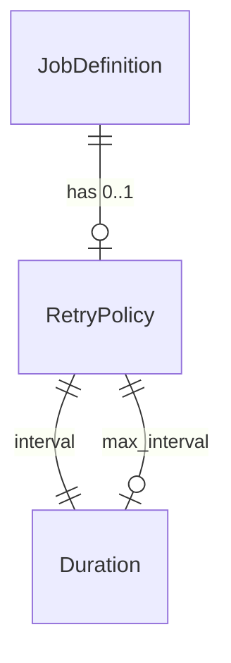

# Functional Spec — u1-retry-config

この Unit の振る舞いの仕様。リトライの設定を、定義から読み取って検証し、実行側(u2)へ渡す形にする。入力: `unit-of-work.md`(U1)、`unit-of-work-story-map.md`、`requirements.md`、`functional-design-questions.md`(Q1〜Q6)。コンポーネントの一覧(`components.md`)は、Domain Design を省いたため、ない。既存のコードの構造(`aidlc/spaces/default/codekb/rust-job-conductor/` の `code-structure.md`、`architecture.md`)を、事実上の設計として扱う。

この Unit が担当する要件: FR1.1〜FR1.9、FR7.1、FR7.2(FR1.2、FR1.6 の動きの側は U2)。

## 定義ファイルの書き方(決めた形)

`conductor.toml` の、ジョブの下に、専用の表 `[job.retry]` を書く。(Q1: A)YAML でも、同じ内容を `retry:` の下に書ける(変換は項目の中身に依存しない)。

```toml
[[job]]
id = "load"
command = "python scripts/load.py"
success_exit_codes = [0]

[job.retry]
exit_codes = [75, 111]      # 必須。1〜255。この終了コードのときだけリトライ
max = 3                     # 必須。1〜100。最初の実行に加えて、やり直す最大の回数
interval = "30s"            # 必須。1s〜24h。単位は s、m、h
multiplier = 2              # 省略可。2〜10。max_interval と一緒に書く
max_interval = "5m"         # 省略可。interval 以上、24h 以下。multiplier と一緒に書く
```

`multiplier` と `max_interval` を省略すると、固定の間隔になる。リトライの設定がないジョブは、これまでと同じである。

## 振る舞い(定義を読み取る流れ)

1. 既存の読み取りの流れ(ファイルを読む → 構文を調べる → 深さを調べる → 版を調べる → 中身を調べる)のうち、「中身を調べる」(ジョブごとの検査)で、`retry` を扱う。(`architecture.md`)
2. `retry` がなければ、そのジョブはリトライなしで、以降の検査は何もしない。(BR1.1)
3. `retry` があれば、表であることを確かめる。(BR1.2)許可されたキーだけであることを確かめる。(BR1.4)必須のキーがそろっていることを確かめる。(BR1.3)
4. 各値を検査する。終了コード(BR1.5、BR1.6)、最大回数(BR1.9)、間隔(BR1.10)、倍率(BR1.12)。
5. 値同士の関係を検査する。倍率と上限が両方あるか、両方ない(BR1.11)。上限が間隔以上(BR1.13)。終了コードが、そのジョブの成功と警告の終了コードと重ならない(BR1.7、成功と警告の集合が決まったあと)。
6. 誤りは、既存の誤りと同じ仕組みで集め、位置の順に報告する。(BR1.14)誤りがあれば、ジョブは実行されず、終了コード 64 で終わる。`validate` も同じ誤りで失敗する。
7. 誤りがなければ、`RetryPolicy`(終了コードの集合、最大回数、間隔の秒、倍率と上限の秒(あれば))を、ジョブの定義に持たせて、実行側へ渡す。(`entities.md`)

## 実行側(u2)への受け渡し(Unit 間の接点)

- 提供するもの: ジョブごとの `RetryPolicy`(0 または 1)。値はすべて整数(終了コードの集合、回数、秒)で、小数はない。
- 実行側が決めること(この Unit の外): どの失敗をリトライの対象にするか(起動の失敗、シグナルでの終了、中断は対象外。Q6: A)、待機、表示。この Unit は、127 を一覧に書くことを許し、誤りにしない。(BR1.8)

## 変換(`convert`)と検証(`validate`)

- `convert` は、`retry` の表を、整数と文字列のまま、YAML と TOML の相互で失わずに変換する。変換のコードの変更は、通常は不要で、往復変換のテストで確かめる。(BR1.15、FR7.2)
- `validate` は、BR1.2〜BR1.13 の誤りを検出して失敗し、ジョブは実行しない。(BR1.14、FR7.1)

## 誤りの種類と文言

誤りの種類(`RetryDefinitionError`)は `entities.md` に示した。文言は、既存の方針に従って、固定の文とキー名だけで組み立てる(入力の値そのものは入れない)。英語と日本語の両方を用意する。(`code-structure.md` の「固定の文だけでエラーを組み立てる」)

## 互換(後方互換)

- `retry` を持たない定義の読み取りの結果は、変わらない。(BR1.1、BR1.16)
- ステートファイルの形式は、この Unit で変えない。

## エンティティの関係(派生の図。正は `entities.md`)



## 規則の要約(派生。正は `rules.md`)

BR1.1(なければリトライなし)、BR1.2〜BR1.4(形とキー)、BR1.5〜BR1.8(終了コード)、BR1.9(最大回数)、BR1.10(間隔)、BR1.11〜BR1.13(倍率と上限)、BR1.14(誤りの集め方と `validate`)、BR1.15(`convert`)、BR1.16(後方互換)。

## 設計の決定と、その理由

| 決定 | 理由 | 検討した別案 |
|---|---|---|
| 専用の表 `[job.retry]`(Q1: A) | 「省略は誤り」の規則が、表の中で閉じる。リトライを使うかどうかが、表の有無で明確になる | 平らなキー(`retry_*`)。ジョブの項目が増えて、関係(両方か、両方なし)が見づらくなる |
| 空の一覧は誤り(Q2: A) | 書いた意図(リトライする)と動作(しない)が食い違うのを防ぐ | 受け付けて「しない」とみなす |
| 上限が間隔より小さいのは誤り(Q3: A) | 矛盾した設定を、読み取りで止める | 上限を優先 |
| 上側の最大値を決める(Q4: A) | 極端な値や、倍率を掛けたときの桁あふれを、定義の段階で防ぐ | 頭打ちで扱う |
| 終了コードは 1〜255(Q5: A) | 0 は成功を表すため | 0 も許す |
| 127 を書いてよく、起動失敗は対象外(Q6: A、BR1.8) | 起動できない原因は、リトライしても直らないため。ジョブ自身の 127 は、一覧どおりにできる | 127 で両方を対象にする |
| 重複は集合として扱う(BR1.6) | 利用者の誤りを増やさない(誤りにはしない)。設計として決めた | 重複を誤りにする |
