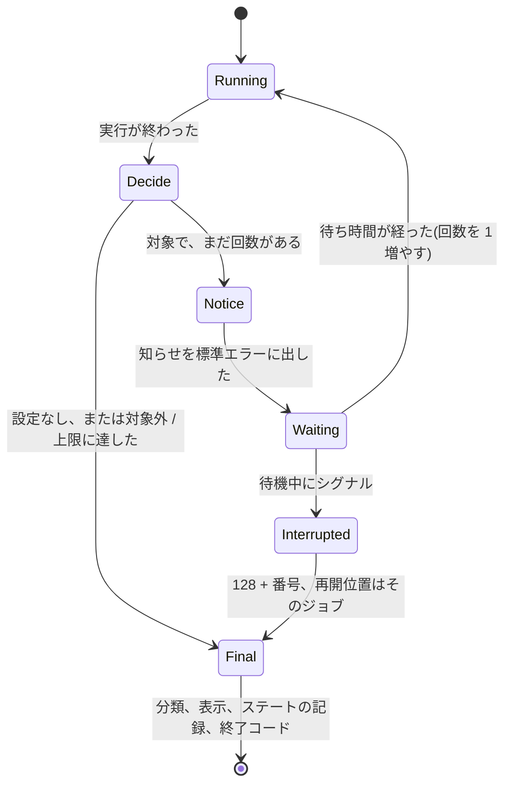
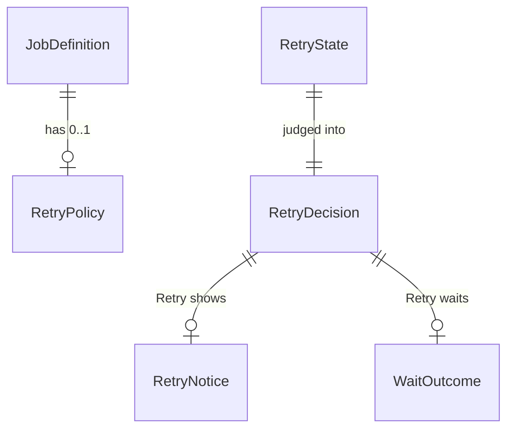

# Functional Spec — u2-retry-execution

リトライの実行の振る舞いの仕様。ジョブが設定の終了コードで終わったとき、間隔を空けて、最大 N 回、同じジョブを実行し直す。入力: `unit-of-work.md`(U2)、`unit-of-work-story-map.md`、`requirements.md`、`functional-design-questions.md`(Q1〜Q3)、u1 の設計(`RetryPolicy`)。コンポーネントの一覧(`components.md`)は、Domain Design を省いたため、ない。既存のコードの構造(`code-structure.md`、`architecture.md`、`run.rs`、`pipeline.rs`、`deps.rs`、`classify.rs`)を、事実上の設計として扱う。

この Unit が担当する要件: FR1.2 と FR1.6 の動き、FR2.1、FR2.2、FR3.1〜FR3.6、FR4.1、FR4.2、FR5.1、FR5.2、FR6.1、FR6.2 の最初の文言、NFR3、NFR7。

## 全体の流れ(1 つのジョブの実行)

既存の「実行 → 分類 → 表示 → 記録」の「実行」の部分を、「リトライを含めた実行」に置き換える。置き換えは、`run` と `pipeline` に共通の 1 つの処理にまとめる。(BR2.11)

1. `retries_done = 0` で始める。
2. ジョブを実行する(既存の `run_job`)。結果は `JobExecution`。(BR2.6)
3. 実行結果を分類する(既存の `classify`)。
4. リトライの判断(`RetryDecision`)をする。(BR2.1、BR2.2、BR2.16)
   - ジョブにリトライの設定がない、または結果が対象外なら、**Stop**。5 へ。(BR2.9)
   - 対象で、`retries_done` が `max` に達していれば、**Stop**。5 へ。(BR2.7)
   - 対象で、`retries_done < max` なら、**Retry**。待ち時間を計算して(BR2.3)、6 へ。
5. 最終の結果として、既存の流れを続ける: `classify_and_decide`、結果の表示(1 回だけ。BR2.12)、ステートの記録(Durable、形式は変えない。BR2.10)、終了コード。
6. リトライの知らせを、標準エラーに出す。(BR2.4)
7. 待つ(`Runtime::wait`)。(BR2.13)
   - 待機の結果が **Interrupted** なら、「起動していない、中断された」実行結果(シグナル番号つき)を作り、5 へ。ここで、128 + 番号、再開位置はそのジョブ、エラーとして記録しない、になる。(BR2.5)
   - **Elapsed** なら、`retries_done` を 1 増やし、2 へ戻る。

## 状態の遷移(1 つのジョブの実行の間)

## 待ち時間の計算(BR2.3)

| 設定 | k 回目の待ち時間 |
|---|---|
| 固定(倍率と上限なし) | 毎回 `interval` |
| 回ごとに伸ばす(倍率と上限あり) | 1 回目は `interval`、2 回目以降は「直前 × 倍率」。上限を超えない(頭打ち)。桁あふれしない |

例: `interval = "10s"`、`multiplier = 2`、`max_interval = "60s"` なら、10、20、40、60、60 秒。(Q2: A)

## リトライの対象(BR2.1、BR2.16)

| 実行の結果 | リトライするか |
|---|---|
| 設定の終了コードで終わった(ジョブ自身の終了コード) | する(回数が残っていれば) |
| 127 で終わった(ジョブ自身)で、一覧に 127 がある | する |
| 起動できなかった(conductor が 127 を付ける) | しない |
| シグナルで終了した | しない |
| conductor が中断した(シグナルを受けた) | しない |
| 成功・警告の終了コード、または一覧にないエラーの終了コード | しない |
| リトライの設定がないジョブの、すべての結果 | しない(これまでと同じ) |

## リトライの知らせ(BR2.4、BR2.15)

- 出す場所: 標準エラー。`-v` がなくても出す。(Q3: A)
- 内容: job_id、直前の終了コード、何回目のリトライか、最大回数、待ち時間(秒)。固定の文と整数と、エスケープしたジョブ ID だけで組み立てる。
- 文言(英語と日本語。この Unit が最初の文言を書き、u3 が確定する):
  - 日本語の例: `[conductor] job=load: 終了コード 75。リトライ 1/3 を 30 秒後に実行します`
  - 英語の例: `[conductor] job=load: exit code 75. retry 1/3 in 30s`
- 表示の仕組みへの足し方: `DisplayEvent` に新しい種類(`RetryScheduled`)を足し、表示のレベルは「常に標準エラー」(エラーと同じ出力先と条件で、エラー扱いの文言ではない)にする。

## 待機(BR2.13、BR2.14)

- 既存の差し込み口 `Runtime` に、「待つ」(待ち時間と合図を受け取り、`Elapsed` か `Interrupted(シグナル番号)` を返す)を足す。(Q1: A)
- 本番: 合図が立っていないかを、100 ミリ秒以内の間隔で確かめながら待つ。立っていれば、すぐに `Interrupted` を返す。待ち時間が 0 なら、確かめて、すぐ `Elapsed` を返す。
- テスト: 偽の実装が、待たずに、呼ばれた待ち時間を記録して `Elapsed` を返す(または、指定の回数目に `Interrupted` を返す)。これで、間隔が 1 時間のリトライも、実際には待たずに試せる。
- 待機は、`unsafe` を使わず、OS 別の `cfg` を `platform/` の外に置かず、新しい外部クレートを使わない(標準ライブラリだけ。NFR2、NFR6)。

## ステートと再開(BR2.10)

- リトライの途中では、ステートファイルを書かない。最終の結果が出たときに、これまでと同じ形で 1 回だけ書く。
- 途中で conductor が落ちたり止まったりすると、そのジョブは、再開したとき、最初の実行から数え直す(at-least-once の範囲)。

## `pipeline` での扱い(BR2.11)

- 各ジョブの実行に、同じ共通の処理を使う。リトライが使い切られて最終の結果がエラーなら、既存の遷移の規則(エラーで止まる、など)に従う。
- ジョブとジョブのあいだの中断の確認(既存)は、変えない。待機中の中断は、BR2.5 で扱う。

## 互換(後方互換、BR2.9)

- リトライの設定がないジョブ、および対象外の結果は、これまでと完全に同じ(待機も、知らせも、追加の実行もない)。既存のテストが、変更なしで通る。

## エンティティの関係(派生の図。正は `entities.md`)

## 規則の要約(派生。正は `rules.md`)

BR2.1〜BR2.3(判断と待ち時間)、BR2.4(知らせ)、BR2.5〜BR2.6(シグナル)、BR2.7〜BR2.8(結果の扱い)、BR2.9(後方互換)、BR2.10(ステート)、BR2.11〜BR2.12(`run` と `pipeline` の共通、表示)、BR2.13〜BR2.14(待機)、BR2.15(文言)、BR2.16(127)。

## 設計の決定と、その理由

| 決定 | 理由 | 検討した別案 |
|---|---|---|
| 待機を `Runtime` に足す(Q1: A) | 既存の差し込み口を使い回せる。流れのテストは偽の `Runtime` を使うため、待機の偽の実装を足すだけで済む | 新しい `Clock`(差し込み口が増える) |
| 待ち時間は、最初は `interval`、以降は直前 × 倍率(Q2: A) | 「間隔」が最初の待ち時間になり、設定の値の意味が分かりやすい | 最初から倍率を掛ける(`interval` の値が使われない) |
| 知らせは、常に標準エラー(Q3: A) | cron のログで、リトライの様子が分かる。ジョブの出力(標準出力)を汚さない | `-v` のときだけ / 標準出力 |
| 待機中の中断を、「起動前の中断」と同じ形の実行結果で表す(BR2.5) | 既存の分類・記録・終了コードの流れを、そのまま使える | 中断の専用の経路(分岐が増える) |
| `run` と `pipeline` の共通の処理にまとめる(BR2.11) | 同じ流れが 2 つのファイルにあり、別々に直すとずれるため | それぞれに書く(重複) |
| ステートに回数を記録しない(FR5.1) | 形式を変えない(要件で決定済み) | 記録する(形式が変わる) |
| 待機の確認の間隔は 100 ミリ秒以内(BR2.14) | 待機の打ち切りを 1 秒以内にする(NFR7)余裕を持たせる | もっと長い間隔(NFR7 を満たしにくい) |
