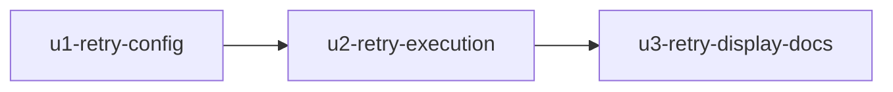

# Unit of Work Dependency — 正常終了しなかったジョブの自動リトライ

このファイルは、何が何に依存するか(形)だけを示す。作る順番の推奨や、最も長い経路の特定は、Delivery Planning の仕事である。

## 依存の関係(DAG)



文章での説明(「A は B に依存する」は、A のコードやテストが、B のコードがないとビルドも通過もしないこと):

- u2-retry-execution は、u1-retry-config に依存する。実行は、u1 が定義に追加したリトライの設定の型(終了コード、最大回数、間隔、倍率、上限)を読む。
- u3-retry-display-docs は、u2-retry-execution に依存する。u3 は、u2 が定義した表示の種類(`DisplayEvent` の新しい種類)と最初の文言を、確定する。README は、u2 の動きを説明する。
- u1 は、ほかの Unit に依存しない。
- u2 は、表示の種類を自分で定義するので、u3 には依存しない。

## Unit 間の接点

| 接点 | 提供する Unit | 使う Unit | 内容 |
|---|---|---|---|
| リトライの設定の型(`JobDefinition` の新しい項目) | u1 | u2 | 終了コードの一覧、最大回数、間隔、倍率、上限。整数と、整数にした間隔で表す |
| リトライの前の知らせ(`DisplayEvent` の新しい種類と、最初の文言) | u2 | u3 | 何回目か、最大回数、次までの待ち時間。u3 は、この文言を確定する |

## 並行して進められる組

なし。3 つの Unit は一列に依存している。作る順番は、Delivery Planning が決める。(チームの方針は「機能を 1 つずつ順に作る」で、Delivery Planning への入力とする。`units-generation-questions.md` Q3: A)

## 機械で読む辺の定義

```yaml
units:
  - name: u1-retry-config
    kind: library
    depends_on: []
  - name: u2-retry-execution
    kind: service
    depends_on: [u1-retry-config]
  - name: u3-retry-display-docs
    kind: service
    depends_on: [u2-retry-execution]
```
