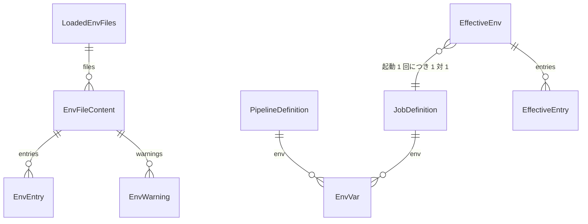

# 機能の仕様(Functional Spec): U1 u1-env-injection(環境変数の注入と `.env`)

出典: ユニットの定義(`inception/units-generation/unit-of-work.md` の U1)、要件(`requirements-analysis/requirements.md` の FR1.1〜FR1.13、FR5.1、FR5.2、NFR2〜NFR6)、ユニットと要件の対応(`unit-of-work-story-map.md`)、コンポーネントの一覧(`domain-design/components.md`)、契約(`contract-design/contract-summary.md` の C1、C3、C4、C5)、機能の設計の質問(`functional-design-questions.md`。以下 Q1〜Q8)、既存のコード(`crates/core`、`crates/runtime`、`crates/cli`)。ユーザーストーリーは作っていない(省略したステージ)ので、要件(FR)の単位で記す。

この文書は、ワークフローと(状態遷移があれば)状態遷移の、原本である。データの形は `entities.md`、判断の規則は `rules.md`(BR の番号)が原本で、ここに書く ER 図と規則の要約は、その導出である。

## 1. 範囲

- この Bolt(B1)が作るもの: `[pipeline.env]`、`[job.env]`、`env_file`(定義の新しいキー)、`.env` の読み取りと検査、層の統合、組み込みの `CONDUCTOR_*` 変数、`validate` の重複キーの警告、ジョブの起動への反映。
- 作らないもの: `unset_env`、optional な `env_file`、変数の展開、複数行の値(要件の範囲の外)。
- 変更の範囲(クレートごと。実装の指針で、コードではない):
  - `conductor-core`: 型(`env`、`env_file`、`DefinitionErrorKind` の 3 種)、定義の読み取り(`walk`)、新しいモジュール `envfile`(`.env` の解析、層の統合、名前の要約)。
  - `conductor-runtime`: 新しいモジュール(`.env` のファイルの読み取り)、`run_job` に環境変数を足す口。
  - `conductor-cli`: `Runtime` の trait(読み取りと、`run_job` の引数)、`prepare`(実行の前の読み取り)、`run_job_with_retry`(試行ごとの環境)、`validate`、表示(新しい誤りと警告)、メッセージ(日本語と英語)。
  - `conductor-converter`: 変更なし(定義のキーを列挙せず、変換は、キーに依存しない。コードで確かめた)。

## 2. ワークフロー

### WF1 定義の読み取り(新しいキー。`CoreDefinition`。BR1.1〜BR1.8)

1. `[pipeline]` の許可するキーに `env`、`env_file` を足す。`[[job]]` の許可するキーにも足す(`format_version` は 1 のまま。BR1.8)。
2. `env` が、表でなければ型の誤り(typeMismatch)。各項目について、次を、この順に検査する。誤りは、集めて返す(従来どおり、複数を返してよい)。
   1. 名前が、`is_valid_env_name`(既存)を満たすか(BR1.2)。満たさなければ invalidEnvName。
   2. 名前が、予約名(ASCII の大文字にして `CONDUCTOR_` で始まる)か(BR1.3)。そうなら reservedEnvName。
   3. 同じ表の中に、大文字小文字を無視すると同じで、綴りが違う名前があるか(BR1.4)。あれば envNameCaseConflict(2 つ目の名前の位置で報告)。
   4. 値が文字列か(BR1.1)。そうでなければ typeMismatch。値に NUL があれば invalidEnvValue(BR1.5)。
3. `env_file` が、文字列でも配列でもなければ型の誤り(typeMismatch)。配列の要素が文字列でなければ typeMismatch、空の文字列なら emptyField(BR1.6)。文字列 1 つなら、要素 1 つの並びにする。
4. 検査が通ったら、定義の型(`PipelineDefinition.env` / `env_file`、`JobDefinition.env` / `env_file`)に、書いた順に入れる。値は展開しない(BR1.1)。
5. 誤りの理由の文は、固定の文から作る。入力の値は含めない。名前は、既存の `quote_key`(エスケープと切り詰め)を通す。

### WF2 `.env` の解析(`CoreEnvFile`。純粋な関数。BR2.1〜BR2.8、BR3.2)

入力: `.env` の内容(UTF-8 の文字列)と、表示用のファイル名。出力: `EnvFileContent`(項目と警告)、または、`EnvFileError` の並び。

1. 先頭が BOM(U+FEFF)なら取り除く(BR2.6)。行は、LF で分け、各行の末尾の CR を取り除く。
2. 各行(行番号は 1 始まり)について:
   1. 空白だけ、または先頭の空白に続く `#` なら、読み飛ばす(BR2.1)。
   2. 先頭の空白のあと、`export ` で始まれば、その部分(と、続く空白)を取り除く。
   3. `=` で `KEY` と値に分ける。`=` がなければ missingEquals。`KEY` の前後の空白は除く。`KEY` が空、または名前の規則に合わなければ invalidName、予約名なら reservedName(BR1.3)。
   4. 値を、先頭の文字で分けて読む: `'`(BR2.3)、`"`(BR2.4)、それ以外(BR2.2)。展開はしない(BR2.5)。
   5. 値に NUL があれば nulInValue(BR1.5)。
   6. 項目を足す。項目の数が 10,000 を超えたら tooManyEntries を返して、解析を止める(BR3.2)。
3. 重複の扱い(BR2.7、BR1.4): 完全に同じ名前の項目が既にあれば、後ろの値で置き換え、警告(file、後ろの行、名前)を足す。大文字小文字だけが違う名前は、caseConflict の誤りにする。
4. 行ごとの誤りは、止めずに集める(BR2.8)。1 つでも誤りがあれば、結果は誤りの並びで、項目は返さない。

実装の指針(インターフェースの形。≤15 行の例):

```rust
/// 契約 C1 の入口(解析)。値を含まない誤りを返す。
pub fn parse_env_file(text: &str, file: &str) -> Result<EnvFileContent, Vec<EnvFileError>>;

pub struct EnvFileError { pub file: String, pub line: Option<usize>, pub kind: EnvFileErrorKind, pub reason: String }
```

### WF3 `.env` の読み取り(`RuntimeEnvLoader`。BR1.7、BR3.1〜BR3.4、BR6.4)

入力: 定義ファイルのパス、読む対象の `env_file` のパス(文字列)の並び。出力: `LoadedEnvFiles`、または `EnvFileError` の並び(すべての誤りを集めて返す)。

1. 各パスを解決する: 相対なら (定義ファイルのディレクトリ)/(パス)、絶対ならそのまま(BR1.7)。解決した結果が同じなら、1 つにまとめる(BR6.4)。
2. 各ファイルについて、大きさを調べる。上限(1 MiB)を超えれば tooLarge(中身を読まない)。無ければ fileMissing、調べられない(権限、ディレクトリなど)なら unreadable(BR3.4)。
3. 上限 + 1 バイトまで読む。上限を超えて読めたら tooLarge。UTF-8 でなければ notUtf8(BR3.3)。
4. 文字列を、WF2 に渡して、解析する。ファイルの誤りは、すべてのファイル分を集める。
5. 誤りが 1 つもなければ `LoadedEnvFiles` を返す。

### WF4 層の統合(`CoreEnvFile`。純粋な関数。BR4.1〜BR4.4、BR5.1〜BR5.3)

入力: 定義、対象のジョブ、`LoadedEnvFiles`、`EnvContext`(パイプライン名、ジョブ ID、run ID、試行)。出力: `EffectiveEnv`。

1. 結果の並びを空にする。
2. 次の順に、層を重ねる(BR4.1、BR4.2): `[pipeline].env_file`(書いた順)→ `[pipeline.env]` → `[job].env_file`(書いた順)→ `[job.env]`。各項目を、出どころ(`EnvOrigin`)つきで、「同じ名前があれば取り除き、末尾に足す」(BR4.3)。大文字小文字だけが違う名前は、別の名前として足す。
3. 自動の変数を、末尾に足す(BR5.1): `CONDUCTOR_PIPELINE`、`CONDUCTOR_JOB_ID`、`CONDUCTOR_RUN_ID`(run ID があるときだけ。BR5.3)、`CONDUCTOR_ATTEMPT`(十進の整数。BR5.2)。出どころは `builtin`。
4. 結果を返す。引き継いだ環境は、含めない(子のプロセスが引き継ぐ。BR4.4)。

実装の指針:

```rust
/// 契約 C1 の入口(統合)。値を持つが、Debug は値を伏せる。
pub fn merge_env(def: &PipelineDefinition, job: &JobDefinition,
                 files: &LoadedEnvFiles, ctx: &EnvContext<'_>) -> EffectiveEnv;

impl EffectiveEnv {
    /// 起動の口へ渡す、足す環境(名前と値)。並びの順に、足す。
    pub fn additions(&self) -> Vec<(&str, &str)>;
    /// 名前だけの要約(値を含まない)。U3 の計画が使う(契約 C1)。
    pub fn names(&self) -> Vec<(&str, EnvOrigin)>;
}
```

### WF5 `pipeline`・`run` の起動(`CliFlows`。BR6.1〜BR6.3、BR5.2)

1. `prepare` が、定義を読んで検査し(既存)、`command` を検査する(既存。`check_definition`)。
2. 存在しないジョブの検査(`run` のみ。使い方の誤り 68)と、run ID の決定(誤りは 68)のあとに、読む対象の `env_file` の一覧を作る。位置は、`read_state` の前である。使い方の誤り(68)と `.env` の誤り(64)が同時にあるときは、先に検出する 68 が勝つ。対象は、`pipeline` なら `[pipeline].env_file` とすべてのジョブの `env_file`、`run` なら `[pipeline].env_file` と、そのジョブの `env_file`(BR6.1)。一覧が空(`env_file = []` を含む)なら、読み取りは何もしない。
3. WF3 で読む。誤りがあれば、表示(BR2.8)して、終了コード 64 で止まる(BR6.2)。ステートの読み込みの前なので、ステートに触れない。
4. `Session` に、`LoadedEnvFiles` を持たせる(ステートには、書かない。BR8.3)。再開のときも、呼び出しごとに読み直す(BR6.3)。
5. ジョブを起動するたびに(`run_job_with_retry` の試行ごとに)、WF4 で `EffectiveEnv` を作る。`attempt` は、(これまでのリトライの回数) + 1(BR5.2)。その `additions` を `run_job` に渡す。リトライの回数は、1 回の呼び出しの中だけで数える(`run_job_with_retry` のローカルな値)ので、再開すると、`CONDUCTOR_ATTEMPT` は、また 1 から始まる。`run_job_with_retry` は、定義、`LoadedEnvFiles`、run ID を受け取るため、`&Session` を受け取る形に変える。呼び出し元(`pipeline.rs`、`run.rs`)と、`Runtime` の trait の偽の実装(`cli/tests/common/mod.rs`)も、合わせて直す。
6. 起動の口(`conductor_runtime::run_job`)は、`Command` に、並びの順に環境変数を足す(`Command::env` の繰り返し)。引き継いだ環境は、そのまま(BR4.4)。

起動の口の形(既存の `run_job(job, signal)` に、環境の引数を足す):

```rust
pub fn run_job(job: &JobDefinition, env: &[(&str, &str)], signal: &InterruptSignal) -> JobExecution;
```

### WF6 `validate`(`CliFlows`。BR7.1、BR7.2)

1. 定義の検査と `command` の検査(既存)。
2. 通ったら、`pipeline` と同じ範囲(BR6.1)の `.env` を、WF3 で読む。誤りがあれば、実行のときと同じ表示で、終了コード 64。
3. 誤りがなければ、各ファイルの警告(重複キー)を、読み取った順に、標準エラーに出す(BR7.2)。警告だけなら、終了コード 0。

### WF7 名前だけの要約(契約 C1。BR8.2)

1. `EffectiveEnv::names()` が、名前と出どころの並びを返す(値を含まない)。
2. U3 の計画(`--dry-run`)は、この関数だけを使う。引き継いだ環境の名前は含めない。

## 3. 状態遷移

ライフサイクルを持つエンティティはない。`.env` の読み取りの結果と統合の結果は、1 回の呼び出しの中だけで持ち、ステートに書かない(BR8.3)。ステートファイルの内容と遷移は、変えない。

## 4. 表示(誤りと警告)

- `.env` の誤り(`EnvFileError`)の表示: `<ファイル>:<行>: <種類の名前>: <理由>`(定義の誤りと同じ形)。行が無いときは、`<ファイル>: <種類の名前>: <理由>`。ファイルの名前は、エスケープと切り詰めをする。理由は、固定の文で、値を含まない。20 件を超えたら、「ほか N 件」を添える(BR2.8)。
- 警告の表示: `<ファイル>:<行>: 警告: 重複キー`(名前を添える)。日本語と英語の両方を用意する(BR9.1)。
- 定義の新しい誤り(reservedEnvName、envNameCaseConflict、invalidEnvValue)は、既存の `DefinitionError` の表示を使う。

## 5. 契約への反映(契約の設計との差と、決まったこと)

- C4(`.env` の誤りの終了コード): **64** に決めた(Q1)。契約の Open questions の C4 の行は、解決。
- C1(統合の関数): 入力から `inherited_env_names` を外した。名前の要約は、「conductor が足すもの」だけを返し、引き継いだ環境の名前は、返さない(引き継いだ環境は、足す対象でなく、数百の名前になりうるため。Q8 の A と同じ考え方)。入力に、解析済みの `.env`(`LoadedEnvFiles`)を足した。この変更は、U3(使う側)の設計で、そのまま使う。あわせて、契約が示した出どころの `inherited` は無くなり、`env_file` の出どころは、層ごと(`pipelineEnvFile`、`jobEnvFile`)に分かれた。契約が C1 の errors に挙げた「予約名の拒否」は、統合の関数ではなく、定義の読み取り(`env` の表)と `.env` の解析(`.env`)で行う(統合の関数は、誤りを返さない)。`--dry-run`(U3)も、`pipeline` と同じ範囲の `.env` を、同じ読み取りで読み、誤りのときは、同じ終了コード 64 で止まる(BR6.1)。
- 受け入れる OS の違い: 層をまたぐ大文字小文字だけが違う名前は、Windows と、Linux・macOS で、子の環境が違う(BR4.3)。統合した環境の全体の大きさに、上限は設けない(BR3.2 の注)。どちらも README に書く。
- C1(`CONDUCTOR_ATTEMPT` の値の未解決事項): `--dry-run` は名前だけを示すので、値は決めなくてよい。解決。
- C1 の errors: `.env` の誤りの種類を、`EnvFileErrorKind` の 13 種に具体化した(`entities.md`)。

## 6. 導出: ER 図(`entities.md` の導出)



テキストの代替: `PipelineDefinition` と `JobDefinition` は、それぞれ 0 個以上の `EnvVar` を持つ。`LoadedEnvFiles` は、0 個以上の `EnvFileContent` を持ち、各 `EnvFileContent` は、項目(`EnvEntry`)と警告(`EnvWarning`)を持つ。`EffectiveEnv` は、1 回の起動に、1 つのジョブに対して作られ、0 個以上の `EffectiveEntry` を持つ。

## 7. 導出: ルールの要約(`rules.md` の導出)

| グループ | 内容 | ルール |
|----------|------|--------|
| 定義のキー | 値は文字列、名前の規則、予約名、大文字小文字、NUL、`env_file` の形とパス、互換 | BR1.1〜BR1.8 |
| `.env` の書式 | 行の種類、引用符、エスケープ、展開なし、BOM、重複、誤りの報告 | BR2.1〜BR2.8 |
| 読み取りと上限 | 1 MiB、10,000 項目、UTF-8、無い・読めない | BR3.1〜BR3.4 |
| 層の統合 | 優先順位、配列の順、統合の規則、引き継ぎは足すだけ | BR4.1〜BR4.4 |
| 自動の変数 | 4 つ、試行ごと、run ID が無いとき | BR5.1〜BR5.3 |
| 実行の前 | 読む範囲、誤りで 64 、再開でも読む、1 回だけ読む | BR6.1〜BR6.4 |
| `validate` | `.env` を読む、重複の警告 | BR7.1〜BR7.2 |
| 値の秘匿 | 出さない、名前だけの要約、ステートに書かない | BR8.1〜BR8.3 |
| 文書 | 日本語と英語、README とデモ | BR9.1〜BR9.2 |

## 8. テストの観点(Code Generation の入力。test-after、行カバレッジ 80%)

- 単体(core): 解析(各引用符、エスケープ、BOM、CRLF、`export`、重複、名前の誤り、上限)、統合(優先順位、配列の順、完全一致、大文字小文字だけが違う名前の順)、自動の変数(run ID の有無、試行)、定義の新しいキーの検査(各誤り、予約名の大文字小文字、NUL)。
- 単体(runtime): 読み取り(無い、読めない、大きすぎる、UTF-8 でない、相対と絶対のパス、同じパスの 1 回の読み取り)、`run_job` が環境を足す(足した値が子に見える、引き継いだ環境が残る)。
- 統合(cli、偽の `Runtime`): `.env` の誤りで、ジョブが 1 つも起動されず、ステートに触れず、64 で止まる。`validate` の警告と 0。リトライで `CONDUCTOR_ATTEMPT` が増える。20 件の打ち切り。
- 統合(実バイナリ、`conductor-cli-test-helper`): `env` と `.env` の値が、実際の子のプロセスの環境に見える。値が、標準出力、標準エラー、ステートの、どこにも出ない(NFR2)。
- 非機能: `nfr_source.rs`(新しい依存なし、`unsafe` なし、`cfg` が `platform` の外にない)、全種類のメッセージの網羅(`ALL` の更新)。

## 9. 未解決の事項

なし(この Bolt の範囲で、決めるべきことは、すべて決めた)。U3(`--dry-run`)が使う入口の、具体の型の名前は、実装(Code Generation)で、この文書の形に従って決める。
