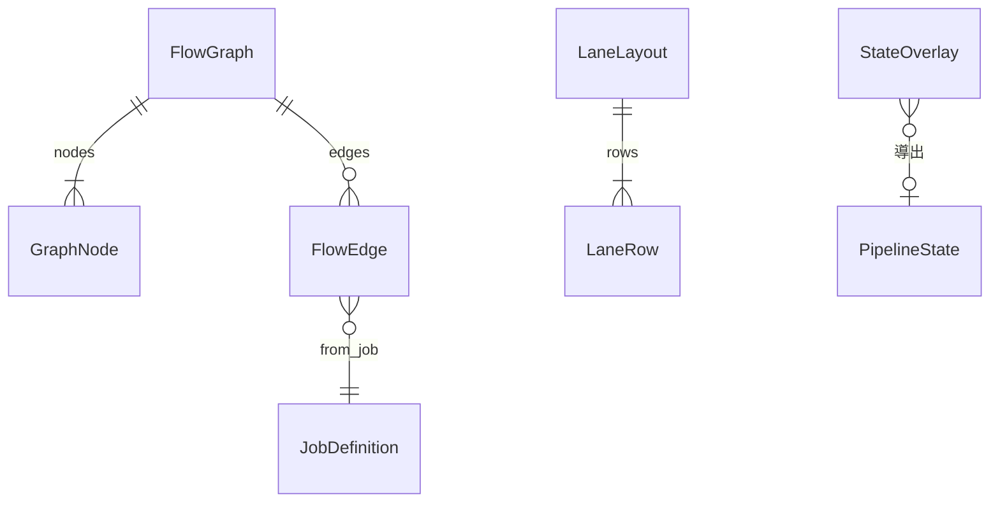

# 機能の仕様(Functional Spec): U2 u2-graph(`conductor graph`)

出典: ユニットの定義(`inception/units-generation/unit-of-work.md` の U2)、要件(`requirements-analysis/requirements.md` の FR2.1〜FR2.7、FR1.12、FR5.1、FR5.2、NFR1)、ユニットと要件の対応(`unit-of-work-story-map.md`)、コンポーネントの一覧(`domain-design/components.md`)、契約(`contract-design/contract-summary.md` の C2、C5、C6)、機能の設計の質問(`functional-design-questions.md`。以下 Q1〜Q5)、既存のコード(`crates/core/src/flow/next_step.rs`、`crates/core/src/types.rs`、`crates/cli/src/{ctx,args,aux_commands,pipeline}.rs`)。ユーザーストーリーは作っていない(省略したステージ)ので、要件(FR)の単位で記す。

この文書は、ワークフローの原本で、期待する出力の例(例 G1〜G9)は、`graph` の text の見た目の原本である。データの形は `entities.md`、判断の規則は `rules.md`(BR の番号)が原本で、ここに書く ER 図と規則の要約は、その導出である。

## 1. 範囲

- この Bolt(B2)が作るもの: `conductor graph [--config <パス>] [--format text|mermaid] [-v] [--state] [--run-id <ID>] [<パイプライン名>]`。辺の取り出し、レーンの配置、text と Mermaid の整形、`--state` の重ね合わせ。
- 作らないもの: 図のファイル出力(標準出力のみ)、色、画像、`--dry-run`(U3)、`init`(U4)。
- 変更の範囲(実装の指針):
  - `conductor-core`: `flow/next_step.rs` の遷移の解決を、公開の関数に切り出す(`classify_and_decide` の結果は変えない。BR1.5)。新しいモジュール `graph/`(辺の取り出し、図の構造、レーンの配置、状態の重ね合わせ)。
  - `conductor-cli`: `args.rs`(`graph`、`--format`、`--state`、`-v` の扱い、`--run-id` の併用の検査)、`types.rs`(`CliCommand` の項目)、`report/`(text と Mermaid の整形、メッセージ)、`aux_commands.rs` または新しい `graph.rs`(流れ)、`lib.rs`(コマンドの振り分け)。
  - `conductor-runtime`、`conductor-converter`: 変更なし。

## 2. ワークフロー

### WF1 辺の取り出し(`CoreFlow` の公開、`CoreGraph`。BR1.1〜BR1.5)

1. 各ジョブ(記述順の位置 i)について、成功の行き先と警告の行き先を、**遷移の解決**で決める(`next_step` が使う関数を、公開して使う)。遷移があれば、その行き先(ジョブ、または `@end`)。なければ、i + 1 のジョブ(最後なら `@end`)。
2. 2 つの行き先が同じなら、辺を 1 つにして、kinds に成功と警告を持たせる。違えば、辺を 2 つ作る(記述順の次への辺を、先に)。
3. 各辺の skipped_jobs を決める(BR1.4)。explicit は、遷移が書かれていた辺だけ true。
4. エラーの辺は作らない(BR1.3)。

### WF2 図の構造と状態の重ね合わせ(`CoreGraph`。BR4.1、BR4.2)

1. 節: ジョブの記述順に 1 つずつ、最後に終点。
2. `StateOverlay` があれば、各ジョブの節に NodeState を付ける(success、warning → ok。skipped → skipped。error → error。pending → pending)。resume_job_id があって、完了していなければ、その節の is_resume を true にする。

### WF3 レーンの配置(`CoreGraph`。BR2.1〜BR2.4、BR2.6、BR2.7)

1. まず、辺から、図の形が「対応する形」かを判定する(`is_lane_drawable`。BR2.4)。次の条件を、すべて満たすとき、対応する形である: 各ジョブの飛び越しの辺が多くて 1 つ、飛び越しの行き先がどの 2 つの辺でも違う、飛び越しの区間が交差しない。
2. 対応する形なら、`git log --graph` と同じ見た目の図の行(`LaneRow`)の並びを作る。見た目の正解は、`layout-oracle.md` の 537 個の例(ジョブ 2〜8 個のすべての対応する形)で、実装は、すべての例に、1 文字も違わず一致させる(BR2.3)。説明用の手順:
   - ジョブは、主線(左の列)に、記述順で、1 行ずつ並ぶ。最後に、終点(記号 `o`)。
   - 飛び越しの辺があるジョブの行のあとに、分岐の行(`\`)を置き、その辺の線を、主線の右隣(列 1)に挿入する。すでにある右のレーンの線は、1 つ右へずれる。
   - 行き先のジョブの手前で、その線(列 1)が、主線へ合流する(合流の行 `/`)。残りの線は、1 つ左へ詰まる。
   - 対応する形では、飛び越しが入れ子か並びなので、挿入と合流は、いつも列 1 で起こる。
3. 対応する形でなければ、レーンの配置を呼ばず、辺の一覧に切り替える(BR2.8)。Mermaid は、形によらず、常に出せる。
4. 配置の処理は、ファイルにもプロセスにも触れない純粋な関数。`git` のソースコードは写さない(GPL。BR2.6)。手順と、正解データから、自前で書く。

### WF4 text の整形(`CliReport`。BR2.2、BR2.5、BR3.1〜BR3.3、BR4.1、BR4.2)

1. `LaneRow` を文字にする: `*`、`o`、`|`、`\`、`/` と空白。列は、空白 1 つで区切る。ノードの行のラベル(ジョブ ID、`@end`)は、グラフ部の幅を(列の数 × 2)にそろえた位置に置く。各行の末尾の空白は取り除く。
2. `--state` のとき、ラベルの前に、状態の記号と空白 1 つを置く(終点には付けない)。再開位置の行は、末尾に「  <- 再開位置」(英語は「  <- resume here」)を添える。
3. `-v` のとき、ノードの行と、続く分岐の行のあとに、詳細の行を足す。詳細の行は、列の数だけ `|` を描き、(列の数 × 2)の位置に詳細の文を置く。詳細の文は、この順: 「コマンド: <コマンド>」、「リトライ: <要約>」、辺の注記(「成功 → d(b、c を飛び越す)、警告 → b」)。該当しない項目は出さない。終点には出さない。コマンドの表示は BR3.3 に従い、環境変数は出さない。
4. 日本語と英語のメッセージを用意する(注記、再開位置、使い方)。

### WF5 Mermaid の整形(`CliReport`。BR5.1〜BR5.5)

`flowchart TD`、節の定義(`n0["a"]`、`nend(["@end"])`)、辺(`n0 -->|"成功"| n3`)の順に出す。例は、例 G2 の Mermaid を参照。

### WF6 `conductor graph` の流れ(`CliFlows`。BR4.3〜BR4.6、BR6.1〜BR6.3)

1. 引数の検査(`CliArgs`): `--format` は `text` か `mermaid`(それ以外は使い方の誤り 68)。`--format`、`-v`、`--state`、`--run-id` は、それぞれ 1 回だけ(重複は 68)。`--run-id` は `--state` と一緒のときだけ(BR4.5。なければ 68)。`--format`、`--state` は、`graph` 以外では、許されないオプション(68。BR6.4)。
2. `validate` と同じ検査(`validate` の中身を共通の関数に切り出して呼ぶ): 定義の検証、`command` の検査、`.env` の読み取り(U1)。パイプライン名の引数(`graph <name>`)は、定義の `name` と照合する。誤りなら、表示して 64。`.env` の重複キーの警告は、標準エラーに出す(BR6.1)。値は、どこにも出さない。
3. `--state` のとき: run ID を決める(`--run-id`、なければ定義の `run_id_env` の環境変数。`prepare` と同じ)。`read_state_raw` で、完了したステートも含めて読む(`read_state` は、完了したステートを「無い」として返すため、使わない。BR4.3)。無ければ(ファイルが無い、または長さ 0)、すべて pending。あれば、`check_consistency` で定義と照合し(完了したステートにも)、食い違いなら、表示して 65(BR4.4)。読み取りの誤りも 65。完了したステートは、状態を重ねるが、再開位置は示さない。書き込み、削除、シグナルの準備は、しない(BR4.6)。
4. WF1〜WF3 で図を作り、WF4(または WF5)で文字列にする。
5. 標準出力に、1 回で書く。成功は 0(BR6.3)。書けなければ 65。

## 3. 期待する出力の例(原本)

ジョブ a、b、c、…。`a→d` は、「a が成功で d へ飛ぶ」の意味(警告は、遷移がなければ、次のジョブ b)。行末の空白は取り除いてある。

**対応する形のレーンの図(G1〜G4、G6)**は、実際の `git log --graph` の出力から取った形で、正解データ `layout-oracle.md`(対応するすべての形、537 個)の一部である。実装は、`layout-oracle.md` のすべての例に、1 文字も違わず一致させる(BR2.3)。交差などの「対応しない形」は、レーンの図にせず、辺の一覧(下の例 E1、E2)で出す(ユーザーの選択。質問 Q5 の A)。

G1 飛び越しなし(a、b、c):

```text
* a
* b
* c
o @end
```

G2 a→d(a、b、c、d、e):

```text
*   a
|\
* | b
* | c
|/
* d
* e
o @end
```

G3 a→@end(a、b、c):

```text
*   a
|\
* | b
* | c
|/
o @end
```

G4 入れ子 a→f、b→e(a〜f):

```text
*   a
|\
* \   b
|\ \
* | | c
* | | d
|/ /
* / e
|/
* f
o @end
```

G6 並び a→c、d→f(a〜g):

```text
*   a
|\
* | b
|/
* c
*   d
|\
* | e
|/
* f
* g
o @end
```

### 辺の一覧(対応しない形。BR2.8)

E1 交差 a→d、b→e(a〜f。`--state` と `-v` なし):

```text
注記: 飛び越しが交差するなどの形のため、レーンの図の代わりに、辺の一覧を出します。
ジョブ:
  a
  b
  c
  d
  e
  f
辺:
  a -> b (警告)
  a -> d (成功)
  b -> c (警告)
  b -> e (成功)
  c -> d
  d -> e
  e -> f
  f -> @end
```

E2 a の成功と警告が、どちらも d へ飛ぶ(b、c は、どの辺にも指されない。a〜d。`--state`。a は成功か警告で d へ進み、b、c は、遷移でスキップされた想定):

```text
注記: 飛び越しが交差するなどの形のため、レーンの図の代わりに、辺の一覧を出します。
ジョブ:
  [OK] a
  [--] b
  [--] c
  [OK] d
辺:
  a -> d (成功・警告)
  b -> c
  c -> d
  d -> @end
```

### `--state`(例 G2 に重ねる。a は警告で終わって、次のジョブ b へ進み、b でエラーで止まっている想定)

```text
*   [OK] a
|\
* | [NG] b  <- 再開位置
* | [  ] c
|/
* [  ] d
* [  ] e
o @end
```

### `--state` で、完了したステート(例 G2。a が成功で d へ飛び、b、c はスキップ、d、e は成功。再開位置は示さない。BR4.2、BR4.3)

```text
*   [OK] a
|\
* | [--] b
* | [--] c
|/
* [OK] d
* [OK] e
o @end
```

### `-v`(例 G2。環境変数は出さない)

```text
*   a
|\
| | コマンド: echo a
| | 成功 → d(b、c を飛び越す)、警告 → b
* | b
| | コマンド: echo b
* | c
| | コマンド: echo c
|/
* d
| コマンド: echo d
* e
| コマンド: echo e
o @end
```

### `-v`(例 G4。入れ子。分岐の行のあとに、残る各列の `|` を描く。BR3.1)

```text
*   a
|\
| | コマンド: echo a
| | 成功 → f(b、c、d、e を飛び越す)、警告 → b
* \   b
|\ \
| | | コマンド: echo b
| | | 成功 → e(c、d を飛び越す)、警告 → c
* | | c
| | | コマンド: echo c
* | | d
| | | コマンド: echo d
|/ /
* / e
| | コマンド: echo e
|/
* f
| コマンド: echo f
o @end
```

(`-v` の詳細の行の位置は、実装の確認として、`-v` のオラクルの例を、実装のテストに足して固定する。ここの例が、期待する形の原本である。)

### Mermaid(例 G2。`--state`、再開位置あり)

```text
flowchart TD
  n0["[OK] a"]
  n1["[NG] b"]
  n2["[  ] c"]
  n3["[  ] d"]
  n4["[  ] e"]
  nend(["@end"])
  n0 -->|"警告"| n1
  n0 -->|"成功"| n3
  n1 --> n2
  n2 --> n3
  n3 --> n4
  n4 --> nend
  classDef resume stroke-width:3px
  class n1 resume
```

### Mermaid(例 G2)

```text
flowchart TD
  n0["a"]
  n1["b"]
  n2["c"]
  n3["d"]
  n4["e"]
  nend(["@end"])
  n0 -->|"警告"| n1
  n0 -->|"成功"| n3
  n1 --> n2
  n2 --> n3
  n3 --> n4
  n4 --> nend
```

## 4. 状態遷移

ライフサイクルを持つエンティティはない。`graph` は、ステートを読むだけで、何も書かない(BR4.6)。

## 5. 契約への反映(契約の設計との差と、決まったこと)

- C2(辺の判断の入口): **変更**(U3 は、この形で使う)。(a) 契約の「次のジョブを決める判断の公開」を、設計では、「遷移の解決を公開関数に切り出し、辺の取り出し(`flow_edges` 相当)を、その上に置く」とした。(b) 契約の辺の種類 `success、warning、default` を、`EdgeKind`(success、warning)と、`explicit`(遷移が書かれたか)の組に変えた(`default` は、`explicit = false` で表す)。(c) 契約の入力(ステート、結果の分類、実行の方式)は、辺の取り出しには要らない(定義だけから決まる)ので、外した。U3 が使う、起動前の判断と、再開位置の関数は、既存の公開された関数で、変えない。
- C5(`graph` のコマンドライン): `--run-id` は、`--state` と一緒のときだけ(68。未解決事項は解決)。`--format` の値の誤り、重複、許されないオプションは 68。ステートの食い違いは 65、定義と `.env` の誤りは 64(`validate` と同じ検査)。
- C6(出力の形): **変更**。(a) 契約の略図は、飛び越されるジョブを右のレーンに描いていたが、設計は、`git log --graph` と同じに、ジョブを主線(左の列)に並べ、飛び越しの辺を右のレーンの線にした(質問 Q5 の記録)。(b) 契約は、`-v` のコマンドを、ジョブの行に置き、`--state` の記号を行頭に置く略図だったが、設計は、詳細を、続く行に置き、記号を `*` のあとに置いた(質問 Q1、Q2)。(c) 契約の「期待出力の具体例」の未解決事項は、正解データ(`layout-oracle.md`)と、この文書の例で、解決した。(d) 交差などの形は、text では辺の一覧にする(質問 Q5 の A。契約に無かった決定)。
- 状態の記号: 成功と警告を `[OK]` にまとめた(要件 FR2.7 は、成功 `[OK]` だけを書き、警告に触れていないため)。
- `.env`: `graph` は、`validate` と同じ検査をするため、`.env` を読む(値は出さない。BR6.1、BR6.2)。

## 6. 導出: ER 図(`entities.md` の導出)



テキストの代替: `FlowGraph` は、1 つ以上の `GraphNode` と、0 個以上の `FlowEdge` を持つ。`FlowEdge` は、元のジョブ(`JobDefinition`)を参照する。`LaneLayout` は 1 つ以上の `LaneRow` を持つ。`StateOverlay` は、ステートの内容(`PipelineState`)から導出する。

## 7. 導出: ルールの要約(`rules.md` の導出)

| グループ | 内容 | ルール |
|----------|------|--------|
| 辺 | 成功と警告の行き先、同じなら 1 つ、エラーに辺はない、飛び越すジョブ、実行と同じ関数 | BR1.1〜BR1.5 |
| レーン | 行の順、記号、git と同じ方式(交差も)、待たれないジョブ、ラベルの位置、ライセンス、性能 | BR2.1〜BR2.7 |
| `-v` | 詳細の行、飛び越しの注記、コマンドの表示 | BR3.1〜BR3.3 |
| `--state` | 状態の記号、再開位置、ステートが無い、食い違い、`--run-id`、読むだけ | BR4.1〜BR4.6 |
| Mermaid | `flowchart TD`、節の ID、辺のラベル、エスケープ、状態 | BR5.1〜BR5.5 |
| コマンド | 定義の誤りは 64、実行せず書かない、標準出力と終了コード | BR6.1〜BR6.3 |
| 文書 | メッセージ、README とデモ | BR7.1〜BR7.2 |

## 8. テストの観点(Code Generation の入力。test-after、行カバレッジ 80%)

- 単体(core): 辺の取り出し(遷移なし、成功だけ、警告だけ、両方が同じ行き先、両方が違う行き先、`@end`、最後のジョブ、1 つだけのジョブ、最初のジョブが `@end` へ飛ぶ)、実行との一致(同じ定義で、`classify_and_decide` の次のジョブと、辺の行き先が、すべての結果で一致する)、「対応する形」の判定(`is_lane_drawable`: 交差、行き先の共有、両方の辺が飛び越し)、レーンの配置(`layout-oracle.md` の 537 個の例のすべてが、1 文字も違わない。テストは、この文書を、そのまま読み込む)、状態の重ね合わせ(成功、警告、スキップ、エラー、未実行、再開位置、完了したステート)、1,000 ジョブで 1 秒以内(NFR1。BR2.7 の最悪の 2 つの形を入力にする)。
- 単体(cli の整形): text(例 G1〜G4、G6、E1、E2、`--state`、完了したステート、`-v` の 2 つの例)、Mermaid(例 G2、`--state` と再開位置、`<`、`>`、`&`、`#`、`"`、バッククォートを含むジョブ ID)、メッセージの網羅(日本語と英語)、リトライの要約(`-v`)。
- 統合(cli、偽の `Runtime`): `graph` が、ジョブを起動せず、ステートに書かず、標準出力に図だけを書く。`validate` が 64 になる定義(定義の誤り、`command` の誤り、`.env` の誤り)で、`graph` も 64 で、図を出さない。`graph <name>` の名前の不一致で 64。ステートの食い違いで 65(完了したステートにも)、`--run-id` だけで 68、`--format` の誤りと重複で 68、`graph` 以外での `--format` で 68、`--state` でステートが無いとき全部 `[  ]`、完了したステートで、状態の記号があって、再開位置が無い。
- 統合(実バイナリ): `conductor graph` の text と `--format mermaid` の出力が、例と一致する。環境変数の値が、出力のどこにも無い(`.env` と `env` を持つ定義で)。

## 9. 未解決の事項

なし(この Bolt の範囲で、決めるべきことは、すべて決めた)。U3(`--dry-run`)が使う辺の取り出しの具体の型の名前は、実装(Code Generation)で、この文書の形に従って決める。
