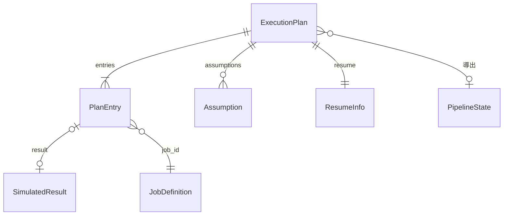

# 機能の仕様(Functional Spec): U3 u3-dry-run(`--dry-run` と `--assume`)

出典: ユニットの定義(`inception/units-generation/unit-of-work.md` の U3)、要件(`requirements-analysis/requirements.md` の FR3.1〜FR3.4、FR1.12、FR5.1、FR5.2、NFR1)、ユニットと要件の対応(`unit-of-work-story-map.md`)、コンポーネントの一覧(`domain-design/components.md`)、契約(`contract-design/contract-summary.md` の C1、C2、C5、C7)、U1 の設計と実装(名前の要約)、U2 の設計(コマンドの表示、リトライの要約)、機能の設計の質問(`functional-design-questions.md`。以下 Q1〜Q4)、既存のコード(`crates/core/src/flow/{decide,next_step}.rs`、`crates/cli/src/{ctx,pipeline,run,args}.rs`)。ユーザーストーリーは作っていない(省略したステージ)ので、要件(FR)の単位で記す。

この文書は、ワークフローと表示の形の原本である。データの形は `entities.md`、判断の規則は `rules.md`(BR の番号)が原本で、ここの ER 図と規則の要約は、その導出である。

## 1. 範囲

- この Bolt(B3)が作るもの: `conductor pipeline <name> --dry-run [--assume <ジョブID>=<終了コード>]...` と `conductor run <ジョブID> --dry-run [--assume ...]`。実行計画の生成(`core`)、`--assume` の模擬、計画の整形(`cli`)。
- 作らないもの: 本番の実行に影響する変更(`--dry-run` なしの動きは、変えない)、計画のファイル出力、`graph`(U2)や `init`(U4)。
- 変更の範囲(実装の指針):
  - `conductor-core`: 新しいモジュール `plan/`(計画の型、模擬、計画の生成)。
  - `conductor-cli`: `args.rs`、`types.rs`(`--dry-run`、`--assume` の文法と検査)、`ctx.rs`(シグナルの準備を除いた準備の切り出し)、`pipeline.rs` と `run.rs`(`--dry-run` の分岐)または新しい `dry_run.rs`(流れ)、`report/`(計画の整形、メッセージ)。
  - `conductor-runtime`、`conductor-converter`: 変更なし。

## 2. ワークフロー

### WF1 引数(`CliArgs`。BR2.1、BR2.2、BR4.5)

1. `--dry-run` は、`pipeline` と `run` だけで使える。それ以外では、許されないオプション(68)。同じオプションの重複は、68(既存の規則)。
2. `--assume` は、複数回指定できる。値は `<ジョブID>=<終了コード>`。`=` がない、終了コードが整数でない、0〜255 の範囲外、同じジョブ ID の重複は、使い方の誤り(68)。表示に、入力の値を含めない(誤りの種類だけ)。`--dry-run` がないときは、68。
3. `--run-id`、`--remove-on-complete` は、本番と同じに受け付ける(後者は、効果がない)。

### WF2 `--dry-run` の準備(`CliFlows`。BR1.1、BR4.1、BR4.2)

`prepare` と同じ順序で、シグナルの準備と、ステートの書き込みを除いて、次を行う。

1. 定義の検査と `command` の検査(`check_definition`。誤りは 64)。
2. `run` のとき、対象のジョブが定義にあるかの検査(なければ使い方の誤り 68)。`--assume` のジョブ ID が定義にあるかの検査(なければ 68)。
3. run ID の決定(`prepare` と同じ。誤りは 68)。
4. `.env` の読み取り(U1。`pipeline` は全ジョブの分、`run` は `[pipeline]` とそのジョブの分。誤りは 64)。
5. `read_state`(本番と同じ。完了したステートは「無い」として返る)と、`check_consistency`(誤りは 65)。
6. 各ジョブのコマンドを、`runtime` の `check_command` で分ける(1. で検査済みなので、誤りは起きない)。

### WF3 計画の生成(`CorePlan`。BR1.2〜BR1.7、BR2.3、BR2.4、BR4.3)

入力: 定義、ステート(なければ空)、各ジョブの分割後のコマンド、`LoadedEnvFiles`、run ID、仮定、方式(`pipeline` か `run`)、対象のジョブ(`run` のとき)。出力: `ExecutionPlan`、または拒否(ジョブ ID と理由)。

`pipeline`(模擬):
1. 模擬の状態(ジョブの状態、再開位置、`end_reached`)を、ステートから作る(なければ、すべて pending)。
2. 定義の記述順に、ジョブごとに `decide_before_run` で決める。
   - `Reject`: 拒否を返す(BR4.3)。
   - `Skip(reason)`: 扱いを決める(実行済み、遷移でスキップ、`@end` のあとでスキップ)。模擬の状態は、変えない(スキップは、すでに決まっている)。
   - `Run`: 仮定(なければ終了コード 0)の実行結果を作る(`JobExecution`。`started = true`)。`classify_and_decide`(`RunMode::Pipeline`)で、分類と次の動きを決める。模擬の状態に、結果(成功、警告、エラー)と、次の動きのスキップ(`skipped_job_ids` を skipped に)と、`end_reached` を反映する。分類がエラー(または conductor 自身のエラー)なら、模擬を止め、以降のジョブを not_reached にする。
3. 模擬の最後を決める(PlanEnd): エラーで止まった(stopped_at_error)、`@end` に到達した(end_reached)、最後まで終わった(completed)。
4. 仮定したジョブのうち、will_run にならなかったものを、unused_assumptions にする(指定順)。
5. 各ジョブの項目に、分割後のコマンド、環境変数の名前(U1 の名前の要約。試行 1、run ID があれば run ID)、リトライの設定を持たせる。
6. 模擬の状態は、関数の中だけで持つ。返さず、保存しない。

`run`:
1. `decide_before_run`(対象のジョブ。ステートから)。`Reject` なら拒否を返す。`Skip(reason)` なら、その扱いの項目を 1 つ。`Run` なら will_run の項目を 1 つ。
2. `Run` のとき、仮定(なければ 0)の結果で、`classify_and_decide`(`RunMode::Individual`)を呼び、次の動き(NextStepNote)を作る。
3. 対象でないジョブへの仮定は、unused_assumptions にする。

### WF4 計画の表示(`CliReport`。BR3.1〜BR3.4)

1. 例 P1〜P5 の形で、文字列を作る。ロケール(日本語/英語)に従う。各行の末尾の空白は取り除く。
2. 標準出力に、1 回で書く。成功は 0(BR4.4)。書けなければ 65。拒否のときは、本番と同じ表示(`DisplayEvent::Rejected`)と 66。

### WF5 秘匿(BR5.1)

計画の型にも、表示の部品にも、値を渡さない。`--assume` の誤りの表示は、誤りの種類だけ。

## 3. 期待する出力の例(原本)

ジョブは a、b、c、…。行末の空白は取り除いてある。「環境変数」の名前の順は、U1 の名前の要約の順(層の順、最後に `CONDUCTOR_*`。`CONDUCTOR_RUN_ID` は run ID があるときだけ)。

P1 すべて成功の流れ(a〜c。ステートなし、run ID なし、`--assume` なし):

```text
計画(--dry-run): パイプライン demo
再開位置: 最初から
1. [実行する] a
     コマンド: ["echo", "a"]
     環境変数: CONDUCTOR_PIPELINE, CONDUCTOR_JOB_ID, CONDUCTOR_ATTEMPT
2. [実行する] b
     コマンド: ["echo", "b"]
     環境変数: CONDUCTOR_PIPELINE, CONDUCTOR_JOB_ID, CONDUCTOR_ATTEMPT
3. [実行する] c
     コマンド: ["echo", "c"]
     環境変数: CONDUCTOR_PIPELINE, CONDUCTOR_JOB_ID, CONDUCTOR_ATTEMPT
結果(模擬): 完了
```

P2 再開と仮定(a〜d。a は成功で記録済み、b でエラーで停止して再開位置。run ID `r1`。`[pipeline.env]` に `API_URL`。c にリトライ(終了コード 75、76、最大 3 回、間隔 5 秒)。`--assume c=75`):

```text
計画(--dry-run): パイプライン demo(run ID: r1)
再開位置: b(前回の停止)
仮定: c=75
1. [実行済み] a
2. [実行する] b  <- 再開位置
     コマンド: ["echo", "b"]
     環境変数: API_URL, CONDUCTOR_PIPELINE, CONDUCTOR_JOB_ID, CONDUCTOR_RUN_ID, CONDUCTOR_ATTEMPT
3. [実行する(仮定: 終了コード 75 → エラー、リトライの対象)] c
     コマンド: ["fetch", "--retry"]
     環境変数: API_URL, CONDUCTOR_PIPELINE, CONDUCTOR_JOB_ID, CONDUCTOR_RUN_ID, CONDUCTOR_ATTEMPT
     リトライ: 終了コード 75、76 を最大 3 回、間隔 5 秒
4. [実行されない(停止のあと)] d
結果(模擬): 停止(エラー: c)
```

P3 使われなかった仮定(a〜c。a が成功で c へ飛ぶ。`--assume b=1`):

```text
計画(--dry-run): パイプライン demo
再開位置: 最初から
仮定: b=1
使われなかった仮定: b
1. [実行する] a
     コマンド: ["echo", "a"]
     環境変数: CONDUCTOR_PIPELINE, CONDUCTOR_JOB_ID, CONDUCTOR_ATTEMPT
2. [スキップ(遷移)] b
3. [実行する] c
     コマンド: ["echo", "c"]
     環境変数: CONDUCTOR_PIPELINE, CONDUCTOR_JOB_ID, CONDUCTOR_ATTEMPT
結果(模擬): 完了
```

P4 `@end` に到達(a〜c。a が警告で `@end`。`--assume a=3`。3 は a の警告コード):

```text
計画(--dry-run): パイプライン demo
再開位置: 最初から
仮定: a=3
1. [実行する(仮定: 終了コード 3 → 警告)] a
     コマンド: ["echo", "a"]
     環境変数: CONDUCTOR_PIPELINE, CONDUCTOR_JOB_ID, CONDUCTOR_ATTEMPT
2. [スキップ(@end のあと)] b
3. [スキップ(@end のあと)] c
結果(模擬): @end に到達(完了)
```

P5 `run b --dry-run`(a〜c。a は成功で記録済み。仮定なし):

```text
計画(--dry-run): パイプライン demo
対象のジョブ: b
1. [実行する] b
     コマンド: ["echo", "b"]
     環境変数: CONDUCTOR_PIPELINE, CONDUCTOR_JOB_ID, CONDUCTOR_ATTEMPT
次の動き: 次のジョブ c
```

(`run` では、ステートの再開位置を示さず、対象のジョブだけを示す。BR1.4。)

P6 既定の終了コード 0 がエラーになるジョブ(a、b。a の `success_exit_codes = [10]`。`--assume` なし):

```text
計画(--dry-run): パイプライン demo
再開位置: 最初から
1. [実行する(既定: 終了コード 0 → エラー)] a
     コマンド: ["make"]
     環境変数: CONDUCTOR_PIPELINE, CONDUCTOR_JOB_ID, CONDUCTOR_ATTEMPT
2. [実行されない(停止のあと)] b
結果(模擬): 停止(エラー: a)
```

P7 `run a --dry-run`(a〜d。a が成功で c へ飛ぶ。仮定なし):

```text
計画(--dry-run): パイプライン demo
対象のジョブ: a
1. [実行する] a
     コマンド: ["echo", "a"]
     環境変数: CONDUCTOR_PIPELINE, CONDUCTOR_JOB_ID, CONDUCTOR_ATTEMPT
次の動き: 次のジョブ c(スキップ: b)
```

P8 `run a --dry-run`(a〜c。a が成功で `@end`。後ろに未処理のジョブがある。仮定なし):

```text
計画(--dry-run): パイプライン demo
対象のジョブ: a
1. [実行する] a
     コマンド: ["echo", "a"]
     環境変数: CONDUCTOR_PIPELINE, CONDUCTOR_JOB_ID, CONDUCTOR_ATTEMPT
次の動き: @end に到達(残りのジョブは、呼ばれたときにスキップ)
```

「次の動き」の表示の表(BR1.6): stopped=`停止`、end_reached で後ろに未処理あり=`@end に到達(残りのジョブは、呼ばれたときにスキップ)`、completed=`完了`、それ以外で次のジョブあり=`次のジョブ <ID>`(スキップがあれば `(スキップ: <ID>、…)`)。仮定(指定、または既定の 0)の結果が警告またはエラーのときは、先頭に `(仮定: 終了コード <n> → 警告|エラー)`(既定のときは `(既定: 終了コード 0 → 警告|エラー)`)を添える。

### 英語の例(日本語の例 P2、P4 の英語版。語句の原本)

P2e:

```text
plan (--dry-run): pipeline demo (run ID: r1)
resume: b (previous stop)
assume: c=75
1. [already executed] a
2. [run] b  <- resume here
     command: ["echo", "b"]
     env: API_URL, CONDUCTOR_PIPELINE, CONDUCTOR_JOB_ID, CONDUCTOR_RUN_ID, CONDUCTOR_ATTEMPT
3. [run (assumed: exit code 75 -> error, retry target)] c
     command: ["fetch", "--retry"]
     env: API_URL, CONDUCTOR_PIPELINE, CONDUCTOR_JOB_ID, CONDUCTOR_RUN_ID, CONDUCTOR_ATTEMPT
     retry: exit codes 75, 76, up to 3 times, every 5 s
4. [not run (after stop)] d
result (simulated): stopped (error: c)
```

P4e:

```text
plan (--dry-run): pipeline demo
resume: from the start
assume: a=3
1. [run (assumed: exit code 3 -> warning)] a
     command: ["echo", "a"]
     env: CONDUCTOR_PIPELINE, CONDUCTOR_JOB_ID, CONDUCTOR_ATTEMPT
2. [skip (after @end)] b
3. [skip (after @end)] c
result (simulated): reached @end (completed)
```

英語の語句の対応(上の例にない形): `from the start`、`(previous stop)`、`(target job)`(ヘッダー `target job: b`)、`unused assumptions:`、`[skip (transition)]`、`next step:`(`next job c`、`next job c (skipped: b)`、`reached @end (the rest are skipped when called)`、`done`、`stop`)、`(assumed: exit code <n> -> success|warning|error)`、`(default: exit code 0 -> warning|error)`、`, retry target`。実装は、日本語と英語の両方を、テストで、この文書のとおりに固定する(ジョブ ID と、使われなかった仮定のジョブ ID は、制御文字をエスケープして表示する)。

### 計画が示さないこと(BR1.8。README にも書く)

中断(シグナル)、起動の失敗(プログラムが無い、実行権がない。PATH の探索はしない)、リトライの回数ごとの結果、ジョブごとに変わりうる実際の終了コード。計画は、仮定した終了コード 1 つを、そのジョブの最終の結果として、進める。完了したステートがあるとき(前回の実行が完了済み)は、本番と同じに、ステートが無いものとして、「最初から」を示す(U2 の `graph --state` が、完了したステートを示すのとは、目的が違う。BR1.4)。

## 4. 状態遷移

ライフサイクルを持つエンティティはない。`--dry-run` は、ステートを読むだけで、何も書かない(BR1.1)。

## 5. 契約への反映(契約の設計との差と、決まったこと)

- C1(名前の要約): U1 の設計のとおり(引き継いだ環境の名前を含まない)。この Unit は、試行 1(`CONDUCTOR_ATTEMPT` は名前だけで、値は示さない)で使う。契約の未解決事項(`CONDUCTOR_ATTEMPT` の値)は、解決。
- C2(辺の判断の入口): **変更**。契約と、ユニットの依存(U3 は U2 に依存)は、U3 が U2 の辺の取り出しを使う前提だった。設計では、計画の生成は、既存の `decide_before_run` と `classify_and_decide`(実行と同じ判断)を使い、U2 の辺の取り出しは使わない。このため、U3 は、U2 の成果に、実質的に依存しない(U2 は、先に終わっている)。U2 が公開した遷移の解決は、`classify_and_decide` の内部で、U3 から見ると変わらない。
- C5: `--dry-run` は `pipeline` と `run` だけ。`--assume` は `--dry-run` と一緒だけ(68)。`--assume` の不正な入力は 68(契約の未解決事項は、解決)。`--remove-on-complete` との併用は、受け付けて、無視する。
- C7(`--dry-run` の出力の構造): **具体化**。契約の項目と順序(ヘッダー、再開位置、仮定、ジョブごと)に、「使われなかった仮定」と「模擬の結果」の行を足した。見た目は、この文書の例 P1〜P5 で決まった。契約の未解決事項(C7 の文言と書式)は、解決。拒否(66)は、計画の項目にせず、本番と同じ誤りにした(契約に無かった決定。質問 Q4)。
- コマンドの分割の置き場所(契約 C1、C7 の未解決事項): `CliFlows` が分けて、`core` に渡す(質問せずに決めた前提)。

## 6. 導出: ER 図(`entities.md` の導出)



テキストの代替: `ExecutionPlan` は、1 つ以上の `PlanEntry`、0 個以上の `Assumption`、1 つの `ResumeInfo` を持つ。`PlanEntry` は、`will_run` のときだけ `SimulatedResult` を持ち、ジョブ(`JobDefinition`)を参照する。計画は、ステート(`PipelineState`)から導出する。

## 7. 導出: ルールの要約(`rules.md` の導出)

| グループ | 内容 | ルール |
|----------|------|--------|
| 計画と模擬 | 実行せず書かない、実行と同じ判断、扱い、再開位置、コマンドと環境変数の名前とリトライ、`run` の計画、リトライは繰り返さない | BR1.1〜BR1.7 |
| `--assume` | 不正な入力は 68、`--dry-run` と一緒だけ、使われなかった仮定、既定は成功 | BR2.1〜BR2.4 |
| 出力 | 項目と順序、見出しの行、詳細の行、標準出力 | BR3.1〜BR3.4 |
| 誤りと終了コード | 定義と `.env` は 64、ステートは 65、拒否は 66、計画を出せたら 0、併用 | BR4.1〜BR4.5 |
| 秘匿 | 値を出さない | BR5.1 |
| 文書と性能 | メッセージ、README とデモ、1,000 ジョブ | BR6.1〜BR6.3 |

## 8. テストの観点(Code Generation の入力。test-after、行カバレッジ 80%)

- 単体(core): 模擬(すべて成功、仮定で警告、仮定でエラー(停止)、遷移でスキップ、`@end` への到達、実行済み、再開位置、ステートなし、完了したステート)、仮定(使われなかった仮定、リトライの対象の注記、`success_exit_codes` に 0 を含まないジョブの既定)、`run` の計画(次の動き)、拒否(`pipeline` の模擬、`run`)、実行との一致(同じ定義、同じステート、同じ結果の仮定で、`pipeline` の本番の流れ(偽の `Runtime`)が起動するジョブと、計画の will_run が、すべて一致する)、1,000 ジョブで 1 秒以内。
- 単体(cli の整形): 例 P1〜P5(日本語と英語)、コマンドの表示のエスケープ、環境変数の名前の順。
- 統合(cli、偽の `Runtime`): `--dry-run` が、ジョブを起動せず、ステートに書かず(書き込みと削除が呼ばれない)、シグナルを準備しない。定義の誤り、`command` の誤り、`.env` の誤りで 64、ステートの食い違いで 65、拒否で 66、`--assume` の不正な入力(`=` なし、整数でない、範囲外、重複、存在しないジョブ)で 68、`--assume` だけ(`--dry-run` なし)で 68、`--dry-run` を `validate` などに付けて 68。計画を出せたら 0。
- 統合(実バイナリ): `conductor pipeline demo --dry-run` と `--assume` の出力が、例と一致する。実際に作ったステートから、再開位置が出る。環境変数の値が、標準出力、標準エラーのどこにも無い(`.env` と `env` を持つ定義で)。何も実行されず、ステートのファイルが変わらない(バイト列の比較)。

## 9. 未解決の事項

なし(この Bolt の範囲で、決めるべきことは、すべて決めた)。
