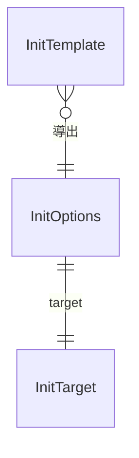

# 機能の仕様(Functional Spec): U4 u4-init(`conductor init`)

出典: ユニットの定義(`inception/units-generation/unit-of-work.md` の U4)、要件(`requirements-analysis/requirements.md` の FR4.1〜FR4.5、FR5.1、FR5.2)、ユニットと要件の対応(`unit-of-work-story-map.md`)、コンポーネントの一覧(`domain-design/components.md`)、契約(`contract-design/contract-summary.md` の C3、C4、C5)、U1 の設計(`[pipeline.env]` の検査)、機能の設計の質問(`functional-design-questions.md`。以下 Q1〜Q4)、既存のコード(`crates/cli/src/{args,types,lib,ctx,exit}.rs`、`crates/runtime/src/state/writer.rs`)。ユーザーストーリーは作っていない(省略したステージ)ので、要件(FR)の単位で記す。

この文書は、ワークフローとひな形の原本である。データの形は `entities.md`、判断の規則は `rules.md`(BR の番号)が原本で、ここの ER 図と規則の要約は、その導出である。

## 1. 範囲

- この Bolt(B4)が作るもの: `conductor init [--config <パス>] [--force] [<パイプライン名>]`。ひな形の生成(日本語と英語)、排他的なファイルの作成と上書き、標準出力への出力、誤りの扱い。
- 作らないもの: 複数種類のひな形、対話的な質問、親ディレクトリの作成(Q4)、ひな形のファイルへの追記。
- 変更の範囲(実装の指針):
  - `conductor-runtime`: 新しいモジュール(`file_create`)。排他的な作成と、一時ファイルからの置き換え。`CreateOutcome`、`CreateError`。
  - `conductor-cli`: `args.rs`、`types.rs`(`init` と `--force` の文法)、`report/`(ひな形の文字列、メッセージ)、新しい `init.rs`(流れ)、`lib.rs`(振り分け)。
  - `conductor-core`、`conductor-converter`: 変更なし。

## 2. ワークフロー

### WF1 引数(`CliArgs`。BR1.1、BR2.2、BR3.1)

1. `init` は、`--config <パス>`、`--force`、位置引数 1 つ(パイプライン名。省略できる)を受け付ける。位置引数が 2 つ以上、名前が空または空白だけ、は使い方の誤り(68)。
2. `--force` は、`init` だけで使える。`init` では、`--dry-run`、`--assume`、`--format`、`--state`、`--run-id`、`--remove-on-complete` は、許されないオプション(68)。同じオプションの重複は、68(既存の規則)。
3. パスは、`--config`(なければ `conductor.toml`)。`-` なら標準出力(`InitTarget::stdout`)。

### WF2 `init` の流れ(`CliFlows`。BR1.1〜BR1.6)

1. ロケールを決める(ほかのコマンドと同じ)。パイプライン名(省略なら `my-pipeline`)から、ひな形(`InitTemplate`)を作る。
2. 出力先が標準出力なら: ひな形を標準出力に 1 回で書いて、終了コード 0(書けなければ 65)。成功のメッセージは出さない。`--force` は無視する。
3. 出力先がファイルなら、`RuntimeFileCreate` を呼ぶ:
   - `--force` なし: 排他的な作成。既にあれば、何も変更せず、標準エラーに「既にあります」を出して、69。
   - `--force` あり: 一時ファイルに書き、置き換える。
4. 作れたら、標準エラーに 1 行(「<パス> を作成しました」、置き換えたときは「置き換えました」)を出して、0。
5. 作れなかったら(親のディレクトリが無い、権限がない、作る先がディレクトリ、そのほか)、標準エラーに、種類の固定の文とパスを出して、65。

### WF3 排他的なファイルの作成(`RuntimeFileCreate`。BR1.3、BR1.6)

1. 新規: `create_new`(ファイルがなければ作る、1 回の操作)。失敗したら、パスを `symlink_metadata` で調べて、`BR1.3` の表のとおりに分類する(ディレクトリ → `is_directory`、ファイルかシンボリックリンク → `already_exists`、`NotFound` → `parent_missing`、権限 → `permission_denied`、そのほか → `other_io`)。書き込みに失敗したら、作りかけのファイルを消す(新規で作ったものに限る)。
2. 置き換え(`--force`): 親のディレクトリが無ければ `parent_missing`。置き換え先がディレクトリなら `is_directory`。同じディレクトリに、一時ファイルを作って書き、置き換える(失敗したら、一時ファイルを消す)。
3. 内容は、UTF-8、LF の改行(Windows でも変換しない)。

## 3. ひな形(原本)

名前は、`<名前>`の位置に、BR2.2 のエスケープをして入る(既定は `my-pipeline`)。末尾に改行が 1 つ。

日本語(ロケールが日本語):

```toml
# conductor の定義ファイルのひな形(conductor init が作った)。
# 検査: conductor validate / 実行計画: conductor pipeline <名前> --dry-run / 図: conductor graph
format_version = 1

[pipeline]
name = "<名前>"
description = "ひな形のパイプライン"

# 全ジョブに足す環境変数。値は、書いたとおりに渡す(展開しない)。
# .env ファイルから読むときは、[pipeline] に env_file = ".env" を足す。
[pipeline.env]
GREETING = "hello"

# hello: 最初のジョブ。
# Windows では、echo は実行ファイルではないので、command = ["cmd", "/c", "echo", "hello"] のように書く。
[[job]]
id = "hello"
command = ["echo", "hello"]

# flaky: 終了コード 75 は「一時的な失敗」。5 秒待って、最大 3 回、実行し直す。
# 待ち時間を伸ばすには、multiplier と max_interval を、一緒に書く(例: multiplier = 2、max_interval = "1m")。
[[job]]
id = "flaky"
command = ["echo", "flaky"]

[job.retry]
exit_codes = [75]
max = 3
interval = "5s"
```

英語(ロケールが英語):

```toml
# A starter conductor definition (created by conductor init).
# Check: conductor validate / plan: conductor pipeline <name> --dry-run / diagram: conductor graph
format_version = 1

[pipeline]
name = "<name>"
description = "Starter pipeline"

# Environment variables added to every job. Values are passed as written (no expansion).
# To read a .env file, add env_file = ".env" to [pipeline].
[pipeline.env]
GREETING = "hello"

# hello: the first job.
# On Windows echo is not an executable; write command = ["cmd", "/c", "echo", "hello"] instead.
[[job]]
id = "hello"
command = ["echo", "hello"]

# flaky: exit code 75 means "a temporary failure". Wait 5 seconds and run again, up to 3 times.
# To lengthen the wait, write multiplier and max_interval together (for example multiplier = 2, max_interval = "1m").
[[job]]
id = "flaky"
command = ["echo", "flaky"]

[job.retry]
exit_codes = [75]
max = 3
interval = "5s"
```

名前のエスケープの例: `a"b` → `name = "a\"b"`、`a\b` → `name = "a\\b"`、改行を含む名前 → `\u000A`、日本語の名前(`夜間バッチ`)→ そのまま。

## 4. メッセージ(日本語と英語。BR1.2、BR1.4、BR3.2、BR4.1)

| 場面 | 日本語 | 英語 |
|------|--------|------|
| 作成した | `<パス> を作成しました` | `created <path>` |
| 置き換えた | `<パス> を置き換えました` | `replaced <path>` |
| 既にある(69) | `<パス> は既にあります(上書きするには --force)` | `<path> already exists (use --force to overwrite)` |
| 親が無い(65) | `<パス> を作れません: 親のディレクトリがありません` | `cannot create <path>: the parent directory does not exist` |
| ディレクトリ(65) | `<パス> を作れません: ディレクトリです` | `cannot create <path>: it is a directory` |
| 権限(65) | `<パス> を作れません: 書く権限がありません` | `cannot create <path>: permission denied` |
| そのほか(65) | `<パス> を作れません: 入出力の誤りです` | `cannot create <path>: I/O error` |
| 標準出力に書けない(65。`--config -`) | `ひな形を標準出力に書けません` | `cannot write the template to standard output` |

パスは、制御文字をエスケープして、切り詰めて表示する(定義ファイルのパスと同じ扱い)。

## 5. 契約への反映(契約の設計との差と、決まったこと)

- C3、C4(定義のキー): ひな形は、U1 の新しいキー(`[pipeline.env]`)と、既存のキー(`[job.retry]`)の例を、有効な行として含む。つまり、U4 は、U1 の検査に通ることを、テストで毎回確かめる(U1 への依存は、テストの中だけ。型の依存はない)。
- C5(`init` のコマンドライン): `conductor init [--config <パス>] [--force] [<パイプライン名>]`。終了コードは、成功 0、既にある 69、使い方の誤り 68。契約の未解決事項(`init` の端の動き)は、次のとおり解決した: パイプライン名は、定義と同じ規則(空でない)で、省略すると `my-pipeline`(Q1、Q2)。`-` と `--force` の併用は、受け付けて、`--force` を無視する(Q4)。親のディレクトリが無いときは、作らず、65(Q3、Q4)。作る先がディレクトリのときは、65。契約が決めていなかった終了コード 65(作れなかったとき)を、新しい終了コードを足さずに、既存の「書き込みの失敗」と揃えた。
- 契約 C5 の `path_dash`(標準出力にひな形を出す): そのとおり。成功のメッセージは出さない(標準出力は、ひな形だけ)。

## 6. 導出: ER 図(`entities.md` の導出)



テキストの代替: `InitOptions` は 1 つの出力先(`InitTarget`)を持つ。ひな形(`InitTemplate`)は、ロケールと名前(`InitOptions`)から導出する。

## 7. 導出: ルールの要約(`rules.md` の導出)

| グループ | 内容 | ルール |
|----------|------|--------|
| コマンドと作成 | コマンドの形、既にあれば 69、排他的な作成、`--force`、`-`、親は作らない | BR1.1〜BR1.6 |
| ひな形 | 1 種類、名前の規則とエスケープ、利用者の値は入らない、必ず `validate` に通る | BR2.1〜BR2.4 |
| 終了コード | 0、68、69、作れなければ 65 | BR3.1、BR3.2 |
| 文書 | メッセージ、README とデモ | BR4.1、BR4.2 |

## 8. テストの観点(Code Generation の入力。test-after、行カバレッジ 80%)

- 単体(runtime、一時ディレクトリ): 新規の作成、既にあるファイルを壊さない(`already_exists`。内容が変わらない)、`--force` で置き換える(内容が新しくなる。一時ファイルが残らない)、親が無い、作る先がディレクトリ、権限がない(UNIX のみ。`cfg` は、`platform` の外に置かない: 権限のテストは、`platform` の補助を使うか、実行環境で条件をつける)、同時に作る 2 つのうち 1 つだけが成功する(排他的)。改行が LF のまま(CRLF に変換されない)。
- 単体(cli の整形): ひな形が、日本語と英語の原本と、1 文字も違わず一致する(既定の名前)。名前のエスケープ(`"`、`\`、制御文字、日本語)。ひな形が、`parse_definition` と `check_command` と、U1 の検査(`[pipeline.env]`)を通る(日本語、英語、特殊な名前)。メッセージの網羅(日本語と英語)。
- 統合(cli、偽の `Runtime` または実ファイル): `init` が、定義も `.env` もステートも読まず、シグナルを準備しない。`--config -` で標準出力にひな形だけ(`--force` を無視)、成功のメッセージなし。既にあれば 69 でファイルが変わらない。`--force` で 0。親が無い、ディレクトリで 65。名前が空、位置引数が 2 つ、許されないオプションで 68。
- 統合(実バイナリ): 空のディレクトリで `conductor init` → `conductor validate` が通り、`conductor pipeline my-pipeline --dry-run` が、計画を出す(U3 と組み合わせた確認)。もう一度 `init` で 69。`init --force` で上書き。`init --config -` の出力が、ファイルの内容と同じ。

## 9. 未解決の事項

なし(この Bolt の範囲で、決めるべきことは、すべて決めた)。
