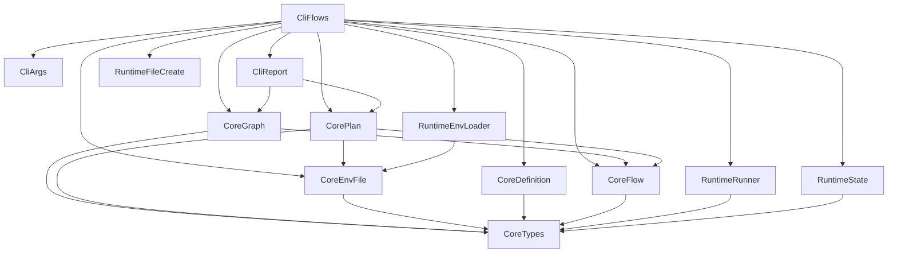

# コンポーネントの一覧: v0.9.0 の機能拡張

出典: 要件(`requirements.md`)、既存の構成(コード知識ベースの `architecture.md`、`component-inventory.md`)、ドメイン設計の質問(`domain-design-questions.md`。以下 Q1〜Q4)。

この文書は、今回の変更で「新しく足す部品」と「変更を受ける既存の部品」を、コンポーネントとして記す。既存の部品のうち、今回の変更に関わらないもの(`converter`、`split`、`platform`、`wait` など)は、載せない。新しい部品は、既存の 3 つのクレート(`conductor-core`、`conductor-runtime`、`conductor-cli`)の中の、新しいモジュールとして置く(新しいクレートは作らない。ADR-005)。

## Part A: コンポーネントのカタログ

```yaml
components:
  - name: CoreTypes
    summary: 定義、ジョブ、ステートなどの、共有する型(既存。env と env_file の項目を足す)
    behaviour: >
      定義の型(`PipelineDefinition`、`JobDefinition`)は、`env`(名前と値の表)と
      `env_file`(パスの並び)を持つ。ステートの内容(`PipelineState`)は、環境変数を持たない。
      型は、値を持つだけで、判断も入出力もしない。
    responsibilities:
      - 定義とステートの型を、すべてのクレートに共有する
    depends_on: []
    dependents:
      - component: CoreDefinition
        interaction: 検証した結果を、この型で返す
      - component: CoreFlow
        interaction: 判断の入力と出力に、この型を使う
      - component: CoreGraph
        interaction: 定義を入力にする
      - component: CorePlan
        interaction: 定義とステートを入力にする
      - component: CoreEnvFile
        interaction: 定義の env の表を入力にする
      - component: RuntimeRunner
        interaction: ジョブの定義(と、統合済みの環境)を受け取る
      - component: RuntimeState
        interaction: ステートの内容を読み書きする
    external_dependencies: []
    entities:
      - name: PipelineDefinition
        identifier: name
        attributes: [name, description, run_id_env, remove_on_complete, env, env_file, jobs]
      - name: JobDefinition
        identifier: id
        attributes: [id, command, warning_exit_codes, success_exit_codes, transitions, retry, env, env_file]
      - name: PipelineState
        identifier: definition_key
        attributes: [definition_key, definition_path, pipeline_name, run_id, job_order, jobs, resume_job_id, end_reached, completed]

  - name: CoreDefinition
    summary: 定義ファイルの読み込みと検証(既存。env と env_file のキーの検査を足す)
    behaviour: >
      Intake、Parse、Depth、VersionCheck、Walk の順で、定義を検証する。新しいキー
      `[pipeline.env]`、`[job.env]`、`env_file` を許可し、名前の規則(run_id_env と同じ)、
      値が文字列であること、`CONDUCTOR_` で始まる名前の拒否(予約名)、Windows に備えた
      大文字小文字だけが違う名前の拒否、を検査する。`format_version` は 1 のまま。
      入力の値(環境変数の値)を、エラーの表示に含めない。
    responsibilities:
      - 定義の検証(新しいキーを含む)
      - 検証の誤りを、種類つきで集める
    depends_on:
      - component: CoreTypes
        interaction: 検証した結果を、定義の型にして返す
        style: sync
    dependents:
      - component: CliFlows
        interaction: 定義を読み込み、検証する
    external_dependencies:
      - name: toml
        kind: other
        purpose: 定義の TOML の読み取り
    entities: []

  - name: CoreFlow
    summary: 次のジョブを決める純粋な判断(既存。変更は小さく、辺の取り出しの入口を公開する)
    behaviour: >
      ジョブの結果の分類、次の動き(成功と警告の行き先、スキップ)、起動前の判断、
      再開位置、リトライの判断を、副作用なしで決める。`graph` と `plan` が、実行と同じ判断を
      使えるように、辺の取り出しと起動前の判断を、外から呼べる形で公開する。
    responsibilities:
      - 結果の分類と、次の動きの決定
      - 起動前の判断と、再開位置の決定
    depends_on:
      - component: CoreTypes
        interaction: 判断の入力と出力の型
        style: sync
    dependents:
      - component: CliFlows
        interaction: 実行の流れの中で、次の動きを決める
      - component: CoreGraph
        interaction: 辺を、実行と同じ判断から作る
      - component: CorePlan
        interaction: 起動前の判断を使って、計画を作る
    external_dependencies: []
    entities: []

  - name: CoreEnvFile
    summary: 【新規】.env の書式の検査と、環境変数の層の統合(純粋な関数)
    behaviour: >
      文字列(.env の内容)を受け取り、`KEY=VALUE` の項目を取り出す。受け付ける書き方は、
      空行、コメント、`export ` の接頭辞、単一引用符、二重引用符(エスケープは \n \r \t \" \\ だけ)、
      引用符なしの値(空白に続く # から先はコメント)。展開と複数行は受け付けない。
      誤りは、行番号つきで返し、値を含めない。同じファイル内の重複キーは、後ろが勝つ。重複の
      位置を警告として返す。NUL を含む値、1 MiB 超、項目 10,000 超は誤りとする。
      4 つの層(引き継いだ環境、env_file、env の表、ジョブの env_file と env)を、優先順位
      どおりに統合し、`CONDUCTOR_*` の自動の変数を足す。値を持つ結果と、名前だけの結果の
      両方を返す。
    responsibilities:
      - .env の文字列の読み取りと検査
      - 環境変数の層の統合(優先順位、自動の変数、予約名の拒否)
      - 名前だけの要約の提供(値を出さないため)
    depends_on:
      - component: CoreTypes
        interaction: 定義の env の表と、統合の結果の型
        style: sync
    dependents:
      - component: CliFlows
        interaction: 実行の前に、層を統合する
      - component: CorePlan
        interaction: 渡される環境変数の名前を、計画に含める
      - component: RuntimeEnvLoader
        interaction: 読んだ文字列を渡して、項目を取り出す
    external_dependencies: []
    entities:
      - name: EnvFileContent
        identifier: path
        attributes: [path, entries, duplicate_warnings]
      - name: EffectiveEnv
        identifier: job_id
        attributes: [job_id, entries, names_only]
        references:
          - entity: JobDefinition
            owned_by: CoreTypes
            relationship: 統合の結果は、1 つのジョブに属する

  - name: CoreGraph
    summary: 【新規】フローの辺の取り出しと、レーンの配置(純粋な関数)
    behaviour: >
      定義から、ジョブと終点(@end)を節、次のジョブへの遷移を辺とする図の構造を作る。
      辺は、`CoreFlow` の判断から作る(実行と食い違わない)。成功と警告の行き先が同じなら、
      1 つの辺にまとめる。`git log --graph` 風に、遷移で飛び越すジョブを、分岐と合流の
      レーンに割り当てる。状態を重ねる入力(任意)を受け取り、節に状態を付ける。文字列の整形は
      しない。ファイルとプロセスに触れない。
    responsibilities:
      - 図の構造(節、辺)の生成
      - レーンの割り当て
      - 状態の重ね合わせ(--state)
    depends_on:
      - component: CoreFlow
        interaction: 辺を、次の動きの判断から作る
        style: sync
      - component: CoreTypes
        interaction: 定義とステートを入力にする
        style: sync
    dependents:
      - component: CliFlows
        interaction: graph コマンドで、図の構造を作る
      - component: CliReport
        interaction: 図の構造を、text と Mermaid に整形する
    external_dependencies: []
    entities:
      - name: FlowEdge
        identifier: from_job
        attributes: [from_job, to, kind, skipped_jobs, explicit]
        references:
          - entity: JobDefinition
            owned_by: CoreTypes
            relationship: 辺は、1 つのジョブから出る

  - name: CorePlan
    summary: 【新規】--dry-run の計画を作る純粋な関数
    behaviour: >
      定義、読み込んだステートの内容、(任意の)仮定の終了コードを受け取り、再開位置と、
      ジョブごとの扱い(実行する、スキップする)、分割後のコマンド、渡される環境変数の名前、
      リトライの設定を返す。起動前の判断と、次の動きを、`CoreFlow` から使う。仮定の終了コード
      (--assume)を使うと、実行せずに、流れを模擬する。入出力をしない。
    responsibilities:
      - 実行計画の生成
      - 仮定の終了コードによる流れの模擬
    depends_on:
      - component: CoreFlow
        interaction: 起動前の判断と、次の動きを使う
        style: sync
      - component: CoreEnvFile
        interaction: 渡される環境変数の名前を取り出す
        style: sync
      - component: CoreTypes
        interaction: 定義とステートを入力にする
        style: sync
    dependents:
      - component: CliFlows
        interaction: --dry-run で、計画を作る
      - component: CliReport
        interaction: 計画を整形して表示する
    external_dependencies: []
    entities:
      - name: ExecutionPlan
        identifier: pipeline_name
        attributes: [pipeline_name, resume_job_id, entries, assumed_codes]
        references:
          - entity: PipelineState
            owned_by: CoreTypes
            relationship: 計画は、1 つのステートの内容から作られる
      - name: PlanEntry
        identifier: job_id
        attributes: [job_id, disposition, command_words, env_names, retry]

  - name: RuntimeRunner
    summary: ジョブの起動とシグナルの転送(既存。環境変数を足す口を持つ)
    behaviour: >
      command を分け、環境を引き継いだ上で、統合済みの環境変数を足して、子プロセスを起動する。
      ステートには、環境変数を書かない。
    responsibilities:
      - 子プロセスの起動(環境変数つき)
      - 終了コードの取得
    depends_on:
      - component: CoreTypes
        interaction: ジョブの定義を受け取る
        style: sync
    dependents:
      - component: CliFlows
        interaction: ジョブを起動する
    external_dependencies: []
    entities: []

  - name: RuntimeState
    summary: ステートの読み込み、書き込み、照合(既存。変更なし)
    behaviour: >
      ステートの内容を、原子的に読み書きする。環境変数の値は、ステートに含めない。
    responsibilities:
      - ステートの読み書きと照合
    depends_on:
      - component: CoreTypes
        interaction: ステートの内容の型
        style: sync
    dependents:
      - component: CliFlows
        interaction: ステートを読み書きする(dry-run では読み取りだけ)
    external_dependencies:
      - name: toml
        kind: other
        purpose: ステートの TOML の読み書き
    entities: []

  - name: RuntimeEnvLoader
    summary: 【新規】.env のファイルを開いて、文字列にする
    behaviour: >
      定義ファイルのあるディレクトリを基準にして、`env_file` のパスを解決し、ファイルを読む。
      大きさの上限(1 MiB)を、読み取りの前後で守る。UTF-8 でない、存在しない、読めない場合は、
      種類つきで返す。文字列を `CoreEnvFile` に渡して、項目を取り出す。呼び出しごとに、最初の
      ジョブを起動する前に、すべて読む。
    responsibilities:
      - env_file のパスの解決
      - ファイルの読み取り(上限つき)
    depends_on:
      - component: CoreEnvFile
        interaction: 読んだ文字列から、項目を取り出す
        style: sync
    dependents:
      - component: CliFlows
        interaction: 実行の前に、すべての .env を読む
    external_dependencies: []
    entities: []

  - name: RuntimeFileCreate
    summary: 【新規】排他的なファイルの作成(init 用)
    behaviour: >
      既に存在するファイルを壊さずに(排他的に)、新しいファイルを作る。既にあるときは、
      その種類を返す。`--force` のときは、上書きする。ステートの書き込みと同じ流儀で、
      原子的に書く。
    responsibilities:
      - 排他的なファイルの作成
      - 上書き(--force)
    depends_on: []
    dependents:
      - component: CliFlows
        interaction: init で、ひな形のファイルを作る
    external_dependencies: []
    entities: []

  - name: CliArgs
    summary: 引数の解釈(既存。graph、init、--dry-run、--assume、--state、--format、--force を足す)
    behaviour: >
      コマンドごとの許可、重複、併用を検査する。`--assume <ジョブID>=<終了コード>` の書式を
      検査する。引数の誤りは、使い方の誤りとして返す。
    responsibilities:
      - 新しいサブコマンドとオプションの解釈
    depends_on: []
    dependents:
      - component: CliFlows
        interaction: 解釈した結果で、コマンドを実行する
    external_dependencies:
      - name: lexopt
        kind: other
        purpose: 引数の字句の分解
    entities: []

  - name: CliReport
    summary: 表示(既存。図、計画、警告、ひな形のメッセージを足す)
    behaviour: >
      メッセージ(日本語と英語)、図の text と Mermaid への整形、計画の整形、
      `validate` の警告、ひな形の文字列を担当する。環境変数の値は表示しない(名前だけ)。
    responsibilities:
      - メッセージカタログ(日本語/英語)
      - 図と計画の整形
      - ひな形の文字列
    depends_on:
      - component: CoreGraph
        interaction: 図の構造を、text と Mermaid に整形する
        style: sync
      - component: CorePlan
        interaction: 計画を整形する
        style: sync
    dependents:
      - component: CliFlows
        interaction: 結果を表示する
    external_dependencies: []
    entities:
      - name: InitTemplate
        identifier: locale
        attributes: [locale, text]

  - name: CliFlows
    summary: コマンドごとの流れの組み立て(既存。graph、init、--dry-run を足す)
    behaviour: >
      `pipeline`、`run`、`validate`、`graph`、`init` の流れを組み立てる。実行の前に、
      `.env` をすべて読んで統合する(誤りなら、何も実行せず止まる)。`--dry-run` では、
      ステートを読み取りだけにして、計画を表示する。
    responsibilities:
      - コマンドごとの流れの組み立て
      - 終了コードの決定
    depends_on:
      - component: CliArgs
        interaction: 解釈した引数を受け取る
        style: sync
      - component: CliReport
        interaction: 結果を表示する
        style: sync
      - component: CoreDefinition
        interaction: 定義を読み込み、検証する
        style: sync
      - component: CoreFlow
        interaction: 実行の流れの中で、次の動きを決める
        style: sync
      - component: CoreEnvFile
        interaction: 環境変数の層を統合する
        style: sync
      - component: CoreGraph
        interaction: graph の図の構造を作る
        style: sync
      - component: CorePlan
        interaction: --dry-run の計画を作る
        style: sync
      - component: RuntimeRunner
        interaction: ジョブを起動する
        style: sync
      - component: RuntimeState
        interaction: ステートを読み書きする
        style: sync
      - component: RuntimeEnvLoader
        interaction: .env のファイルを読む
        style: sync
      - component: RuntimeFileCreate
        interaction: init でファイルを作る
        style: sync
    dependents: []
    external_dependencies: []
    entities: []
```

## Part B: 人が読む形

### コンポーネントの図



### コンポーネントの要約

| Component | Purpose | Depends On | Dependents | Entities Owned |
|-----------|---------|------------|------------|----------------|
| CoreTypes | 共有する型 | なし | CoreDefinition、CoreFlow、CoreGraph、CorePlan、CoreEnvFile、RuntimeRunner、RuntimeState | PipelineDefinition、JobDefinition、PipelineState |
| CoreDefinition | 定義の読み込みと検証(既存) | CoreTypes | CliFlows | なし |
| CoreFlow | 次のジョブを決める判断(既存) | CoreTypes | CliFlows、CoreGraph、CorePlan | なし |
| CoreEnvFile | .env の検査と層の統合(新規) | CoreTypes | CliFlows、CorePlan、RuntimeEnvLoader | EnvFileContent、EffectiveEnv |
| CoreGraph | 辺とレーンの配置(新規) | CoreFlow、CoreTypes | CliFlows、CliReport | FlowEdge |
| CorePlan | --dry-run の計画(新規) | CoreFlow、CoreEnvFile、CoreTypes | CliFlows、CliReport | ExecutionPlan、PlanEntry |
| RuntimeRunner | ジョブの起動(既存) | CoreTypes | CliFlows | なし |
| RuntimeState | ステートの読み書き(既存) | CoreTypes | CliFlows | なし |
| RuntimeEnvLoader | .env のファイルの読み取り(新規) | CoreEnvFile | CliFlows | なし |
| RuntimeFileCreate | 排他的なファイルの作成(新規) | なし | CliFlows | なし |
| CliArgs | 引数の解釈(既存) | なし | CliFlows | なし |
| CliReport | 表示と整形(既存) | CoreGraph、CorePlan | CliFlows | InitTemplate |
| CliFlows | 流れの組み立て(既存) | 上の 11 個 | なし | なし |

### エンティティの所有

| Entity | Owning Component | Identifier | Attributes | References |
|--------|------------------|------------|------------|------------|
| PipelineDefinition | CoreTypes | name | name、description、run_id_env、remove_on_complete、env、env_file、jobs | なし |
| JobDefinition | CoreTypes | id | id、command、warning_exit_codes、success_exit_codes、transitions、retry、env、env_file | なし |
| PipelineState | CoreTypes | definition_key | definition_key、definition_path、pipeline_name、run_id、job_order、jobs、resume_job_id、end_reached、completed | なし |
| EnvFileContent | CoreEnvFile | path | path、entries、duplicate_warnings | なし |
| EffectiveEnv | CoreEnvFile | job_id | job_id、entries、names_only | JobDefinition(CoreTypes) |
| FlowEdge | CoreGraph | from_job | from_job、to、kind、skipped_jobs、explicit | JobDefinition(CoreTypes) |
| ExecutionPlan | CorePlan | pipeline_name | pipeline_name、resume_job_id、entries、assumed_codes | PipelineState(CoreTypes) |
| PlanEntry | CorePlan | job_id | job_id、disposition、command_words、env_names、retry | なし |
| InitTemplate | CliReport | locale | locale、text | なし |

### 外部の依存

| Component | Dependency | Kind | Purpose |
|-----------|------------|------|---------|
| CoreDefinition | toml | other | 定義の TOML の読み取り |
| RuntimeState | toml | other | ステートの TOML の読み書き |
| CliArgs | lexopt | other | 引数の字句の分解 |

新しい外部の依存は、足さない(project.md の NEVER)。

### 根拠(Rationale)

| Component | 別の部品にする理由 |
|-----------|--------------------|
| CoreEnvFile | `.env` の読み取りと、層の統合は、入出力を持たない純粋な処理で、変更の理由(書式、優先順位)が、ほかと違う。純粋にすると、`graph` と `--dry-run` が、実行せずに結果を使える(Q1) |
| CoreGraph | 図の辺は、実行と同じ判断から作る必要がある(FR2.4)。レーンの配置は、純粋で、定義だけでテストできる(Q2) |
| CorePlan | 実行しない計画と、模擬(--assume)を、実行と同じ判断から作る。実行の流れに、実行しない分岐を混ぜない(Q3) |
| RuntimeEnvLoader | ファイルを開く処理は、`runtime` に集める。`core` は、`intake` 以外でファイルに触れない(Q1) |
| RuntimeFileCreate | 排他的なファイルの作成は、ファイルの書き込みの責務で、ステートの書き込みと同じ流儀にする(Q4) |
| CliReport の InitTemplate | メッセージと同じ置き場所に、文字列をまとめる(Q4) |

#### 境界の選択肢と、選んだもの

- `.env` の置き場所(Q1): A(core の envfile + runtime の読み取り。選んだもの)、B(すべて runtime)、C(すべて core)。B は、`graph` と `--dry-run` が `runtime` に依存する。C は、`core` がファイルに触れる範囲が広がる。
- `graph`(Q2): A(辺とレーンは core、整形は cli。選んだもの)、B(整形まで core)、C(すべて cli)。B は、`core` が表示の都合を持つ。C は、辺の判断を作り直し、実行との食い違いが出る。
- `--dry-run`(Q3): A(core の plan。選んだもの)、B(cli の流れに分岐を足す)。B は、実行の流れに、実行しない分岐が混ざる。
- `init`(Q4): A(文字列は cli、作成は runtime。選んだもの)、B(すべて cli)。B は、ファイルの操作が `cli` に散らばる。

詳細は、`decisions.md` の ADR-001 から ADR-005 を参照。

## 未解決事項(Open questions)

- 環境変数を足す口(`RuntimeRunner`)の具体のシグネチャは、Functional Design で決める。
- `.env` の誤りの終了コード(要件 FR1.8 の未解決事項)は、Functional Design で決める。
