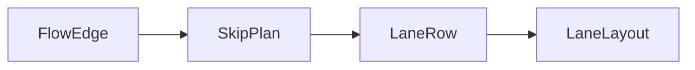

# 機能の仕様(Functional Spec): graph の text 表示の改善

対象: `conductor graph` の text(`--format text`)のレーンの配置と、辺の一覧への切り替え。`--format mermaid`、`--state`、`-v` の書式は変えない(BR3.2)。入力の質問と答え: `functional-design-questions.md`(Q1: A、Q2: A)。

## 1. 変更の要点

| 形 | 今(v0.9.0) | この変更のあと |
|----|-------------|----------------|
| 同じ行き先へ飛ぶ辺が 2 つ以上(交差しない) | 辺の一覧 | レーンの図。2 つ目以降は、既存の線に合流(`|\|`)(BR1.1〜BR1.4) |
| 成功と警告の両方が次のジョブを飛び越す | 辺の一覧 | レーンの図。そのジョブは線なしの `*` の行(BR2.1) |
| 飛び越しが交差する | 辺の一覧 | 辺の一覧(変わらない。BR1.5) |
| 1 つのジョブが、異なる行き先への飛び越しを 2 つ持つ | 辺の一覧 | 辺の一覧(変わらない。BR3.1) |
| 上記以外 | 従来どおり | 1 文字も変わらない(BR3.2) |

## 2. ワークフロー: レーンの図で描けるかの判定(WF1)

1. ジョブごとに、そのジョブから出る辺を、次のジョブへの辺と、それ以外(飛び越し)に分ける。
2. 辺が 1 つだけで、種類が成功と警告の両方で、行き先が次のジョブでないなら、「両方の飛び越し」(BR2.1)。そのジョブは SkipKind = NoLane。以降の手順では、飛び越しのないジョブとして扱う。
3. 次のジョブへの辺を持たず、「両方の飛び越し」でもないジョブがあれば、辺の一覧(従来どおり。BR3.1 の (b) を含む)。
4. 飛び越し(それ以外の辺)が 1 つのジョブごとに、記述順に、開いている線の行き先の積み上げ(上が最も内側)と比べる。
   - 行き先が、積み上げの上と等しい: 合流(JoinLane)。積み上げは変えない(BR1.1)。
   - 行き先が、積み上げの上より近い(または積み上げが空): 新しい線(NewLane)。積み上げに載せる。
   - 行き先が、積み上げの上より遠い: 交差。辺の一覧(BR1.5)。
5. 飛び越しが 2 つ以上あるジョブがあれば、辺の一覧。
6. 記述順にノードを見て、そのノードが積み上げの上の行き先なら、積み上げから外す。外すとき、積み上げの上以外の線が、そのノードで終わるなら、交差(辺の一覧)。

## 3. ワークフロー: レーンの行の作り方(WF2)

節(ジョブ、最後に終点)を記述順に見て、次の行を作る(BR1.2〜BR1.4)。

1. そのノードが、最も内側の線の行き先なら、合流の行(`|/` と、残りの線を左へ詰める)を先に置く。置いたら、その線を積み上げから外す。
2. ノードの行。既存の線の記号:
   - NewLane のジョブで、直前の行が分岐の行なら `\`。
   - このノードが合流の行き先で、次のノードも合流の行き先なら `/`。
   - それ以外は `|`(直前が合流の行(`|\|`)のときも `|`。BR1.4)。
   ラベルの位置は、2 × (1 + 開いている線の数 + (NewLane なら 1))(BR1.3)。
3. NewLane なら分岐の行(`|\` と、既存の線を右へずらす `\`)を置き、線を積み上げに載せる。JoinLane なら合流の行 `|\|`(外側の線の数だけ ` |` を続ける)を置く(BR1.2)。NoLane は、行を足さない。

## 4. 図の例

### 4.1 「同じ行き先」(git log --graph の実際の出力。正解データの一部)

S1: `a>d` と `b>d`(ジョブ 5 個)

```text
*   a
|\
* | b
|\|
* | c
|/
* d
* e
o @end
```

S2: 外側の線がある場合(`a>f`、`b>e`、`c>e`)

```text
*   a
|\
* \   b
|\ \
* | | c
|\| |
* | | d
|/ /
* / e
|/
* f
* g
o @end
```

S3: 行き先が終点(`a>END`、`b>END`、`c>END`)

```text
*   a
|\
* | b
|\|
* | c
|\|
* | d
* | e
|/
o @end
```

### 4.2 「両方の飛び越し」(`git` では取れない。規則 BR2.1 から導いた図。実装のテストで確かめる)

D1: `a` が、成功でも警告でも `c` へ(ジョブ 4 個)

```text
* a
* b
* c
* d
o @end
```

D2: 別の線の内側にある「両方の飛び越し」(`a>f`、`b` が成功でも警告でも `d` へ。`b` は線なし)

```text
*   a
|\
* | b
* | c
* | d
* | e
|/
* f
o @end
```

### 4.3 `-v` の詳細(導いた図。テストで確かめる)

S1 に `-v` を付けた場合、合流の行 `|\|` のあとに、列の数(2)だけ `| ` を描き、詳細の文を置く(既存の規則 BR3.1 と同じ)。

```text
*   a
|\
| | command: echo a
| | success -> d (skips b, c), warning -> b
* | b
|\|
| | command: echo b
| | success -> d (skips c), warning -> c
* | c
| | command: echo c
|/
* d
...
```

(実際の書式は、コード生成のテストで、実出力から確かめる。)

### 4.4 「両方の飛び越し」の追加の例(導いた図。git では確かめられない。テストで確かめる)

D3: 別の線(`a>e`)の行き先を越える「両方の飛び越し」(`b` が成功でも警告でも `g` へ。ジョブ 7 個)。`b` は線なしなので、`a>e` の線だけが描かれる。

```text
*   a
|\
* | b
* | c
* | d
|/
* e
* f
* g
o @end
```

D4: 終点への「両方の飛び越し」(ジョブ 3 個、`a` が成功でも警告でも `@end` へ)。線なし。

```text
* a
* b
* c
o @end
```

D5: 別のジョブの飛び越し先であり、自分は「両方の飛び越し」のジョブ(`a>c`、`c` が成功でも警告でも `e` へ。ジョブ 5 個)。`c` の前の合流の行は従来どおり。`c` は線なし。

```text
*   a
|\
* | b
|/
* c
* d
* e
o @end
```

D6: 「同じ行き先」と「両方の飛び越し」の組み合わせ(`a>e`、`b>e`、`c` が成功でも警告でも `f` へ。ジョブ 6 個)。

```text
*   a
|\
* | b
|\|
* | c
* | d
|/
* e
* f
o @end
```

`--state` の重ね表示は、配置に依存しない(状態の記号とラベルだけを足す)ので、「両方の飛び越し」でも「同じ行き先」でも、行の形は変わらない。テストで、1 つの例(D1)に `--state` を重ねて確かめる。

## 5. 辺の一覧(変わらない形)

交差の例(`a>d` と `b>e`)と、異なる行き先を 2 つ持つ形(`a` の成功が `c`、警告が `d`)は、辺の一覧のまま。ほかにも、定義の検証で退けられない形のうち、後ろ向きの遷移や、解決できない行き先などは、「レーンの図で描ける形」の判定が偽になり、辺の一覧に落ちる(従来どおり)。先頭の注記の英語は、すべてのこれらの形を含む言い方に改める: 「note: the skip edges cross or form a shape the lane diagram cannot draw, so it is replaced by a list of edges.」(今は「…cross or share a target…」。日本語の注記「飛び越しが交差するなどの形のため、…」は、もともと広い言い方なので、そのまま)(BR3.1)。

## 5a. コードの変更点(core の `graph/layout.rs` と cli)

実装は、次を変える(ほかは変えない)。

1. `skip_targets`: 条件 1(次のジョブへの辺)は、「両方の飛び越し」のジョブ(辺が 1 つで、種類が成功と警告の両方で、行き先が次のジョブでない)では、要らない。そのジョブは、飛び越しなし(NoLane)として扱う。
2. `skip_targets`: 条件 2(行き先がすべて違う)は、外す。条件 3 の比較 `t >= top`(交差)は、`t > top` にする。`t == top` は、合流(JoinLane)。合流のときは、積み上げ(`open`)に載せない(載せると、行き先のノードで `open.contains` が偽の交差を返す)。積み上げの取り外しと、`open.contains(&i)` の交差の判定は、変えない。
3. `lane_layout`: ジョブごとに、NoLane、NewLane、JoinLane を決める。JoinLane は、`|\|` の行(外側の線の数だけ ` |` を続ける)を置き、積み上げに載せない。ラベルの位置は、2 × (1 + 開いている線の数)。
4. `lane_layout`: `after_fork` は、NewLane のあとだけ真。JoinLane と NoLane のあとは偽(真のままだと、次の NewLane のノードの行で、既存の線が `\` になる。BR1.4)。
5. cli の `graph_text.rs`: 変更なし。`-v` の詳細の行の置き場所は、合流の行(`|\|`)が `Fork` の記号を含むことに頼っている(分岐の行と同じ扱いで、ノードの行の直後に置く)。この頼りは、仕様として、ここに書く。JoinLane の行も、`Fork` を含めること。
6. cli の `messages.rs`: `GRAPH_EDGE_LIST_NOTE` の英語を、上の文に改める。
7. テストの書き換え(次の §8)と、README、仕様書の更新(BR4.2)。

## 6. 派生の図: エンティティの関係(entities.md から)



## 7. 派生: 規則の要約(rules.md から)

| ID | 内容 |
|----|------|
| BR1.1〜BR1.5 | 同じ行き先は、既存の線に合流(`|\|`)。ラベルの位置、直後の記号、交差の判定 |
| BR2.1、BR2.2 | 両方の飛び越しは、線なしの `*` の行。注記は `-v` だけ |
| BR3.1、BR3.2 | 辺の一覧は 2 つの形だけ。ほかの形は変えない |
| BR4.1、BR4.2 | 正解データ 1,517 例の一致。README と仕様書の更新 |

## 7a. 成功の指標との対応(traceability.json の `SM1`〜`SM4`)

要件の分析の段階は省略したので、`intent-statement.md` の「Success Metrics」の 4 項目を、追跡の ID にした。

| ID | 成功の指標 | 対応する規則 |
|----|------------|--------------|
| SM1 | 2 つの形が、決めた描き方のレーンの図で出る | BR1.1(同じ行き先)。両方の飛び越しは BR2.1(下の注) |
| SM2 | ほかの形の出力は変わらない | BR3.2 |
| SM3 | README と仕様書の記述が、実装に合う | BR4.2 |
| SM4 | 描き方は、形ごとの正解の図で確かめる | BR4.1 |

注: SM1 には、両方の飛び越し(BR2.1、BR2.2)も含まれる。追跡の「target」には 1 つの ID を書いたので、ここに併記する。

## 8. テストの方針(Standard の test-after、行カバレッジ 80%)

- 既存のうち、**そのまま通る**もの: 既存の正解データ(537 例)のテスト(`graph_layout_oracle.rs`)、レーンの出力を確かめる `graph_report`(G1〜G4、G6)、交差の例(E1、E2)、`graph_perf`(入れ子と交差の形)、`binary_graph`、`docs_graph`(これらは、同じ行き先と「両方の飛び越し」の入力を使っていない)。
- 既存のうち、**書き換えが要る**もの(`crates/core/tests/graph_drawable.rs`。BR3.2 は、「ほかの形の出力が変わらない」のであって、すべての既存のテストが変わらず通るのではない):
  - `対応しない形_交差と行き先の共有` の 2 つの表明: `a→d、b→d`(今は「図にできない」)は、**図にできる**(レーンの図)に。`a→@end、b→@end`(今は「図にできない」)は、**図にできる**に。交差(`a→d、b→e`)は、そのまま「図にできない」(辺の一覧)。テストの名前から「行き先の共有」を外す。
  - `対応しない形_成功と警告の両方が飛び越す` の最初の表明: `a` の成功と警告がどちらも `d` へ(今は「図にできない」)は、**図にできる**(線なし)に。2 つ目(`a` の成功が `c`、警告が `e`。異なる行き先が 2 つ)は、そのまま「図にできない」。テストの名前を、「対応しない形(異なる行き先が 2 つ)」に改める。
  - そのほか、`graph_report` と cli のテストで、英語の注記の全文を確かめているものがあれば、新しい英語の文に合わせる。
- 新規: `layout-oracle-same-target.md` を、`crates/core/tests/fixtures/graph_layout_oracle_same_target.md` として入れ、全 1,517 例が一致すること(BR4.1)。「両方の飛び越し」の例(D1、D2)と、`-v` の例、辺の一覧に残る形(交差、異なる行き先が 2 つ)の例。
- 実バイナリ: `conductor graph` を、「同じ行き先」の定義と、「両方の飛び越し」の定義で動かして、図を確かめる。
- 文書: README の「辺の一覧に切り替わる形」の記述が、実装に合う(README の検査テスト)。
