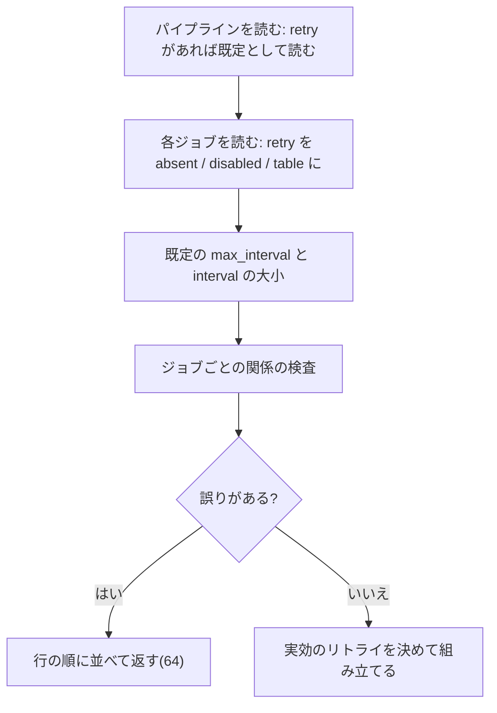
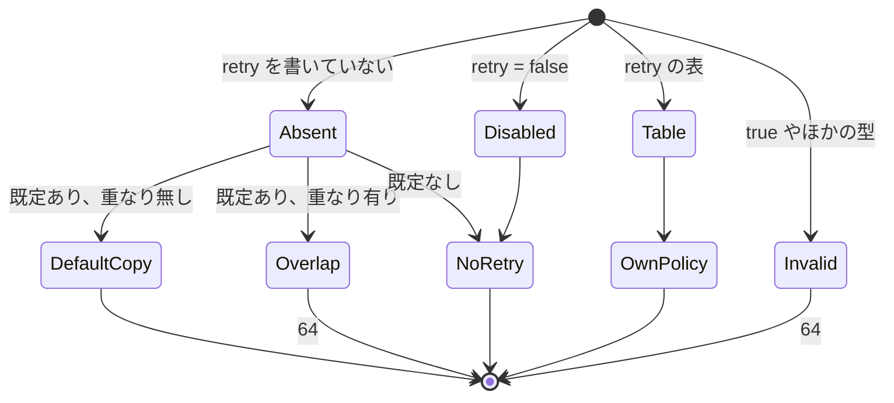
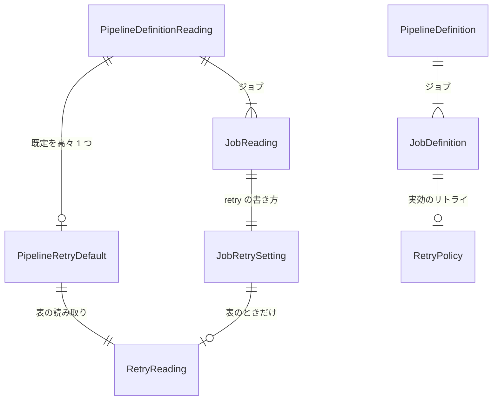

# 機能の仕様: u1-pipeline-retry(パイプライン共通のリトライの既定)

出典: ユニットの定義(`unit-of-work.md` の U1)、要件とユニットの対応(`unit-of-work-story-map.md`。ユーザーストーリーは作っていないため要件の ID で対応を示す)、要件(`requirements.md` の FR1.1〜FR1.6、FR8.1、NFR1、NFR6)、コンポーネントの一覧(`components.md` の CoreTypes、CoreDefinition)、契約(`contract-summary.md` の C3)、設計の決定(`decisions.md` の ADR-003、ADR-008)、機能の設計の質問(`functional-design-questions.md` の Q1〜Q4)。データの形は `entities.md`、判断の規則は `rules.md` が正本で、この文書は流れと状態の移り方の正本である。

## 1. 範囲

- 変えるのは定義の検証(CoreDefinition)だけ。組み立て後の定義の型(CoreTypes)の形は変えない(`entities.md`)。
- リトライの判断(`flow/retry`)、流れ(cli の `run`・`pipeline`)、`graph -v`、`--dry-run` は、今と同じく各ジョブの `retry` を読む。そこに実効のリトライが入るので、これらのコードは変えない(BR2.4、ADR-003)。
- 書き方は契約 C3 のとおり:

```toml
[pipeline.retry]        # 全ジョブの既定(BR1.1、BR1.2)
exit_codes = [75]
max = 3
interval = "10s"

[[job]]
id = "build"
command = ["make"]
retry = false           # 既定を打ち消す(BR2.1)
```

## 2. 流れ: 定義の検証

今の検証の手順(読み取り → ジョブどうしの関係の検査 → 誤りが無ければ組み立て)に、次を足す。番号は実行の順。

1. **パイプラインを読む**。`[pipeline]` の書けるキーに `retry` を足す。`retry` があれば、表なら `[job.retry]` と同じ手続きで読み、PipelineRetryDefault にする(BR1.1、BR1.2)。表でなければ誤りを積む(BR1.1)。
2. **各ジョブを読む**。ジョブの表の始まりの位置を覚える。`retry` を読み、JobRetrySetting(absent・disabled・table)にする。`true` やほかの型は誤りを積む(BR2.1)。表のときの検査は今と同じ。
3. **既定そのものの関係の検査**。既定の `max_interval` が `interval` より小さければ、誤りを 1 つ積む(BR3.5)。
4. **ジョブどうしの関係の検査**(今の cross_check)。ジョブごとに:
   1. 今の検査(ID、遷移先、終了コードの重なり)。
   2. table のジョブは、今までどおり自分の `exit_codes` と成功・警告の重なりを調べる(BR3.3)。
   3. absent のジョブは、既定があり、既定の `exit_codes` が読めていれば、既定との重なりを調べる(BR3.1、BR3.4)。重なれば、そのジョブの表の始まりの行で誤りを 1 つ積む(BR3.2)。
   4. disabled のジョブは何も調べない(BR3.3、BR2.3)。
5. **誤りがあれば**、すべてを行の順に並べて返す(今のまま)。終了コードは 64 で、どのジョブも動かない。
6. **誤りが無ければ組み立てる**。各ジョブの `retry` に実効のリトライを入れる(BR2.2)。既定は組み立て後の定義に残さない(BR2.4)。



<!-- Text fallback: パイプラインを読み(retry があれば既定として読む)、各ジョブの retry を 3 つの場合に分けて読み、既定の上限と間隔の大小を調べ、ジョブごとの関係を調べる。誤りがあれば行の順に返して 64、無ければ実効のリトライを決めて組み立てる。 -->

## 3. 状態の移り方: ジョブの実効のリトライ

ジョブの `retry` の書き方(JobRetrySetting)と、既定の有無から、実効のリトライが 1 つに決まる(BR2.2)。決めるのは組み立てのときの 1 度だけで、その後は変わらない。

| ジョブの `retry` | 既定あり | 既定なし |
|---|---|---|
| 書いていない(absent) | 既定の複製(BR3.1 の検査を通ったもの) | 無し(今と同じ。BR4.1) |
| `false`(disabled) | 無し | 無し(誤りにしない。BR2.3) |
| 表(table) | ジョブの表を丸ごと(既定と混ぜない。FR1.3) | ジョブの表(今と同じ) |
| `true`・ほかの型 | 定義の誤り(64。BR2.1) | 定義の誤り(64。BR2.1) |



<!-- Text fallback: retry を書いていなければ、既定があり重なりが無いとき既定の複製、重なりがあれば 64、既定が無ければリトライ無し。false ならリトライ無し。表ならジョブの表。true やほかの型は 64。 -->

## 4. 使う場面ごとの動き

| 場面 | 動き | 規則 |
|---|---|---|
| `run`・`pipeline` のリトライ | 実効のリトライで、今と同じ判断と待ち時間。`multiplier` は、実効のリトライに入っているものだけを使う | BR2.2、BR2.4、FR1.3 |
| `validate` | 既定の誤り、`retry` の型の誤り、既定との重なりを 64 で示す | BR1.1〜BR3.5 |
| `graph -v` | 各ジョブの実効のリトライを今の 1 行の形で出す。既定由来の印は付けない(Q3 の A) | BR2.4 |
| `--dry-run` | 実効のリトライで模擬する。表示は今の形 | BR2.4 |
| 変換のツール(`converter`) | 定義を型に依らない木として扱うため、そのまま通る | (対象外) |

## 5. 利用者から見たシナリオ

- **既定で全ジョブをリトライする**: `[pipeline.retry]`(`exit_codes = [75]`、`max = 3`、`interval = "10s"`)があり、`retry` を書かないジョブが 75 で終わる → 10 秒待ってリトライする。最大 3 回(FR1.2)。
- **ジョブの表を丸ごと使う**: 既定に `multiplier = 2`・`max_interval = "1m"` があり、ジョブの `[job.retry]` には無い → そのジョブの待ち時間は伸びない(FR1.3)。
- **打ち消す**: `retry = false` のジョブが既定の `exit_codes` で終わる → リトライせず、今のエラーの扱い(FR1.4)。
- **重なり**: 既定の `exit_codes = [1]`、あるジョブの `warning_exit_codes = [1]`、そのジョブは `retry` を書いていない → `validate` も `run` も 64。誤りの行はそのジョブの `[[job]]` の行で、表示に値と ID は無い(FR1.5、BR3.2)。同じジョブに `retry = false` を書けば通る(BR3.3)。
- **既定が誤り**: `[pipeline.retry]` に `max = 0` → `[job.retry]` の `max = 0` と同じ種類の 64(FR1.1)。
- **既定が無い**: 今の定義はすべて今と同じ結果(FR1.6、NFR1)。`retry = false` だけを書いたジョブも通る(BR2.3)。

## 6. 誤りと秘密の扱い

- 誤りはすべて定義の誤り(64)で、今の表示の形(`<ファイル>:<行>: <種類>: <理由>`)のまま。
- 理由の文は固定の文だけ。終了コードの値、ジョブの ID は入れない(NFR6、project.md の Forbidden)。
- 種類の文は変えない。`retry` が表でも false でもないときの理由の文だけが「`retry` はテーブルか `false` で書きます」に変わる(BR2.1、BR4.1)。

## 7. 文書とデモ(FR8.1)

- README: リトライの節に `[pipeline.retry]`、実効のリトライの決まり方(表 → 丸ごと、`false` → 無し、無し → 既定)、重なりの誤りを足す。終了コード 64 の説明に `[pipeline.retry]` の誤りを足す(BR4.2)。
- デモ: `demo/retry.toml` と `demo/windows/retry.toml` に既定と `retry = false` の例を足し、`demo/README.md` の説明を合わせる。デモのテスト(`unix_demo.rs`、`windows_demo.rs`)が通るようにする。
- `conductor init` のひな形は変えない(Q4 の A)。使い方の表(`args.rs`、`report/messages.rs`、README)はコマンドラインの変更が無いので揃え直しは要らない。

## 8. 派生の見え方(正本は `entities.md` と `rules.md`)

### エンティティの関係



<!-- Text fallback: 検証の途中では、パイプラインの読み取りが既定(PipelineRetryDefault)を高々 1 つと、ジョブの読み取りを 1 つ以上持つ。ジョブの読み取りは retry の書き方(JobRetrySetting)を持ち、表のときだけ RetryReading を持つ。組み立て後は、パイプラインの定義がジョブの定義を持ち、各ジョブが実効のリトライ(RetryPolicy)を高々 1 つ持つ。 -->

### 規則のまとめ

| 群 | 規則 | 内容 |
|---|---|---|
| 既定の検証 | BR1.1、BR1.2、BR3.5 | 表で書く。項目と検査は `[job.retry]` と同じ |
| 打ち消しと実効の決定 | BR2.1〜BR2.4 | 表か false。表 → 丸ごと、false → 無し、無し → 既定。1 度だけ決める |
| 重なり | BR3.1〜BR3.4 | 既定を当てはめるジョブだけ調べ、ジョブごとにジョブの行で出す |
| 互換と文書 | BR4.1、BR4.2 | 既定を書かない定義は今と同じ。README とデモを更新 |
