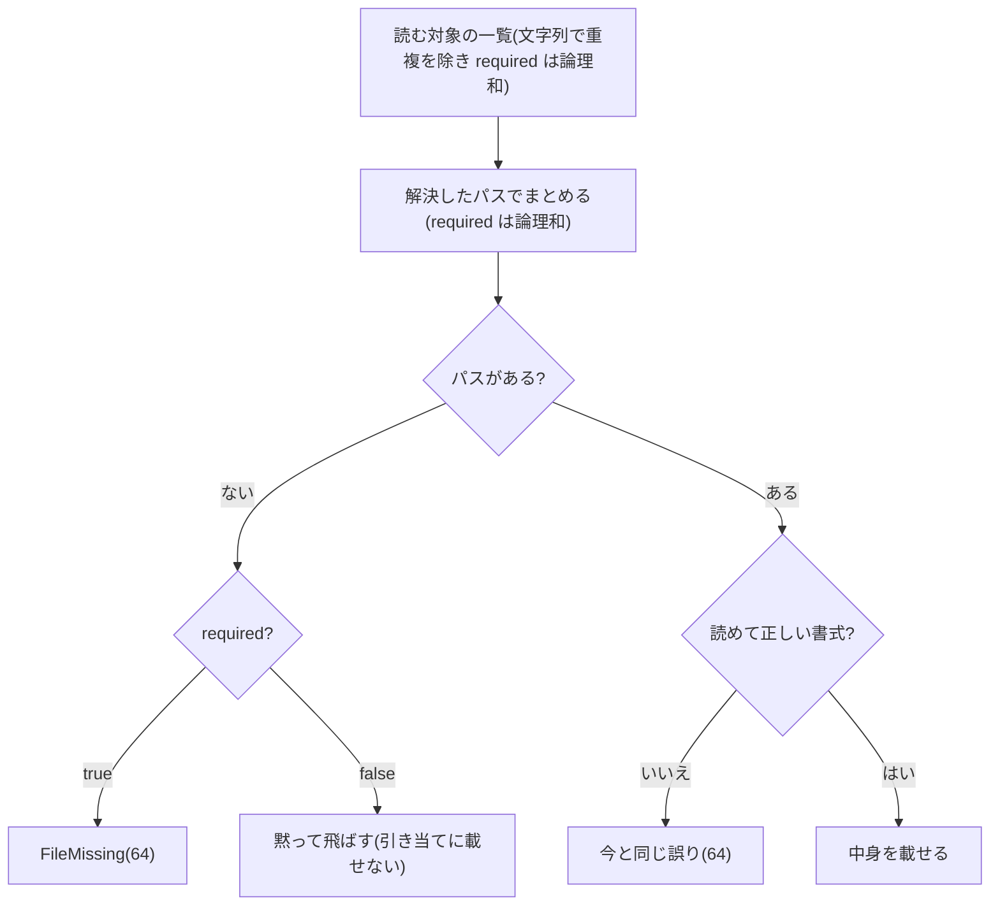
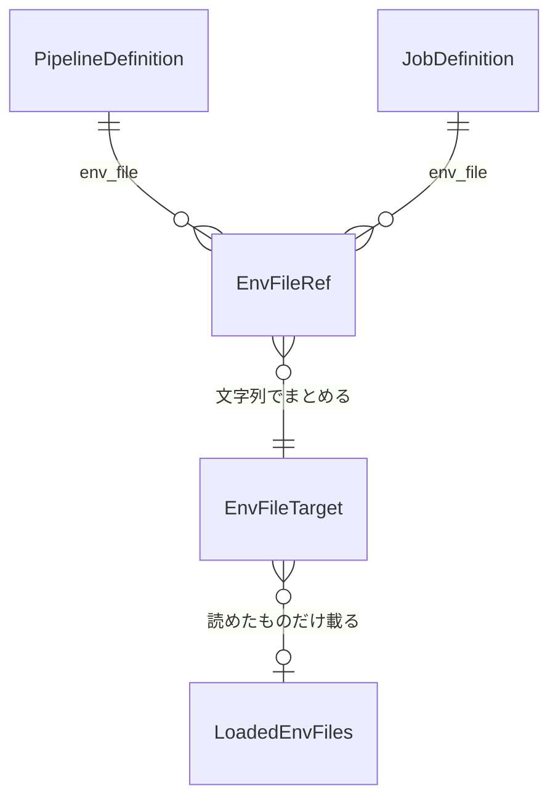

# 機能の仕様: u2-optional-env-file(無くてもよい `.env`)

出典: ユニットの定義(`unit-of-work.md` の U2)、要件とユニットの対応(`unit-of-work-story-map.md`。ユーザーストーリーは作っていないため要件の ID で対応を示す)、要件(`requirements.md` の FR2.1〜FR2.5、FR8.1、NFR1、NFR6)、コンポーネントの一覧(`components.md` の CoreTypes、CoreDefinition、CoreEnvFile、RuntimeEnvFile、CliFlows)、契約(`contract-summary.md` の C1、C3)、機能の設計の質問(`functional-design-questions.md` の Q1、Q2)。データの形は `entities.md`、判断の規則は `rules.md` が正本で、この文書は流れと状態の移り方の正本である。

## 1. 範囲

- 書き方は契約 C3 のとおり: `env_file = [".env", { path = ".env.local", required = false }]`。`[pipeline]` と `[job]` の両方で書ける。
- 変えるのは、定義の検証(CoreDefinition)、定義の型(CoreTypes の EnvFileRef)、読む対象の一覧(CoreEnvFile の `env_file_refs`)、読み取り(RuntimeEnvFile の `load_env_files`)。統合(`merge_env`)は、書いたパスの文字列で引く今の形のまま、EnvFileRef の `path` で引く。
- 統合の結果(足す変数)の形は変えない(契約 C1 の output_u2)。U3 がここに消す名前を足す。
- cli は、読む対象の一覧と読み取りを今の 1 つの入口から呼ぶので、流れは変えない。

## 2. 流れ: 定義の検証

1. `[pipeline]` と各 `[job]` の `env_file` を読む。文字列なら required = true の EnvFileRef。表なら `path` と `required` を読む(BR1.1、BR1.2、BR1.3)。
2. 誤りがあれば、ほかの誤りと一緒に行の順で返し、64(今のまま)。理由の文に値を含めない。
3. 誤りが無ければ、EnvFileRef の並び(書いた順)を定義に入れる。

## 3. 流れ: `.env` を読む(5 つのコマンドで同じ)

1. **読む対象の一覧を作る**(`env_file_refs`): コマンドの範囲(`run` は `[pipeline]` とそのジョブ、ほかは `[pipeline]` とすべてのジョブ)の EnvFileRef を書いた順に集める。パスの文字列で重複を除き、required は論理和にする(BR2.1)。
2. **解決したパスでまとめる**: 相対パスを定義ファイルのディレクトリから解決する。同じパスになる項目は 1 回だけ読む。そのパスの required は、そこに解決されるすべての項目の論理和(BR2.2)。
3. **読む**: 解決したパスごとに今の読み取り(通常のファイルか、大きさ、上限までの読み取り、UTF-8、解析)を行う。
   - 無い、かつ required = false → 誤りにせず、そのパスの文字列を引き当てに載せない(BR2.3)。
   - 無い、かつ required = true → FileMissing(BR2.5)。
   - それ以外の失敗 → required によらず今と同じ誤り(BR2.4)。
4. **誤りがあれば** すべてを集めて返し、64(今のまま)。無くてもよいファイルが無かったことは、どこにも表示しない(BR2.3)。
5. **統合する**: 引き当てに無い文字列は何も足さない(今の `merge_env` の扱い)。`--dry-run` の環境変数の名前も、読めたファイルの名前だけになる(BR3.1)。

<!-- Text fallback: 読む対象の一覧を作り、解決したパスでまとめる。パスが無いとき、必ず要るなら FileMissing(64)、要らないなら黙って飛ばす。パスがあるとき、読めないか書式が誤りなら今と同じ 64、正しければ中身を載せる。 -->

## 4. 状態の移り方: 1 つのパスの扱い

| パスの状態 | required = true | required = false |
|---|---|---|
| 無い | FileMissing(64) | 飛ばす。何も表示しない。変数は渡らない |
| 通常のファイルでない(ディレクトリなど)・読めない | Unreadable(64) | Unreadable(64) |
| 1 MiB を超える | TooLarge(64) | TooLarge(64) |
| UTF-8 でない・書式の誤り | 今と同じ誤り(64) | 今と同じ誤り(64) |
| 正しい | 中身を使う | 中身を使う |

「無い」は、今の読み取りが FileMissing にする場合(パスのメタデータが「見つからない」)と同じ。親のディレクトリが無い場合も含む。

## 5. 利用者から見たシナリオ

- **ローカルだけのファイル**: `env_file = [".env", { path = ".env.local", required = false }]`。CI には `.env.local` が無い → 読まずに進み、終了コードも出力も変わらない(FR2.2)。手元に置けば、その変数が後ろの層として渡る。
- **あるが壊れている**: `.env.local` が UTF-8 でない → `required = false` でも 64(FR2.3)。
- **今の書き方**: `env_file = ".env"` で `.env` が無い → 今と同じく 64(FR2.4)。
- **同じファイルを両方で書く**: `[pipeline]` に `".env.local"`、ジョブに `{ path = ".env.local", required = false }`。ファイルが無い → 64(必ず要るを優先。Q1 の A)。
- **表の誤り**: `{ required = false }`(path が無い)、`{ path = "" }`、`{ path = "a", optional = true }`、`{ path = "a", required = "no" }` → どれも 64(FR2.1)。
- **`--dry-run`・`validate`・`graph`**: 無くてもよいファイルが無くても 0 で進む(FR2.5)。

## 6. 誤りと秘密の扱い

- 定義の誤りは既存の種類(TypeMismatch、UnknownKey、EmptyField)を使う。理由の文は固定の文で、値を含めない(キー名だけは今の規則どおりエスケープして出す)。
- `.env` の誤りは今の種類と表示のまま。誤りの種類も増やさない。
- 無くてもよいファイルが無かったことは表示しないため、パスも値も漏れない。

## 7. 文書とデモ(FR8.1)

- README: `env_file` の説明に、表の形 `{ path, required }`、`required` の既定(true)、無いときの扱い、あって読めないときは 64、同じファイルを両方で書いたときは必ず要るが優先することを足す。
- デモ: `demo/env.toml` と `demo/windows/env.toml` の `env_file` に `{ path = "local.env", required = false }` を足す(`local.env` は置かない)。デモの説明に一言足す。デモの出力は変わらず、デモのテストは今のまま通る(Q2 の A)。

## 8. 派生の見え方(正本は `entities.md` と `rules.md`)

### エンティティの関係

<!-- Text fallback: パイプラインとジョブの定義が EnvFileRef の並びを持つ。EnvFileRef はパスの文字列ごとに EnvFileTarget にまとめられ、読めたものだけが LoadedEnvFiles に載る。 -->

### 規則のまとめ

| 群 | 規則 | 内容 |
|---|---|---|
| 書き方の検証 | BR1.1〜BR1.3 | 文字列か表、path と required、既定は必ず要る |
| 読み取り | BR2.1〜BR2.5 | required は論理和、無いときだけ飛ばす、ほかの失敗は 64 |
| コマンド | BR3.1 | 5 つのコマンドで同じ扱い |
| 互換と文書 | BR4.1、BR4.2 | 表を書かない定義は今と同じ。README とデモ |
