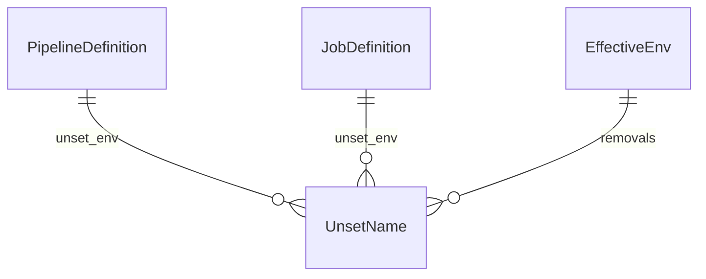

# 機能の仕様: u3-unset-env(`unset_env`)

出典: ユニットの定義(`unit-of-work.md` の U3)、要件とユニットの対応(`unit-of-work-story-map.md`。ユーザーストーリーは作っていないため要件の ID で対応を示す)、要件(`requirements.md` の FR3.1〜FR3.5、FR8.1)、コンポーネントの一覧(`components.md`)、契約(`contract-summary.md` の C1、C3)、設計の決定(ADR-007)、機能の設計の質問(`functional-design-questions.md` の Q1〜Q3)。データの形は `entities.md`、判断の規則は `rules.md` が正本で、この文書は流れの正本である。

## 1. 範囲

- 書き方(C3): `[pipeline] unset_env = ["HTTP_PROXY"]`、`[[job]] unset_env = ["SECRET_TOKEN"]`。
- 変える部品: CoreTypes・CoreDefinition(`unset_env` と重なりの検査)、CoreEnvFile(統合の結果に消す名前、`.env` との重なり)、RuntimeRunner(親から消す)、CliDeps(`run_job` に消す名前を渡す)、CliReport(`--dry-run` の表示)。U2 の環境の統合の上に積む(C1)。

## 2. 流れ

1. **定義の検証**: `unset_env` を読み(BR1.1、BR1.2)、ジョブどうしの関係の検査で `env` との重なりを調べる(BR2.1)。誤りは今の方式で行の順に集めて 64。
2. **`.env` を読む**(U2 の入口のまま): 読めた後、コマンドの範囲のジョブごとに、その `.env` の名前と消す名前の重なりを調べる(BR2.2)。誤りは `.env` の誤りと一緒に集めて 64。
3. **統合**: `merge_env` が足す変数(今のまま)と消す名前(BR3.1)を返す。`--dry-run` は値を読まない名前だけの統合で、足す名前と消す名前の両方を得る(BR4.1)。
4. **起動**: cli が `run_job` に足す変数と消す名前を渡す。runtime は消す名前を除いてから足す変数を加えて起動する(BR3.2)。

```mermaid
flowchart TD
    A["定義の検証(unset_env、env との重なり)"] --> B["`.env` を読み、中身との重なりを調べる"]
    B --> C["統合: 足す変数と消す名前"]
    C --> D{"--dry-run?"}
    D -- "はい" --> E["足す名前と消す名前を表示"]
    D -- "いいえ" --> F["親の環境から消し、足して起動"]
```

<!-- Text fallback: 定義の検証で unset_env と env の重なりを調べ、.env を読んで中身との重なりを調べ、統合で足す変数と消す名前を作る。dry-run なら両方の名前を表示し、そうでなければ親の環境から消して足して起動する。 -->

## 3. 利用者から見たシナリオ

- `unset_env = ["HTTP_PROXY"]` で、親に `HTTP_PROXY` がある → ジョブの環境に無い(FR3.2)。
- `[pipeline] unset_env = ["A"]` と `[job] unset_env = ["B", "A"]` → そのジョブから A と B が消える(Q3)。
- `unset_env = ["FOO"]` と `[job.env] FOO = "x"` → 64(FR3.3)。
- `unset_env = ["FOO"]` と、そのジョブの `.env` に `FOO=...` → 64(`.env` のファイルと行を示す)(FR3.3)。
- `unset_env = ["CONDUCTOR_JOB_ID"]` → 64(FR3.4)。
- Windows で `unset_env = ["PATH"]` → 親の `Path` も消える(Q1)。
- `--dry-run` → 各ジョブに足す名前と、消す名前が出る(Q2)。

## 4. 誤りと秘密の扱い

- 誤りの理由は固定の文。値は表示しない(名前は今の `env` の誤りと同じく表示しうるが、新しい 2 つの誤りの理由の文には名前も入れない)。

## 5. 文書とデモ(FR8.1)

- README と、デモの環境変数の場面(`demo/env.toml` と Windows 版)に `unset_env` を足す。デモの出力に、消した変数が見えないことを確かめる行を足す。

## 6. 派生の見え方(正本は `entities.md` と `rules.md`)



<!-- Text fallback: パイプラインとジョブの定義が消す名前を持ち、統合の結果がそれをまとめて持つ。 -->

| 群 | 規則 |
|---|---|
| 書き方 | BR1.1〜BR1.3 |
| 重なり | BR2.1、BR2.2 |
| 統合と起動 | BR3.1〜BR3.3 |
| 表示・互換・文書 | BR4.1〜BR4.3 |
