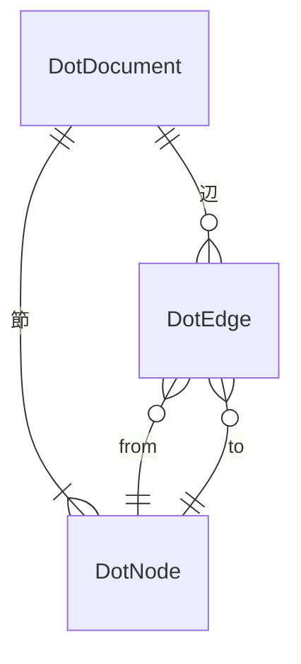

# 機能の仕様: u4-graph-dot(`graph --format dot`)

出典: ユニットの定義(`unit-of-work.md` の U4)、要件とユニットの対応(`unit-of-work-story-map.md`。ユーザーストーリーは作っていないため要件の ID で対応を示す)、要件(`requirements.md` の FR4.1〜FR4.4、FR8.1)、コンポーネントの一覧(`components.md` の CliArgs、CliReport)、契約(`contract-summary.md` の C5)、設計の決定(ADR-006)、機能の設計の質問(`functional-design-questions.md` の Q1、Q2)。データの形は `entities.md`、判断の規則は `rules.md` が正本で、この文書は流れの正本である。

## 1. 範囲

- コマンドラインは契約 C5 のとおり: `conductor graph [-v] [--config <パス>] [--format <text|mermaid|dot>] [--state [--run-id <ID>]] [<パイプライン名>]`。
- 変えるのは cli だけ: 引数の解析(CliArgs の `GraphFormat` に `Dot`)、表示(CliReport に DOT の描画を足す。ADR-006)、使い方の表の 3 か所。core の図の構造と状態の重ね合わせは変えない。
- 定義やステートの読み方、誤りの扱い、終了コードは、text・mermaid と同じ。

## 2. 流れ: `graph --format dot`

1. 引数を解析し、`--format dot` を受け付ける(BR1.1)。
2. 今と同じく定義を読み、`--state` ならステートを読んで状態を重ねた `FlowGraph` を作る(text・mermaid と共通)。
3. DOT を描く(BR2.1):
   1. `digraph conductor {` と `  rankdir=TB;`
   2. 節を記述順に: ジョブは `  n<i> [label="<記号><ジョブ ID>", shape=box];`。再開位置のジョブは `penwidth=3` を足す(BR2.2、BR2.4)。終点は `  nend [label="@end", shape=oval];`
   3. 辺を `FlowGraph` の順に: 主線は `  n<i> -> n<j>;`、それ以外は `  n<i> -> n<j> [label="<種類の語>"];`(BR2.3)。行き先の分からない辺は mermaid と同じく出さない
   4. `}` と改行
4. 標準出力に 1 回で書く(C5)。`-v` は出力を変えない(BR2.5)。

例(`--state` あり、b が再開位置、a から c への警告の辺がある場合):

```text
digraph conductor {
  rankdir=TB;
  n0 [label="[OK] a", shape=box];
  n1 [label="[NG] b", shape=box, penwidth=3];
  n2 [label="[  ] c", shape=box];
  nend [label="@end", shape=oval];
  n0 -> n1;
  n0 -> n2 [label="警告"];
  n1 -> n2;
  n2 -> nend;
}
```

## 3. escape(BR3.1)

| 入力の文字 | DOT のラベルに書く形 |
|---|---|
| 普通の文字(日本語を含む) | そのまま |
| `"` | `\"` |
| `\` | `\\` |
| 改行・タブ・ほかの制御文字、書式の制御文字 | まず text と同じ見える形(`\n`、`\u{..}` など)にし、その `\` を `\\` にする(DOT の特別な列として働かない) |

どのジョブ ID でも、DOT の文法として正しい文書になる。

## 4. 利用者から見たシナリオ

- `conductor graph --format dot | dot -Tsvg > flow.svg`: 流れの図を画像にできる(FR4.1)。
- `conductor graph --format dot --state`: 各ジョブの記号で状態が分かり、再開位置が太い枠になる(FR4.2)。
- `conductor graph --format dot -v`: `-v` なしと同じ出力(FR4.2、Q2 の A)。
- `conductor graph --format svg`: 今と同じ使い方の誤り(FR4.4)。
- ジョブ ID に `"` や `\` を含む定義: DOT が壊れない(FR4.3)。

## 5. 誤りと秘密の扱い

- 誤りは text・mermaid と同じ経路・同じ表示。
- DOT に書く入力の値は、ジョブ ID だけ(BR3.2)。コマンド、環境変数、パイプライン名は書かない。

## 6. 文書とデモ(FR8.1)

- README の `graph` の節に `--format dot` と、Graphviz で画像にする例を足す。使い方の表を `args.rs`・`report/messages.rs` と揃える(BR1.2)。
- デモの `graph` の場面に `--format dot` の出力を足す(Unix と Windows の両方)。デモのテストに、`digraph` の行が出ることの確認を足す。

## 7. 派生の見え方(正本は `entities.md` と `rules.md`)

### エンティティの関係



<!-- Text fallback: DOT の文書は節を 1 つ以上、辺を 0 個以上持つ。辺は from と to で節を指す。 -->

### 規則のまとめ

| 群 | 規則 | 内容 |
|---|---|---|
| 引数と文書 | BR1.1、BR1.2 | `--format dot`、使い方の表 |
| 描画 | BR2.1〜BR2.5 | mermaid と同じ構造、連番の ID、主線のラベル、記号と太い枠、`-v` は影響しない |
| escape と秘密 | BR3.1、BR3.2 | DOT の文字列の escape、ジョブ ID 以外を書かない |
| 互換と文書 | BR4.1、BR4.2 | text・mermaid は変えない、README とデモ |
