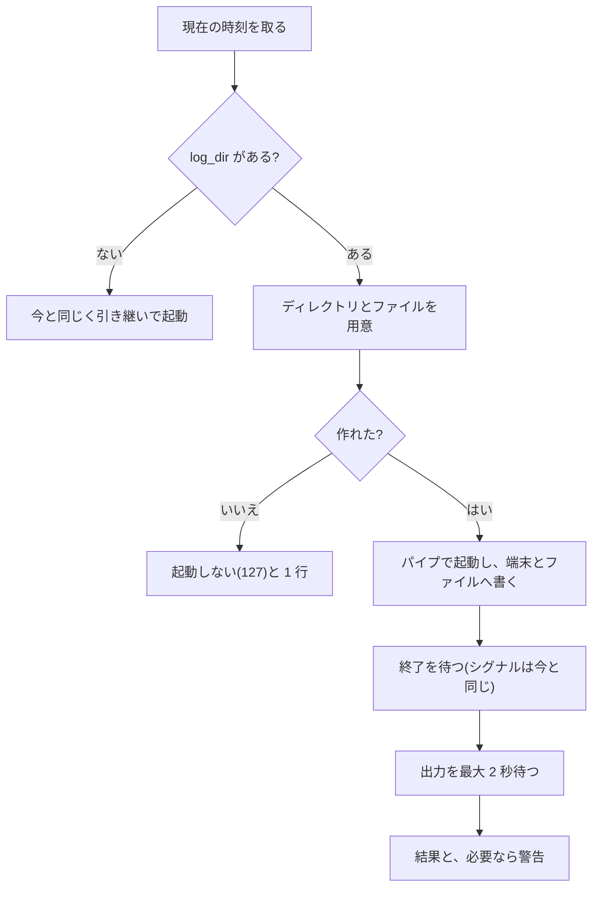
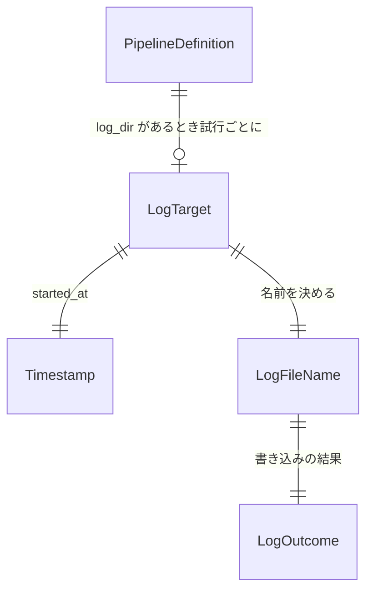

# 機能の仕様: u5-log-dir(ジョブの出力をファイルにも残す)

出典: ユニットの定義(`unit-of-work.md` の U5)、要件とユニットの対応(`unit-of-work-story-map.md`。ユーザーストーリーは作っていないため要件の ID で対応を示す)、要件(`requirements.md` の FR5.1〜FR5.5、FR6.2、FR6.6、FR8.1)、コンポーネントの一覧(`components.md`)、契約(`contract-summary.md` の C2、C6)、設計の決定(ADR-002、ADR-005)、機能の設計の質問(`functional-design-questions.md` の Q1〜Q5)。データの形は `entities.md`、判断の規則は `rules.md` が正本で、この文書は流れと状態の移り方の正本である。

## 1. 範囲

- 定義: `[pipeline] log_dir = "logs"`(C3)。
- 新しい部品: CoreTime(core。時刻の整形・読み取り・差)、RuntimeClock(runtime。現在の時刻)、RuntimeLog(runtime。ディレクトリとファイル)(ADR-001、ADR-002、ADR-005)。
- 変える部品: CoreTypes・CoreDefinition(`log_dir`)、RuntimeRunner(出力の複製)、CliDeps(`now`、`run_job` にログの指定)、CliFlows(試行ごとに時刻を取りログを指定)。
- ステートの時刻(started_at)は U6 で足す。このユニットは、U6 が同じ値を使えるよう、流れが試行の前に 1 回だけ時刻を取る形を作る(C2)。

## 2. 流れ: 1 回の試行(`run`・`pipeline`、リトライを含む)

1. 流れが `Runtime::now()` で現在の時刻を取る(BR2.3)。
2. `log_dir` が無ければ、今と同じく `run_job` を呼ぶ(BR1.2)。以下は `log_dir` があるとき。
3. LogTarget(解決済みのディレクトリ、ジョブ ID、時刻、試行の番号)を作り、`run_job` に渡す。
4. runtime が、合図の確認(今のまま)の後、起動の前にログのファイルを用意する(RuntimeLog):
   1. ディレクトリが無ければ作る(BR3.1)。
   2. 名前 `<安全な ID>.<詰めた時刻>.<試行の番号>.log` を作り(BR3.2)、「無いときだけ作る」で開く。UNIX 系は 0600(BR3.4)。
   3. 「すでにある」なら `-2`、`-3` … を足して作り直す(BR3.3)。
   4. 作れなければ起動せず、起動の失敗として返す(BR5.1)。流れはその理由を標準エラーに 1 行出す。
5. 子を、標準出力と標準エラーをパイプにして起動する(標準入力は今と同じく引き継ぐ。BR4.3)。
6. 2 つのスレッドが、それぞれのパイプを読み、読んだ分を端末(conductor の標準出力か標準エラー)とファイルへ書く(BR4.1)。ファイルへの書き込みは 1 つの鍵で順にする。ファイルへの書き込みに失敗したら、以後ファイルには書かない(BR5.2)。
7. 今と同じ待ちのくり返しで子の終了を待ち、合図があればシグナルを転送する(BR4.4)。
8. 子の終了の後、2 つのスレッドの終わりを最大 2 秒待つ(BR4.5)。
9. 結果(終了コードなど、今と同じ)に LogOutcome を添えて返す。流れは、書き込みの失敗か待ち切れがあれば警告を 1 行ずつ出す(BR5.2、BR5.3)。

<!-- Text fallback: 現在の時刻を取る。log_dir が無ければ今と同じく起動する。あれば、ディレクトリとファイルを用意し、作れなければ起動せず 127 と 1 行。作れればパイプで起動して端末とファイルへ書き、終了を待ち、出力を最大 2 秒待って、結果と必要なら警告を返す。 -->

## 3. 状態の移り方: 1 つのログのファイル

| 状態 | 次へ | 出来事 |
|---|---|---|
| 未作成 | 書き込み中 | 作れた |
| 未作成 | (起動しない) | 作れない → 127 |
| 書き込み中 | 書き込み停止 | ファイルへの書き込みに失敗 → 警告 |
| 書き込み中 | 閉じた | 子が終わり、出力も 2 秒以内に終わった |
| 書き込み中 | 閉じた(待ち切れ) | 2 秒待っても出力が続いた → 警告 |
| 書き込み停止 | 閉じた | 子が終わった(端末への出力は続けていた) |

## 4. 時刻(CoreTime)

- `format_rfc3339`: 秒 → `YYYY-MM-DDTHH:MM:SSZ`(BR2.1)。
- `format_compact`: 秒 → `YYYYMMDDTHHMMSSZ`(ファイル名用)。
- `parse_rfc3339`: `YYYY-MM-DDTHH:MM:SSZ` だけを受け付ける(BR2.2)。U6 がステートで使う。
- `duration`: 2 つの時刻の差(秒。後が前より小さければ 0)。表示の形は U6 で決める。
- 範囲は 1970-01-01 から 9999-12-31。日付の計算は、日数から年月日を求める既知の方法(うるう年を含む)を自前で書く(新しい依存を使わない)。

## 5. 利用者から見たシナリオ

- `log_dir = "logs"` で `pipeline` を動かす → 端末に今と同じ出力が出て、`logs/build.20261125T091248Z.1.log` などができる(FR5.2)。
- リトライで 3 回動いたジョブ → `.1.log`、`.2.log`、`.3.log` の 3 つ(FR5.3)。
- 同じ秒に別の run ID で同じジョブ → 2 つ目は `.1-2.log`(Q2)。
- ジョブ ID `a/b` → ファイル名は `a_b.<時刻>.1.log`(Q3)。
- `log_dir` が書けない場所 → そのジョブは起動されず 127、標準エラーに 1 行(Q1)。
- 実行中にディスクがいっぱい → 警告を 1 行出し、ジョブは最後まで動き、終了コードは変わらない(Q1)。
- `log_dir` を書かない → 今と同じ(FR5.5)。

## 6. 誤りと秘密の扱い

- 定義の誤り(`log_dir` の型、空)は 64。理由の文は固定の文。
- ログの失敗の文は固定の文に、表示用に escape したパスだけを付ける(今の `.env` の誤りと同じ扱い)。ファイルの中身は表示しない。
- ログのファイルは UNIX 系で 0600(Q4)。conductor は何も書き足さない(BR4.2)。

## 7. 文書とデモ(FR8.1)

- README: `log_dir` の書き方、名前の形と置き換え・番号、権限、失敗の扱い、子から見て端末でなくなること、古いログは消さないこと(Q5)。
- デモ: `log_dir` を使う定義と場面を足し、できたファイルを見せてから消す(Unix と Windows)。

## 8. 派生の見え方(正本は `entities.md` と `rules.md`)

### エンティティの関係

<!-- Text fallback: log_dir があるとき、試行ごとに LogTarget を作る。LogTarget は時刻を 1 つ持ち、名前を 1 つ決め、その書き込みの結果が LogOutcome になる。 -->

### 規則のまとめ

| 群 | 規則 | 内容 |
|---|---|---|
| 定義 | BR1.1、BR1.2 | `log_dir` の検証、書かなければ今のまま |
| 時刻 | BR2.1〜BR2.3 | 整形・読み取り・現在の時刻 |
| ファイル | BR3.1〜BR3.4 | 名前、置き換え、番号、0600 |
| 出力 | BR4.1〜BR4.5 | 複製、書き足さない、端末でなくなる、シグナル、2 秒 |
| 失敗 | BR5.1〜BR5.4 | 127、警告、警告、動かさないコマンド |
| その他 | BR6.1、BR6.2 | 整理しない、README とデモ |
