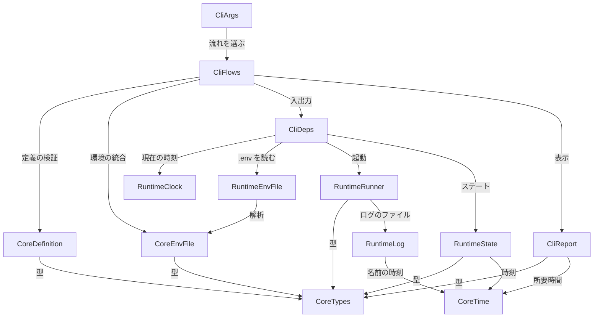

# コンポーネントの一覧: v0.10.0 の小さな機能のまとまり

出典: 要件(`requirements.md`)、既存の構成(コード知識ベースの `architecture.md`、`component-inventory.md`)、チームの実践(`team-practices.md`)、ドメイン設計の質問(`domain-design-questions.md`。以下 Q1〜Q4)。

この文書には、今回の変更で新しく足す部品と、変更を受ける既存の部品を載せる。今回の変更に関わらない既存の部品(`converter`、`split`、`platform` の大半、`CoreFlow` のリトライの判断、`CorePlan` など)は載せない。新しい部品は、既存の 3 つのクレート(`conductor-core`、`conductor-runtime`、`conductor-cli`)の中に新しいモジュールとして置く。新しいクレートは作らない(ADR-001)。

## Part A: コンポーネントのカタログ

```yaml
components:
  - name: CoreTypes
    summary: 定義とステートの共有の型(既存。retry の既定、unset_env、log_dir、表の env_file、試行の時刻を足す)
    behaviour: >
      定義の型は、ジョブごとの実効の retry(既定を当てはめた後のもの。打ち消したジョブは無し)、
      unset_env(名前の並び)、log_dir(パイプラインだけ)、env_file の項目(パスと required)を持つ。
      ステートの各ジョブは、試行の並び(開始の時刻と、無くてもよい終了の時刻)を持つ。
      型は値を持つだけで、判断も入出力もしない。
    responsibilities:
      - 定義とステートの型を、すべてのクレートに共有する
    depends_on: []
    dependents:
      - component: CoreDefinition
        interaction: 検証した結果を、この型で返す
      - component: CoreEnvFile
        interaction: env、env_file、unset_env を入力にする
      - component: RuntimeRunner
        interaction: ジョブの定義と、統合済みの環境を受け取る
      - component: RuntimeState
        interaction: ステートの内容(試行の時刻を含む)を読み書きする
      - component: CliFlows
        interaction: 定義とステートを扱う
      - component: CliReport
        interaction: 定義とステートを表示する
    external_dependencies: []
    entities:
      - name: PipelineDefinition
        identifier: name
        attributes: [name, run_id_env, env, env_file, unset_env, log_dir, jobs]
      - name: JobDefinition
        identifier: id
        attributes: [id, command, success_exit_codes, warning_exit_codes, transitions, retry, env, env_file, unset_env]
        references:
          - entity: PipelineDefinition
            owned_by: CoreTypes
            relationship: 各ジョブは 1 つのパイプラインに属する
      - name: EnvFileRef
        identifier: path
        attributes: [path, required]
      - name: JobState
        identifier: id
        attributes: [id, status, exit_code, skip_reason, attempts]
      - name: Attempt
        identifier: number
        attributes: [number, started_at, ended_at]
        references:
          - entity: JobState
            owned_by: CoreTypes
            relationship: 各試行は 1 つのジョブのステートに属する
          - entity: Timestamp
            owned_by: CoreTime
            relationship: 開始と終了の時刻は Timestamp で持つ

  - name: CoreDefinition
    summary: 定義ファイルの読み込みと検証(既存。[pipeline.retry]、retry = false、unset_env、log_dir、表の env_file を足す)
    behaviour: >
      [pipeline.retry] を [job.retry] と同じ規則で検証する。ジョブの retry は表か false。
      検証の終わりに、各ジョブの実効の retry を決める(ジョブの表があればそれを丸ごと、false なら無し、
      無ければ既定)。既定を当てはめたジョブで、既定の exit_codes が成功・警告と重なれば誤り(64)。
      unset_env は env と同じ名前の規則で検証し、同じジョブに当てはまる env の名前と重なれば誤り。
      env_file の項目は文字列か {path, required} の表。log_dir は空でない文字列。
      誤りの表示に入力の値を含めない。
    responsibilities:
      - 定義の検証(新しいキーを含む)
      - 各ジョブの実効の retry の決定
    depends_on:
      - component: CoreTypes
        interaction: 検証した結果を、定義の型にして返す
        style: sync
    dependents:
      - component: CliFlows
        interaction: 定義を読み込み、検証する
    external_dependencies:
      - name: toml
        kind: other
        purpose: 定義の TOML の読み取り(既存の依存)
    entities: []

  - name: CoreEnvFile
    summary: .env の解析と、環境の層の統合(既存。unset_env と、無くてもよいファイルを足す)
    behaviour: >
      読む対象の一覧に required を添える。統合の結果は「足す変数」と「親から消す名前」の 2 つ。
      unset_env の名前が、そのジョブに当てはまる .env の変数と重なれば .env の誤り(64)にする。
      無くてもよいファイルが無いことは誤りにしない。値は誤りの表示に含めない。
    responsibilities:
      - .env の解析
      - 層の統合(足す変数と、消す名前)
    depends_on:
      - component: CoreTypes
        interaction: 定義の env、env_file、unset_env を入力にする
        style: sync
    dependents:
      - component: CliFlows
        interaction: ジョブに渡す環境を作る
      - component: RuntimeEnvFile
        interaction: 読んだ内容を解析する
    external_dependencies: []
    entities: []

  - name: CoreTime
    summary: UTC の RFC 3339 の整形と読み取り、所要時間の計算(新規。純粋)
    behaviour: >
      UNIX 時刻の秒を UTC の RFC 3339(例 2026-11-25T09:12:48Z)に整形し、その形の文字列を読む。
      日付の計算は自前で書く(新しい依存を使わない)。2 つの時刻の差を所要時間にし、
      watch の表に出す形に整える。現在の時刻は持たない(入出力をしない)。
    responsibilities:
      - 時刻の整形と読み取り
      - 所要時間の計算と表示の形
    depends_on: []
    dependents:
      - component: RuntimeState
        interaction: ステートの時刻を書き、読む
      - component: RuntimeLog
        interaction: ログのファイルの名前に時刻を入れる
      - component: CliReport
        interaction: watch の所要時間を出す
    external_dependencies: []
    entities:
      - name: Timestamp
        identifier: unix_seconds
        attributes: [unix_seconds]

  - name: RuntimeClock
    summary: 現在の時刻を OS から取る(新規。入出力)
    behaviour: >
      std の SystemTime から UNIX 時刻の秒を取る。unsafe も cfg も使わない。
    responsibilities:
      - 現在の時刻の取得
    depends_on: []
    dependents:
      - component: CliDeps
        interaction: 差し替え口の本番の実装が呼ぶ
    external_dependencies: []
    entities: []

  - name: RuntimeEnvFile
    summary: .env のファイルを読む(既存。無くてもよいファイルを足す)
    behaviour: >
      required が偽のファイルが無ければ、読まずに進む。あるが読めない、大きすぎる、UTF-8 でない
      ときは、今までどおり誤り。
    responsibilities:
      - .env のファイルの読み取り
    depends_on:
      - component: CoreEnvFile
        interaction: 読んだ内容を解析する
        style: sync
    dependents:
      - component: CliDeps
        interaction: 差し替え口の本番の実装が呼ぶ
    external_dependencies: []
    entities: []

  - name: RuntimeRunner
    summary: ジョブの起動と待機(既存。消す名前と、出力の複製を足す)
    behaviour: >
      親の環境を引き継ぎ、消す名前を除き、足す変数を加えて起動する。ログのファイルが
      渡されたときは、子の標準出力と標準エラーをパイプで受け、端末(親の標準出力と標準エラー)と
      ファイルの両方へ書く。ファイルには子の出力だけを書く。
    responsibilities:
      - ジョブの起動と終了の待機
      - 出力の複製
    depends_on:
      - component: CoreTypes
        interaction: ジョブの定義と統合済みの環境を受け取る
        style: sync
      - component: RuntimeLog
        interaction: 試行のログのファイルを開く
        style: sync
    dependents:
      - component: CliDeps
        interaction: 差し替え口の本番の実装が呼ぶ
    external_dependencies: []
    entities: []

  - name: RuntimeLog
    summary: ログのディレクトリとファイルの用意(新規。入出力)
    behaviour: >
      log_dir が無ければ作る。ジョブ、試行の番号、開始の時刻を名前に入れた新しいファイルを、
      既存のファイルを上書きせずに作る。名前の形、権限、衝突の避け方は機能の設計で決める。
    responsibilities:
      - ログのディレクトリの作成
      - 試行ごとのログのファイルの作成
    depends_on:
      - component: CoreTime
        interaction: ファイルの名前に時刻を入れる
        style: sync
    dependents:
      - component: RuntimeRunner
        interaction: 試行のログのファイルを開く
    external_dependencies: []
    entities: []

  - name: RuntimeState
    summary: ステートの読み書き(既存。試行の時刻を足す)
    behaviour: >
      各ジョブの試行の並びを、UTC の RFC 3339 の時刻で書き、読む。format_version は 1 のまま。
      動いたジョブに試行が無ければ壊れたステート(65)。終了の時刻が無い試行は許す。
      書き込みは今までどおり原子的。コマンド、環境変数、出力は書かない。
    responsibilities:
      - ステートの読み書き(試行の時刻を含む)
    depends_on:
      - component: CoreTypes
        interaction: ステートの内容を読み書きする
        style: sync
      - component: CoreTime
        interaction: 時刻を整形し、読む
        style: sync
    dependents:
      - component: CliDeps
        interaction: 差し替え口の本番の実装が呼ぶ
    external_dependencies:
      - name: toml
        kind: other
        purpose: ステートの TOML の読み書き(既存の依存)
    entities: []

  - name: CliDeps
    summary: 入出力の差し替え口(既存。現在の時刻、消す名前、ログのファイルを足す)
    behaviour: >
      Runtime に現在の時刻を返すメソッドを足す。run_job に消す名前とログのファイルの指定を渡す。
      本番の実装は runtime を呼び、テストの偽の実装は時刻と結果を決めて返す。
    responsibilities:
      - 入出力の差し替え
    depends_on:
      - component: RuntimeClock
        interaction: 現在の時刻を取る
        style: sync
      - component: RuntimeEnvFile
        interaction: .env を読む
        style: sync
      - component: RuntimeRunner
        interaction: ジョブを起動する
        style: sync
      - component: RuntimeState
        interaction: ステートを読み書きする
        style: sync
    dependents:
      - component: CliFlows
        interaction: 入出力をすべてここから行う
    external_dependencies: []
    entities: []

  - name: CliFlows
    summary: コマンドの流れ(既存。試行の時刻の記録と、watch の繰り返しを足す)
    behaviour: >
      run と pipeline は、試行の前に現在の時刻を取り、開始としてステートに書いてからジョブを動かし、
      終わったら終了の時刻を書く。watch は、オプションがあれば一定の間隔で読み直して表示し、
      中断のシグナルかパイプラインの終わりで止まる。待つのは今の wait を使う。
    responsibilities:
      - 試行の時刻の記録の順番
      - watch の繰り返しと終わり方
    depends_on:
      - component: CoreDefinition
        interaction: 定義を読み込み、検証する
        style: sync
      - component: CoreEnvFile
        interaction: ジョブに渡す環境を作る
        style: sync
      - component: CliDeps
        interaction: 入出力をすべてここから行う
        style: sync
      - component: CliReport
        interaction: 表示を作る
        style: sync
    dependents:
      - component: CliArgs
        interaction: 解析した引数で流れを選ぶ
    external_dependencies: []
    entities: []

  - name: CliReport
    summary: 表示(既存。DOT の描画、watch の所要時間と描き直し、ステートの誤りの案内を足す)
    behaviour: >
      graph の DOT を、text・mermaid と同じ構造と配置から描く(-v と --state に対応。値は DOT の
      文字列として escape)。watch の表に所要時間の列を足す。UNIX 系の端末なら画面を消す制御の文字を
      前に付け、それ以外は付けない。壊れたステートの誤りに、reset で直せる旨の 1 文を足す。
    responsibilities:
      - graph の DOT の描画
      - watch の表示
      - 誤りの文言
    depends_on:
      - component: CoreTypes
        interaction: 定義とステートを表示する
        style: sync
      - component: CoreTime
        interaction: 所要時間を出す
        style: sync
    dependents:
      - component: CliFlows
        interaction: 表示を作る
    external_dependencies: []
    entities: []

  - name: CliArgs
    summary: 引数の解析(既存。--format dot と、watch の継続表示のオプションを足す)
    behaviour: >
      graph の --format に dot を足す。watch に継続表示と間隔のオプションを足す(名前と範囲は機能の
      設計で決める)。使い方の表を args.rs、messages.rs、README の 3 か所で揃える。
    responsibilities:
      - 引数の解析と検査
    depends_on:
      - component: CliFlows
        interaction: 解析した引数で流れを選ぶ
        style: sync
    dependents: []
    external_dependencies: []
    entities: []
```

## Part B: 人が読む形

### Component Diagram



文字の説明: 呼び出しは cli → core と cli → runtime → core の向きだけで、逆向きは無い。新しい部品は CoreTime(core)、RuntimeClock と RuntimeLog(runtime)の 3 つ。

### Component Summary

| Component | Purpose | Depends On | Dependents | Entities Owned |
|---|---|---|---|---|
| CoreTypes | 共有の型 | なし | CoreDefinition, CoreEnvFile, RuntimeRunner, RuntimeState, CliFlows, CliReport | PipelineDefinition, JobDefinition, EnvFileRef, JobState, Attempt |
| CoreDefinition | 定義の検証と実効の retry | CoreTypes | CliFlows | なし |
| CoreEnvFile | .env の解析と層の統合 | CoreTypes | CliFlows, RuntimeEnvFile | なし |
| CoreTime(新規) | 時刻の整形・読み取り・所要時間 | なし | RuntimeState, RuntimeLog, CliReport | Timestamp |
| RuntimeClock(新規) | 現在の時刻 | なし | CliDeps | なし |
| RuntimeEnvFile | .env を読む | CoreEnvFile | CliDeps | なし |
| RuntimeRunner | 起動、消す名前、出力の複製 | CoreTypes, RuntimeLog | CliDeps | なし |
| RuntimeLog(新規) | ログのディレクトリとファイル | CoreTime | RuntimeRunner | なし |
| RuntimeState | ステートの読み書き | CoreTypes, CoreTime | CliDeps | なし |
| CliDeps | 差し替え口 | RuntimeClock, RuntimeEnvFile, RuntimeRunner, RuntimeState | CliFlows | なし |
| CliFlows | 時刻の記録の順番、watch の繰り返し | CoreDefinition, CoreEnvFile, CliDeps, CliReport | CliArgs | なし |
| CliReport | DOT、watch の表示、誤りの文言 | CoreTypes, CoreTime | CliFlows | なし |
| CliArgs | 引数 | CliFlows | なし | なし |

### Entity Ownership

| Entity | Owning Component | Identifier | Attributes | References |
|---|---|---|---|---|
| PipelineDefinition | CoreTypes | name | name, run_id_env, env, env_file, unset_env, log_dir, jobs | なし |
| JobDefinition | CoreTypes | id | id, command, success_exit_codes, warning_exit_codes, transitions, retry, env, env_file, unset_env | PipelineDefinition |
| EnvFileRef | CoreTypes | path | path, required | なし |
| JobState | CoreTypes | id | id, status, exit_code, skip_reason, attempts | なし |
| Attempt | CoreTypes | number | number, started_at, ended_at | JobState、Timestamp |
| Timestamp | CoreTime | unix_seconds | unix_seconds | なし |

### External Dependencies

| Component | Dependency | Kind | Purpose |
|---|---|---|---|
| CoreDefinition | toml | other | 定義の TOML の読み取り(既存) |
| RuntimeState | toml | other | ステートの TOML の読み書き(既存) |

新しい外部の依存は無い(project.md の Forbidden)。

### Rationale

| Component | 別の部品にする理由 |
|---|---|
| CoreTime | 日付の計算は純粋で、ステート・ログ・表示の 3 か所で使う。core に置けば入出力なしでテストできる(Q1、ADR-002) |
| RuntimeClock | 現在の時刻は入出力で、core に置けない。差し替え口から偽の時計に替えられるよう、本番の取得を 1 か所にする(Q1、ADR-002) |
| RuntimeLog | ログのファイルの作成(ディレクトリ、名前、権限)は、ジョブの起動とは変わる理由が違う(ADR-005) |
| CoreDefinition の実効の retry | 既定の当てはめを検証の中で 1 度だけ行い、判断と流れを変えない(Q3、ADR-003) |
| CliFlows の時刻の記録 | 開始をステートに書いてからジョブを動かす順番は、流れが決める(Q2、ADR-004) |
| CliReport の DOT | text・mermaid と同じ構造から描く表示の 1 つ(ADR-006) |

**Alternatives Rejected**: 時刻をすべて runtime に置く案(Q1 の B)、run_job が時刻を返す案(Q2 の B)、判断のたびに既定とジョブの retry を両方見る案(Q3 の B)、打ち消しに no_retry や max = 0 を使う案(Q4 の B・C)。理由は `decisions.md` の各 ADR に書く。
