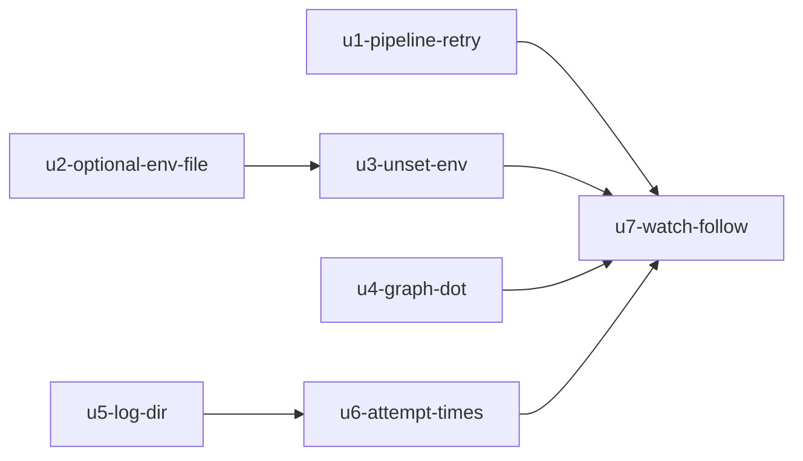

# ユニットの依存: v0.10.0 の小さな機能のまとまり

出典: ユニットの定義(`unit-of-work.md`)、コンポーネントの一覧(`components.md`)、ユニットの分割の質問(`units-generation-questions.md`)。

この文書は依存の形(トポロジー)だけを示す。作る順序は Delivery Planning で決める。

## 依存の辺

| ユニット | 依存先 | 理由 |
|---|---|---|
| u3-unset-env | u2-optional-env-file | 同じ環境の統合と `.env` の読み取りのコードを続けて変える(Q4) |
| u6-attempt-times | u5-log-dir | u5 で作る時刻の整形(CoreTime)と現在の時刻(RuntimeClock)を使う(Q3) |
| u7-watch-follow | u6-attempt-times | 継続表示が所要時間の列を描き直す |
| u7-watch-follow | u1-pipeline-retry、u2-optional-env-file、u3-unset-env、u4-graph-dot、u5-log-dir | 版を 0.10.0 にする作業を含むため、すべての機能の後に置く(Q2) |

```yaml
units:
  - name: u1-pipeline-retry
    kind: service
    depends_on: []
  - name: u2-optional-env-file
    kind: service
    depends_on: []
  - name: u3-unset-env
    kind: service
    depends_on: [u2-optional-env-file]
  - name: u4-graph-dot
    kind: service
    depends_on: []
  - name: u5-log-dir
    kind: service
    depends_on: []
  - name: u6-attempt-times
    kind: service
    depends_on: [u5-log-dir]
  - name: u7-watch-follow
    kind: service
    depends_on: [u1-pipeline-retry, u2-optional-env-file, u3-unset-env, u4-graph-dot, u5-log-dir, u6-attempt-times]
```



文字の説明: 矢印は「先に要る」の向き(u2 → u3 は、u3 が u2 に依存する)。u7 は u1〜u6 のすべてに依存する(図では u2・u5 からの辺を、u3・u6 を経由する形で省いている)。

## 結合する点

- **定義の型(CoreTypes)**: u1、u2、u3、u5、u6 が、それぞれ別の項目を足す。同じ構造体に項目を足すため、各ユニットは前のユニットの変更を取り込んでから作る。
- **差し替え口(`Runtime`)**: u3(`run_job` に消す名前)、u5(現在の時刻、ログのファイルの指定)が変える。偽の実装も合わせて変える。
- **ステート(RuntimeState)**: u6 だけが変える。
- **表示(CliReport)と引数(CliArgs)**: u4、u6、u7 が変える。使い方の表は `args.rs`、`messages.rs`、README の 3 か所を揃える。
- **README とデモ**: すべてのユニットが変える。

## 並行に作れる組

依存の辺が無いユニットどうしは、依存の上では同時に作れる。

- {u1, u2, u4, u5} は互いに独立。
- u3 は u2 の後、u6 は u5 の後、u7 は最後。

ただし、上の「結合する点」のとおり、同じファイル(定義の型、README)を変えるため、同時に作ると取り込みのときに衝突しやすい。どう並べるかは Delivery Planning で決める。
