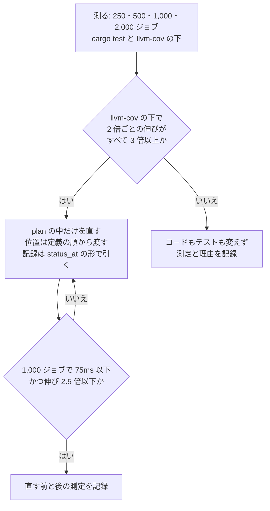
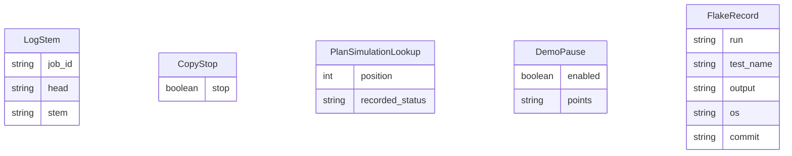

# 機能の仕様: v0.10.1 の整理・修正

出典: 要件(`requirements.md`、承認済み。R-07 を含む)、設計の質問(`functional-design-questions.md` の Q1、まとめの確かめ済み)、`entities.md`、`rules.md`、コードの知識(`aidlc/spaces/default/codekb/rust-job-conductor/`)。refactor の作業のため、Units・ユーザーストーリー・ドメインの設計は無い。この文書は、手順の並びと動きの移り変わりの正本である。

## 1. 作業の順序

変更は小さな単位でコミットし、直接 `main` に入れる(team.md)。層と課題の順に次のとおり進め、各段の後にその層のテストを書いて走らせる(test-after)。

| 順 | 課題 | 主な変更 | 規則 |
|---|---|---|---|
| 1 | F2 名前 | runtime `log.rs` の `safe_log_stem`、`tests/log_file.rs` の表、README の「名前の置き換え」 | BR2.1、BR2.2 |
| 2 | F2 印 | runtime `runner.rs` の `copy_stream`、その `mod tests` | BR2.3、BR2.4 |
| 3 | F3 | 測定(使い捨て) → 判定 → 直す(`crates/core/src/plan/`)か記録だけ | BR3.1〜BR3.6 |
| 4 | F5 | `demo/run-demo.sh`、`demo/README.md`、`crates/cli/tests/unix_demo.rs` | BR5.1〜BR5.5 |
| 5 | F1 | README の `watch --follow` の注意 | BR1.1〜BR1.3 |
| 6 | 文書のずれ | runtime `lib.rs` の契約の表、`docs/spec/rust/` と 2 つのテストの注釈の「33 種」 | BR6.1、BR6.2 |
| 7 | F4 | `build-and-test-summary.md` の手順の節(Build and Test の段階で書く) | BR4.1 |
| 8 | 版 | `crates/cli/Cargo.toml`(と `Cargo.lock`)を 0.10.1 | BR7.1 |

## 2. 手順

### W1. ログの名前の頭を作る(F2、BR2.1・BR2.2)

1. ジョブ ID の各文字のうち、ファイル名に使えない・危ない文字を `_` に置き換える(今のまま)。
2. 先頭が `.` なら `_` に置き換える(今のまま)。
3. 最初の `.` より前の部分を取り出す(今のまま)。
4. **その部分の前後の ASCII の空白を除いた値**を、予約名と大文字小文字を問わずに比べる(v0.10.1 で変わる所)。等しければ、名前の先頭に `_` を足す。名前そのものからは空白を除かない。
5. 100 バイトまでに切る(文字の途中では切らない。今のまま)。
6. 末尾が `.` か空白なら、その 1 文字を `_` にする(今のまま)。

例(要件の FR2.1 の表と同じ): `con ` → 手順 4 で `con` と比べて予約名 → `_con ` → 手順 6 で `_con_`。` con` → `_ con`。`con .x` → `_con .x`。`console` は `console` のまま。

### W2. 出力を写す読み取りの繰り返し(F2、BR2.3・BR2.4)

```
loop:
  if 止める印が立っている: 抜ける            # v0.10.1 で足す(BR2.3)
  n = read(buf)                              # 中断されたら繰り返し、誤りか 0 なら抜ける(今のまま)
  if 止める印が立っている: 抜ける            # 今のまま。読んだ分はどこにも書かない(BR2.4)
  端末へ書く(失敗したら以後書かない)、ファイルへ書く(今のまま)
```

- 足すのは繰り返しの初めの 1 つの確かめだけ。読んだ後の確かめ、端末とファイルへの書き方、誤りの扱いは変えない。
- テスト(BR2.3): `copy_stream` の単体テスト(`runner.rs` の `mod tests`、モジュールの中の今の入口)で、印を立てた共有の状態と、`read` が呼ばれた回数を数える読み手を渡し、戻ったときに呼ばれた回数が 0 で、端末とファイルに何も書かれていないことを確かめる。テスト専用の引数や `pub` は本番に足さない(project.md の Forbidden)。

### W3. F3 の測定と判定と直し(BR3.1〜BR3.6、Q1 A)



文字の代替: 測る → 判定(llvm-cov の下で、2 倍ごとの伸びがすべて 3 倍以上か)。はいなら plan の中だけを直し、1,000 ジョブで 75ms 以下かつ伸び 2.5 倍以下になるまで直しを続け、直す前と後の測定を記録する。いいえなら、コードもテストも変えず、測定と理由を記録する。

1. 測る仕組みは使い捨てとし、リポジトリにコミットしない(BR3.2)。測定の表は、コード生成の記録(`code-summary.md`)に残す。
2. 直すときは、計画の模擬が定義の順にジョブを進むことを使い、各ジョブの位置を `job_index` で探さずに、繰り返しの位置から渡す。記録の状態は、位置で引いて位置のジョブ ID が違うときだけ探す今の `status_at` の形で引く(BR3.4)。
3. 直しは `crates/core/src/plan/` の中に閉じる。共有の `job_index`(`types.rs`)・`record_of`(`flow/mod.rs`)と、実行の流れ(`flow/decide.rs`、`flow/next_step.rs`)は変えない。模擬の中で共有の関数を呼んでいて、それが遅さの元のときは、plan の中に同じ答えを返す位置つきの引き方を置き、呼ぶ側を差し替える。
4. 計画の結果(項目、次の動き、終わり)は変えない。既存の計画のテスト(`plan_*.rs`、`dry_run*.rs` など)がすべて変えずに通ることで確かめる。
5. `plan_simulate_perf.rs` の `LIMIT`(150ms)と中身は変えない(BR3.1)。

### W4. デモの場面 4(F5、BR5.1〜BR5.5)

```
scene "4. ..."
cmd conductor pipeline -v nightly
echo / 1 回の watch(完了の行が出る)
echo "watch --follow は、…"(説明の 2 行。今のまま)
pause                                        # v0.10.1 で足す(DEMO_PAUSE=1 のときだけ待つ)
cmd conductor watch --follow
states / --remove-on-complete の続き(今のまま)
pause(場面の終わり。今のまま)
```

- 足すのは、説明の 2 行の後、`watch --follow` の前の `pause` の呼び出し 1 つ。読み手は、待ちの間に再開の出力と 1 回の `watch` の表と説明を読める。Enter で `watch --follow` が画面を消して描く。
- `DEMO_PAUSE` が無いとき、`pause` は何もしないので、出力は変わらない(BR5.2)。
- Windows 版は変えない(BR5.3)。
- テスト(BR5.5): `unix_demo.rs` に、`DEMO_PAUSE=1` を与え、子の標準入力に、すべての `pause`(場面の数と、足した 1 つ)を越える数の改行を与えてデモを動かすテストを足す。場面 4 の範囲(`=== 4. ` から `=== 5. ` の前まで)で、`(Enter で次へ)` が、1 回の `watch` の完了の行より後で、`watch --follow` を呼ぶコマンドの行より前に出ることを確かめる。子の標準入力を与える方法は、今のテストの補助(`run_limited`)の使い方に合わせてコード生成で決める。

### W5. README の注意(F1、BR1.1〜BR1.3)

1. 「ステートが無いとき」の項の「パイプラインを始める前から見ておけます」は残し、この使い方では次の注意が当てはまらないことが分かるようにする。
2. 「エラーの後に続くジョブがあるときの注意」を、次の形に書き直す。
   - 起きる使い方: エラーで止まったステートを `watch --follow` で見ながら、別の端末でパイプラインを再開するとき。
   - 起きること: 再開の位置のジョブが試行を書く前に最初の描画が来ると、「止まった」と判定して、その回の表を最後に 0 で終わる。
   - 例: `load` がエラーで止まった `nightly` で、端末 A で `conductor watch --follow` を始め、端末 B で `conductor pipeline nightly` を実行する。端末 A は、`load` が動き始める前の表を出して終わることがある。
   - 避け方: 再開してから(ジョブが動き始めてから)`watch --follow` を始める。終わってしまったら、もう一度 `watch --follow` を実行する。
3. 判定(`activity.rs`)は変えない(BR1.3)。README の必須語句の検査と `src/tests/docs.rs` が通る。

### W6. 文書のずれ(BR6.1・BR6.2)

1. runtime の `lib.rs` の契約の表で、`run_job` の行に `unset`(消す環境変数の名前の並び)を、`run_job(line, env, unset, signal, log)` の順に書き足す。
2. 「33 種」を「34 種」に直す箇所: `docs/spec/rust/00-README.md` 23 行、`02-architecture.md` 103 行・297 行(103 行は v0.10.0 の `UnsetEnvConflict` の追加も書く)、`03-definition-format.md` 523 行の見出し、`10-errors-and-exit-codes.md` 120 行、`11-quality-and-build.md` 213 行、`12-rebuild-guide.md` 22 行・24 行・321 行、`crates/core/tests/env_types.rs` 56 行の注釈、`crates/cli/src/tests/report_messages.rs` 1225 行の注釈(R-07)。
3. 残す箇所: `12-rebuild-guide.md` 105 行(v0.9.0 の段階の、その時点の数)、285 行(入れ子の深さの「33 段」)。
4. 確かめ: `grep -rn '33 種' docs/spec/rust/ crates/` の結果が `12-rebuild-guide.md` の 105 行だけ。

## 3. 動きの移り変わり

新しい状態の移り変わりは無い。ジョブの状態(5 つ)、ステートの形、`watch --follow` の「続ける・終わる」の判定は v0.10.0 のまま。変わる動きは次の 2 つだけで、どちらも状態を持たない。

- 読み取りのスレッド: 「止める」印が立った後は、`read` に入らない(W2)。印が立つのは待ち切れの後だけで、下ろされない。
- デモ: `DEMO_PAUSE=1` のとき、場面 4 の中に待ちが 1 つ増える(W4)。

## 4. 実体の関係の図(`entities.md` から導いたもの)



文字の代替: 5 つの実体(LogStem、CopyStop、PlanSimulationLookup、DemoPause、FlakeRecord)は互いに関係を持たない。正本は `entities.md` の YAML。

## 5. 規則のまとめ(`rules.md` から導いたもの)

- F1: BR1.1・BR1.2(README の書き直し)、BR1.3(判定は変えない)。
- F2: BR2.1・BR2.2(空白を除いて比べる、表のとおり)、BR2.3・BR2.4(read の前にも印を見る、後の確かめは変えない)。
- F3: BR3.1(上限は変えない)、BR3.2・BR3.3(測って判定)、BR3.4・BR3.5(plan の中だけを直し、75ms と 2.5 倍)、BR3.6(直さないときの記録)。
- F4: BR4.1(手順の節)。
- F5: BR5.1〜BR5.5(UNIX 版だけ待ちを足す、README、テスト)。
- 文書のずれ: BR6.1・BR6.2。版: BR7.1。

正本は `rules.md` の YAML。

## 6. 範囲の外

要件の 6 章のとおり(判定と画面の消し方の変更、実時計のテストの見直し、性能のテストを `coverage` から外すこと、`docs/spec/rust/` への機能の記述の書き足し、`team.md` の数の更新)。
