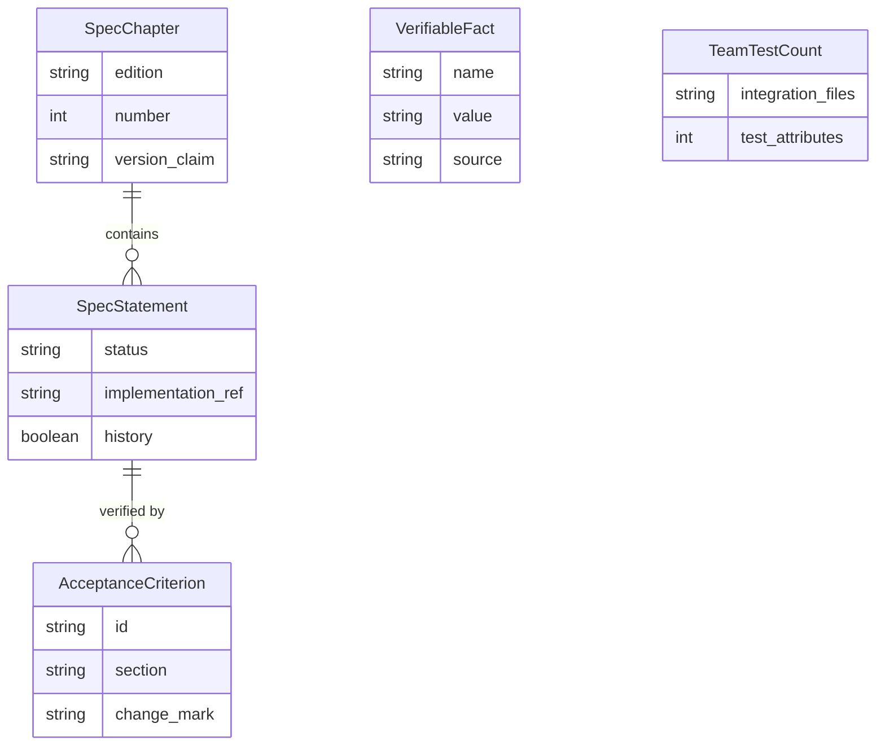

# 機能の仕様: v0.10.2 の仕様書の整理

出典: 要件(`requirements.md`、承認済み。受け入れたレビューの指摘 R-01〜R-04)、設計の質問(`functional-design-questions.md` の Q1・Q2、まとめの確かめ済み)、`entities.md`、`rules.md`、コードの知識(`code-quality-assessment.md` の「仕様書と実装の差」と、引き渡し `inception/reverse-engineering/developer-scan.md` の章ごとの差の表)。refactor の作業で Units・ストーリー・ドメインの設計は無い。この文書は、作業の手順の正本である。

## 1. 作業の順序とコミット(R-04、BR6.2)

| 順 | 対象 | コミットの単位 | 規則 |
|---|---|---|---|
| 1 | rust 03(定義の書式) | 1 コミット | BR1.1〜BR1.3 |
| 2 | rust 06(ステート) | 1 コミット | 同上 |
| 3 | rust 07(プロセスとシグナル) | 1 コミット | 同上 |
| 4 | rust 05(実行の流れ) | 1 コミット | 同上 |
| 5 | rust 04(CLI) | 1 コミット | 同上 |
| 6 | rust 08(出力) | 1 コミット | 同上 |
| 7 | rust 10(誤りと終了コード) | 1 コミット | 同上 |
| 8 | rust 02(構成) | 1 コミット | 同上 |
| 9 | rust 11(品質とビルド) | 1 コミット | 同上 |
| 10 | rust 12(作り直しの手引き) | 1 コミット | 同上 |
| 11 | rust 00・01(案内と概要)、09 の版の記述 | 1 コミット(00・01・09 の冒頭) | 同上 |
| 12 | language-agnostic 03・06・07・05・04・08・10・02・01・00(rust と同じ順) | 章ごとに 1 コミット | BR2.1、BR2.4、BR1.3 |
| 13 | language-agnostic 11 の既存の AC の書き換え | 1 コミット | BR2.3 |
| 14 | language-agnostic 11 の新しい節(4.21 以降、AC-519〜) | 1 コミット(大きければ節ごと) | BR2.2 |
| 15 | language-agnostic 12(段と AC の範囲) | 1 コミット | BR2.2 |
| 16 | `crates/runtime/src/lib.rs` の呼び出しの順序 | 1 コミット | BR4.1 |
| 17 | `team.md` のテストの数 | 1 コミット | BR3.1 |
| 18 | 版を 0.10.2 にする | 1 コミット | BR5.1 |

- 下の層(書式、ステート、プロセス)から上の層(流れ、CLI、出力)へ、その後に全体をまとめる章(構成、品質、手引き、案内)の順に書く。前の章で書いた事柄を、後の章から参照できるようにするため。
- コミットの件名は `docs:`(仕様書、team.md は `aidlc:`、lib.rs は `runtime:`)を先頭に付ける。

## 2. 1 つの章を書く手順(W1)

1. 引き渡しの「章ごとの差」の表で、その章の `missing` と `contradicts` の行を確かめる。
2. 各事柄の実装の根拠の行を開き、数・名前・文を写す(BR1.1)。根拠が見つからない事柄は書かず、`code-summary.md` に差として書く。
3. `missing` は、今の章の構成(節の番号、表の列、版の注記「(v0.10.0 以降)」)に合わせて書き足す。新しい節が要るときは、章の末尾の番号の続きに置く。
4. `contradicts` は書き換える(BR1.3)。履歴として残す記述(その時点の数や形)には触れない。
5. 章の中の、他の章への参照(「05 の 14.4」など)が、書き足した節の番号と合うかを確かめる。
6. 4 章の確かめのうち、その章に関わるものを走らせ、結果を `code-summary.md` に書く。

language-agnostic では、3 で型名・モジュール名・関数名を使わず、入力と出力と挙動で書く(BR2.1)。v0.10.1 の内部の入口は、05 章に「計画の模擬は、実行と同じ判断を、ジョブの位置を使って 1 つの判断あたり定数の手間で行う。1,000 ジョブの計画の目安は 02・11 章の性能の表」の形で書く。

## 3. 書き換える記述の一覧(R-01、R-02、BR1.3、BR2.3)

### 3.1 rust の書き換え(作業の後に、各行が書き換わったことを確かめる)

| 場所(今の行) | 今の記述 | 書き換えた後 |
|---|---|---|
| `00-README.md:75` | 環境変数の層は「足すだけ(取り除かない)」 | `unset_env` で取り除けることを書く |
| `01-overview.md:64` | 非目標に「ジョブの出力の保存」「`unset` はない」 | 非目標から外し、`log_dir` と `unset_env` を機能として書く |
| `05-execution-flow.md:531` | 「ステートは最終の結果で 1 回だけ書かれ、途中では書かれない」 | 試行の開始で `Fast` で書き、結果で `Durable` で書く。リトライの待ちの間は試行を開いたまま |
| `05-execution-flow.md:634` | 「取り除く書き方(`unset`)はない」 | `unset_env` の層と `env_remove` |
| `05-execution-flow.md:652` 付近(層の図) | `unset_env` が無い | 層に `unset_env` を足す |
| `07-process-and-signals.md:205` | 環境は「すべて引き継ぐ。足すだけ」 | 消す名前を取り除いてから足す |
| `07-process-and-signals.md:206` | 「出力を読まない・保存しない」 | `log_dir` があるときはパイプで読み、端末とファイルへ書く |
| `12-rebuild-guide.md:182` | 「環境変数は足すだけ(取り除かない)」 | `unset_env` を含めて書く |
| `02-architecture.md:121` ほか | `run_job(line, env, signal) -> JobExecution` | `run_job(line, env, unset, signal, log) -> (JobExecution, LogOutcome)` |
| `03-definition-format.md` 9.3(523〜561) | 表が 33 行 | `unsetEnvConflict` を足して 34 行 |
| 13 種の `.env` の誤り(02:106、03:391・563、10:121、11:213、12:321 ほか) | 13 種 | 14 種(`unsetConflict` を足す) |

残してよい記述(書き換えない)の見分け方: (1) v0.10 の機能と関係の無い事柄の「取り除かない」「読まない」「保存しない」(例: `05:691` の `CONDUCTOR_RUN_ID`、`03:370` の `export`、`04:133` の定義を読まない、`06` の項目を保存しない)。(2) その時点の数や形を書いた履歴(例: `12:105` の v0.9.0 の段の 33 種)。

### 3.2 language-agnostic の既存の AC の書き換え(Q2 A)

番号を残して中身を書き換え、「(v0.10.0 で変更)」を添え、テストの名前を今の名前に直す。

| AC | 今の中身 | 合わない理由 |
|---|---|---|
| AC-170、AC-174、AC-175 | `watch` の表が 3 列(`JOB STATUS NOTE`) | 4 列(`DURATION`/所要時間)になった |
| AC-278 | ステートは最終の結果で 1 回だけ、途中では書かれない | 試行の開始で書く |
| AC-453 | リトライの回数はステートに書かれない | `[[job.attempt]]` が試行ごとに残る |
| AC-355、AC-389 | OUT に書くコマンド、終了 0 の種類 | `watch --follow` の終わりを足す |
| 4.11 節(ステートの異常系) | 試行の理由が無い | `NO_ATTEMPT`、`BAD_TIME`、`UNFINISHED_ATTEMPT` |
| 5 章(デモ)の AC | 場面 0〜14 | 場面 0〜15、場面 4 の待ち |

- この表は、設計の時点で見つけた分。作業の初めに、11 章の AC の表のすべての行を、v0.10 の機能の語(`watch`、リトライ、ステート、`env`、`env_file`、`graph`、`--format`、デモ、終了コード)で洗い出し、合わない行を足す。洗い出しの結果は `code-summary.md` に表で残す。

## 4. 数で確かめる項目(R-03、`VerifiableFact`)

作業の後に、仕様書の数と、実装から数えた値が一致することを確かめる。

| 項目 | 値 | 実装の根拠 |
|---|---|---|
| `[pipeline]` のキー | 9 | `crates/core/src/definition/walk/mod.rs` の `PIPELINE_KEYS` |
| `[[job]]` のキー | 9 | 同 `JOB_KEYS` |
| `DefinitionErrorKind` | 34 種 | `crates/core/src/error.rs` の列挙 |
| `EnvFileErrorKind` | 14 種 | `crates/core/src/envfile/mod.rs` の列挙 |
| ステートの最上位・ジョブ・試行のキー | 10・5・2 | `crates/runtime/src/state/reader.rs` |
| ステートの誤りの理由(試行) | 3 つ | `crates/runtime/src/error.rs` |
| `watch` の表の列 | 4 | `crates/cli/src/report/watch.rs` |
| `--interval` の範囲と既定 | 1〜3600、2 秒 | `crates/cli/src/args.rs`、`crates/cli/src/types.rs` |
| `--format` の値 | `text`、`mermaid`、`dot` | `crates/cli/src/args.rs` |
| デモの場面 | 0〜15 | `demo/run-demo.sh` の `scene` |
| `#[test]` の数 | 1,460 | `grep -rE '^\s*#\[test\]' crates --include='*.rs'` の行の数 |
| 統合テストのファイル | 36・16・26・2 | 各 `crates/*/tests/` の直下の `.rs` |

確かめのコマンド(作業の後):

- `grep -rn '33 種\|13 種' docs/spec/rust/ docs/spec/language-agnostic/` の結果が、履歴として残す行だけ(各行を `code-summary.md` に書く)。
- `grep -rln 'log_dir' docs/spec/rust/` と `docs/spec/language-agnostic/` が、02・03・05・07・08・10・11・12 章を含む。`unset_env`、`--follow`、`attempt`、`dot` も同様に、要件の FR1 の各章に現れる。
- 3.1 の各行が書き換わっている。

## 5. team.md と lib.rs(W2)

- `team.md`: Testing Posture の「テストの種類: 各クレートの `tests/` に統合テスト(core 33、…)。単体テストは …。`#[test]` は合計 1,170。」の 1 行の数を、4 章の値に置き換え、数え方を括弧で添える。他は変えない(BR3.1)。
- `crates/runtime/src/lib.rs`: 「# 呼び出しの順序」の 2. の `Run` の手順を、`start_attempt` → `write_state`(`Fast`)→ `run_job`(消す名前とログの指定)→ `classify_and_decide` → `end_attempt` → `apply_outcome` → `write_state`(`Durable`)の形に直す。リトライの待ちと中断の扱い(`cancel_attempt`)を 1 行で添える。コードは変えない(BR4.1、BR6.1)。

## 6. 動きの移り変わり

新しい状態の移り変わりは無い。`conductor` の動きは変えない。

## 7. 実体の関係の図(`entities.md` から導いたもの)

文字の代替: 仕様書の章(`SpecChapter`)は多くの記述(`SpecStatement`)を持つ。language-agnostic の記述は、多くの受け入れの条件(`AcceptanceCriterion`)で確かめられる。`VerifiableFact` と `TeamTestCount` は独立した確かめの項目。正本は `entities.md`。

## 8. 規則のまとめ(`rules.md` から導いたもの)

- 両仕様書: BR1.1(実装の行から写す)、BR1.3(逆の記述は書き換え、履歴は残す)。
- rust: BR1.2。language-agnostic: BR2.1、BR2.2(新しい節に AC-519 から)、BR2.3(逆の既存 AC は番号を残して書き換え)、BR2.4(34 種・14 種、版)。
- team.md: BR3.1。lib.rs: BR4.1。版: BR5.1。動きを変えない: BR6.1。コミット: BR6.2。CI: BR6.3。

正本は `rules.md`。

## 9. 範囲の外

要件の 6 章のとおり(ほかの 5 つの言語版、`conductor` の動き、README、仕様書の検査の追加、`team.md` の他の古い記述)。
